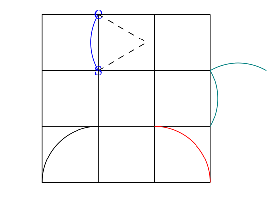

## 引入
这个所谓的 `\arc` 命令，我自己是又爱又恨。用的好的话，很多时候可以少些很多的tikz代码 ? 但是问题就在于我之前用不好这个命令 :(

## arc 原理
首先来说一下这个 arc 命令的原理，参见如下的代码:
``` latex
\draw (x, y) arc (theta_1: theta_2: radius);
```

根据前面的坐标点 $(x,y)$ 可以计算得到后续所要绘制的arc的圆心坐标以及结束绘制的点为:
* 圆心: $(x-r\cdot\cos\theta_1, y-r\cdot \sin\theta_1)$
* 结束点: $(x-r\cdot \cos\theta_1+r\cdot \cos\theta_2, y-r\cdot \sin\theta_1+r\cdot \sin\theta_2)$


## 方法
有了上面的两个点的坐标后，可以用下面的 4 个步骤用于确定两个角度的大小:
* Find the center of your circle, Calculate $\Delta x$ between **start and center**.
* Find $\tan\theta_1 = \frac{\Delta y}{\Delta x}$, so that $\theta_1=\theta_0 + \cdots$
* Using $\Delta x>0(<0)$ to decide $\cdots$ by $\theta_1\in [-\pi/2, \pi/2]$ or $\theta_1\in [\pi/2,3\pi/2]$
* Calculate $\Delta x$ between **center and end**.


## example
下面代码就是一个 `\arc` command的使用样例:
``` latex
\begin{tikzpicture}
    \draw (0, 0) grid (3, 3);
    \draw (0, 0) arc (180:90:1);  
    \draw[red] (3, 0) arc (0:90:1);  
    \draw[blue] (1, 2)node{s} arc (210:150:1)node{e};  
    \draw[teal] (3, 2) arc (120:60:1);
    \draw[teal] (3, 2) arc (30:-30:1);
    \coordinate (o) at (1.865, 5/2);
    \draw[dashed] (1, 2) -- (o) -- (1, 3); 
\end{tikzpicture}
```

绘制结果如下:

