## 1. 敬告
这是一个过来人的真实经历. 我为什么要用 Linux ? 也许是因为 Linux 的自定义程度高吧, 而且在折腾的过程中也能学到一点东西，从此我也很喜欢上了 Linux 的命令行, 以前觉得那些使用命令行的人太傻了，放着好好的 GUI 界面不去用. 现在看来，其实二者各有千秋, 命令行下其实常用命令就那几个, 慢慢积累的,不用的就去查. 部分情况下也许是命令行比较高效, 但是既然 GUI 用户占大多数，说明 GUI 这个理念也迎合了很多的人.

在使用 Linux 一段时间后, 我的 Windows 也被我调教的挺好的, 而且我也不是那么排斥 Windows, 所以目前打算就这样用着. 入坑 Arch 需谨慎, 你要有那种 "一个人, 一支烟, 一bug一整天" 的精神. 不然的话, 你还是乖乖用 Windows 吧, 但是你一旦度过这个最艰难的时期你就会觉得,也就这样吧。不管怎样, 祝各位 Archlinux 用户都有一个愉快的使用体验, 祝天天滚挂 >_<.

其次记住, Linux 它不是 windows; windows 也不是 Linux; 所以你不应该用 windows 的要求去要求 Linux, 同样用 Linux 的要求去要求 windows也是不合理的。最后, Linux也好, windows也好, 它们都只是一个工具而已, 是为了给我们提供服务, 所以什么适合自己就用什么吧.


## 2. 阅前提醒
文章很长, 我想在这里把我个人的所有关于 Linux 感受说出来, 特别是对于 Arch. 我并不想你浪费时间来阅读一个你不感兴趣的内容, 所以不感兴趣可以关闭这个网页了. 好了, 正文开始！想要看 Archlinux 安装的请直接跳到 **[第6节]**


## 3. 此文目的
此篇文章的目的: 记录我使用Linux的经历, 至少以后还能留下一些东西. 因为我现在发现我那种折腾的耐心了, 可以这样说. 反正我感觉我每天都在和Linux斗智斗勇, 几乎每个软件都有bug。我甚至都不知道我为什么最初会选择Linux, 我好像忘记了我选择 Linux 的初衷.现在每天折腾Linux都很痛苦, 仿佛以前的那种折腾Linux的快乐再也没有了, 以前的我是那么的乐此不疲。希望我把这篇文章写完之后, 回忆起当初使用 Linux 的种种, 能够找到属于 Linux 的那份快乐, 不然我可能真的要放弃 Linux 了

* 但是Linux本来就是你爱用不用的
* 这里没有其他的意思, 其实我还是挺想用Linux的


## 4. Where to learn ? 
1. 首先是去小破站（B站）, 众所周知, 小破站是最大的学习网站
2. 其次当然是去官方的Arch wiki或者是在Arch的bug里边看看是不是系统本身的原因, 抑或是Arch的Fomular
3. 然后就是先查百度, 看有没有人的经历和我相同, 这样改Bug就快得多.因为百度还会展示以下的这些网站里边的相关的内容。
    > 有时候我觉得百度的搜索结果还是挺好的

3. 百度的方法不行, 就上知乎, 看看有没有类似的经历
4. 知乎不行, 就上csdn
    > 虽然很多人都说这里是一个垃圾堆, 但是我觉得那是对于那种高手而言的；我虽然没有经常逛, 但毕竟这是我第一个接触到的编程相关的网站, 还是它把握领进门的吧。但是现在我也觉得csdn的做法有一点的恶心了, 唉……

5. csdn不行, 我就会上老牌社区博客园看看
    > 现在我觉得博客园很好, 很清爽, 很干净, 社区氛围很好, 力荐

6. 博客园还不行的话我就只有上github了, 毕竟我的英语并不是很好, 虽然有浏览器的翻译, 但你们有没有觉得有时候浏览器的翻译怪怪的, 我从Arch wiki得出的经验
7. 实在是没有办法了就只有上国外的网站搜索了。比如Quora, Stack Overflow, Stack Exchange, 或者是一些民间社区。 但是你得英语好, 再者就是盲目的google了
8. 最后一招:也是我的杀手鐗: remake。软件卸载了然后重装。


## 5. How to learn ?
很多人可能都会认为上边的内容过于的浮夸, 但是我觉得，从一个电脑小白到安装手动 Linux 的路还是比较长的. 也许你需要去了解磁盘的分区方式, Linux 的文件系统, 挂载的概念, 文件系统的 inode, 以及 block 等东西。

> 特别感谢在 2023 年寒假一直陪伴我的: [鳥哥的 Linux 私房菜](https://linux.vbird.org/). 尽管 `服务器假设篇` 那本书我几乎没怎么看，但是 `基础篇` 我几乎看完了, 部分内容至今仍觉得历历在目 ...

因为我是准备安装 Windows + Linux 双系统, 然而原本的 win10 里边还有很多的重要文件, 课件, 包括一些难以安装的工业软件等。我不想到时候 archlinux 没有安装成功, 反而把原本的 win10 也搞挂了。所以即使是网上有很详细的双系统安装教程, 我也不敢一步一步的照着做。我还是得去查询每一条命令的实际作用, 查询这个命令运行后对原本文件系统的影响。

也许不会相信我所说的, 可能觉得太过夸张了。但是我当时连:
* linux 命令行
* GPT,  MBR
* BIOS, UEFI
* GRUB 

这些东西都没有听说过, 更不用说知道它们是干什么的. 特别是在目睹了网上很多老鸟安装双系统后失败的惨状, 作为一个电脑小白, 我害怕极了. 我不会放开手去按照网上的教程安装，所以我的解决办法是: 

* 先去小破站把上边所说的什么: linux命令行, GPT,  MBR,  BIOS,  UEFI, GRUB 了解一下
* 然后在小破站看看装机视频(就是单纯安装 windows 的, 听听那些 up 对于每一步操作的解释, 在这里推荐up: `硬件茶谈`, 他的视频解决了我在这一阶段的大部分问题)
* 不实际操作, 总是会感觉不踏实: 但只有一个实体机, 怎么做实验呢? 对了, 使用虚拟机。我用的是 VMware。为了练习安装操作系统，我的 Vmware的系统快照最终变成了一个 "树" 形图，现在还是那些操作失败的系统安装分支都被删除的样子:

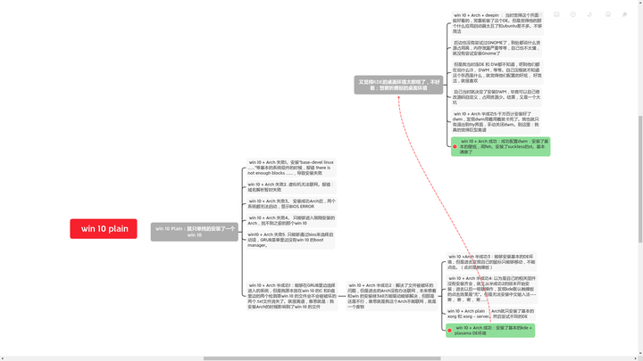

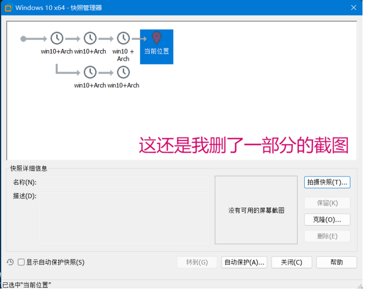


这些系统快照在容积最大的时候, 占了我大约 200G 的磁盘, 接下来就是实体机的安装了


## 6. 安装教程
在虚拟机上进行演练后, 我自信满满的
* 在我的硬盘分出一个区
* 安装基础包
* 编写基本配置
* 安装 DWM

虽然最终是安装好了，但是, 我还是想要记录下我这个过程中经理的种种 ...


### 6.1 制作启动盘
我使用的是 rufus,一个免费的软件, 在windows上制作的, 具体的注意点: 

* 选项 --> GPT
* 写入方式 --> DD

关于选项设置, 对于自己的电脑的启动方式, 可以在 Windows 上的 `运行` 框中输入:
``` shell 
msinfo32
```

来查看, 如果 `BIOS MODE` 显示的是 `UEFI` 那么就选择 `GPT`, 如果是 `Legacy` 那么就选择 `MBR`.进入LiveCD, HONOR 笔记本开机时长按的两个按键的说明: 

* F2: 设置 BIOS
* F12: 选择启动项


### 6.1 连接网络
要在实体机中安装 Arch, 你首先的连的上网, 来下载 Arch 的基本环境组件(固件, 驱动, 内核等等).首先, 在虚拟机中我是使用的NAT来让我的虚拟机链接上网络的, 但那是在实体机里边怎么搞呢? 其实挺简单的；假如你想使用无线网的话, 依次输入如下命令即可 


备注: 在后文中,  `#` 后边的内容代表注释


``` shell
iwctl                                               # 进入iwd模式
device list                                         # 扫描你的无线网卡
station <your netcard name> scan                    # 使用你的网卡扫描周围的可用wifi
station <your netcard name> get-networks            # 列出刚才扫描到的wifi的名称
station <your netcard name> connect <wifi name>     # 他会自动要求你输入密码（不会显示你键入的字符, 但是你的确时输入进去了, 键入完成后 摁 <Enter>即可）
exit                                                # 退出iwd模式[重要]；别在iwd模式下运行下边的命令, 不然你会得到 "command not found"
```

但是, 我还是推荐第二种联网方案的,就是直接利用DHCP.简单来说就是直接从你的路由器

> 要可以上网的, 别用那种电都没插的, 或者是其他的离谱路由器

上接一根网线出来连接到你的电脑上。(USB口的可以买一个转接器)然后你的电脑自动就能够上网了, 不用你设置什么的。为什么我推荐这种方式呢?

1. 稳定: 如果安装的过中, 隔壁的老王利用你的wifi偷看“学习资料”, 或者是各种原因导致你的wifi不稳定
2. 速度快:  同样也是为了防火,  防电, 防老王。这样你的安装会很快(应该可以减少焦虑吧)

> 我就是用的DHCP, 网速平均能够达到30mb/s左右

首先, 因为在虚拟机的时候我可以手动选择启动时进入BIOS界面。怎么检测你是否连接上互联网了呢? 
连接一下网站试试呗,运行如下的命令

``` shell
ping www.baidu.com    # www.可以不加；(如果不断地返回了 64bytes from …… 之类的字眼, 说明联网成功)
```

### 6.2 refleactor 服务
系统里边又一个名为 `refleactor` 的服务, 它会挑选一下我们下载软件的仓库地址, 然后把它们放到

``` shell
/etc/pacman.d/mirrorlist    
# 在Linux中没有C,  D盘之类的概念。你可以认为它只有一个文件夹,这个文夹的名字叫"/".你之后的所有东西都放在这个文件夹里边
```

的文件下, 这个文件夹的大概结构图示（扩容的问题:  很简单的, 后边会讲）

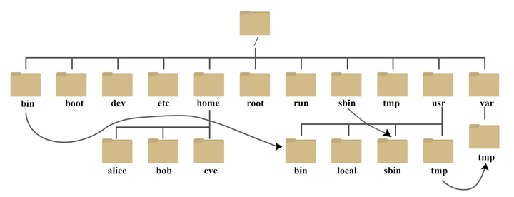


为什么要禁用reflector ?

> 你想, 它同步的是全球的下载源（地址）, 什么自由美利坚啊, 加拿大啊之类的, 当然也有我们中国的。 但是我们下载<东西>的时候时好像是默认使用排在前边的几个地址。你想, 你从美国下载快,  还是中国快。

所以我们就可以添加几个中国的源(下载地址)到开头: (再次提醒: `#` 后边的内容是注释)

``` shell
Server = https://mirrors.ustc.edu.cn/archlinux/$repo/os/$arch                # 中国科学技术大学开源镜像站
Server = https://mirrors.tuna.tsinghua.edu.cn/archlinux/$repo/os/$arch       # 清华大学开源软件镜像站
Server = https://repo.huaweicloud.com/archlinux/$repo/os/$arch               # 华为开源镜像站
Server = http://mirror.lzu.edu.cn/archlinux/$repo/os/$arch                   # 兰州大学开源镜像站
```

怎么添加呢?挺简单地（你会vim的基础操作情况下）

### ref: vim 基础操作

1. 怎么退出 vim ? 没想到吧, 你第一次接触 vim 你可能都无法退出这个东西
* 先按个几下 `<Esc>` 键,看到 vim 的左下角出现 normal mode 或者是 Insert mode 消失
* 在英文模式下输入 `:wq` 即可,但是这个是保存后退出
* 不保存强制退出就输入 `:q!`

2. 怎么插入文本, 或者说怎么使用“人性化”的方法进行类似 notepad 的操作
* 在 `normal mode` 的情况下, 在英文输入的情况下, 键入 `a i o` 中任何一个字母即可
* 然后用上下左右方向 `(k j h l)` 键进行光标的移动


3. 复制粘贴
* 在 normal 模式下使用 `<n>yy` 可以实现复制 n 行, 然后用 p 粘贴
* 部分的 vim 支持系统的剪切板, 输入 `echo has('clipboard')` 即可验证

4. 搜索
* 在normal模式下输入 `:/<text you find>`
* 搜索支持正则表达式


### 6.3 磁盘分区[重点]
#### 6.3.1 电脑启动流程

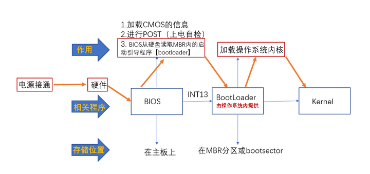


这一段感觉不知道该怎么讲, 如有讲的不对的地方, 欢迎补充. 我也不知道能否清楚, 我尽力 ...

#### 6.3.2 常见术语

* BIOS
* Legacy
* Legacy BIOS
* UEFI
* EFI
* ESP
* UEFI BIOS
* GPT
* MBR
* BootLoader
* Kernel
* GRUB(2)
* LILO
* OC
* clover

**1.BootLoader**
<开机管理程序> 或叫做 <启动引导程序>。在加载内核上具有唯一性, 你不能说用 windoes 的 BootLoader 去加载 Linux 的内核, 这是不行的。下边来解释原因, 以Linux下的 GRUB2 为例:

我们上边提到在 BIOS 读完信息后, 接下来就是会到第一个开机设备的 MBR（LBA0）去读取 boot loader 了。这个 boot loader 可以具有:
* 菜单功能、
* 直接载入核心文件
* 以及控制权移交的功能等

系统必须要有 loader 才有办法载入该操作系统的核心就是了。但是我们都知道,  MBR 是整个硬盘的第一个 sector 内的一个区块, 充其量整个大小也才 446 Bytes 而已。即使是 GPT 也没有很大的扇区来储存 loader 的数据。我们的 loader 功能这么强, 光是程序码与设置数据不可能只占这么一点点的容量吧? 那如何安装?

为了解决这个问题, 所以 Linux 将 boot loader 的程序码执行与设置值载入分成两个阶段来执行: 
* 阶段一: 执行 boot loader 主程序:  第一阶段为执行 boot loader 的主程序, 这个主程序必须要被安装在开机区, 亦即是 MBR 或者是 boot sector 。但如前所述, 因为MBR 实在太小了, 所以, MBR 或 boot sector 通常仅安装 boot loader 的最小主程序,  并没有安装 loader 的相关配置文件；

* 阶段二: 主程序载入配置文件:  第二阶段为通过 boot loader 载入所有配置文件与相关的环境参数文件 （包括**文件系统定义**与主要配置文件 grub.cfg）,  一般来说, 配置文件都在 /boot 下面。

**2. BIOS**
使用汇编语言写到主板上的一个16位固件（硬件上的软件）---> 计算机执行的第一个程序

**3. UEFI**
使用C语言写到主板上的一个固件(可以看作一个低级的操作系统), 主要就是想要取代BIOS这个固件接口, 所以又叫做UEFI BIOS

**4. EFI（EFI system partition）**
GPT格式的硬盘中的系统启动分区, 又叫做ESP分区。 EFI其实就是**系统自动安装**或者是你**手动添加**的一个BootLoader, 通常都是一个**.efi**作为后缀的文件。然后这个BootLoader就会带着主板找到其它操作操作系统的BootLoader, 然后被找到的这个BootLoader就加载这个操作系统的内核内核, 从而启动操作系统。

**5. BIOS寻找操作系统的方式**
Legacy 和 UEFI → 可以进入BIOS模式后进行设置; 比如在Legacy模式下, 在BIOS中要把第一启动项设为安装由操作系统的那个硬盘。之后BIOS会扫描第一启动硬盘的第一个分区(MBR或这是LBA0),找到boot之类的启动文件,只用利用Loader才能加载系统内核, 从而进入操作系统


**6. 磁盘的分区格式**
MBR, GPT


**7. 加载OS内核**
BootLoader的主要工作之一, 常见的BootLoader有GRUB(2), LILO, spfdisk, Boot Manager(windows的boot loader), OC, clover. 好像还有一个叫变色龙是吧?
> 黑苹果玩家出来挨打


**8. kernel**
就是操作系统的内核, 我们平时说的 `Linux` 其实应该叫 `GNU/Linux`; 因为 Linux 是 GNU 组织采用了 Linus 的 Linux 内核产生的


**9. (BIOS and UEFI) OR (MBR and GPT)?**
下面引用鸟哥书中的一句话:
> 如果你的分区表为 GPT 格式的话, 那么 BIOS 也能够从 LBA0 的 MBR相容区块读取第一阶段的启动引导程序代码,  如果你的启动引导程序能够认识 GPT 的话, 那么使用 BIOS 同样可以读取到正确的操作系统核心！换句话说,  如果启动引导程序不懂 GPT , 例如 Windows XP 的环境, 那自然就无法读取核心文件, 开机就失败了

明确几个点:
1. 安装 Windows + Linux 双系统的话, 你应该先安装 windows, 再安装 Linux; windows 的安装会覆盖你的 MBR 和 BootSector, 从而你原本在 MBR 里边的 Linux 的 BootLoader 会被覆盖成 **啥也不能干** 的 windows 的 Boot Manager,然后你就只有使用 Linux 的修复模式来修复 MBR 了
2. 多系统在磁盘上的关系, 如图:GPT也有MBR的兼容区, 所以说只要你在 windows 里边预先分出一块空余的磁盘(不要分区), 之后你在这个分区里边可以使劲造(还是别太使劲了), 你原来的 windows 里边的文件不会受到丝毫的影响（亲身体会）. 但是在安装引导的时候得注意一下:

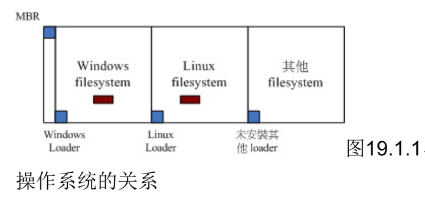

3. BootLaoder的作用

- 提供菜单: 使用者可以选择不同的开机项目, 这也是多重开机的重要功能！
- 载入核心文件: 直接指向可开机的程序区段来开始操作系统；
- 转交其他 loader: 将开机管理功能转交给其他 loader 负责。（windows的不行）

bootloader的示意图

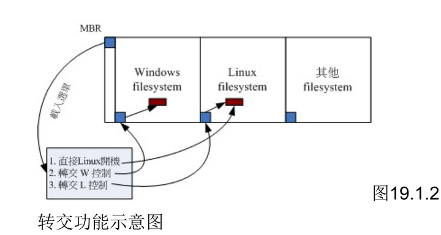


#### 6.3.3 引导方案
在本教程中 Linux 的引导不安装在 windows 的 EFI 分区, 转而新建一个 `/Boot` 分区来存放 Linnux 和 Windows:
* 一部分用户 windows 自带的那个存放 BootLoader 的分区小的可怜(虽然BootLoader也很小)
* 另一方面是为了防止损坏 windows 原本的引导


#### 6.3.4 分区方案
首先在你的 windows 中使用 windows 自带的磁盘管理分出 200G 左右的 free space, 下面是我实体机的分区情况: 
| 1G       | \boot | fat32 |
| -------- | ----- | ----- |
| 8G       | swap  | swap  |
| The rest | \     | ext4  |


> 每个人可以按照自己的偏好进行调整, 由于我的实体机已经安装完成, 于是下边在虚拟机中进行演示, 数据按照表格来

1. 磁盘分区: MBR 格式的硬盘使用fdisk(cfdisk 图形界面),GPT 格式的硬盘使用gdisk(cgdisk 图形界面);
最后一定要写入分区表才有效, 即输入w, 具体的方法我不多讲, 还是简单的;


2. 查看分区后磁盘情况, 使用命令:
``` shell
lsblk                        # 查看分区情况, 如下图
```

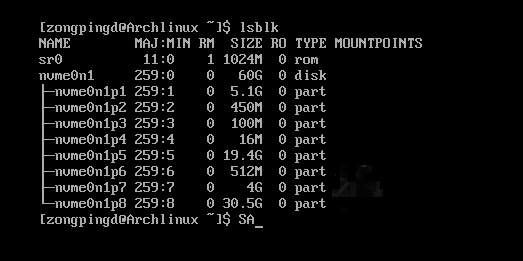


注: 这个是我已经安装好的虚拟机双系统, 我已经把预留的60G分成了20G windows + 30G Arch; 然后我又把这个 30G 分成: 512M的/boot:/dev/nvme0n1p6 + 4G的swap:/dev/nvme0n1p7 + 30.5GM的/dev/nvme0n1p8


3. 格式化分区:其实应该叫做格式化文件系统, 常见的文件系统如下:
* windows 下的FAT,  FAT16,  FAT32,  NTFS文件系统
* Linux 下的ext2, ext3, ext4, SGI's XFS, btrfs 文件系统

输入以下的命令

``` shell
# 1. 制作boot分区,  必须为fat格式
mkfs.fat -F32 /dev/nvme0n1p6

# 2. 制作swap分区
mkswap /dev/nvme0n1p7
swapon /dev/nvme0n1p7

# 3. 制作主分区的文件系统
mkfs.ext4 /dev/nvme0n1p8
# 或 mkfs -t ext4 /dev/nvme0n1p8                    

# 4. 最好在使用fdisk -l 或者是 lsblk查看各个文件系统的情况
```

### 6.4 安装基本系统

#### 6.4.1 软件源配置
因为Arch使用 pacman 作为包管理器, 所以你应该先编辑一下pacman的配置文件, 设置pacman的下载仓库有哪些, 不然仓库没有的话你就会缺少依赖, 然后就会一直改bug. pacman配置文件位于 `/etc/pacman.conf`, 运行如下的命令进行编辑: 

``` shell
vim   /etc/pacman.conf
```

打开后你会看到Arch自带有三个软件源

- [core]
- [extra]
- [community]

但是你还应该把另外一个软件源给解封（它默认是被注释了的）---> 给两行解除注释, 就是 `[multilib]`, 它的作用就是提供 32 位支持库。

> 你还可以在添加一个archlinuxcn这个源, 但是它不是官方的源, 是我们中国人自己搞的

在刚才的那个/etc/pacman.conf文件里边加入下边的内容即可

``` shell
[archlinuxcn]
Server = https://mirrors.ustc.edu.cn/archlinuxcn/$arch                   # 中国科学技术大学开源镜像站
Server = https://mirrors.tuna.tsinghua.edu.cn/archlinuxcn/$arch          # 清华大学开源软件镜像站
Server = https://mirrors.hit.edu.cn/archlinuxcn/$arch                    # 哈尔滨工业大学开源镜像站
Server = https://repo.huaweicloud.com/archlinuxcn/$arch                  # 华为开源镜像站

# 安装这个源你还需要运行下边的命令,安装签名
sudo pacman -S archlinuxcn-keyring
# 最后相比大家安装Arch的一大原因就是看上了它的AUR吧, 据说就没有上边找不到的野包。
# 为此你只需要下载一个yay就行了, yay就可以从AUR中下载软件
sudo pacman -S yay
```

> 你也可以编辑 pacman 的镜像源, 把中国的镜像源放在最前边, 可能网速会好一点, 和前边的禁用 reflector 一样

最后就是要更新一下你的系统, 万一不是最新的, 但时候在安装的结束之际给你弹个ERROR出来, 相信我你会裂开的, 怎么更新呢?很简单, 运行下边的命令就可以了

``` shell
sudo pacman -Syyu
```

#### 6.4.2 硬盘安装 

其实你细心一点就会对发现, 我们的配置都是改的U盘里边的那个系统, 即ISO文件, 根本没有和我们的安装硬盘扯上半点的关系, 毕竟我们是要把Arch安装到电脑的硬盘上, 而不是一个U盘里边。所以要怎么把Arch安装到电脑的硬盘上呢?

这里就涉及到一个Linux下的常用命令: **挂载**

* 什么是挂载? 其实就是把你的储存设备(文件系统, 分区)挂到一个Linux的目录下边, 然后被挂载的目录就叫**挂载点。**你从挂载点进去就是进入了你的那个储存设备

* 什么是目录? 比如 windows下的 `C:\users\..\Desktop` 就是一个目录, `(C:\users\..\)Desktop` 就是挂载点.

只不过我们在 Linux 下使用的是 `/mnt` 这个目录, 作为挂载点; 所以就很简单了, 只需要把电脑的硬盘的分区挂载到 `/mnt` 目录下, 我们在这个U盘的系统里边, 把东西下载到 `/mnt` 目录下, 就等于我们把东西下载到电脑的硬盘上了.

回归正题:
1. 我们要把 Arch 的系统主要内容安装在主分区, 就是最大的那个 ext4 玩意儿, 也就是 `/dev/nvme0n1p6`
2. 还得把 Arch 的引导安装在 `/boot` 分区, 也就是 `/dev/nvme0n1p8`

挂载操作相关命令如下: 
``` shell
# 1.挂载主分区
mount /dev/nvme0n1p8 /mnt


# 2.挂载引导分区
# 这也就是他们说的挂载必须从根目录开始的原因, 你不可能直接挂到boot上吧（都没有这个目录呢）
mkdir /mnt/boot 
# 此时Arch的pacstrap脚本就会自动把系统的引导安装到这里                                                
mount /dev/nvme0n1p6 /mnt/boot                  


# 3.检查挂载情况
ls /mnt
# 如果出现 lost + found 就说明已经挂载上了
# 或是是使用lsblk来查看挂载点
```

接下来就可以开始下载东西来安装了,这么久的前期工作, 终于等来安装了;使用如下的命令即可:

``` shell
pacstrap \mnt base linux linux-firmware base-devel vim
# 安装过程中一定不能出现报错


# 各个参数的解释:
# 1. pacstrap: arch 自带的一个安装东西的脚本, 可以看作你们平时用的p2p下载, 华军软件源下载, 或者是2345超级下载之类的
# 2. \mnt: 表示下载的东西放在那里, 因为我们要把Arch安装在主分区是吧, 前边我们也把主分区挂载到了/mnt下,后边的就是要下载的东西。千万别少装, 后边出bug你就知道回来了
# 3. base: 基础软件
# 4. linux: linux的内核,也可以使用其它的内核, 如 linux-lts, linux-zen. 我使用的是 linux-zen
# 5. linux-firmware: 固件
# 6. base-devel:编译的工具, 含有gcc之类的, 提供了make命令等。
# 7. vim: 文本编辑器
```

> 有小伙伴可能还会问, 你上边不是说在Linux下, 文件系统是从 `/` 开始的吗? 而且U盘里变的文件系统是从 `/` 开始的吗? 怎么又多了一个 `/mnt` 和 `/boot` 目录出来呢?

这个是安装 Arch 过程中的另外一个操作:叫做 `arch-chroot`; 别着急,后边我们会详细讲解这个命令

#### 6.4.3 fatab文件
首先恭喜你走到了这一步, 很多人在前边就放弃了, 离胜利不远了; 那么fstab有什么用呢? 还记得我们之前说的吗? 我们是不是手动的把我们的分区挂载到了一些目录下边。但是你的电脑肯定得关机吧, 那么重新开机以后你又得手动去挂载, 麻烦吗? 所以生成 fstab 文件就是在电脑开机后自动读取这个fstab文件, 然后挂载相关的文件系统, 使用如下命令: 

> 这里的文件系统就是指的分区, 因为一般情况下, 一个分区只能有一个文件系统

``` shell
# 1. 生成 fstab 文件
# >: 覆盖重写; >>: 表示追加在文件末尾
genfstab -U /mnt >> /mnt/etc/fstab          


# 2. 查看fstab文件得信息,检查fstab是否配置成功
# 如果是重新生成可以使用:genfstab -U /mnt > /mnt/etc/fstab            
cat /mnt/etc/fstab
# cat 是常用得Linux下的查看文件命令
```

### 6.5 基本环境配置
走完上边的流程, 你得到了一个很简洁的系统, 简洁到代码编辑器,  dhcpcd, 反正要啥没啥。还有就是,现在的系统你肯定很不适应: 语言为英文, 时间也不对 ... 但是先别急, 我们还得完成一个操作, 就是前边提到得一个命令 —— `arch-chroot`. 它有什么用呢? 字面上看就是改变 (change) 根 (root)目录。那么实际意义是什么呢? 对了, 就是这个字面意义

那个改变根目录有什么作用呢?前边我们是不是说过, 在Linux下一切得目录都是从 `/` 开始的, 也就是说, `/` 就是最顶层的目录, 你不能够到达比 `/` 目录更上边的目录了
> 这样就可以起到保护你的学习资料, 从而免于被别人偷看

同时, 它也会改变你的工作目录, 你原来是在 `/mnt` 下(U盘里), 现在你就在 `/` 下了(电脑硬盘里,也就是的的新安装的Arch系统里面)这样也就能够解释上边的问题了. 使用如下命令切换根目录:

``` shell
arch-chroot /mnt
# 此时你的命令提示符会从 root@archiso ~# 变为 [root@archiso /]
# 然后就可以执行下边的设置了
```


如果你之前在安装时配置了vim, 并且发现在新的系统里边少了一些配置文件, vim使用起来不顺手的话, 你可以退出当前的新系统。你在新系统里边没有你的vim配置文件, 因为你只能使用原来的/mnt下你安装的文件, 而你的vim配置文件在/mnt的上级, 你说, 你怎么使用?此时退出新系统, 进入U盘中的系统重新配置一下, copy过来即可, 使用如下命令退出新系统*


``` shell
exit
# 退出新系统
```

#### 6.5.1 locale 设置

**时区设置**
``` shell
ln -sf /usr/share/zoneinfo/Asia/Shanghai /etc/localtime
```

**硬件时钟的同步**
``` shell
hwclock --systohc
```

**设置locale**
什么是locale?实际上就是生活习惯, 根据不同地区人们的不同的生活习惯, 电脑会调整相应的有关东西, 比如语言, 货币, 日期格式等。也就是说让Arch知道我们是中国人, 你的配置得按着我们中国人的习惯来

``` shell
nano /etc/locale.gen
# 取消以下两行得注释
# 使用vim的/, 搜索字符串:
# "#en_US" -> 回车, 找到 "UTF-8" 那一行 删掉前面的 '#'（取消注释）
# "#zh_CN" -> 回车, 找到 "UTF-8" 那一行 删掉前面的 '#'（取消注释）


% 生成locale, 因为上边解除注释只是代表我们能用这个locale
locale-gen
```

**新建 /etc/locale.conf**
``` shell
vim /etc/locale.conf 
# 就是设置你的系统语言了, 添加下边的内容
LANG=en_US.UTF-8
# 不要改成中文的, 不然会造成 tty 乱码
```

#### 6.5.2 设置 host
1. 设置 hostname

那些改host文件的windows玩家, 这个东西, 你们肯定熟悉吧。你随便设一个英文名就行了, 但是下边配置host的时候名字得一致

``` shell
vim /etc/hostname
# 直接填入的hostname即可
# 比如我设置为 Archlinux
```

2. 设置 host

``` shell
vim /etc/hosts
# 然后在里边输入如下的内容
127.0.0.1      localhost
::1            localhost
127.0.1.1      Archlinux.domain        Archlinux
# 提示: 是 tab 键, 不是空格
```

#### 6.5.3 设置 root 密码
``` shell
passwd
# 然后会叫你输入密码, 不会实时的显示在屏幕上, 但是你的确是输入进去了的
# 最后会叫你确认你的密码, 所以不用担心密码输错
```

### 6.6 多操作系统引导
如果你只需要安装单个 Linux 操作系统, 那么这一部分你可以直接跳过; 对于需要安装 Linux+Windows 双系统, 甚至是多个操作系统, 包括 MacOS, 亦或者是多个 Linux 系统的用户来说, 多个操作系统的引导是一个很重要的话题:

``` shell
pacman -S grub efibootmgr  intel-ucode os-prober
# 1. intel-ucode: 厂家为电脑的cpu更新驱动
# amd 的 cpu 就安装 amd-ucode
# 2. grub: 上边说过了, 不多讲
# 3. efibootmgr: efibootmgr 被 grub 脚本用来将启动项写入 NVRAM
# 4. os-prober: 发现 windows 操作系统的引导
```

#### 6.6.1 GRUB基本配置
具体的详细步骤和参数意义可以参见 Arch 官方维基, 下面以命令
``` shell 
fdisk -l
```

来进行相关信息的查看.可用的参考信息有: 磁盘类型, `ESP分区` 位置（本例中就是寻找 `bootmgfw.efi` 所在的分区位置）, 相关命令输出如下: 

``` shell
[root@Archlinux zpd]# fdisk -l
Disk /dev/nvme0n1: 931.51 GiB, 1000204886016 字节, 1953525168 个扇区
磁盘型号: WD_BLACK SN770 1TB
单元: 扇区 / 1 * 512 = 512 字节
扇区大小(逻辑/物理): 512 字节 / 512 字节
I/O 大小(最小/最佳): 512 字节 / 512 字节
磁盘标签类型: gpt
磁盘标识符: 0042EA61-A4D7-452B-9DFA-0AF034C48726

设备                  起点       末尾       扇区   大小 类型
/dev/nvme0n1p1        2048     411647     409600   200M EFI 系统
/dev/nvme0n1p2      411648     444415      32768    16M Microsoft 保留
/dev/nvme0n1p3      444416 1371561983 1371117568 653.8G Microsoft 基本数据
/dev/nvme0n1p4  1925212160 1926260735    1048576   512M Windows 恢复环境
/dev/nvme0n1p5  1926260736 1951426559   25165824    12G Windows 恢复环境
/dev/nvme0n1p6  1951426560 1953523711    2097152     1G Windows 恢复环境
/dev/nvme0n1p7  1505779712 1507876863    2097152     1G Linux 文件系统
/dev/nvme0n1p8  1507876864 1524654079   16777216     8G Linux 文件系统
```

 

所以我们要寻找的分区就是: `/dev/nvme0n1p1`, 然后使用如下命令进行挂载操作,挂载点为: `/boot`.

``` shell
mount /dev/nvme0n1p1 /boot
```

> 为了保险起见, 可以查看一下其中是否存在 EFI 文件夹
 

然后使用 `os-prober` 工具查找 `bootmgf.efi`, 运行如下的命令: 

``` shell
os-prober
```
> os-prober 官方认为启动别的操作系统是不安全的, 所以就默认禁用了 os-prober 查找其他操作系统启动文件的功能. 尽管不自动启用, 但你仍然可以修改这一默认行为. 在文件 `/etc/default/grub` 中增加配置项:`GRUB_DISABLE_OS_PROBER=false`, 然后再生成我们的 GRUB 配置文件

如果你可以得到类似如下输出, 就说明 `os-prober` 找到了 windows 的启动引导项了: 

``` shell
[root@Archlinux zpd]# os-prober
/dev/nvme0n1p1@/EFI/Microsoft/Boot/bootmgfw.efi:Windows Boot Manager:Windows:efi
```

之后就是如下的常规操作:
``` shell
# 1. 创建一个文件夹
mkdir /boot/grub

# 2. 生成配置文件
grub-mkconfig > /boot/grub/grub.cfg         
# 也可以用: grub-mkconfig -o /boot/grub/grub.cfg
```


#### 6.6.2 GRUB 主题
GRUB 默认的主题是纯黑白的, 大概就像下面这样(示例图片选自:[linux-grub-windows-dual-boot](https://www.techmesto.com/set-windows-as-default-in-linux-dual-boot/)):

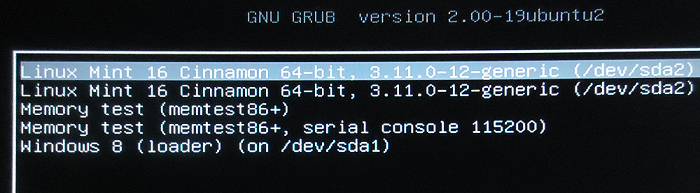

可能部分的用户并不喜欢, 所以我们可以自定义这个 grub 菜单界面的主题。这里采用的工具是: [grub2-themes](https://github.com/vinceliuice/grub2-themes), 它提供的主题样式如下:


这个工具的使用十分的简单, 只需参考仓库对应的README即可, 但是我还是在这里补充一些易错点.其实主要的问题就出现在 os-prober 寻找 windows 的 `.efi` 上, 下面是我在默认的 windows 和 Linux 的引导都正常下的配置
方法:

1. 首先把 Windows 的 `.efi` 文件对应的分区挂载到 Linux 的 `/boot/EFI` 文件夹下, windows 的 `.efi` 文件在我这里位于 `/dev/nvme0n1p1` 分区. 所以使用命令:
    ``` shell
    sudo mount /dev/nvme0n1p1 /boot/EFI
    ```
2. 然后运行命令:
    ``` shell 
    sudo os-prober
    ```
    看一看是否能检测到 Linux 和 Windows 两个系统的启动文件, 如果正常的话, 应该会有类似如下的输出:
    ``` shell 
    $ sudo grub-mkcontig temp.cfg
    Generating grub configuration file ...
    Found theme:/usr/share/grub/themes/vimix/theme.txt
    Found linux image:/boot/vmlinuz-linux-zen
    Found initrd image:/boot/intel-ucode.img /boot/initramfs-linux-zen.img
    Found fallback initrd image(s)in /boot:intel-ucode.img initramfs-linux-zen-fallback.img
    Warning:os-prober will be executed to detect other bootable partitions
    Its output will be used to detect bootable binaries on them and create new boot entries.
    Found Windows Boot Manager on /dev/nvmeon1p1@/EFI/Microsoft/Boot/bootmgfw.efi
    Adding boot menu entry for UEFI Firmware Settings ..
    done
    ```
    尤其得关注那个 `Windows Boot Manager` 项.
3. 如果以上两步均正常, 那么最后可以使用 grub2-themes 提供的脚本命令生成对应的 grub 配置
    ``` shell 
    sudo ./install.sh -t vimix -s 1080p
    ```
    最后再检查一下对应的 grub 配置文件: `/boot/grub/grub.cfg` 是否正常, 我最后的文件长这样(不要抄袭, 每个人的情况是不同的):
    ``` shell 
    #
    # DO NOT EDIT THIS FILE
    #
    # It is automatically generated by grub-mkconfig using templates
    # from /etc/grub.d and settings from /etc/default/grub
    #

    ### BEGIN /etc/grub.d/00_header ###
    insmod part_gpt
    insmod part_msdos
    if [ -s $prefix/grubenv ]; then
    load_env
    fi
    if [ "${next_entry}" ] ; then
    set default="${next_entry}"
    set next_entry=
    save_env next_entry
    set boot_once=true
    else
    set default="0"
    fi

    if [ x"${feature_menuentry_id}" = xy ]; then
    menuentry_id_option="--id"
    else
    menuentry_id_option=""
    fi

    export menuentry_id_option

    if [ "${prev_saved_entry}" ]; then
    set saved_entry="${prev_saved_entry}"
    save_env saved_entry
    set prev_saved_entry=
    save_env prev_saved_entry
    set boot_once=true
    fi

    function savedefault {
    if [ -z "${boot_once}" ]; then
        saved_entry="${chosen}"
        save_env saved_entry
    fi
    }

    function load_video {
    if [ x$feature_all_video_module = xy ]; then
        insmod all_video
    else
        insmod efi_gop
        insmod efi_uga
        insmod ieee1275_fb
        insmod vbe
        insmod vga
        insmod video_bochs
        insmod video_cirrus
    fi
    }

    if [ x$feature_default_font_path = xy ] ; then
    font=unicode
    else
    insmod part_gpt
    insmod ext2
    search --no-floppy --fs-uuid --set=root 95e4daca-8211-4bb5-8407-1bfd1123e560
        font="/usr/share/grub/unicode.pf2"
    fi

    if loadfont $font ; then
    set gfxmode=1920x1080,auto
    load_video
    insmod gfxterm
    set locale_dir=$prefix/locale
    set lang=en_US
    insmod gettext
    fi
    terminal_input console
    terminal_output gfxterm
    insmod part_gpt
    insmod ext2
    search --no-floppy --fs-uuid --set=root 95e4daca-8211-4bb5-8407-1bfd1123e560
    insmod gfxmenu
    loadfont ($root)/usr/share/grub/themes/vimix/dejavu_sans_12.pf2
    loadfont ($root)/usr/share/grub/themes/vimix/dejavu_sans_14.pf2
    loadfont ($root)/usr/share/grub/themes/vimix/dejavu_sans_16.pf2
    loadfont ($root)/usr/share/grub/themes/vimix/dejavu_sans_24.pf2
    loadfont ($root)/usr/share/grub/themes/vimix/dejavu_sans_32.pf2
    loadfont ($root)/usr/share/grub/themes/vimix/dejavu_sans_48.pf2
    loadfont ($root)/usr/share/grub/themes/vimix/terminus-12.pf2
    loadfont ($root)/usr/share/grub/themes/vimix/terminus-14.pf2
    loadfont ($root)/usr/share/grub/themes/vimix/terminus-16.pf2
    loadfont ($root)/usr/share/grub/themes/vimix/terminus-18.pf2
    insmod jpeg
    insmod png
    set theme=($root)/usr/share/grub/themes/vimix/theme.txt
    export theme
    if [ x$feature_timeout_style = xy ] ; then
    set timeout_style=menu
    set timeout=-1
    # Fallback normal timeout code in case the timeout_style feature is
    # unavailable.
    else
    set timeout=-1
    fi
    ### END /etc/grub.d/00_header ###

    ### BEGIN /etc/grub.d/10_linux ###
    menuentry 'Arch Linux, with Linux linux-zen' --class arch --class gnu-linux --class gnu --class os $menuentry_id_option 'gnulinux-linux-zen-advanced-95e4daca-8211-4bb5-8407-1bfd1123e560' {
        savedefault
        load_video
        set gfxpayload=keep
        insmod gzio
        insmod part_gpt
        insmod fat
        search --no-floppy --fs-uuid --set=root F8A7-B7F8
        echo	'Loading Linux linux-zen ...'
        linux	/vmlinuz-linux-zen root=UUID=95e4daca-8211-4bb5-8407-1bfd1123e560 rw  loglevel=5 quiet nowatchdog
        echo	'Loading initial ramdisk ...'
        initrd	/intel-ucode.img /initramfs-linux-zen.img
    }
    menuentry 'Arch Linux, with Linux linux-zen (fallback initramfs)' --class arch --class gnu-linux --class gnu --class os $menuentry_id_option 'gnulinux-linux-zen-fallback-95e4daca-8211-4bb5-8407-1bfd1123e560' {
        savedefault
        load_video
        set gfxpayload=keep
        insmod gzio
        insmod part_gpt
        insmod fat
        search --no-floppy --fs-uuid --set=root F8A7-B7F8
        echo	'Loading Linux linux-zen ...'
        linux	/vmlinuz-linux-zen root=UUID=95e4daca-8211-4bb5-8407-1bfd1123e560 rw  loglevel=5 quiet nowatchdog
        echo	'Loading initial ramdisk ...'
        initrd	/intel-ucode.img /initramfs-linux-zen-fallback.img
    }
    menuentry 'Arch Linux, with Linux linux-zen (recovery mode)' --class arch --class gnu-linux --class gnu --class os $menuentry_id_option 'gnulinux-linux-zen-recovery-95e4daca-8211-4bb5-8407-1bfd1123e560' {
        load_video
        set gfxpayload=keep
        insmod gzio
        insmod part_gpt
        insmod fat
        search --no-floppy --fs-uuid --set=root F8A7-B7F8
        echo	'Loading Linux linux-zen ...'
        linux	/vmlinuz-linux-zen root=UUID=95e4daca-8211-4bb5-8407-1bfd1123e560 rw single 
        echo	'Loading initial ramdisk ...'
        initrd	/intel-ucode.img /initramfs-linux-zen-fallback.img
    }

    ### END /etc/grub.d/10_linux ###

    ### BEGIN /etc/grub.d/20_linux_xen ###
    ### END /etc/grub.d/20_linux_xen ###

    ### BEGIN /etc/grub.d/25_bli ###
    if [ "$grub_platform" = "efi" ]; then
    insmod bli
    fi
    ### END /etc/grub.d/25_bli ###

    ### BEGIN /etc/grub.d/30_os-prober ###
    menuentry 'Windows Boot Manager (on /dev/nvme0n1p1)' --class windows --class os $menuentry_id_option 'osprober-efi-94D9-50AD' {
        savedefault
        insmod part_gpt
        insmod fat
        search --no-floppy --fs-uuid --set=root 94D9-50AD
        chainloader /EFI/Microsoft/Boot/bootmgfw.efi
    }
    ### END /etc/grub.d/30_os-prober ###

    ### BEGIN /etc/grub.d/30_uefi-firmware ###
    if [ "$grub_platform" = "efi" ]; then
        fwsetup --is-supported
        if [ "$?" = 0 ]; then
            menuentry 'UEFI Firmware Settings' $menuentry_id_option 'uefi-firmware' {
                fwsetup
            }
        fi
    fi
    ### END /etc/grub.d/30_uefi-firmware ###

    ### BEGIN /etc/grub.d/40_custom ###
    # This file provides an easy way to add custom menu entries.  Simply type the
    # menu entries you want to add after this comment.  Be careful not to change
    # the 'exec tail' line above.
    ### END /etc/grub.d/40_custom ###

    ### BEGIN /etc/grub.d/41_custom ###
    if [ -f  ${config_directory}/custom.cfg ]; then
    source ${config_directory}/custom.cfg
    elif [ -z "${config_directory}" -a -f  $prefix/custom.cfg ]; then
    source $prefix/custom.cfg
    fi
    ### END /etc/grub.d/41_custom ###
    ```
    然后取消挂载, 重启, 即可看到效果

再说一说我在这个过程中遇到的另一个坑吧. 我当时把 `/dev/nvme0n1p1` 分区挂载到了 `/boot` 目录下, 然后再运行 os-prober 命令就只能找到 Windows 的启动文件, 但是就找不到 Linux 的启动文件了, 这种情况下输出的 `grub.cfg` 文件大概长这样:
``` shell 
#
# DO NOT EDIT THIS FILE
#
# It is automatically generated by grub-mkconfig using templates
# from /etc/grub.d and settings from /etc/default/grub
#

### BEGIN /etc/grub.d/00_header ###
insmod part_gpt
insmod part_msdos
if [ -s $prefix/grubenv ]; then
  load_env
fi
if [ "${next_entry}" ] ; then
   set default="${next_entry}"
   set next_entry=
   save_env next_entry
   set boot_once=true
else
   set default="0"
fi

if [ x"${feature_menuentry_id}" = xy ]; then
  menuentry_id_option="--id"
else
  menuentry_id_option=""
fi

export menuentry_id_option

if [ "${prev_saved_entry}" ]; then
  set saved_entry="${prev_saved_entry}"
  save_env saved_entry
  set prev_saved_entry=
  save_env prev_saved_entry
  set boot_once=true
fi

function savedefault {
  if [ -z "${boot_once}" ]; then
    saved_entry="${chosen}"
    save_env saved_entry
  fi
}

function load_video {
  if [ x$feature_all_video_module = xy ]; then
    insmod all_video
  else
    insmod efi_gop
    insmod efi_uga
    insmod ieee1275_fb
    insmod vbe
    insmod vga
    insmod video_bochs
    insmod video_cirrus
  fi
}

if [ x$feature_default_font_path = xy ] ; then
   font=unicode
else
insmod part_gpt
insmod ext2
search --no-floppy --fs-uuid --set=root 95e4daca-8211-4bb5-8407-1bfd1123e560
    font="/usr/share/grub/unicode.pf2"
fi

if loadfont $font ; then
  set gfxmode=1920x1080,auto
  load_video
  insmod gfxterm
  set locale_dir=$prefix/locale
  set lang=en_US
  insmod gettext
fi
terminal_input console
terminal_output gfxterm
if [ x$feature_timeout_style = xy ] ; then
  set timeout_style=menu
  set timeout=-1
# Fallback normal timeout code in case the timeout_style feature is
# unavailable.
else
  set timeout=-1
fi
### END /etc/grub.d/00_header ###

### BEGIN /etc/grub.d/10_linux ###

### END /etc/grub.d/10_linux ###

### BEGIN /etc/grub.d/20_linux_xen ###
### END /etc/grub.d/20_linux_xen ###

### BEGIN /etc/grub.d/25_bli ###
if [ "$grub_platform" = "efi" ]; then
  insmod bli
fi
### END /etc/grub.d/25_bli ###

### BEGIN /etc/grub.d/30_os-prober ###
menuentry 'Windows Boot Manager (on /dev/nvme0n1p1)' --class windows --class os $menuentry_id_option 'osprober-efi-94D9-50AD' {
	savedefault
	insmod part_gpt
	insmod fat
	search --no-floppy --fs-uuid --set=root 94D9-50AD
	chainloader /EFI/Microsoft/Boot/bootmgfw.efi
}
### END /etc/grub.d/30_os-prober ###

### BEGIN /etc/grub.d/30_uefi-firmware ###
if [ "$grub_platform" = "efi" ]; then
	fwsetup --is-supported
	if [ "$?" = 0 ]; then
		menuentry 'UEFI Firmware Settings' $menuentry_id_option 'uefi-firmware' {
			fwsetup
		}
	fi
fi
### END /etc/grub.d/30_uefi-firmware ###

### BEGIN /etc/grub.d/40_custom ###
# This file provides an easy way to add custom menu entries.  Simply type the
# menu entries you want to add after this comment.  Be careful not to change
# the 'exec tail' line above.
### END /etc/grub.d/40_custom ###

### BEGIN /etc/grub.d/41_custom ###
if [ -f  ${config_directory}/custom.cfg ]; then
  source ${config_directory}/custom.cfg
elif [ -z "${config_directory}" -a -f  $prefix/custom.cfg ]; then
  source $prefix/custom.cfg
fi
### END /etc/grub.d/41_custom ###
```

可以看到:
``` shell 
### BEGIN /etc/grub.d/10_linux ###

### END /etc/grub.d/10_linux ###
```

之间根本就没有任何的 Linux 启动选项, 所以导致我的 GRUB 菜单中只有一个 windows 启动项. 但是我这次并没有通过 LiveCD 进行对应的 `grub.cfg` 文件的更改, 我直接在 Windows 下使用 `Disk Genius` 修改的. 操作示意图如下:

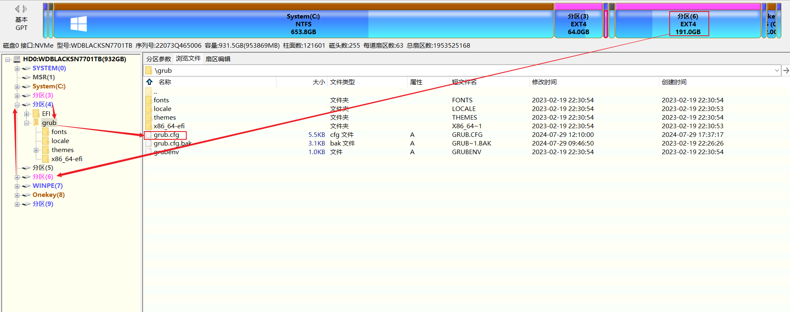

上图中的那个 `分区(4)` 其实就是我那个 Linux 文件系统下的 `/boot` 文件夹, 所以我们要修改的文件就是那个: `grub.cfg`, 修改好之后, 再替换原始的文件.重启系统, 马上恢复正常引导.

> 不建议新手像我这样手动修改 `grub.cfg` 文件, 但是如果你熟悉这个文件的结构和语法, 那我反而更推崇手写这个文件, archlinux 的官方文档中也有对应的 grub 启动菜单配置教程: [grub menu](https://wiki.archlinux.org/title/GRUB#Boot_menu_entry_examples)


最后的效果如下:

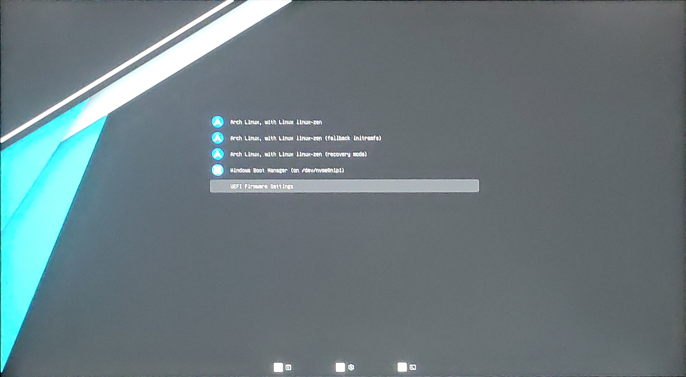

> 实体机的 GRUB menu 界面不好截图，手机像素有点差，将就看吧

#### 6.6.3 救赎 -- 引导丢失
下面就说一个我亲身体验的:系统引导丢失, 无法进入系统的案件

> 某次我使用 timeshift 恢复系统时, 它问我要不要恢复 grub 引导, 然后我选择了同意。自然而然的, 重启后无法进入系统了（Arch 和 windows）。就连启动 windows 都只能够进入 BIOS 进行选择启动项了, 也就是说我的GRUB崩了。

然后我就重新制作了一个启动盘, 进入 LiveCD 模式, 也就是 Arch 的安装时的模式。重新把 Arch 的主分区和 boot 分区分别挂载在了`/mnt` 和 `/mnt/boot` 目录.

> 尽量不要颠倒下面命令的执行顺序

1. 重新生成了 fstab 文件

``` shell
genfstab -U /mnt >> /mnt/etc/fstab
```

2. 重新安装了 Arch 的内核, 也就是如下的命令: 

``` shell
pacstrap \mnt  linux
```

3. 重新挂载 windows 的 ESP 分区到 `/mnt/boot` 目录. 使用命令 
``` shell 
os-prober
```
找到 Linux 和 Windows 的引导文件

4. 重新生成 GRUB 的启动引导项
``` shell
grub-mkconfig > /boot/grub/grub.cfg         
# 也可以用:  grub-mkconfig -o /boot/grub/grub.cfg
```

5. 最后
``` shell 
exit
```
重启, GRUB 成功引导 arch 和 Windows 两个系统

``` shell
[root@Archlinux zpd]# grub-mkconfig > /boot/grub/grub.cfg
正在生成 grub 配置文件 ...
警告:  os-prober 将运行以检测其它可引导分区。
将使用 os-prober 的输出, 以检测分区中可引导的二进制文件, 并为其创建新的启动项。
发现了 Windows Boot Manager, 位于 /dev/nvme0n1p1@/EFI/Microsoft/Boot/bootmgfw.efi
正在添加 UEFI 固件设置的引导菜单项……
完成
```


### 6.7 基本软件 
#### 6.7.1 计算机联网
为了方便之后的网络连接以及管理, 我个人安装了如下软件:
``` shell
sudo pacman -S networkmanager network-manager-applet  wpa_supplicant
```

#### 6.7.2 其余软件
还有一部分额外的软件, 可以根据个人喜好进行安装:
``` shell
sudo pacman -S mtools git dosfstools ntfs-3g sudo linux-headers
# 1. mtools, dosfstools: Linux下的工具程序
# 2. git: 分布式版本管理工具
# 3. ntfs-3g: 兼容ntfs文件系统
# 4. sudo: 不多讲了
# 5. linux-headers: 就是格式规范的、可以被编译器识别的软件接口规格书
```

#### 6.7.3 完成安装
完成以上的所有任务后, 恭喜你, 你得到了一个 Archlinux 系统, 蓝色双面鹰永在. 退出安装, 准备进行系统:
``` shell
exit          # 退出安装环境
umountmnt     # 取消文件系统的挂载
reboot        # 重启
```


### 6.8 进入系统
#### 6.8.1 连接网络
``` shell
# 设置开机自启并且现在就启动
systemctl enable --now NetworkManager

# 进入图形化的wifi连接界面
nmtui

# 每天一边遍,防止滚挂
sudo pacman -Syyu
```

#### 6.8.2 root 默认编辑器

``` shell
vim  ~/.bash.profile
# 添加如下的内容
export EDITOR='vim'
```

#### 6.8.3 准备非 root 用户

``` shell
# 1. 添加用户
useradd -m -G wheel  <your name>


# 2. 创建密码, 注意别去改root
passwd <your name>


# 3. 取消wheel用户组的注释
EDITOR=vim visudo                                    
# 也就是去掉 #%wheel ALL=(ALL) AL前边的注释
```

#### 6.8.4 DE 环境安装
我这里的教程只保证你们安装好基本的 Display server, 至于你们喜欢什么桌面环境, 这个也许需要你自己去选择.

``` shell
# 1. 安装显示服务
sudo pacman -S xorg                


# 2. 安装显卡驱动
# 2.1 核显:Intel
sudo pacman -S mesa lib32-mesa vulkan-intel lib32-vulkan-intel    
# amd请参见:archwiki

# 2.2 独立显卡
# A 卡
pacman -S xf86-video-amdgpu        
# N 卡
pacman -S nvidia nvidia-utils      
```

#### 6.8.5 平铺桌面
如果用户喜欢轻量化的平铺桌面管理器, 我这里倒是有一个推荐的配置: [yaocccc-dwm](https://github.com/yaocccc/dwm). 配置好的效果大概是这样: [yaocccc-dwm-showoff](https://www.bilibili.com/video/BV1Ef4y1Z7kA/?share_source=copy_web&vd_source=a9d745bfbf443d7fec13113cdd89ee46). 我目前的桌面大概长这样:

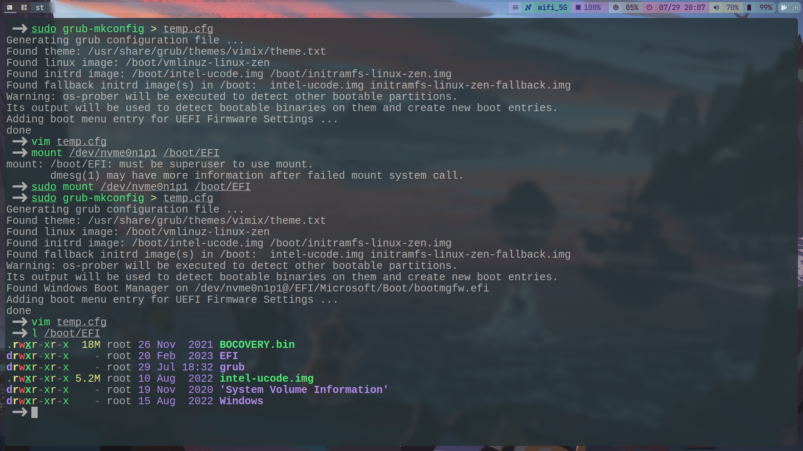


## 7 日前现状
### 7.1 痛点
Windows 上的那些软件自然不能迁移到 Linux 下, 如:
- 大型工业软件如 SolidWorks, AutoCAD, Matlab.
- 还有数学软件 Mathematica, Maple.
- 最后就是 Adobe 系列

这些东西都没有办法迁移(大部分的用户应该都用不起正版 + 找不到linux的"科技"版). 可是既然你已经开始使用 Linux 了, 就说明你应该接纳 Linux, 上边的要求(要求 Linux 有 Windows 上的软件),也许有些过于的苛刻了. Linux 完全可以反问一句:我为什么要有这些软件呢? 的确也是这个道理。其实如果仅仅只是想要体验一下, 装个虚拟机, 尽管性能比较差, 但是也够了.


### 7.2 软件推荐

我现在又用回 Windows 了, weztrem 这个终端模拟器 + WSL2 还是很能打的.

但是在Linux下我的日常生活所需基本都能够满足, 主要是依靠如下的软件: 

1. 写作: LaTeX, WPS; 目前我使用 LaTeX 写论文, 制作演示文稿, 对应的表格需求很少
2. 音乐: spotify, 网易云(而且有人基于网页端封装了一个), qqMusic 还不错
3. 代码: Jetbrain 全家桶 + (n)vim, code-oss(VScode 的开源版本)
4. 文档查看器: okular, zathura
5. 交友通讯: linuxqq, 微信暂时无解, Telegram
6. 科学上网: V2aray, clash-for-windows, 现在那个 `dae` 似乎比较的火.
7. 终端: simple-terminal(suckless), wezterm(目前在 Windows 上用着很舒服，打算迁移到 Linux 上), konsole 还不错
8. 终端小工具: ranger, yazi, autojump, 

> 这两个东西是类似于端口代理的, 不是其他的VPN软件那样全局的代理, 附注一张图,懂得自然懂: 

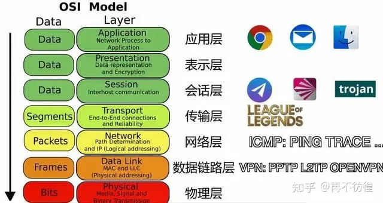


7. 浏览器: Vivalda, Chrome
8. 剪辑绘图: kdenlive, Gimp, krita, inkscape
9. 输入法: fcxit5+rime, 好像还有一个 `oh-my-rime` 感兴趣的可以看看.
    > 输入法的坑:  在某些应用中无法切换中文输入, 比如 dolphin, gedit, telegram ...

    解决方法也是比较简单的，首先运行命令进行输入法的配置检查:
    ``` shell
    fcitx-diagnose                        
    # 或者是 fcitx-diagnose 来查看潜在问题（你按照它的提示基本都可以 解决bug）
    ```

    基本都是更改以下的几个配置文件: 
   * `/etc/profile`
   * `～/.xprofile`
   * `/etc/environment`
  
10. 专业软件: Matlab ☞ Octave, Mathematica

### 7.3 DE 相关
目前我的桌面环境是: 我没有桌面环境(DE), 我用的就是简单的 `xorg` + `picom` + `dwm`.个人感觉其他的 GUI 太重了, 不喜欢. 至于游戏, 我不打游戏的, 据说 Linux 的游戏体验不咋的.


## 8. Linux 基础知识/技巧
新手刚接触 Linux 难免会有些摸不着头脑，我自己平时也总结了一些常用技巧，就列在这里，希望能帮助到大家.

> 下面的部分技巧可能并不是通用的，请注意

### 8.1 zsh 终端小技巧 
* `&`	      : 在一个命令后面添加&可以把命令放到后台执行
* `ctrl + z`  : 把正在前台执行的命令放到后台并“暂停”（在命令行窗口输出）
* `jobs`      : 查看当前在后台执行的命令
* `fg %[num]` : 将后台命令调到前台(这里的num不是pid,是jobs命令返回的进程编号)，对应的命令bg
* `ps`        : 列出系统中正在运行的进程（很少，很实用）
* `htop`      : 列出系统进程（更加的详细的系统进程信息，比较多）
* `Ctrl + r`  : 搜索历史命令


### 8.2 系统管理员知识
* `sudo pacman -S package_name` # 安装软件包
* `pacman -Ss` # 在同步数据库中搜索包，包括包的名称和描述
* `sudo pacman -Syyu` # 升级系统。-yy：标记强制刷新、-u：标记升级动作
* `sudo pacman -Rns package_name` # 删除软件包，及其所有没有被其他已安装软件包使用的依赖包
* `sudo pacman -R package_name` # 删除软件包，保留其全部已经安装的依赖关系
* `pacman -Qi package_name` # 检查已安装包的相关信息。-Q：查询本地软件包数据库
* `pacman -Qdt` # 找出孤立包。-d：标记依赖包、-t：标记不需要的包、-dt：合并标记孤立包
* `sudo pacman -Fy` # 更新命令查询文件列表数据库
* `pacman -F some_command` # 当不知道某个命令属于哪个包时，用来在远程软件包中查询某个命令属于哪个包（即使没有安装）
* `pactree package_name` # 查看一个包的依赖树)
* `sudo pacman -Rns $(pacman -Qtdq)   ` # 删除孤立软件包（常用）
* `sudo pacman -Sc` # 删除当前未安装的所有缓存包和未使用的同步数据库（可选）
* `sudo pacman -Scc` # 从缓存中删除所有文件，这是最激进的方法，不会在缓存文件夹中留下任何内容（一般不使用）
* `paccache -r` # 删除已安装和未安装包的所有缓存版本，但最近 3 个版本除外) 


### 8.3 系统服务的管理
* `systemctl start dhcpcd` # 启动服务
* `systemctl stop dhcpcd` # 停止服务
* `systemctl restart dhcpcd` # 重启服务
* `systemctl reload dhcpcd` # 重新加载服务以及它的配置文件
* `systemctl status dhcpcd` # 查看服务状态
* `systemctl enable dhcpcd` # 设置开机启动服务
* `systemctl enable --now dhcpcd` # 设置服务为开机启动并立即启动这个单元
* `systemctl disable dhcpcd` # 取消开机自动启动
* `systemctl daemon-reload dhcpcd` # 重新载入 systemd 配置。扫描新增或变更的服务单元、不会重新加载变更的配置


### 8.4 top 命令
* `z`: 开启高亮
* `x`: 高亮一列
* `b`: 高亮一行
* `>/<`: 进行左右移动


### 8.5 其余技巧
* `nohup <cmd> &`: 让命令在后台运行,不输出运行日志
* `pkill`: 可以杀死一个进程的父进程和子进程
* `pstree`: 显示进程树
* `htop`: 显示进程信息，支持鼠标操作/排序


## 9 配置文件
### 9.1 zshrc
这里给一部分我的 zsh 终端的配置文件吧，个人感觉对于新手有一定的帮助.
``` shell
# Zsh的语言高亮和建议
source /usr/share/zsh/plugins/zsh-autosuggestions/zsh-autosuggestions.zsh
source /usr/share/zsh/plugins/zsh-syntax-highlighting/zsh-syntax-highlighting.zsh
[[ -s /etc/profile.d/autojump.sh ]] && source /etc/profile.d/autojump.sh


# use comand "env" to find out 
# export PS1="%n@%c >> "
if [[ $(tty) == "/dev/tty1" ]] {
	export PS1=" --> "
} else {
	export PS1="  "
} 
export dwm=~/Downloads/dwm-yaoccc
export Desktop=/mnt/Users/PC/Desktop
export qqmusic=/opt/apps/com.qq.music.deepin/files/run.sh

# 设置终端的语言为英文
# export LANG=en_US


# alias:命令别名设置
alias l='exa --long --git'
alias c=clear
alias v=vim
alias nv=nvim
alias za=zathura
alias r=ranger
alias rm='rm -i'
alias s=source
alias p=pwd
alias chrome=google-chrome-stable
alias xmind=/opt/XMind-2020/data/opt/XMind/XMind
alias telegram=telegram-desktop
alias tor=tor-browser
alias camera=kamoso
alias manim=/home/zpd/.local/bin/manim
alias clion=/opt/clion-2022.2.1/bin/clion.sh
alias wine=deepin-wine5
alias neo=neofetch


# 挂载windows
function mnt_win(){
  sudo mount /dev/nvme0n1p3 /mnt 
}

# 更新pacman的镜像源
function mirrors(){
  curl -s "https://archlinux.org/mirrorlist/?country=CN&protocol=https&use_mirror_status=on" | sed -e 's/^#Server/Server/' -e '/^#/d' | rankmirrors -n 5 - 
}
function udp_mir(){
  mirrors >> ./mirrors_latest
  sudo rm -f /etc/pacman.d/mirrorlist
  sudo mv ./mirrors_latest /etc/pacman.d/mirrorlist
  cat /etc/pacman.d/mirrorlist
}

# 查找应用程序pid
function pid(){
   # program_name=$(pstree -p | grep $1 | head -1)
   program_name=$(ps -ef|grep $1)
   echo ${program_name}
}


# 设置软件代理,并非系统代理
# dae+daed based
function proxyon(){
	sudo systemctl enable --now dae
	daed run > /dev/null 2>&1& 
	echo -e "\nProxy ready, open http://localhost:2023 to start proxying.\nNote:Close proxy in the panel before command 'proxyoff'."
}
function proxyoff(){
	sudo systemctl disable --now dae
	pkill dae
	sudo pkill daed
	unset http_proxy
	unset https_proxy
	unset all_proxy
	echo -e "\nUnset http,https,all proxy, proxy off"
}


# 外接显示屏设置
# 默认笔记本放在副屏的右边,下面这条命令可以把显示器放在屏幕的左边
function scrtoleft(){
    xrandr --output eDP-1 --left-of HDMI-1	
}
```

### 9.2 wezterm
个人对于 wezterm 这个终端模拟器的评价非常高，而且还跨平台，支持图片查看, 支持终端复用, 也许将来会把 linux 下的 st 换为 wezterm. 我的配置文件很简单，如下:
``` lua 
------------ Init ------------
local wezterm = require 'wezterm'
local act = wezterm.action
local config = {}
if wezterm.config_builder then
  config = wezterm.config_builder()
end


---------- Basic windows config ------------
-- cli: wezterm start --position 500,200
config.default_cwd = 'C:/Users/PC/Desktop/'
config.enable_tab_bar = false
config.tab_bar_at_bottom = true
config.window_decorations = "RESIZE"
config.window_close_confirmation = 'NeverPrompt'
config.initial_cols = 90
config.initial_rows = 25
config.window_padding = { left = 2, right = 2, top = 0, bottom = 0 }


---------- Themes config ------------
-- opcity and blur
config.window_background_opacity = .85
-- config.win32_system_backdrop = 'Acrylic'
config.font_size = 15
-- color scheme
config.color_scheme = 'Dracula+'
-- shell
config.default_prog = { 'C:/Program Files/PowerShell/7/pwsh.exe', '-l' }
-- cursor
config.default_cursor_style = "BlinkingBar"
config.cursor_blink_rate = 800
config.cursor_thickness = "1px"
-- font: WezTerm bundles JetBrains Mono, Nerd Font Symbols and Noto Color Emoji fonts and uses those for the default font configuration.


---------- Launch menu ------------
config.launch_menu = {
  -- cmd-'-l':show login log
  { label = 'cmd', args = {'cmd', '-l'}, cwd = 'C:/Users/PC' },
}


---------- Key bindings ------------
-- Activate copy mode: Ctrl + Shift + X (vim-like copy mode)
config.keys = {
  -- 1.tab key bindings
  -- New Tab, Close Tab
  { key = 'n',              mods = 'CTRL',          action = act.SpawnTab 'CurrentPaneDomain'             },
  { key = 'q',              mods = 'CTRL',          action = act.CloseCurrentTab  { confirm = true }      },

  -- 2. panes key bindings
  -- search in cli('CRAL+R' to cycle through 'case-sensitive', 'ignoring case', 'regular')
  { key = 'F',              mods = 'SHIFT|CTRL',    action = act.Search{ CaseInSensitiveString = '' }      },
  { key = 's',              mods = 'SHIFT|CTRL',    action = act.Search( "CurrentSelectionOrEmptyString" ) },
  -- Split Pane
  { key = "Enter",          mods = 'CTRL|SHIFT',    action = act.SplitHorizontal  { domain = 'CurrentPaneDomain' } },
  { key = 'h',              mods = 'CTRL|SHIFT',    action = act.SplitVertical    { domain = 'CurrentPaneDomain' } },
  -- Adjust Pane
  { key = 'LeftArrow',      mods = 'CTRL|SHIFT',    action = act.AdjustPaneSize   { 'Left',  2 } },
  { key = 'RightArrow',     mods = 'CTRL|SHIFT',    action = act.AdjustPaneSize   { 'Right', 2 } },
  -- Rotates panes,Swith pane 
  { key = 'r',              mods = 'ALT',           action = act.RotatePanes 'CounterClockwise'  },
  { key = 'Enter',          mods = 'ALT',           action = act.TogglePaneZoomState             },
  { key = 's',              mods = 'ALT',           action = act.PaneSelect       { alphabet = '1234567890', mode = 'SwapWithActive'} },
  -- Active pane
  { key = 'LeftArrow',      mods = 'ALT',           action = act.ActivatePaneDirection 'Left'    },
  { key = 'RightArrow',     mods = 'ALT',           action = act.ActivatePaneDirection 'Right'   },
  { key = 'UpArrow',        mods = 'ALT',           action = act.ActivatePaneDirection 'Up'      },
  { key = 'DownArrow',      mods = 'ALT',           action = act.ActivatePaneDirection 'Down'    },

  -- 3. show launcher
  { key = 'm',              mods = 'ALT',           action = act.ShowLauncher                    },
}


---------- Mouse Config ------------
config.mouse_bindings = {
  -- 1. windows drag
  { event = { Drag = { streak = 1, button = 'Left' } }, mods = 'CTRL',  action = act.StartWindowDrag, },
  -- 2. open hyper link
  { event = { Up =   { streak = 1, button = 'Left' } }, mods = 'CTRL',  action = act.OpenLinkAtMouseCursor, },
}


-- return configuration to wezterm
return config 
```

在 windows 上的效果如图:

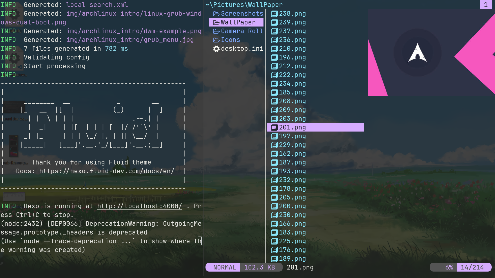
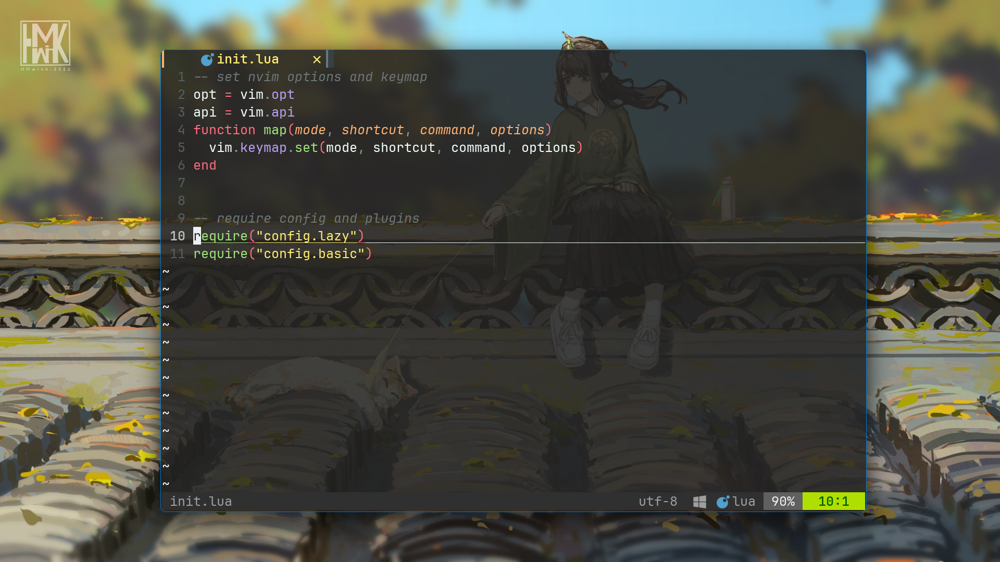


## 10 一篇文章
我最近看到的一篇关于Linux的文章:[王垠-完全使用Linux工作](https://zongpingding.github.io/2024/03/26/work_with_linux/), 你们也可以看一看, 应该可以改变很多人对 Linux 的刻板印象.
