## 1. 前言
作为一个程序猿，很多人都喜欢ASCII艺术，然后你就可以见到部分的人在Linux上安装有`figlet`,  大概的样子就是下面这样： 

``` text
% Geek
  ____           _
 / ___| ___  ___| | __
| |  _ / _ \/ _ \ |/ /
| |_| |  __/  __/   <
 \____|\___|\___|_|\_\

% Banner
#####    ##   #    # #    # ###### #####
#    #  #  #  ##   # ##   # #      #    #
#####  #    # # #  # # #  # #####  #    #
#    # ###### #  # # #  # # #      #####
#    # #    # #   ## #   ## #      #   #
#####  #    # #    # #    # ###### #    #
```

除了命令行工具外，还有许多的在线ASCII字符画生成网站 ，比如如下的几个网站：关于动物的ascii艺术字，自定义Spring Boot 动物 banner下载，各种有意思的banner、ascii图案，还有中文文字banner，作为Spring Boot和终端命令行banner会让项目更有意思。

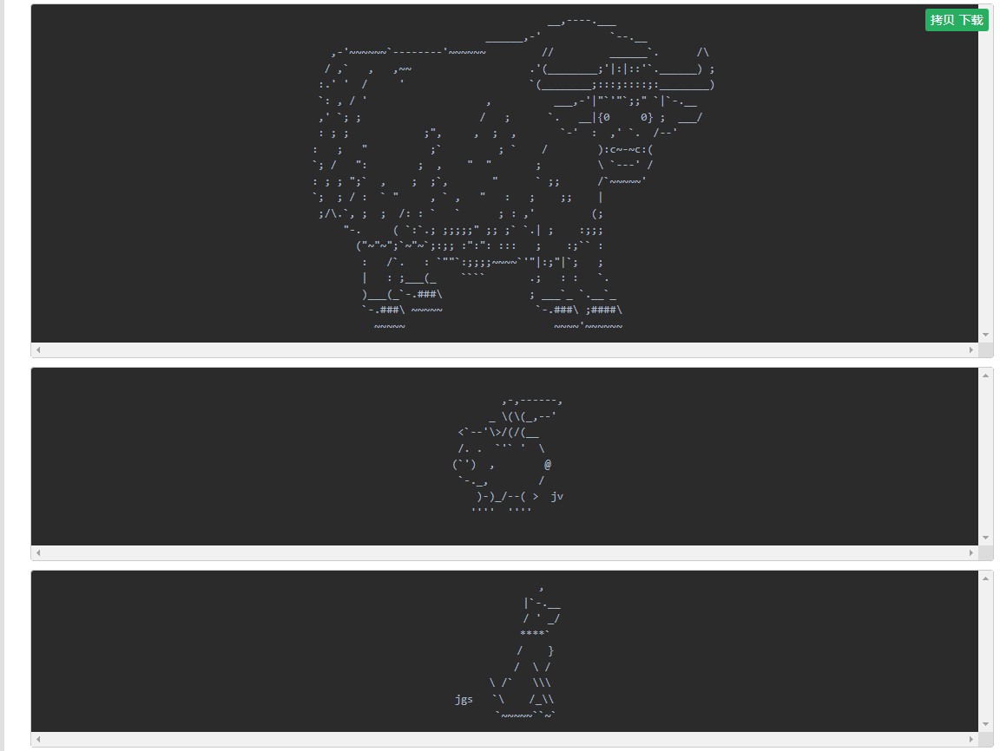

> 网址: www.bootschool.net/ascii-art/animals


这样的网站断然是十分的多的，这里就不一一例举了。下面回到我们的重点，怎么在 LATEX 中使用这样的ASCII艺术。这里分为两种(这部分全是我抄的，因为本文的重点不在这部分，原文地址在文末 )：

- 彩色图
- 灰度图

这里只展示一下第一种类型，大概就像下面这样 ：
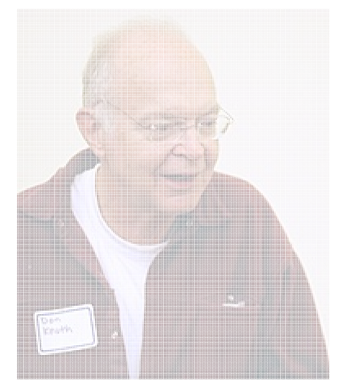

,当把这个图片放大之后就其实内部是这样的：
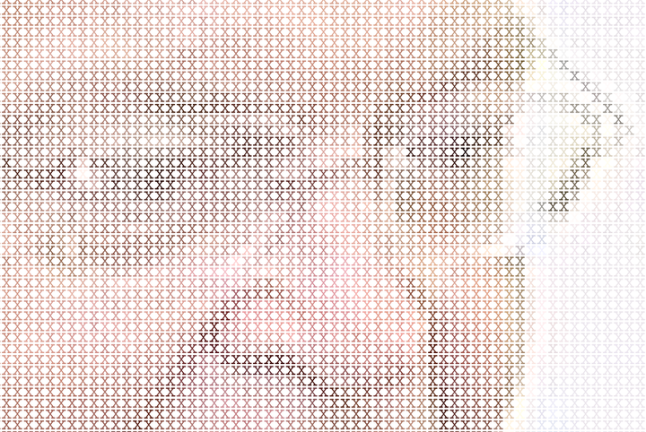

,它是由一个个的x组成的，每一个x的颜色不同从而构成了这样的一副图片;

> 我记得在早期，好像也有人使用这种ASCII的方法来打印图片，好像就是Knuth 本人.

本文的关注点是生成类似如下类型的图片 ， 相应的彩色图片的输出直接去看原始的文章即可:

> 注意：你可能需要注意一下你的imagemagick的命令行调用方式

原始的答主已经把左右的代码贴出来了，当然也可以看文末我整理好的代码 [ >_< ]

> 本文也主要是对原始的一个回答做出相应的补充，原始的作者之讲述了一种方式，但是着这种方式应该有部分人不能运行成功，于是补充一个相对现代的工具链

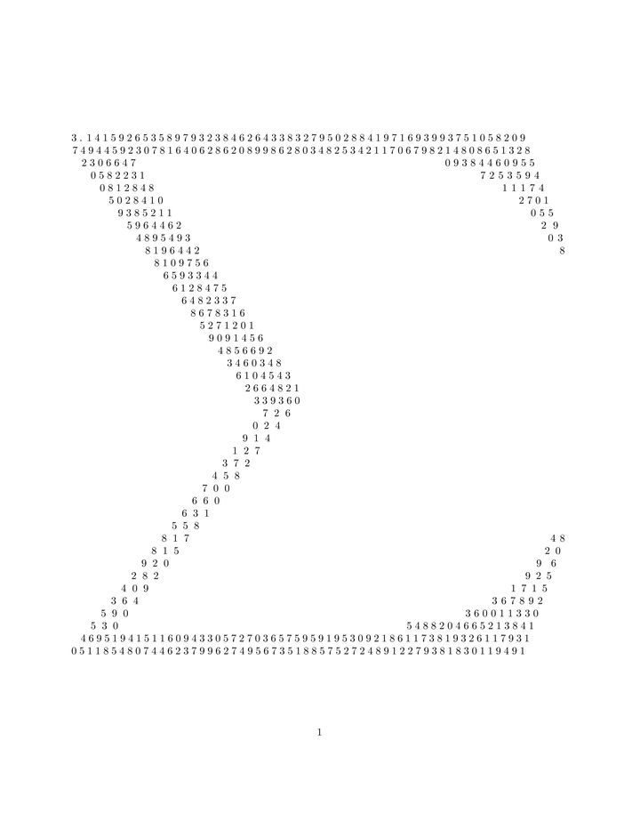


## 2. 正文

### 2.1 原始回答

原始的回答中，[karl ove hufthammer](https://tex.stackexchange.com/users/8540/karl-ove-hufthammer) 提到的方法如下:

- 首先使用 [xfig](https://www.xfig.org/) 绘制段落的shape（需要给对应的路径添加comment '+' 和 comment '-'）
- 然后使用 [fig2dev](https://linux.die.net/man/1/fig2dev) 把xfig导出的.fig文件转换为 .shape(这个.shape文件中就包含了  形式的段落形状的定义，下面会详细介绍)
- 最后在LaTeX文档中引入 [shapepar](https://www.ctan.org/pkg/shapepar) 宏包，再导入刚才的.shape文件中的形状定义，最后的使用方法如下

``` tex
\documentclass[10pt]{article}
\usepackage{graphicx}   
\usepackage{shapepar}
\input{sum.shape}
% in .shape file
% \def\sumpar#1{\shapepar{\sumshape}#1\par}

% in .tex source
\begin{document}
    \sumpar{<your text>}
\end{document}
```

这种方法是肯定可行的，但是想要成功的复现出来你可能会遇到如下困难：

- xfig无法正确安装（或者自己无法编译）
- fig2dev无法正确安装（或者自己无法编译）
- 复杂的形状,比如上述的  符号，很难在xfig这个古老的软件中绘制出来

这里对原始的方法做一些note

- 关键程序安装

对于xfig, 我这里使用的程序是使用Arch Linux上的 yay 进行安装的

``` shell
yay -S xfig
```

对于 fig2dev 我这里也是使用Arch自带的包管理器 pacman 进行安装的

``` shell
sudo pacman -S fig2dev
```

一些额外的软件可以参见xfig官方网站

- 添加comment方法

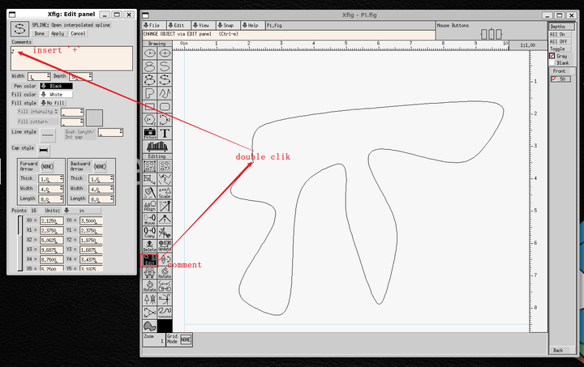


- 保存的Tips

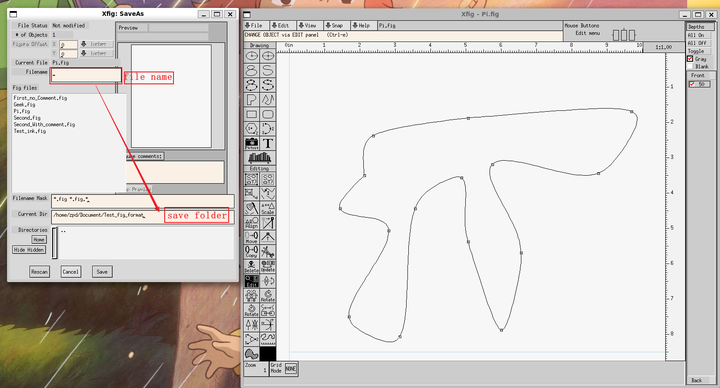


- .fig文件的编译

在命令行中使用如下的命令即可

``` shell
fig2dev -L shape -n <cmd after \def> <file name>.fig <output name>.shape

% 比如你定义为 -n sum，那么到时候你在LaTeX中使用的命令为 \sumpar<some text>
```

最终编译结果就像下面这样：
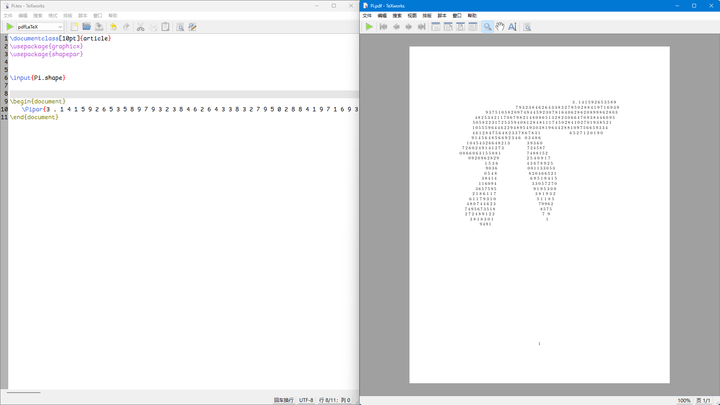


其实从上面也可以看出来，你如果想要在这样古老的一个软件上进行手绘，是很难得到一些复杂的图形的，于是我们下面采用更加现代的方法 Inkscape + [file convert](https://www.freefileconvert.com/) 

> 可以参见后文，使用autotrace进行 .svg 到 .fig 的转换

### 2.2 补充与修正

首先在Inkscape中插入   这个符号，取消它的填充，设置对应的stoke style (其实关系不大)，构建方法如下
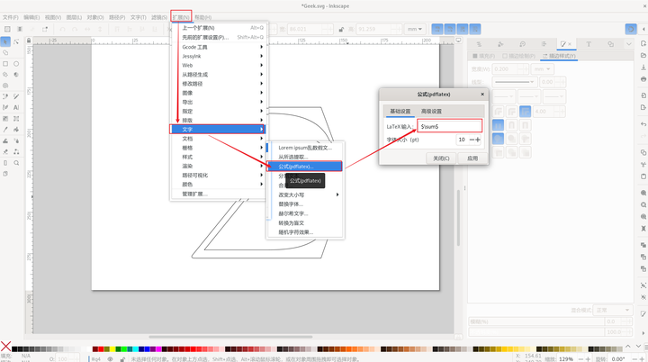


,然后经过调整，你就可以得到如下的符号
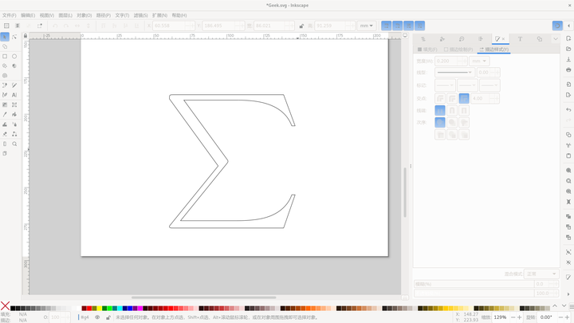


最后导出为svg。至此，我们就需要使用哪个在线网站 [file convert](https://www.freefileconvert.com/) 把我们导出的 .svg 文件转为 .fig文件，

使用方法如下:
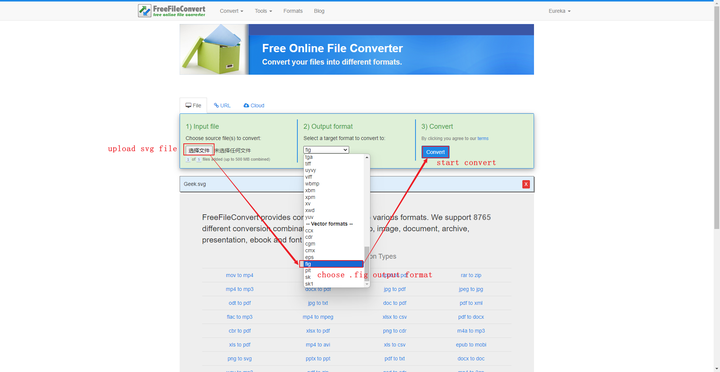


但是我们还没有完成我们的 .fig 文件制作，很显然我们缺少了添加 comment 这一步，这一步也很简单，按照如下步骤操作即可：

- 替换 .fig 文件按前面的 '导言区'

我们刚才下载下来的 .fig 文件长这样

``` text
#FIG 3.2 UniConvertor 2.0 sk1project.net
Portrait
Center
Inches
Custom
100.00
Single
-1
1200 2
2 3 0 1 0 -1 50 -1 -1 0.0 0 0 -1 0 0 239
	 4504 5766 2973 7654 2962 7667 2953 7678 2949 7683 2946 7687
	 2943 7691 2940 7695 2939 7697 2938 7698 2938 7700 2937 7701
	 2936 7703 2935 7704 2935 7706 2934 7708 2934 7709 2934 7711
	 2933 7712 2933 7714 2933 7716 2933 7717 2933 7719 2933 7721
	 2933 7723 2933 7725 2933 7727 2933 7729 2934 7731 2934 7733
	 2934 7735 2935 7737 2935 7738 2936 7740 2936 7741 2937 7743
	 2938 7744 2939 7746 2939 7746 2940 7747 2940 7748 2940 7748
	 2941 7749 2942 7751 2944 7752 2945 7753 2946 7754 2947 7755
	 2949 7756 2950 7757 2951 7757 2953 7758 2954 7759 2956 7760
	 2958 7760 2960 7761 2961 7762 2963 7762 2967 7763 2971 7764
	 2976 7765 2980 7766 2990 7767 3001 7767 3026 7768 3054 7768
	 6614 7768 6985 6696 6877 6696 6867 6726 6855 6756 6843 6785
	 6829 6814 6814 6843 6799 6871 6782 6899 6765 6926 6747 6953
	 6728 6979 6708 7005 6687 7030 6665 7055 6643 7079 6619 7103
	 6595 7126 6570 7148 6545 7170 6518 7191 6491 7212 6463 7232
	 6435 7251 6406 7270 6376 7288 6345 7305 6314 7321 6283 7337
	 6250 7352 6217 7366 6184 7380 6150 7392 6116 7404 6100 7410
	 6079 7417 6053 7426 6020 7435 5937 7456 5829 7478 5694 7499
	 5531 7516 5340 7528 5118 7532 3290 7532 4787 5685 4804 5660
	 4814 5643 4815 5642 4816 5640 4817 5638 4817 5637 4818 5635
	 4818 5634 4819 5632 4819 5631 4820 5629 4820 5627 4820 5626
	 4821 5624 4821 5623 4821 5621 4821 5619 4821 5617 4821 5614
	 4821 5610 4821 5608 4820 5605 4820 5604 4820 5602 4820 5601
	 4819 5600 4819 5598 4819 5597 4818 5596 4818 5594 4816 5591
	 4814 5588 4812 5584 4809 5580 4803 5570 4794 5556 3398 3641
	 5097 3641 5303 3644 5541 3658 5669 3672 5799 3692 5864 3705
	 5930 3720 5996 3736 6061 3755 6125 3777 6189 3800 6252 3827
	 6314 3856 6344 3871 6374 3888 6403 3905 6432 3923 6461 3942
	 6489 3961 6516 3982 6543 4003 6570 4025 6596 4048 6621 4072
	 6645 4096 6669 4122 6692 4149 6714 4176 6736 4205 6757 4234
	 6777 4265 6796 4297 6814 4329 6831 4363 6848 4398 6863 4434
	 6877 4471 6985 4471 6614 3466 3054 3466 3033 3466 3014 3467
	 3006 3467 2998 3468 2991 3468 2984 3469 2981 3470 2978 3470
	 2975 3471 2972 3472 2970 3472 2967 3473 2965 3474 2962 3475
	 2960 3476 2958 3477 2957 3478 2956 3478 2955 3479 2954 3480
	 2954 3480 2953 3481 2952 3482 2951 3482 2950 3483 2949 3484
	 2949 3485 2948 3486 2947 3486 2947 3487 2946 3488 2945 3489
	 2945 3490 2944 3491 2944 3492 2943 3493 2942 3495 2941 3497
	 2940 3500 2939 3502 2938 3505 2938 3507 2937 3510 2937 3513
	 2936 3519 2935 3526 2933 3558 2933 3601 4504 5766
2 1 0 1 0 -1 50 -1 -1 0.0 0 0 -1 0 0 1
	 4504 5766
```

我们把 '导言区' 替换成如下的内容

``` text
#FIG 3.2  Produced by xfig version 3.2.9
#encoding: UTF-8
Landscape
Center
Inches
Letter
100.00
Single
-2
1200 2
```

然后在添加对应的comment内容(就是一条注释而已, '# +')， 最终得到的完整文件为

> 相应的路径的 comment - 操作，在对应的路径前面添加 '# -' 即可

``` text
#FIG 3.2  Produced by xfig version 3.2.9
#encoding: UTF-8
Landscape
Center
Inches
Letter
100.00
Single
-2
1200 2
# +
2 3 0 1 0 -1 50 -1 -1 0.0 0 0 -1 0 0 239
	 4504 5766 2973 7654 2962 7667 2953 7678 2949 7683 2946 7687
	 2943 7691 2940 7695 2939 7697 2938 7698 2938 7700 2937 7701
	 2936 7703 2935 7704 2935 7706 2934 7708 2934 7709 2934 7711
	 2933 7712 2933 7714 2933 7716 2933 7717 2933 7719 2933 7721
	 2933 7723 2933 7725 2933 7727 2933 7729 2934 7731 2934 7733
	 2934 7735 2935 7737 2935 7738 2936 7740 2936 7741 2937 7743
	 2938 7744 2939 7746 2939 7746 2940 7747 2940 7748 2940 7748
	 2941 7749 2942 7751 2944 7752 2945 7753 2946 7754 2947 7755
	 2949 7756 2950 7757 2951 7757 2953 7758 2954 7759 2956 7760
	 2958 7760 2960 7761 2961 7762 2963 7762 2967 7763 2971 7764
	 2976 7765 2980 7766 2990 7767 3001 7767 3026 7768 3054 7768
	 6614 7768 6985 6696 6877 6696 6867 6726 6855 6756 6843 6785
	 6829 6814 6814 6843 6799 6871 6782 6899 6765 6926 6747 6953
	 6728 6979 6708 7005 6687 7030 6665 7055 6643 7079 6619 7103
	 6595 7126 6570 7148 6545 7170 6518 7191 6491 7212 6463 7232
	 6435 7251 6406 7270 6376 7288 6345 7305 6314 7321 6283 7337
	 6250 7352 6217 7366 6184 7380 6150 7392 6116 7404 6100 7410
	 6079 7417 6053 7426 6020 7435 5937 7456 5829 7478 5694 7499
	 5531 7516 5340 7528 5118 7532 3290 7532 4787 5685 4804 5660
	 4814 5643 4815 5642 4816 5640 4817 5638 4817 5637 4818 5635
	 4818 5634 4819 5632 4819 5631 4820 5629 4820 5627 4820 5626
	 4821 5624 4821 5623 4821 5621 4821 5619 4821 5617 4821 5614
	 4821 5610 4821 5608 4820 5605 4820 5604 4820 5602 4820 5601
	 4819 5600 4819 5598 4819 5597 4818 5596 4818 5594 4816 5591
	 4814 5588 4812 5584 4809 5580 4803 5570 4794 5556 3398 3641
	 5097 3641 5303 3644 5541 3658 5669 3672 5799 3692 5864 3705
	 5930 3720 5996 3736 6061 3755 6125 3777 6189 3800 6252 3827
	 6314 3856 6344 3871 6374 3888 6403 3905 6432 3923 6461 3942
	 6489 3961 6516 3982 6543 4003 6570 4025 6596 4048 6621 4072
	 6645 4096 6669 4122 6692 4149 6714 4176 6736 4205 6757 4234
	 6777 4265 6796 4297 6814 4329 6831 4363 6848 4398 6863 4434
	 6877 4471 6985 4471 6614 3466 3054 3466 3033 3466 3014 3467
	 3006 3467 2998 3468 2991 3468 2984 3469 2981 3470 2978 3470
	 2975 3471 2972 3472 2970 3472 2967 3473 2965 3474 2962 3475
	 2960 3476 2958 3477 2957 3478 2956 3478 2955 3479 2954 3480
	 2954 3480 2953 3481 2952 3482 2951 3482 2950 3483 2949 3484
	 2949 3485 2948 3486 2947 3486 2947 3487 2946 3488 2945 3489
	 2945 3490 2944 3491 2944 3492 2943 3493 2942 3495 2941 3497
	 2940 3500 2939 3502 2938 3505 2938 3507 2937 3510 2937 3513
	 2936 3519 2935 3526 2933 3558 2933 3601 4504 5766
2 1 0 1 0 -1 50 -1 -1 0.0 0 0 -1 0 0 1
	 4504 5766
```

把这个文件作为figdev的输入文件，运行如下的命令(这里我保存为sum.fig)

``` shell
fig2dev sum.fig -L shape -n sum sum.shape
```

运行之后可以得到如下的输入信息
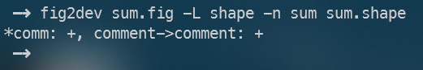


然后我们来看看最后的 `sum.shape` 文件里面都是一些什么东西

``` tex
\def\sumpar#1{\shapepar{\sumshape}#1\par}
\def\sumshape{%
{25.1235}%
{0.123457}b{0.864198}\\%
{0.123457}t{0.864198}{44.6914}\\%
{0.864198}t{0.246914}{45.58}\\%
{1.85185}t{0.123457}{46.0653}\\%
{2.34568}t{0.482396}{28.9003}st{29.3827}{16.9869}\\%
{2.34568}t{0.482396}{5.44353}t{29.3827}{16.9869}\\%
{2.46914}t{0.572131}{5.44364}t{32.3457}{14.0692}\\%
{2.71605}t{0.751601}{5.44386}t{33.9506}{12.5547}\\%
{2.96296}t{0.931071}{5.44408}t{35.5556}{11.0402}\\%
{3.08642}t{1.02081}{5.44419}t{36.2963}{10.3447}\\%
{3.33333}t{1.20028}{5.44442}t{37.1605}{9.57096}\\%
{3.45679}t{1.29001}{5.44453}t{38.0247}{8.75199}\\%
{3.7037}t{1.46948}{5.44475}t{38.7654}{8.1017}\\%
{3.95062}t{1.64895}{5.44497}t{39.5062}{7.45141}\\%
{4.32099}t{1.91815}{5.4453}t{40.3704}{6.72289}\\%
{4.5679}t{2.09762}{5.44552}t{41.1111}{6.07261}\\%
{4.93827}t{2.36683}{5.44586}t{41.8519}{5.46755}\\%
{5.30864}t{2.63603}{5.44619}t{42.5926}{4.86249}\\%
{5.80247}t{2.99497}{5.44663}t{43.3333}{4.30265}\\%
{6.2963}t{3.35391}{5.44707}t{44.0741}{3.74282}\\%
{7.03704}t{3.89232}{5.44774}t{45.0617}{3.02653}\\%
{7.90123}t{4.52046}{5.44851}t{45.9259}{2.47892}\\%
{8.64198}t{5.05887}{5.44918}t{46.5432}{2.13299}\\%
{9.62963}t{5.77675}{5.45006}t{47.4074}{1.63061}\\%
{10.3704}t{6.31516}{5.45073}t{47.9012}{1.40814}\\%
{11.2346}t{6.9433}{5.4515}t{48.2716}{1.35436}\\%
{12.0988}t{7.57144}{5.45228}t{48.642}{1.30058}\\%
{12.5926}t{7.93038}{5.45272}e{50.1235}\\%
{25.9259}t{17.6217}{5.46468}\\%
{26.7901}t{18.2499}{5.20691}\\%
{27.5309}t{18.7883}{4.29813}\\%
{28.5185}t{19.5062}{2.77945}\\%
{40}t{10.2116}{2.76467}b{48.8889}\\%
{40}t{10.2116}{2.76467}t{48.8889}{1.23457}\\%
{40.7407}t{9.61199}{2.76372}t{48.5185}{1.34879}\\%
{41.4815}t{9.01235}{2.76276}t{48.2716}{1.33956}\\%
{42.2222}t{8.4127}{2.76181}t{47.9012}{1.45379}\\%
{43.2099}t{7.61317}{2.76054}t{47.284}{1.72955}\\%
{44.1975}t{6.81364}{2.75927}t{46.5432}{2.12876}\\%
{45.0617}t{6.11405}{2.75816}t{45.679}{2.69413}\\%
{45.9259}t{5.41446}{2.75704}t{44.6914}{3.38295}\\%
{46.6667}t{4.81482}{2.75609}t{43.7037}{4.11446}\\%
{47.284}t{4.31511}{2.75529}t{42.716}{4.88866}\\%
{47.7778}t{3.91534}{2.75466}t{41.8519}{5.58209}\\%
{48.1481}t{3.61552}{2.75418}t{41.1111}{6.19476}\\%
{48.5185}t{3.3157}{2.75371}t{40.2469}{6.93089}\\%
{48.7654}t{3.11581}{2.75339}t{39.5062}{7.58625}\\%
{49.0123}t{2.91593}{2.75307}t{38.642}{8.36506}\\%
{49.3827}t{2.61611}{2.75259}t{37.284}{9.59502}\\%
{49.6296}t{2.41623}{2.75228}t{35.9259}{10.8677}\\%
{50}t{2.1164}{2.7518}t{34.1975}{12.468}\\%
{50.1235}t{2.01646}{2.75164}t{32.2222}{14.4006}\\%
{50.2469}t{1.91652}{2.75148}t{29.8765}{16.7036}\\%
{50.3704}t{1.81658}{2.75132}t{27.1605}{19.3769}\\%
{50.3704}t{1.81658}{2.75132}jt{4.5679}{41.9695}\\%
{51.8519}t{0.617284}{45.4079}\\%
{52.5926}t{0.123457}{45.6456}\\%
{53.2099}t{0.864198}{44.6914}\\%
{53.2099}e{45.5556}%
}
```

最后把这个 `sum.shape` 文件和你的 `.tex` 文件放在同一路径下，在 `.tex` 文件中粘贴如下代码:

``` tex
\documentclass[10pt]{article}
\usepackage{graphicx}   
\usepackage{shapepar}
\input{sum.shape}


\begin{document}
\sumpar{3 . 1 4 1 5 9 2 6 5 3 5 8 9 7 9 3 2 3 8 4 6 2 6 4 3 3 8 3 2 7 9 5 0 2 8 8 4 1 9 7 1 6 9 3 9 9 3 7 5 1 0 5 8 2 0 9 7 4 9 4 4 5 9 2 3 0 7 8 1 6 4 0 6 2 8 6  2 0 8 9 9 8 6 2 8 0 3 4 8 2 5 3 4 2 1 1 7 0 6 7 9 8 2 1 4 8 0 8 6 5 1 3 2 8 2 3 0 6 6 4 7 0 9 3 8 4 4 6 0 9 5 5 0 5 8 2 2 3 1 7 2 5 3 5 9 4 0 8 1 2 8 4 8 1  1 1 7 4 5 0 2 8 4 1 0 2 7 0 1 9 3 8 5 2 1 1 0 5 5 5 9 6 4 4 6 2 2 9 4 8 9 5 4 9 3 0 3 8 1 9 6 4 4 2 8 8 1 0 9 7 5 6 6 5 9 3 3 4 4 6 1 2 8 4 7 5 6 4 8 2 3 3  7 8 6 7 8 3 1 6 5 2 7 1 2 0 1 9 0 9 1 4 5 6 4 8 5 6 6 9 2 3 4 6 0 3 4 8 6 1 0 4 5 4 3 2 6 6 4 8 2 1 3 3 9 3 6 0 7 2 6 0 2 4 9 1 4 1 2 7 3 7 2 4 5 8 7 0 0 6  6 0 6 3 1 5 5 8 8 1 7 4 8 8 1 5 2 0 9 2 0 9 6 2 8 2 9 2 5 4 0 9 1 7 1 5 3 6 4 3 6 7 8 9 2 5 9 0 3 6 0 0 1 1 3 3 0 5 3 0 5 4 8 8 2 0 4 6 6 5 2 1 3 8 4 1 4 6  9 5 1 9 4 1 5 1 1 6 0 9 4 3 3 0 5 7 2 7 0 3 6 5 7 5 9 5 9 1 9 5 3 0 9 2 1 8 6 1 1 7 3 8 1 9 3 2 6 1 1 7 9 3 1 0 5 1 1 8 5 4 8 0 7 4 4 6 2 3 7 9 9 6 2 7 4 9  5 6 7 3 5 1 8 8 5 7 5 2 7 2 4 8 9 1 2 2 7 9 3 8 1 8 3 0 1 1 9 4 9 1}
\end{document}
```

最后使用 pdflatex 或者是 xelatex 编译均可，结果如下：
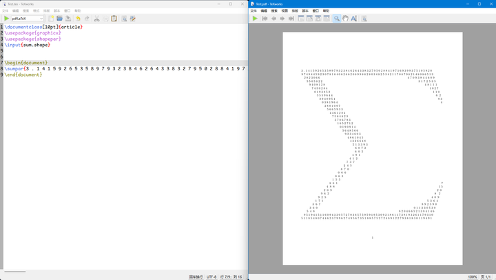


## 3. More Example

这里在举例一些更加复杂的例子, 包括我们之前提到的 comment + 和 comment - 的操作.

inkscape 中的图形为


编译结果为：

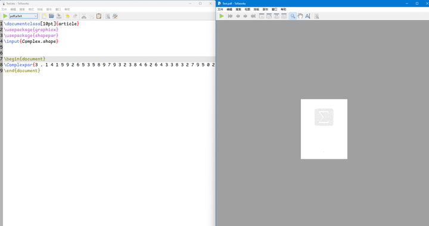


完整的 .fig 代码

``` text
#FIG 3.2  Produced by xfig version 3.2.9
#encoding: UTF-8
Landscape
Center
Inches
Letter
100.00
Single
-2
1200 2
# -
2 3 0 1 0 -1 50 -1 -1 0.0 0 0 -1 0 0 239
	 4713 5719 3182 7607 3171 7620 3161 7632 3158 7636 3154 7641
	 3152 7644 3149 7648 3148 7650 3147 7651 3146 7653 3145 7655
	 3145 7656 3144 7658 3144 7659 3143 7661 3143 7662 3142 7664
	 3142 7666 3142 7667 3142 7669 3142 7671 3142 7672 3142 7674
	 3142 7676 3142 7679 3142 7681 3142 7683 3142 7684 3143 7686
	 3143 7688 3143 7690 3144 7691 3144 7693 3145 7695 3146 7696
	 3147 7698 3147 7699 3148 7700 3148 7700 3149 7701 3149 7702
	 3150 7703 3151 7704 3152 7705 3153 7706 3155 7707 3156 7708
	 3157 7709 3159 7710 3160 7711 3162 7712 3163 7712 3165 7713
	 3166 7714 3168 7714 3170 7715 3172 7716 3176 7717 3180 7717
	 3184 7718 3189 7719 3199 7720 3210 7721 3234 7721 3263 7721
	 6823 7721 7194 6649 7086 6649 7076 6679 7064 6709 7051 6739
	 7038 6768 7023 6796 7008 6824 6991 6852 6974 6879 6955 6906
	 6936 6932 6916 6958 6895 6984 6874 7008 6851 7032 6828 7056
	 6804 7079 6779 7102 6753 7123 6727 7145 6700 7165 6672 7185
	 6644 7205 6614 7223 6585 7241 6554 7258 6523 7275 6491 7290
	 6459 7305 6426 7319 6393 7333 6359 7346 6324 7357 6309 7363
	 6288 7371 6261 7379 6229 7389 6146 7410 6038 7431 5903 7452
	 5740 7469 5548 7481 5326 7485 3499 7485 4996 5638 5012 5613
	 5023 5597 5024 5595 5025 5593 5025 5592 5026 5590 5027 5588
	 5027 5587 5028 5585 5028 5584 5028 5582 5029 5581 5029 5579
	 5029 5577 5029 5576 5029 5574 5030 5572 5030 5570 5030 5567
	 5029 5564 5029 5561 5029 5558 5029 5557 5029 5556 5028 5554
	 5028 5553 5028 5552 5027 5550 5027 5549 5026 5548 5025 5545
	 5023 5541 5021 5538 5018 5533 5011 5523 5003 5510 3607 3595
	 5306 3595 5512 3597 5750 3612 5877 3626 6007 3646 6073 3658
	 6139 3673 6204 3690 6269 3709 6334 3730 6398 3754 6461 3780
	 6522 3809 6553 3825 6582 3841 6612 3858 6641 3876 6669 3895
	 6698 3914 6725 3935 6752 3956 6778 3978 6804 4001 6829 4025
	 6854 4050 6878 4075 6901 4102 6923 4130 6945 4158 6965 4188
	 6985 4218 7004 4250 7023 4283 7040 4316 7056 4351 7072 4387
	 7086 4424 7194 4424 6823 3419 3263 3419 3242 3420 3223 3420
	 3214 3420 3207 3421 3199 3422 3193 3422 3190 3423 3187 3424
	 3184 3424 3181 3425 3178 3426 3176 3426 3173 3427 3171 3428
	 3169 3429 3167 3430 3166 3431 3165 3432 3164 3432 3163 3433
	 3162 3434 3161 3434 3161 3435 3160 3436 3159 3436 3158 3437
	 3157 3438 3157 3439 3156 3440 3155 3441 3155 3441 3154 3442
	 3153 3443 3153 3444 3152 3445 3152 3446 3151 3448 3150 3451
	 3149 3453 3148 3455 3147 3458 3146 3461 3146 3463 3145 3466
	 3144 3472 3143 3479 3142 3512 3142 3554 4713 5719
2 1 0 1 0 -1 50 -1 -1 0.0 0 0 -1 0 0 1
	 4713 5719
# +
2 3 0 1 0 -1 50 -1 -1 0.0 0 0 -1 0 0 165
	 2357 2307 2340 2307 2322 2308 2304 2309 2287 2310 2270 2312
	 2253 2315 2235 2317 2219 2321 2185 2328 2153 2338 2121 2348
	 2089 2361 2059 2375 2029 2390 2000 2406 1972 2424 1945 2443
	 1919 2464 1894 2486 1871 2508 1848 2532 1826 2557 1806 2583
	 1786 2610 1769 2638 1752 2667 1737 2697 1723 2727 1711 2758
	 1700 2790 1691 2823 1683 2856 1680 2873 1677 2890 1674 2907
	 1672 2925 1671 2942 1670 2960 1669 2977 1669 2995 1669 8055
	 1669 8073 1670 8090 1671 8108 1672 8125 1674 8142 1677 8160
	 1680 8177 1683 8193 1691 8227 1700 8259 1711 8291 1723 8323
	 1737 8353 1752 8383 1769 8412 1786 8440 1806 8467 1826 8493
	 1848 8518 1871 8542 1894 8564 1919 8586 1945 8606 1972 8626
	 2000 8643 2029 8660 2059 8675 2089 8689 2121 8701 2153 8712
	 2185 8721 2219 8729 2235 8732 2253 8735 2270 8738 2287 8740
	 2304 8741 2322 8742 2340 8743 2357 8743 7980 8743 7998 8743
	 8016 8742 8033 8741 8051 8740 8068 8738 8085 8735 8102 8732
	 8119 8729 8152 8721 8185 8712 8217 8701 8248 8689 8279 8675
	 8308 8660 8337 8643 8365 8626 8392 8606 8418 8586 8443 8564
	 8467 8542 8490 8518 8511 8493 8532 8467 8551 8440 8569 8412
	 8586 8383 8601 8353 8615 8323 8627 8291 8638 8259 8647 8227
	 8655 8193 8658 8177 8661 8160 8663 8142 8665 8125 8667 8108
	 8668 8090 8668 8073 8669 8055 8669 2995 8668 2977 8668 2960
	 8667 2942 8665 2925 8663 2907 8661 2890 8658 2873 8655 2856
	 8647 2823 8638 2790 8627 2758 8615 2727 8601 2697 8586 2667
	 8569 2638 8551 2610 8532 2583 8511 2557 8490 2532 8467 2508
	 8443 2486 8418 2464 8392 2443 8365 2424 8337 2406 8308 2390
	 8279 2375 8248 2361 8217 2348 8185 2338 8152 2328 8119 2321
	 8102 2317 8085 2315 8068 2312 8051 2310 8033 2309 8016 2308
	 7998 2307 7980 2307 2357 2307
```

所以有了inkscape这个强大的工具，par in any shape in possible. 除此之外，还可以参考

## 4. 本文源码仓库

## 5. 结语

这次全程使用vim操作，的确很舒服
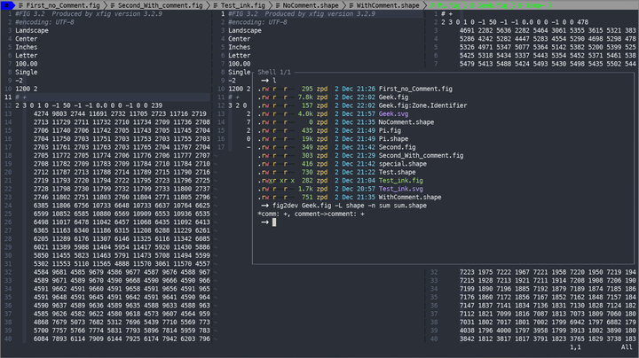
