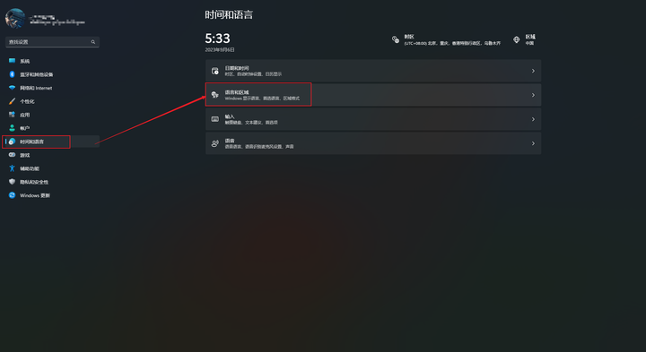
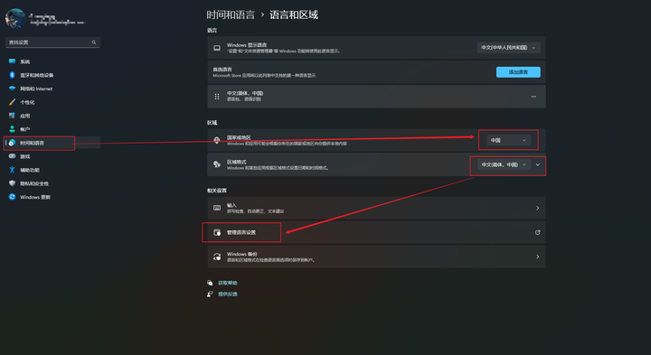
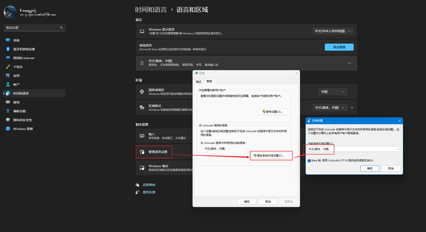
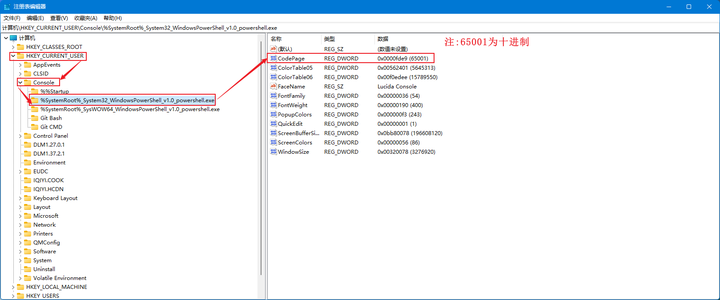
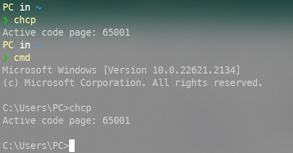
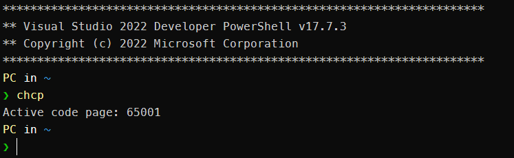
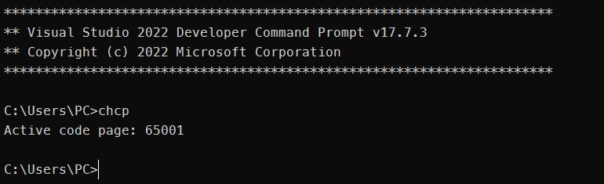
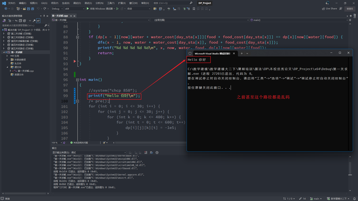
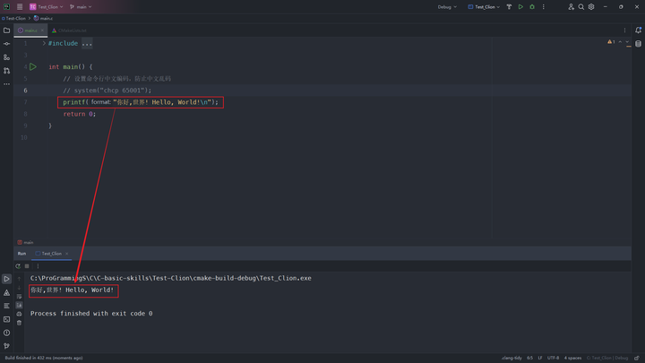

## 1. 前言
什么默认的gcc/g++编译出来中文乱码，或者是使用集成开发环境Visual Studio, Clion, Vscode乱码，有叫你改注册表的，有叫你引用库的，有叫你修改文件编码的，... 我也折腾了很久，发现了如下的三个方法:

1. 更改系统语言/区域设置
2. 临时更改终端的Active code page
3. 注册表更改终端的Active code page

> 本文没有讲到所谓的文件保存编码问题，若以下方法不管用，请参见其余网络内容，见谅

## 2. 方法一









然后重启电脑，一切正常。

## 3. 修改注册表

这个可以看作上面操作的一个偏方，这第一种方法的本质相同，都是修改部分终端的 Active code page为65001，但是第一种方法会把你的所有终端的 Active code page设为65001，所以想要使用英文系统的可以使用第二个方法。




> 1. 一般情况下这个CodePage值得你自己添加 2. 对应的想要修改cmd的对应值，需要新建一个

## 4. 临时设置

第三种方法就是引入对应的库windows.h, stdlib.h然后执行，然后执行如下命令即可:

```
system("chcp 65001");
```

然后你的VS或者是Clion就可以正常printf输出中文了，不用去修改什么注册表和系统语言设置。

## 5. 检验方法

只需要在下面的终端中输入对应的命令

```
chcp
```

即可查看，我自己修改后的各终端结果：








此时的VS和Clion的输出窗口也都正常了




