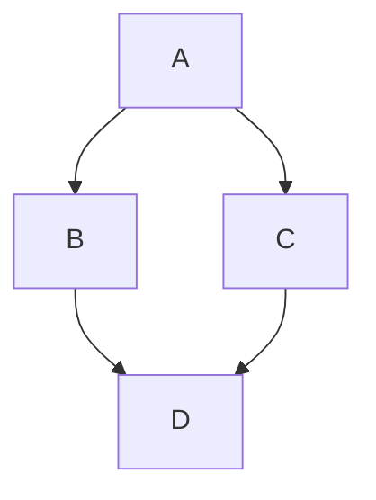

## 1. 定理内容

**Darboux定理**：对任意在$[a,b]$上有界的函数 $f(x)$,恒有:  
$$
\lim_{\lambda\to0}\bar{s}(P)=L\quad\lim_{\lambda\to0}\underline{s}(P)=l
$$

1. $P$是$[a,b]$上的任意划分，$P:a=x_0<x_1<x_2<\cdots<x_{n-1}<x_n=b$; 
2. $\displaystyle\lambda=\max_{1\le i\le n}\Delta x_i$
3. $L=\inf\{\overline{s}(P)|\overline{s}(P)\in\overline{S}\}$ 
4. $\overline{S}$是一切可能划分的得到的Darboux大和的集合



这里的达布定理不是导数里边的那个达布定理, 导数中的Darboux Theorem表述如下:
$$
\begin{aligned}
&\text{Let }I\text{ be a closed intenva},f{:}I\to\mathbb{R}\text{ be a real-valued differentiable function. Then }f^{\prime}\text{ has the intermediate value property. If }a\mathrm{~and~}b\mathrm{~are} \\
&\text{points in }I\mathrm{~with~}a<b,\text{then for every }y\mathrm{~between~}f^{\prime}(a)\mathrm{~and~}f^{\prime}(b)\text{, there exists an }x\mathrm{~in~}[a,b]\text{ such that }f^{\prime}(x)=y.
\end{aligned}
$$


## 2. 思路分析
我们这里仅讨论`上和`的极限，`下和`的讨论也是完全类似的.

### 2.1 证明极限
想要证明一个极限，比如 $\lim\limits_{x\to 1}x=1$ ,我们需要用$\varepsilon-\delta$语言来规范的描述.

$$
\forall\varepsilon>0,\exists\delta>0,\mathrm{s.t}\left|x-1\right|<\delta\text{时,有}\left|f(x)-1\right|<\varepsilon 
$$

### 2.2 类比证明
把上面的证明过程类比到这个情况下即为: 

$$
\begin{array}{c}
\boxed{
\begin{array}{c}
    1.\;\forall\varepsilon>0,\exists \delta>0\\
    \downarrow\\
    \text{此时必然存在一个划分$P$满足这个区间的性质}
\end{array}}\\[4em]
\boxed{
    \begin{array}{c}
    2.\;{\rm s.t.}|\lambda-0|<\varepsilon \\
    \downarrow\\
    \text{这里比较特殊，因为区间长度$\lambda>0$,所以就是$\lambda<\varepsilon$}
    \end{array}}\\[4em]
\boxed{
    \begin{array}{c}
    3.\;|\overline{s}(P)-L|<\varepsilon \\
    \downarrow\\
    \text{这里比较特殊，因为大和不增的性质(下边会证明)，所以}\\
    \overline{s}(P)-L>0>-\varepsilon,\text{故只需证}\overline{s}(P)-L<\varepsilon
    \end{array}
}
\end{array}
$$

 

### 2.3 着手证明

现在着手分析怎么证明 $\overline{S}(P)-L<\varepsilon$,利用确界原理,这里
$$
\overline{S}(P)>(b-a)\cdot\min_{x\in[a,b]}f(x)
$$
所以$\overline{S}(P)$有下确界,记为$L$,接着我们做变换
$$
\overline{S}(P)-L=\overline{S}(P)-\overline{S}(P^{'})+\overline{S}(P^{'})-L
$$

此时后边的 $\overline{S}(P^{\prime})-L$ 正是确界的性质

> * 其实也不能说这个思路每个人都能够想的到，但是毕竟是学习数学分析的人，这还算得上是常规套路
> * 你们以前应该用的很多这种方法吧，比如单调有界原理的证明里边

现在由确界原理可以知道
$$
\forall\varepsilon>0,0<\overline{S}(P^{'})-L<\frac{\varepsilon}{2}
$$

因而现在我们只要能够解决
$$
\overline{S}(P)-\overline{S}(P^{'})<\frac\varepsilon2
$$

> * 在这里取$\frac{\varepsilon}{2}$主要是为了美观，你可以取为其它的合理的值
> * 这也是为什么我要把 $\overline{S}(P)-L$ 拆开:不然这么好一个确界性质摆在那里不用就太可惜了吧.其实下边我们还要充分
> 运用 $\overline{S}(P)$ 的相关性质，因为$\lambda<\varepsilon$就是一个我们证明能够用到的条件, 这里你可以认为$\lambda$与$P$是对应的.

### 2.4 证明目标
现在我们就只需要证明 
$$
\overline{S}(P)-\overline{S}(P^{'})<\frac\varepsilon2
$$

你可以想一想我们还有一个满足 $\lambda<\delta$ 所对应的划分$P$还没有使用，现在就要开始使用划分$P$的相关性质了.但是因为$\overline{S}(P)$和$\overline{S}(P')$中的两个划分并没有很强的联系，所以我们又可以又一个常规的操作:把划分$P'$插入到划分$P$中，
得到（构造）划分$P^*$, 此时即可以利用到大和不增的性质：
$$
\overline{S}(P^*)<\overline{S}(P),\quad\overline{S}(P^*)<\overline{S}(P^{^{\prime}})
$$

现在把
$$
\overline{S}(P^*)<\overline{S}(P),\quad\overline{S}(P^*)<\overline{S}(P^{^{\prime}})
$$

这两个东西塞到
$$
\overline{S}(P)-\overline{S}(P^{^{\prime}})<\frac\varepsilon2
$$

里边了,于是即证明:
$$
\overline{S}(P)-\overline{S}(P^{*})<\frac\varepsilon2
$$

这里能够塞进去是因为前面有大和不增的性质，即:
$$
\overline{S}(P)-\overline{S}(P^*)+\overline{S}(P^*)-\overline{S}(P^{^{\prime}})<\frac\varepsilon2
$$

现在就只需要找到这样的$\delta$满足当$\lambda<\delta$时, 满足如下的性质：
$$
\overline{S}(P)-\overline{S}(P^*) <\frac\varepsilon2
$$

由于我们不知道划分$P'$是怎么插入划分$P$中的，所以我们边取以一种比较特殊的插入方式，将$x_1,x_2,\cdots,x_{p-1}$这$(P-1)$个点插入每个区间$(x_{i-1},x_i)$中. 

> * $\overline{S}(P^*)-\overline{S}(P^*)$二者的差可以看成是一个关于$\delta$的表达式，我们需要反求出$\varepsilon$,即可完成最终的证明
> * 此时$x_0$与$x_p$就会和两个端点重合,且每个$(x_{i-1},x_i)$里只有一个点

他们二者的差可以看作是$(P-1)$个区间上差的求和，现在我们考虑$[x_{i-1},x_i]$这个区间。这个区间插入了点 $x_j$ ,令$M_i',M_i''$分别为区间$[x_{i-1},x_j], [x_j,x_i]$上的函数$f(x)$的上确界.令$M_i$为未插入$x_j$时的$f(x)$的上确界。于是$\overline{S}(P)-\overline{S}(P^*)$可以表示为:

$$
\begin{align*}\Delta_{i}  &= M_i(x_{i}-x_{i-1})-[{M_i}^{'}(x_{j^{'}}-x_{i-1})+{M_i}^{''}(x_{i}-x_{j^{'}})] \\[5pt]   &= M_i(x_{i}-x_{j^{'}}+x_{j^{'}}-x_{i-1})-[{M_i}^{'}(x_{j^{'}}-x_{i-1})+{M_i}^{''}(x_{i}-x_{j^{'}})]\\[5pt]    &= (M_i-{M_i}^{'})(x_{i}-x_{j^{'}})+(M_i-{M_i}^{''})(x_{j^{'}}-x_{i-1})\\[5pt]   &\le (M_i-m_i)(x_{i}-x_{j^{'}})+(M_i-m_i)(x_{j^{'}}-x_{i-})\\[5pt]    &\le (M-m)(x_{i}-x_{j^{'}})+(M-m)(x_{j^{'}}-x_{i-})\\[5pt]    &\le (M-m)(x_{i}-x_{i-1})    \end{align*}
$$

于是就有
$$
(P-1)(M-m)(x_i-x_{i-1}) < \varepsilon
$$

> 注意：我们前边假设的划分$P$满足
> $$
>\lambda=\max_{1\leq i\leq n}(\Delta x_i)<\delta.
> $$

所以我们有
$$
(P-1)(M-m)(x_i-x_{i-1})<(P-1)(M-m)\delta 
$$

现在我们要令
$$
\overline{S}(P)-\overline{S}(P^*)
$$

即$(P-1)(M-m)\delta$, 解得
$$
\delta=\frac\varepsilon{2(P-1)(M-m)}
$$

这就是我们要寻找的$\delta$

### 2.5 思路完善 

由于由于我们采取了一种比较特殊的插入方式，将$x_1,x_2,\cdots$,$x_{P-1}$ 这$(P-1)$ 个点插入每个区间 $(x_{i-1},x_i)$ 中.
接下来我们用 $\delta$ 的范围的限制来实现我们的这种插值方法。只需要 $\Delta x_i<\Delta x_{j^{\prime}}$ 即可.

> 如果同一个小区间 $(x_{i-1},x_i)$ 内插入了两个点 $x_{j^{\prime}},x_{j-1^{\prime}}$ ,那么$\Delta x_{j^{\prime}}<\Delta x_i$ 了，于是就产生了矛盾。

这时我们只需要取
$$
\delta=\min\{\Delta x_{1^{^{\prime}}},\Delta x_{2^{^{\prime}}},\Delta x_{j3^{^{\prime}}},\ldots,\Delta x_{p^{^{\prime}}},\frac\varepsilon{2(P-1)(M-m)}\}
$$

目的实现

## 3. 完整证明
请参见[陈纪修-数学分析-第三版](https://annas-archive.org/md5/912cda82b51ef615e4f1cec4c4aa6fd5)238页.
