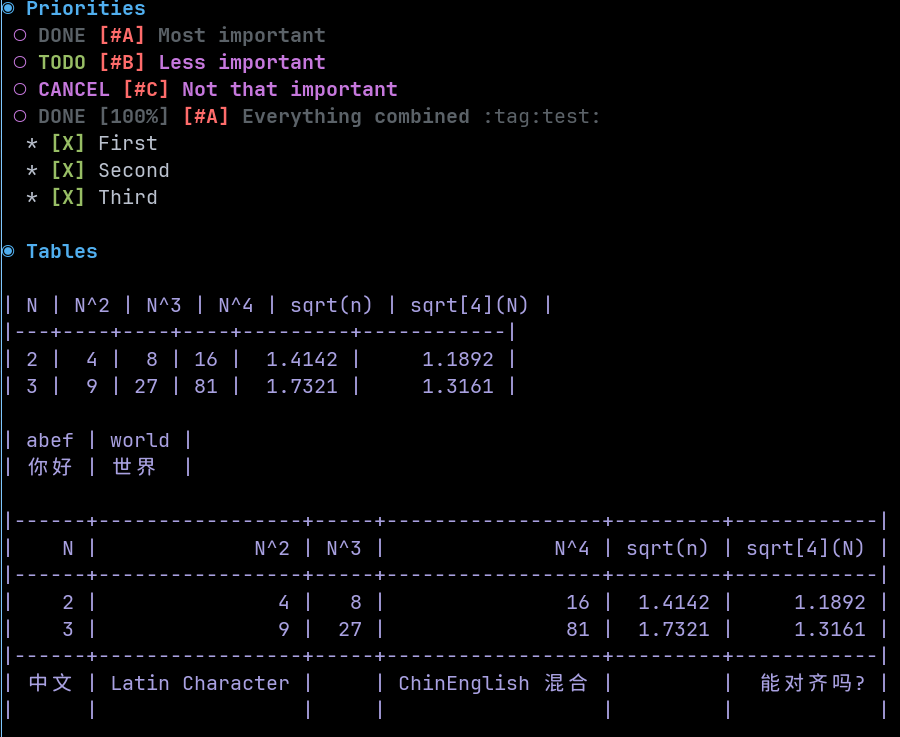
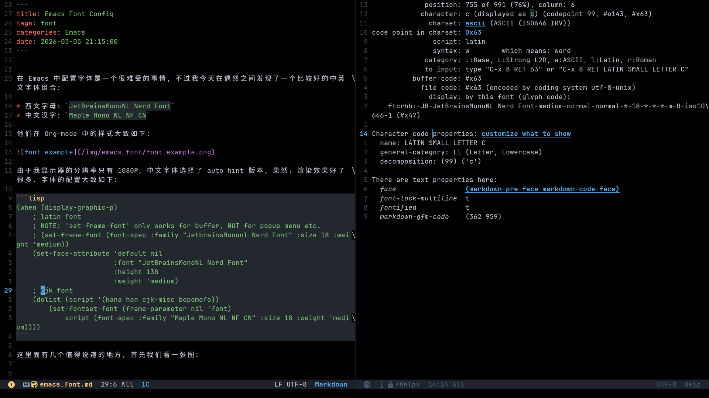

在 Emacs 中配置字体是一个很难受的事情, 不过我今天在偶然之间发现了一个比较好的中英文字体组合:

* 西文字母: `JetBrainsMonoNL Nerd Font`
* 中文汉字: `Maple Mono NL NF CN`

他们在 Org-mode 中的样式大致如下, 可以完美的对齐表格:



由于我显示器的分辨率只有 1080P, 中文字体选择了 auto hint 版本, 果然，渲染效果好了很多. 字体的配置大致如下:

```lisp
(when (display-graphic-p)
    ; latin font
    ; NOTE: 'set-frame-font' can NOT apply to popup menu etc.
    ; (set-frame-font (font-spec :family "JetbrainsMononl Nerd Font" :size 18 :weight 'medium))
    (set-face-attribute 'default nil
                        :font "JetBrainsMonoNL Nerd Font"
                        :height 138
                        :weight 'medium)
    ; cjk font
    (dolist (script '(kana han cjk-misc bopomofo))
        (set-fontset-font (frame-parameter nil 'font) 
            script (font-spec :family "Maple Mono NL NF CN" :size 18 :weight 'medium))))
```

这里面有几个值得说道的地方, 首先我们看一张图: 



里面有一个很奇怪的名字: `ftcrhb:-JB-JetBrainsMonoNL Nerd Font-medium-normal-normal-*-18-*-*-*-m-0-iso10646-1 (#x47)`, 这是什么东西 ? 

~~这个是旧时代的产物~~, 我们不用管，我们只需要使用 Emacs 提供的 `font-spec` 函数即可, 在指定 `:name(family)`, `:size`, `:weight` 等参数后, 它可以帮助我们生成上面这种复杂的字体名.

还有一个需要注意的地方, `set-face-attribute` 函数并没有 `:size` 这个参数, 它提供了 `:width` 和 `:height` 来控制 size. 

函数 `set-frame-font` 无法控制 `popup menu` 等的字体(也许应该起叫做 `child frame` ? 反正就是自动补全菜单对应的那个字体)， 所以我们才使用其底层函数 `set-face-attribute` , 控制所有的字体.

最后一个笔记: 上述的 `set-frame-font` 以及 `set-face-attribute` 都只能改变西文字体, 中文字体以及中文标点之类的就需要通过设置备用字体的方式来定义了.

如果你的 Emacs 是在终端打开的（加了 `-nw` 参数）, 此时 Emacs 中的字体由你的终端控制.
