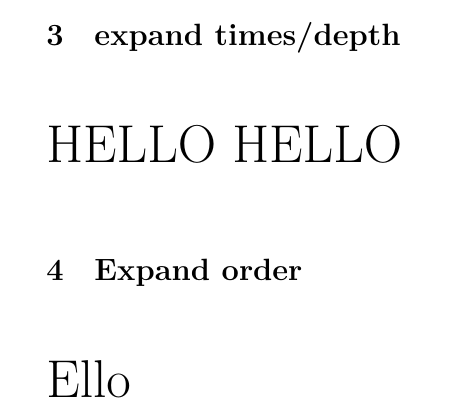
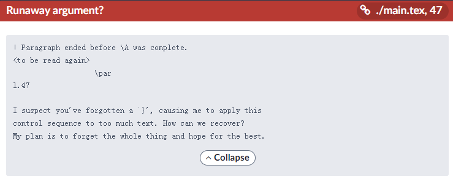

## 引入

宏展开是 $\rm\LaTeX$ 中一个很重要的概念，为了引入这个概念，参加下面的例子:

```latex
\def\cmda{abc}
\uppercase{\cmda}
```

那么你猜猜，这段代码输出的结果是什么? abc ? ABC ?  结果是 abc. 我不是都让它uppercase了么？为什么还是没有uppercase，反而是给我直接输出了? 

背后的原理就是宏展开, 下面我们来细说这个宏展开. 

> 个人感觉 `宏展开` 是可以和 `catcode` 并列的一个属于 $\rm\TeX$ 的黑魔法, 用好了可以写出一些很 unbelievable 的代码.

## LaTeX 2e

### simple example 

先讲一下\expandafter的作用:  expand the **first token** after the `{`.  所以下面的命令：

 ```latex
\uppercase\expandafter{\cmda}
 ```

会先展开 { 后的第一个token，这个token就是\cmda, 于是\cmda被展开为 'abc' , 从而就变成了 \uppercase{abc}了.  

> TeX only uppercases explicit character tokens (using the `\uccode` table)

The `\expandafter`  primitive expands the token after the next one, 所以上述的 the next one 就是 '{'， 而那个after的东西就是 \cmda. 

> 如果你的命令是 \uppercase\expandafter{abc\cmda}, 那么这个 \expandafter首先展开的其实是letter 'a',而不是macro \cmda. 毕竟\expandafter只负责展开它后面的第二个token (the token after the next one)

### expanding process
#### expand rule
一个\expandafter命令可以认为包含下面这三个步骤, 针对示例: \expandafter T\cmda

* 首先把第一个token 'T'保存 (read: a\cmda)
* 然后展开第二个token '\cmda' (\cmda -> abc)
* 随后把第一个token重新放到input中, 让TeX再次read (read:Tabc)

相当于一个\expandafter要吃两个参数,第一个参数先存着，第二个参数进行展开.  有了这个原理之后我们在看一看multiple \expandafter的情况. 一个具体的例子,参考自 Overleaf Understanding expandafter ,  网址如下:

```html
https://www.overleaf.com/learn/latex/Articles/How_does_%5Cexpandafter_work%3A_A_detailed_study_of_consecutive_%5Cexpandafter_commands
```

定义 $\text{T}_Y = \text{T}^1_{Y}\text{T}^2_{Y}\cdots\text{T}^N_{Y}$ , 然后 $\text{T}^1_{Y} = \text{T}^A_{Y1}\text{T}^B_{Y1}\text{T}^C_{Y1}$​，然后使用如下的命令:
$$
\backslash\text{expandafter}_1\backslash\text{expandafter}_2\backslash\text{expandafter}_3\text{T}_X\text{T}_Y
$$
下面我们来分析这个展开的过程:

* 首先TeX在read过程中，首先读到第一个token-$\backslash\text{expandafter}_1$，然后这个 $\backslash\text{expandafter}_1$ 把它后面的第一个 token-$\backslash\text{expandafter}_2$ save，把它后面的第二个token-$\backslash\text{expandafter}_3$ 展开(执行此token).

  * 现在我们进入到了$\backslash\text{expandafter}_3$展开的子过程 (这其实是一个子递归)
  * $\backslash\text{expandafter}_3$ 会把它后面的第一个token-$\text{T}_X$ save, 然后把它后面的第二个 token-$\text{T}_Y$ 展开
  * 最后这个子过程得到的token list为: $\text{T}_X\text{T}^1_{Y}\text{T}^2_{Y}\cdots\text{T}^N_{Y}$​ 

* $\backslash\text{expandafter}_3$子过程(子递归)结束，把前面 save 的 $\backslash\text{expandafter}_2$ 重新 re-inserted 进 input . 所以现在的 token list 为: $\backslash\text{expandafter}_2\text{T}_X\text{T}^1_{Y}\text{T}^2_{Y}\cdots\text{T}^N_{Y}$, TeX 继续处理这个 token list 的展开

* 对于 $\backslash\text{expandafter}_2$, 其后的第一个 token-$\text{T}_x$ 被 save, 其后的第二个token-$\text{T}^1_Y$ 被展开. 

* token-$\text{T}_Y^1$ 的展开结束，把前面 save 的token-$\text{T}_X$ 再次 re-inserted 进 input

* 这个过程结束得到的 token list 为: $\text{T}_X\text{T}^A_{Y1}\text{T}^B_{Y1}\text{T}^C_{Y1}\text{T}^2_{Y}\cdots\text{T}^N_{Y}$

* 这个 token list 便是最终的展开结果 ,  其实可以把最后的展开结果总结为 :
  $$
  \text{T}_X\langle\text{expansion of the first token in } \text{T}_Y\rangle \langle\text{ remaining tokens in }\text{T}_Y\rangle
  $$


把上面抽象的分析实体化为一个具体的实例如下:

```latex
% T_X
\def\foo#1{\textbf{#1}}

% T_Y
\def\abc{Hello}, \def\xyz{, World}
\def\bar{\abc\xyz}

% example
\expandafter\expandafter\expandafter\foo\bar
```

最终得到的结果就是: **H**ello, world

也就是只加粗了第一个字母 'H', 可以对比如下命令的结果来理解:

* \foo\bar: **Hello, World**
* \expandafter\foo\bar: **Hello**, world

这样也许你就能看出\expandafter到底有啥作用? 到底是怎么作用的 ?

> 别忘了 \expandafter 命令本身就可以看作一个 token

其实LaTeX2e中有一个比较好用的命令: `\@expandtwoargs`, 可以在命令把这两个参数吃进去时，提前展开这两个参数

> 突然感觉这个\expandafter 应该改名为\expandfirst了. 但是如果从整个命令的角度来看，就是 \uppercase operation expand after macro \cmda: means that \cmda will expand first.

#### read expand CS
现在分享一个怎么读懂别人`\expanafter` 代码的方法，这个案例是本博客后续会用到的一个回答，代码如下:

```latex
\protected\def\pempty{}

\edef\withedef{x\pempty x}
\expandafter\def\expandafter\withexpandafter\expandafter{\expandafter x\pempty x}

\tt
\meaning\pempty.

\meaning\withedef.

\meaning\withexpandafter.
```

我们重点分析那一长串的 \expandafter, 这里先给出我的一个分析方法: 

* 从左往右，依次划掉  “1个  \expandafter + 1个 token”

* 最后从后往前分析，把之前划掉的 token 一步一步的加回来(如果划掉的token是 \expanafter 也要加回来)

所以你可以按照如下过程分析:

```latex
% 划掉 token:\def
\expandafter\def\expandafter\withexpandafter\expandafter{\expandafter x\pempty x}

% 划掉 token:\withexpandafter
\expandafter\withexpandafter\expandafter{\expandafter x\pempty x}

% 划掉 token:{
\expandafter{\expandafter x\pempty x}

% 划掉 token:x
\expandafter x\pempty x}

% 最后expand \pempty
x}
```

因为最后的一个  \pempty 虽然被 \protected 保护了, 但是使用 \expandafter 仍然可以把它给展开. 于是我们一步一步的加回来被划掉的 token，过程如下:

```latex
x}

xx}

{xx}

\withexpandafter{xx}

\def\withexpandafter{xx}
```

所以最后得到的结果就是:

```
\protected macro:->.
macro:->x\pempty x.
macro:->xx.
```

第一个命令 \withedef 中的  \pempty 由于被 \protected 了，所以不能被 \edef 给展开. 

> 因为 \pempty  是一个macro，所以它和后面  'x' 之间的空格会被吃掉

#### write expand CS-I
我们当然不能局限于仅仅只是看懂expand，很多时候其实我们需要的是自己去写这个expand，知道了原理之后其实并不复杂. 就以前面的那个
``` latex 
\uppercase{abc\cmda}
```
为例. 为了一步一步的引导新手怎么写这个`\expandafter`，我们先从一个简单的例子开始. 下面这个代码片段是错误的:
``` latex 
\uppercase\expandafter{a\cmda}
```

怎么把这个展开写正确? 在此之前，让我先给出我总结这个规律：

在一个要被前一个`\expandafter`展开的 token 前添加一个`\expandafter`，可以让这个 token 后面的宏提前展开


在这里的情况就是：上述的expand会去展开字母 'a', 但是我们想要的是去展开 'a' 后面的 macro `\cmda`, 那么就需要让这个`\expandafter`的展开对象后移1个 token. 所以只需要在这个 'a' 的前面添加一个 `\expandafter` 即可，所以正确的代码为:
``` latex
\uppercase\expandafter{\expandafter a\cmda}
```

好，现在增大难度，有两个letters "ab", 如果直接像下面这样写:
``` latex
\uppercase\expandafter{b\expandafter a\cmda}
```

那么`\uppercese`后面的第一个 `\expanafter` 回去展开 'b', 和前面类似，我们需要展开的对象后移一个 token; 所以直接在 'b' 的前面加上一个 `\expandafter`, 正确的代码如下:
``` latex
\uppercase\expandafter{\expandable b\expandafter a\cmda}
```

所以对于三个letters下的正确展开代码就是:
``` latex
\uppercase\expandafter{\expandafter c\expandafter b\expandafter a\cmda}
```

所以最后看来：命令`\expandafter`展开 token 的过程就是以 token 为单位，从左至右，跳着展开的.



#### write expand CS-II
本节内容部分参考自问题: [多个\expandafter的展开过程是怎样的](https://www.zhihu.com/question/26916597)

**引入**
首先介绍三个宏的逆序展开，并且以此来总结一个规律用于之后的代码书写. 为了代码的书写方便，进行一定的记号规定
> * \let\ep\expanafter
> * `<A>` 表示宏 `\A` 的展开内容 

下面即为代码展开过程的详细说明:
``` latex
\let\ep\expandafter
\ep\ep\ep\A\ep\B\C
\ep\A\ep\B\C
\ep\B\C
<C>

<C>
\B<C>
\A\B<C>
\ep\A\B<C>
\A<B><C>
```

所以从上面可以发现一个总结出如下的展开规律:
* 位于**偶数**位置的 token 均被 save 了，位于**奇数**位置的则被展开了(跳着生效，跳着展开)
* 被展开的 `\ep` 直接扔掉，被展开的 `宏内容` 就保留下来

**逆向分析**
下面就运用上面总结的规律构造四个宏逆序展开的代码:我们要构造四个宏的逆序展开命令(\*)，那么四个宏对应的命令展开一次后就会得下面的这个序列(因为第四个宏最先被展开)：
``` latex
\ep\ep\ep\A\ep\B\C<D>      (**)
```
> 后续为了讲解的便利，我们把 (\*) 看作公式编号

又因为(\*)是跳着展开的，所以上述序列-(\*\*)就位于原序列(\*)的偶数位置. 为什么没有出现第四个宏? 因为第四个宏 `\D` 已经被展开为 `<D>` 了，而(\*\*)中仅包含被 save 的 token. 于是添加等数量的 `\exp` 即可确定原(\*)序列为：

``` latex
\ep\ep\ep\ep\ep\ep\ep\A\ep\ep\ep\B\ep\C\D   (*)
```

其中高亮部分就表示(\*\*)中的元素, 从而格式化后原逆序展开四个宏的代码为：
``` latex
\ep\ep\ep\ep\ep\ep\ep\A
\ep\ep\ep\B
\ep\C
\D
```
> 后续会说明为什么这样写代码，部分情况你可能需要在每一行的末尾加上 % 注释掉多余的空格.

**统计规律**
下面我们总结$n$个宏逆序展开的规律,得出这种类型宏的写法：
``` latex
% n = 2
\ep\A
\B

% n=3
\ep\ep\ep\A
\ep\B
\C

% n=4
\ep\ep\ep\ep\ep\ep\ep\A
\ep\ep\ep\B
\ep\C
\D

% n=5
\ep\ep\ep\ep\ep\ep\ep\ep\ep\ep\ep\ep\ep\ep\ep\A
\ep\ep\ep\ep\ep\ep\ep\B
\ep\ep\ep\C
\ep\D
\E
```

下面来统计每一行的 token 数目,下面不同 $n$ 值下统计的 token 数：
``` latex
% n=2
1+1+
1

% n=3
2+2+
1+1+
1

% n=4
4+4+
2+2+
1+1+
1

% n=5
8+8+
4+4+
2+2+
1+1+
1

% n=6
16+16+
8+8+
4+4+
2+2+
1+1+
1
```

所以逆序展开 $n$ 个宏总共所需的 tokens 数目 $N$ 为: 
$$
N = 1+2+\cdots+ 2^{n-1} = \sum_{i=1}^n 2^{n-1} \tag {1}
$$

然后统计每一行的 `\ep` 个数 $N_i$ 可以发现, 从下到上每一层 $i$ 的 `\ep` 数量为:        
$$
    N_i = 2^{i-1}-1 \tag{2}
$$

所以今后写这种宏就可以按照这种规律来写了，但是部分的问题可能还的具体分析吗，不可能情况下都是最简洁的.

**跳跃展开**
之前都是反正，正向顺序一词展开的, 那么如果是我要求展开顺序为:$B\rightarrow C\rightarrow A$ 呢? 你肯定不能把原始命令 (\*) 写成下面这样：
``` latex
\ep\ep\ep\A
\ep\C
\B
```

写成这样都不一定能运行，毕竟这些 token 的顺序不一定能够交换(也就是输入的格式必须为:`\A\B\C`). 那么怎么写? 我们采用逆向分析的方法, 一步一步的反推展开前的控制序列.

先不考虑 `\A` 命令的展开，因为是先展开 `\B`, 然后再展开 `\C`, 所以原控制序列 (\*) 展开一个宏后得到的结果 (\*\*) 肯定是:`\A\ep<B>\C`，再添加对应数量的 `\ep` 后可以得到展开前的原控制序列 (\*) 为：
``` latex  
\ep\A\ep\ep\B\C            (*)
```

但是现在还有一个问题:如果 TeX 再去读取 `\A\ep<B>\C` 这个结果，那么它会先去展开 `\A`, 所以我们的想办法让 `\A` 后面再展开。于是就必须在 `\A` 前要加上 `\ep`. 所以考虑到 `\A` 的展开顺序，那么展开后的命令 (\*\*) 为：
``` latex
\ep\A\ep<B>\C           (**)
```

具体到每一个宏，从左到右其展开前应为：
* `\ep\ep`：因第一个\ep保留，故它是偶数
* `\ep\A`： 保留
* `\ep\ep`：保留
* `\B\ep`： 因被展开，故奇数，后面加 `\ep` 
* `\ep\C`： 保留

所以最终的原始控制序列 (\*) 为：
``` latex
\ep\ep\ep\A\ep\ep\B\ep\ep\C     (*)

% format code
\ep\ep\ep\A 
\ep\ep\B
\ep\ep\C
```

**注意**
* 其中那个 `\ep` 的作用是为了占位，为了防止这个占位 `\ep` 对其他内容产生影响，可以考虑在 `\C` 后加上 `\empty` 等类似的宏.
* 如果不添加这个占位，那么最后的 `\C` 其实也可以保留下来(只要对应的宏 `\C` 能被保留，也就是保证其在原序列中位于偶数位置)，代码如下：
    ``` latex
    \ep\ep\ep\A\ep\ep\B\C       (*)
    
    % format code
    \ep\ep\ep\A
    \ep\ep\B 
    \C
    ```

**检验代码是否正确**
为了检验我们这个代码是否正确，我写了一个 mwe 用于测试，如下:
``` latex 
\documentclass{article}
\let\ep\expandafter
\def\A#1{\uppercase{#1}}
\def\B#1{}
\def\c{Hello}
\def\C{\c}

\begin{document}
\Huge
\section{expand times/depth}
% C → A
% \expanafter only expand a macro once (or depth=1)
\uppercase\ep\ep\ep{\C}
\uppercase\ep{\c}


\section{Expand order}
% C → B → A
\ep\ep\ep\A%
\ep\B%
\c

% B → C → A
% 由于 B先展开，所以就把\C整个给吃了，
% 从而导致\A没有接受到参数，所以报错
\ep\ep\ep\A%
\ep\ep\B%
\c
\end{document}
```

上述构造的三个宏 `\A, \B, \C` 的作用和效果见源代码注释. 这里的重点是检测宏的展开顺序，如果是 `\B` 最先展开，那么它必然会把后面的 `\C` 这个 token 给吃掉，但是 `\B` 什么都没有留下，也就导致了后续 `\A` 展开的过程中没有参数的传入，导致报错. 但是如果是 `\C` 先展开，那么 `\B` 就只会吃掉对一个的 `token` 'H', 后续的 `\A` 会把剩下的 `ello` 的第一个 token 给 uppercase 了. 

最后的运行结果如下:





**总结**
* 其实就是从结果去一步一步倒推上一步，在这个过程中考虑一下奇偶 `token`. 毕竟奇偶涉及到这个 `token` 是保留还是展开. 
* 如果多个 `\ep` 分布的较为稀疏，那么它们可能就是多个组，并不是一个组前面的命令 `\uppercase\ep{\cmda}` 和这里的 `\ep` 命令也是相同的，只不过上述的 `{` 就是这里的 `\A`, `\cmda` 就是上述的 `\B`.

> 突然发现之前也没有遇到这种多个宏展开的问题了

### noexpand and protect

如果你不想提前展开某些 macro 呢? 这个特性在 TeX 中其实是随处可见的，比如常用的 \thepage 命令，如果我们设置这个 macro 为具体的数值肯定是不行的，这个 \thepage 的数值得随着不同的页面变化. 可以认为这个 \thepage 里面就有一些 macro 没有被完全展开，它们只有在打印具体的页数的时候才会被完全展开. 

> 这个机制应该就叫做 lazy evaluation 吧, 类似于 mma 中的延迟赋值 f[x_] := x;

再来一个简单的例子:

```latex
\def\cmda{a}
\def\cmdb{\cmda}

\def\cmda{A}
```

上述定义的\cmdb就是没有被展开的例子, 当我 \cmda 重定义为"A"后，对应命令 \cmdb 也会被重定义为 "A".

这里可以介绍几个基本的命令:

* \noexpand: prevents doing an expansion of the next token (only **one** token).

* \unexpanded: e-TeX includes an additional primitive \unexpanded, which will prevent expansion of **multiple** tokens.

既然都说到这里的，就必须要提到这一系列命令了: \def, \gdef, \edef, \xdef. 以及对应的 e-TeX 拓展的命令\protected 了. 这里必须抄一段了，代码来自: [When to use \edef, \noexpand, and \expandafter?](https://tex.stackexchange.com/a/12148/294585) :

 The prefix `\protected`  can be used before `\def` and friends to define a protected, i.e. "robust" macro which doesn't expand inside an `\edef` context (like in `\write`). However, `\expandafter` does expand such a macro.

> * 这个所谓的  robust 在你们刚入门的时候应该也不理解吧
> * 所谓的 \xdef 可以看成是 \gdef 和 \edef 的结合体

### further reading

更多的详细教程可以参见: [Overleaf Articles](https://www.overleaf.com/learn/latex/Articles), 里面有挺多不错的东西. 

## LaTeX 3
### introduction
在LaTeX 3中是可以很方便的操控宏展开的，可以有如下的途径:

``` latex
\exp_not:N 

\exp_args:N⟨variant⟩ 

\exp_args_generate:n

\cs_generate_variation:Nn 

\prg_generate_conditional_variant:Nnn 
```


这5个命令用的好，就不用担心绝大部分的展开问题了. 第一个 `\exp_not:N` 可以控制一个宏不被 `e`-type 或者是 `x`-type 展开. 

### Expand

#### expandable variable   

部分用户也许经常在 interface 3 中看到诸如下面这样的 TeXhackers note, 下面这个例子是 `\tl_tail:N` 的 note:
> The result is returned within \exp_not:n, which means that the token list does not expand further when appearing in an e-type or x-type argument expansion

我们下面就写一个具体的例子来说明这个 note 到底说了怎样一回事:
``` latex
\tl_set:Nn \l_tmpa_tl {a\l_tmpb_tl}
\tl_set:Nn \l_tmpb_tl {b}
\tl_set:Nx \l_tmpd_tl {\l_tmpb_tl \tl_tail:N\l_tmpa_tl}
\cs_meaning:N \l_tmpd_tl
```

这段代码的结果是: `macro:->b\l_tmpb_tl`; 因为 `\tl_tail:N` 的结果是 `\l_tmpa_tl`, 而这个宏是 within `\exp_not:n` 的，也就是说:上面 `\tl_set:Nx` 这一行其实等价于:
``` latex
\tl_set:Nx \l_tmpd_tl {\l_tmpb_tl \exp_not:n {\l_tmpb_tl}}
```

这样我们的 `\l_tmpa_tl` 中的第二个 token 自然就是 `\l_tmpb_tl` 的原始定义了，而不是 `b`.

被 `\protected` 的宏也不会被 `e`-type 和 `x`-type 展开; 故而 `xparse` 提供的 `\NewDocumentCommand` 等一系列的命令定义的宏和被 `\noexpand` 修饰定义的宏无法被正常展开. 

注意区分 `\protect` 与 `\protected`; 这两者是没有关系的, `\protected` 的作用机制和 `\long` 的类似。还可以这样理解: 前者是 LaTeX 内部提供的为了弥补没有 `\protected` 宏的一个 trick，后者是 eTeX 提供的; 对于 `\protect`, 它会在 normal context 中，它会被展开为 `\relax`; 在部分特殊的 context 中会被定义为 `\noexpand\protect\noexpand`, 在部分的 context 中也会被定义为 `\noexpand`. 

详细信息,可以参见:[why do we need \protect](https://tex.stackexchange.com/a/4747/294585) (可以认为这个参考样例中的 `\protect` 起了一个传递作用，为了把 `\noexpand` 传递到第二个过程中；个人觉得也可以在第一步传递一个 `\foobar` 过去，得到 `\foobar\foo`, 然后在把行命令写到 toc 文件之前，把 `\foobar` 定义为 `\noexpand` 也行。但是两次都用 `\protect` 我觉得更好，更加的统一.)


下面就是一个示例:
``` latex 
\tl_set:Nn \l_tmpa_tl {a}
\protected\def\cmda{CMD-A}
\newcommand\cmdb{CMD-B}
\NewDocumentCommand\cmdc{}{CMD-C}
\tl_set:Nx \l_tmpb_tl {\l_tmpa_tl \cmda \noexpand\cmdb \cmdc}
\cs_meaning:N \l_tmpb_tl\par
```

运行结果:
``` latex 
macro:->a\cmda \cmdb \cmdc
```

如果把上述的 `\noexpand` 去掉，那么 `\cmdb` 就会被展开为 `CMD-B`. 可以参见前一节: "noexpand and protect". 然后再来说一下这个 robust,见示例:
``` latex 
\tl_set:Nn \l_tmpa_tl {a}
\DeclareRobustCommand\robcmd{ROBUST-CMD}
\tl_set:Nx \l_tmpb_tl {\l_tmpa_tl \robcmd}
\cs_meaning:N \l_tmpb_tl
```

对应的输出为:
``` latex 
macro:->a\protect ROBUST-CMD
```
我们也可以用 `\MakeRobust`这个命令来让一个已经存在的 fragile command 编程 robust command.


#### expandable function 
把 LaTeX 中的宏划分为 Variable 和 Function 是不太准确的，但为说明 `xparse` 宏包中 `\NewExpandableDocumentCommand` 等系列命令存在的意义，我这里就认为的进行了划分，并且 LaTeX 3 中也是区分了变量和函数的. 

> 大部分的用户如果弄不清一个函数是不是 expandable 的，那么建议你一律使用 `\newcommand`.

一个函数是 expandable 的，就意味着你可以直接把这个函数当成一个值（前提是你的函数要有返回值,并且处于一个expand 的 context 中）直接在一个表达式中参与运算, 而不用再新建一个变量来存储这个函数返回的值，然后再用这个新的变量进行表达式的操作.

一个普通示例:
``` latex 
\newcommand{\double}[1]{#1*2}
\NewDocumentCommand{\triple}{m}{#1*3}
\NewExpandableDocumentCommand{\quart}{m}{#1*4}
\edef\Expandcmd{\double{2}}
\edef\nonExpandcmd{\triple{3}}
\edef\NewExpandcmd{\quart{4}}
\meaning\Expandcmd\par
\meaning\nonExpandcmd\par
\meaning\NewExpandcmd\par
```

运行结果:
``` latex 
macro:->2*2
macro:->\triple {3}
macro:->4*4
```

从 TeXLive 2019 开始, pdfTeX, XeTeX, LuaTeX 中提供了 `\expanded` 这个primitive (最开始仅在 LuaTeX 中可用, 更多的信息可以参见: [Does \expanded replace the \romannumeral trick for expansion?](https://tex.stackexchange.com/q/489063/294585)), 这个 primitive 和 LaTeX 3 中的 `e`-type 是密切相关的，可以说这就是后者的基础.并且也是 `e`-type 和 `x`-type 的一个重要区别(LaTeX3 中 `\tex_expanded:D` 的原定义即为 `\expanded`).

> `\expanded` gives a nice mix of both `\edef` and `\romannumeral`, allowing us to get the full expansion of a token list while being itself expndable

在介绍之前，先复制粘贴几个 interface 3 中的 remark:
> * **Fully expandable functions (★)**: Some functions are fully expandable, which allows them to be used within an x-type or e-type argument (in plain TEX terms, inside an \edef or \expanded), as well as within an f-type argument. These fully expandable functions are indicated in the documentation by a **star(★)**
> * **Restricted expandable functions (☆)**: A few functions are fully expandable but cannot be fully expanded within an f-type argument. In this case a **hollow star(☆)** is used to indicate this

好了，接下来我们看看 `\expanded` 的使用方法:
``` latex 
\def\aaa{aaa}
\def\Oldupercase#1{
  \uppercase{#1}
}
\def\Newupercase#1{
  \expanded{\uppercase{#1}}
}
\Oldupercase{\aaa}\Newupercase{\aaa}
```

运行结果:
``` latex 
aaa AAA
```

#### expand or excute
关于 expand 和 excute 的区别? 目前我觉得 expand 就是替换，而 excute 就是“吃(前面被展开的)参数”，这个参数可以是一个控制序列，也可以是一个 token list. 比如下面这个case:
```latex
\def\foo#1{#1}
```

如果在 expand only 的 context 中，`\def` 并不会把 `\foo` 这个token 吃进去，返回会留在这个；然后再继续去展开这个 `\foo` 如果 `\foo` 没有定义，那么必然报错.

那么哪些 context 是 expand only 的呢？常见的有:
* `\edef`
* `\write` 
* `\csname \endcsname`
* 我们前面讲到的 `\expandafter`
* `f` and `e` specifier in LaTeX 3. 

所以这个时候我们也许就需要另外一个 data type 了: `Expandable flags`. 看看文档中对这个 data type 的定义:
> Flags are the only data-type that can be modified in expansion-only contexts.

但是我们也不用太过担心这个 expand only, 一般都是 kernel 或者是 toc 之类的东西才会涉及到. 普通情况下用 int, 或者是 boolean 之类的就行了.

#### \exp_after:wN

为什么是 `\exp_after:wN` 不是 `\exp_after:NN`. 因为这个命令的第一个 token 可能是 `{`, `}` 或者是一个 `N`-type 的东西.  详细信息可以参见: [Why is \exp_after:wN named \exp_after:wN ?](https://tex.stackexchange.com/a/493171/294585)

一个简单的使用示例:

```latex
\tl_set:Nn \l_tmpa_tl {aaa}
\uppercase{ \l_tmpa_tl }
\uppercase\exp_after:wN { \l_tmpa_tl }

% RESULT:
% aaaAAA
```

不推荐使用 `\exp_after:wN`  这个命令(除非万不得已)，推荐使用 `\exp_args:N<...>` 及其 variant. 可以参见 interface 3:

> `\exp_after:wN ⟨token1⟩ ⟨token2⟩`
>
> Unless specifically required this should be avoided: expansion should be carried out using an appropriate argument specifier variant or the appropriate `\exp_args:N⟨variant⟩` function.

### argument specifier

#### Introduction

下面讲解一些关于 argument specifier 的东西，毕竟这个东西你是必要要学会的，如果你要使用 LaTeX 3 中的上面两个命令的话. Every function must include an argument specifier. For functions which take no arguments, this will be blank and the function name will end `:`.

* **N** and **n**: means "no manipulation", pass the argument through exactly as given

* **c**: means "csname", argument be turned into a csname. like `\csname mycmd \csname`.

* **V** and **v**: means "value of variable", get the content of a variable: `V` argument will be a single token (similar to `N`), using `v` a csname is constructed first, and then the value is recovered. So 

  ``` latex
  % 两个等价的命令
  \foo:V \MyVariable
  \foo:v {MyVariable}
  ```

  You can only define a base function argument is `n` instead of `v`, `x`, `e`, `o` etc. Then generiant the variant(only `n` can be variant).

* **o**: means "expansion once" (Is it equvilant to expand only the first macro once?), while that `V`,`v` are prefered.

* **x**: means "exhaustive expansion", fully expand every macro(until only unexpandable ones remain). Functions which feature an `x`-type argument are not expandable.

* **e**: means "expandable functions", The `e` specifier is in many respects identical to `x`, Functions which feature an `e`-type argument may be expandable. Besides, Parameter character (like `#1`, `#2`, ...) in the argument need not be doubled (when in nest loop).

* **f**: means "first token expansion". The `f` specifier stands for full expansion, and in contrast to `x`, this type stops at the first non-expandable token(`<space>` is gobbled) (reading the argument from left to right) without trying to expand it.

* **T/F**: Ture/False in logic test.

* **p**: means TeX "traditional parameters", like 

  ``` latex 
  \cs_set:Npn \foo:n #1{\textbf{#1}}
  ```

* **w**: means "weird arguments", This covers everything else, but mainly applies to delimited values

当然，这个函数名其实也不一定要以 `:` 结尾, 详细信息可以参见: [Create Macro in LaTeX](https://zongpingding.github.io/2024/06/14/create_macro_in_latex/). 最后，再来看一个来自 interface 3.pdf 和 expl3.pdf 中关于 signatute 的简短总结:

* `N` is used for single-token arguments while `c` constructs a control sequence from its name and passes it to a parent function as an `N`-type argument.
* Many argument types extract or expand some tokens and provide it as an `n`-type argument, namely a braced multipe-token argument: `V` extracts the value of a variable, `v` extracts the value from the name of a variable, `n` uses the argument as it is, `o` expands once, `f` expands fully the front of the token list, `e` and `x` expand
  fully all tokens (This type is not **nestable**, thus `x`-type does not work in `e` or `x`-type, while `e`-type does work in `x` and `e`-type; And it can only be used to create **non-expandable** functions).
* A few odd argument types remain: `T` and `F` for conditional processing, otherwise identical to `n`-type arguments, `p` for the parameter text in definitions, `w` for arguments with a specific syntax, and `D` to denote primitives that should not be used directly.

> In almost all cases, `e`-type should be preferred, `x`-type retained largely for historical reasons, and should where possible be replaced by the `e`-type equivalent. --- From `expl3.pdf`

#### Generate variants
First of all, only `n` and `N` arguments can be changed to other types. The only allowed changes are:
* `c` variant of an `N` parent;
* `o`, `V`, `v`, `f`, `e`, or `x` variant of an n parent;
* `N`, `n`, `T`, `F`, or `p` **argument unchanged**, useful in command `\cs_generate_variation:Nn`, see [LaTeX3 variants with TF arguments](https://tex.stackexchange.com/q/404860/294585).

#### f-type
f-type 这一个argument specifier 可能比较奇怪，但是可以参见如下的示例:

```latex
% 'f'-type expansion
\tl_new:N \l_tmpaa_tl
\tl_set:Nn \l_tmpa_tl { A }
\tl_set:Nn \l_tmpaa_tl { \l_tmpa_tl }
\tl_set:Nn \l_tmpb_tl { B }
% 'x' type
\tl_set:Nx \l_tmpc_tl { \l_tmpaa_tl \l_tmpb_tl }
\quad\;(`x'-expand)\cs_meaning:N \l_tmpc_tl\par

% 'f' type expand
\tl_set:Nf \l_tmpc_tl { \l_tmpaa_tl \l_tmpb_tl }
(`f'-expand)\cs_meaning:N \l_tmpc_tl\par

% expans step by step
% expand once
\tl_set:No \l_tmpc_tl { \l_tmpaa_tl \l_tmpb_tl }
(`o'-type~ once)\cs_meaning:N \l_tmpc_tl\par
% expand twice
\tl_set:No \l_tmpc_tl { \l_tmpa_tl \l_tmpb_tl }
(`o'-type~ twice)\cs_meaning:N \l_tmpc_tl\par
% expand third
\tl_set:No \l_tmpc_tl { \l_tmpa_tl \l_tmpb_tl }
(`o'-type~ third)\cs_meaning:N \l_tmpc_tl
```

最终的结果为:

```latex
(‘x’-expand)macro:->AB
(‘f’-expand)macro:->A\l_tmpb_tl
(‘o’-type once)macro:->\l_tmpa_tl \l_tmpb_tl
(‘o’-type twice)macro:->A\l_tmpb_tl
(‘o’-type third)macro:->A\l_tmpb_t
```

所以把这个f-type 看作 (first) expansion 个人觉得还是比较好理解的.

#### e-type/x-type

See blog: [Get the Jag: from x-type to e-type](https://www.texdev.net/2023/10/10/get-the-jag-from-x-type-to-e-type) for more info. Thus in most case, use `e` type instead of `x` type.

#### w-type

本节参考:

* [:w or :ww for several 'weird' arguments?](https://github.com/latex3/latex3/issues/255)
* [The LATEX3 kernel: style guide for code authors](https://mirror.las.iastate.edu/tex-archive/macros/latex/required/l3kernel/l3styleguide.pdf)

什么时候应该使用 `w` - type ? l3styleguide 中描述到:

> When defining commands that do not follow the usual convention of accepting arguments as single-tokens or braced-text, the `w` argument specifier is used to denote that the function signature cannot fully describe the syntax.

也就是说你定义的函数接受参数的行为很 **奇怪** 的时候，也就是你的参数不是以下的情况:

* single token, `<single char>`, `<single CS>`
* braced-text, `{<arg>}`

每一个 `w`-type 的 function 都尽量在最开头的位置说明其语法，不然别人阅读时可能就不知道你这个函数的参数到底是怎么 **接收** 和 **处理** 的. 比如下面的[例子](https://github.com/latex3/latex3/issues/255#issuecomment-130190536):

```latex
\foo:ww 12345

\cs_new:Npn \foo:ww #1 23 #2 5{...}
```

如果你不知道函数  `\foo:ww` 的定义，那么你有极大的可能无法写出正确的参数（传递）形式. 

> 其实就是你不会写出 `23` 这个 explicit text, 从而导致 `#2` 不能被正常的解析

 这个 `w`-type 和传统的 `p`-type 还是比较类似的，有趣的是，`w`-type 会常常和  quark 共同出现, 比如把`\q_stop` 作为一个分隔符的存在 (delimiter) .  当然你也可以定义其它的分隔符命令, 可以参考下述这个 l3kernel 中的例子:

```latex
\cs_new_protected:Npn \__clist_get:wN #1 , #2 \s__clist_stop #3
  { \tl_set:Nn #3 {#1} }
```

然后这个函数在 `l3kernel` 中的使用方法为:

```latex
\cs_new_protected:Npn \clist_get:NN #1#2
  {
	\if_meaning:w #1 \c_empty_clist
	  \tl_set:Nn #2 { \q_no_value }
	\else:
	  \exp_after:wN \__clist_get:wN #1 , \s__clist_stop #2
    \fi:
  }
```

有了这个例子作为参考，就很好理解这个 `w` - signarture 了. 

> 不然 excute 一个 quark，因为 quark 的定义方式类似: `\def\foo{\foo}`；一旦 excute  一个 quark， 就会导致无限循环.

如果定义的使用了 `w`-type, 那么你极大可能是为了完成一些 **参数解析** 的工作。所以一般情况下写一个 `w` 参数就行了, 比如这样:

```latex
\cs_new:Npn \triple_parser:w (#1,#2,#3) {
  \#1~is:~#1\par
  \#2~is:~#2\par
  \#3~is:~#3
}
\triple_parser:w (a, bb, ccc)

% RESULT:
% #1 is: a
% #2 is: bb
% #3 is: ccc
```

而且并不推荐在一个 `w`-argument 后接太多的其它 signature, 比如:

* \foo_bar:wnw
* \foo_bar:ww

这两种写法都是不推荐的. 但是有时候你可能会看到 `:wn`, `:wN` 这种类型的 signature. 比如 `\exp_after:wN`.如果你拿不准主意，就直接写 `:w` 就好了，不用管其它的.  

> 关于参数解析，或者是参数预处理器，可以使用 xparse  中的 processor, 也可以依托于 xparse 来定义你自己的 processor.
