## font shape
See the problems below:
* What is Font Shape ? (Maybe call this `typeface`? ) 
* Does Font shape rely on `encoding`, `family`, `series` ? 
* Which files provide these (font) shape?  

See a simple example:

```latex
\DeclareFontShape{OMX}{cmex}{m}{n}{%
  <-7.5>cmex7%
  <7.5-8.5>cmex8%
  <8.5-9.5>cmex9%
  <9.5->cmex10%
}{}%
```

searching on local, you will see:
* `cmex7`: cmex7.afm, cmex7.mf, cmex7.tfm, cmex7.pfb, cmex8.pfm
* `cmex8`: cmex8.afm, cmex8.mf, cmex8.tfm, cmex8.pfb, cmex8.pfm

Thus these shape are originally provided by these font files (The `*.fd` files are of importance as well). 


## mind map
Below is the LaTeX font guide note for TeXLive:




The note and pdf version of this picture can be find at: [LaTeX Font Guide Note mind map](https://github.com/zongpingding/All-About-TeX/blob/main/LaTeX_Notes/Font_Config/Font_Guide_Note/Font_Guide_mindmap.pdf)
