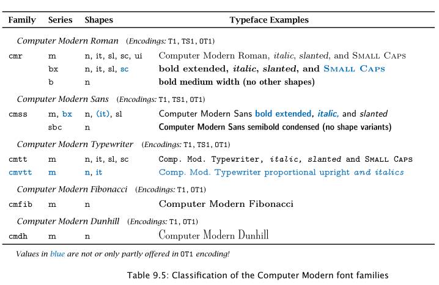
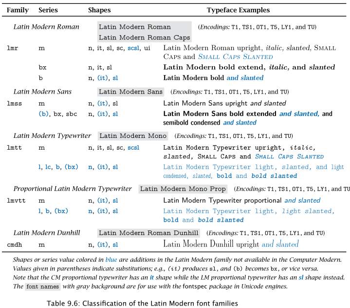

## 引入
闲来无事，在编译的一个TeX文档的过程中看到了如下的警告:

```shell
LaTeX Font Warning: Font shape `TU/NewCM10-Book.otf(2)/m/it' undefined
(Font)              using `TU/NewCM10-Book.otf(2)/m/n' instead on input line 43


LaTeX Font Warning: Font shape `TU/NewCM10-Book.otf(2)/b/n' undefined
(Font)              using `TU/NewCM10-Book.otf(2)/m/n' instead on input line 55
.


LaTeX Font Warning: Font shape `TU/NewCM10-Book.otf(2)/m/sl' undefined
(Font)              using `TU/NewCM10-Book.otf(2)/m/it' instead on input line 5
8.
```

那么问题来了，这个里面的 `/m/it`, `/b/n`, `/m/sl` 是什么意思 ? 

## 参考
本博客内容参考(抄袭)内容过多，但是大致可以例举如下:
* [TeX SE 的回答 1](https://tex.stackexchange.com/questions/552407/ot1-xcmss-b-n-undefined-using-ot1-xcmss-bx-n-instead)
* [TeX SE visaul markup](https://tex.stackexchange.com/a/5012/294585)
* The LaTeX Companion-III part1 9.2-Understanding font characteristics
* The LaTeX Companion-III part1 9.5-Standard LATEX font support
* The LaTeX Companion-III part1-9.4.1-Defining new alphabet identifiers

## 正文
In NFSS, there are four font parameters：

* the encoding
  * `OT1 encoding`: The fonts that were originally distributed with TEX had only 128 glyphs per font and therefore did not include any accented characters as individual glyphs.
  * `T1 encoding` : As an alternative encoding, the TEX user community defined a 256-character encoding called T1 that enables TEX to typeset correctly (with proper hyphenation and kerning) in more than 30 languages based on the Latin alphabet
  * `TU encoding`: use Unicode fonts and thus use Unicode as the encoding, made the default if $\rm\LaTeX$ is used with such an engine, like `xelatex`.
* the font family
  *  `lmr`: Latin Modern Roman
  *  `cmss`: Computer Modern Sans Serif
  *  ...
* the series: typeface of current font
  * `m`: selects a font with **medium** values for the width and the weight
  * `b/x`: switches to a **bolder** series, `x` refers to 'extend'.
* the shape: 
  * `n`: The normal(upright) shape
  * `it`: The italic shape
  * `sl`: The slanted or oblique shape
  * `sc`: The Small Caps shape
  * The swash letter shape

采用缩写的具体历史原理是因为MS-DOS文件系统的限制，见如下:

> This naming scheme dates back to when MS-DOS limited all filenames to be eight characters, a dot, and a three-character file type, so they had to be terse.

关于这个属于的区别: 可以参见下面的这些命令: The visual `\textXX` commands will change 3 `axes` of the text: **shape**, **family** and **weight**.

* The shape axis covers: \textup, \textit, \textsc and \textsl
* The family axis covers: \textrm, \textsf, \texttt
* The weight axis covers: \textbf, \textmd

## Table 
下面从 `The LaTeX Companion-3rd edition` 中截取了两张表格用于对上面的内容进行一个补充:





## Math Alphabets
在了解如上所述的基本字体知识后，我们可以对数学公式下手了. 你也许经常看到下面这个命令:

```latex
\DeclareMathAlphabet{cmd}{encoding}{family}{series}{shape}
```

这个玩意儿到底是什么意思? 其实你在看了前面的 **看懂TeX的字体警告** 之后应该就能看懂这个命令了. 

### new identifier

Suppose that you want to make a **slanted sans serif** typeface available as a math alphabet. You will find that the Computer Modern Sans family, for example, consists of a medium series with upright and slanted shapes.  Then declare and use it as follows:

```latex
\DeclareMathAlphabet{\mathsfsl}{T1}{cmss}{m}{sl}

We demonstrate this with the formula
\begin{equation}
\sum \mathsfsl{A}_{i} = a \tan \beta
\end{equation}
```

### redefine identifier

It is also possible to redefine an existing math alphabet identifier in a package file or in the preamble of your document. For example, the declaration

```latex
\DeclareMathAlphabet{\mathsf}{T1}{qag}{m}{n}
```

Then `\mathsf` will switch to **Adventor (Avant Garde)** in your formulas.

> 如果一个math alphabet 已经被某一个symbol font 加载了，那么最好使用命令 `\DeclareSymbolFontAlphabet`，这样可以节约资源 
