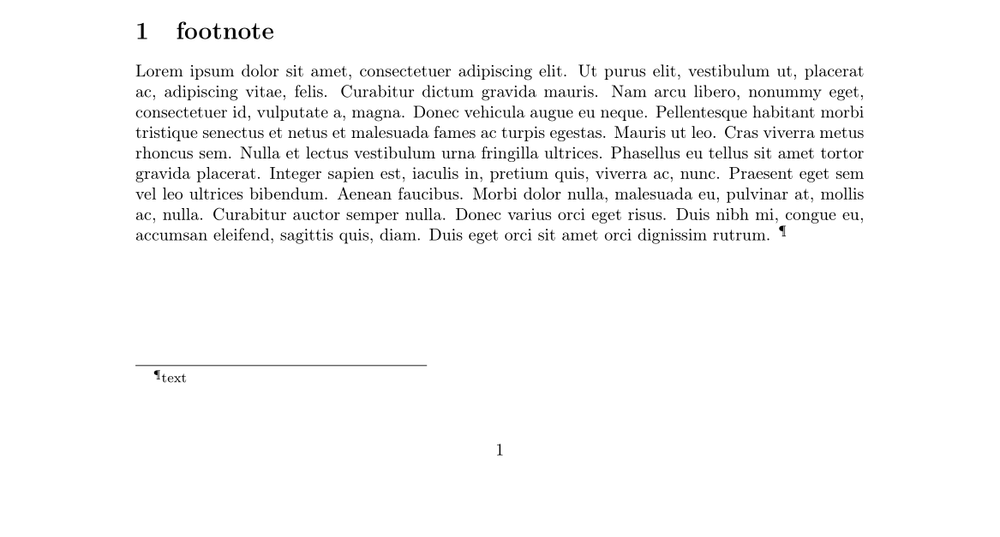

## way 1
常规的 footnote 是数字角标形式的，但是我们也可以把这些数字转化为一些个符号:如 $\dagger, \P$ 等. 只需要使用 LaTeX 2e 内置的命令\fnsymbol, 原始声明如下:

```latex
\def\fnsymbol#1{\expandafter\@fnsymbol\csname c@#1\endcsname}
```

该命令的详细说明还请参见 `source 2e`.

## way 2
当然你也可以使用宏包 footmisc 宏包， 加载时使用 
``` latex 
\usepackage[symbol]{footmisc}
```
来启用这个特性.然后还是正常使用 `\footnote` 命令, 即 `\footnote[2]{<footnote content>}`. 那么此时对应的数字角标就会变成 $\P$ 符号.

> 使用 `footmisc` 宏包后还有一个效果:就是会把你的所有脚注都放到页面底部，无论当前的页面是否撑满. 但是我个人不喜欢这个功能

## 效果
更改脚注后的效果如下:


