
**2023-07-22 更正**
感谢 [@唐慕](https://www.zhihu.com/people/ddf187d555a89784cf7c0a2e67493996) 指正：gnuplot和GNU组织没有任何的关系,仅仅只是当初开发者由于名字冲突才取的一个折中的办法.相关详细解答见如下链接:[gnuplot FAQ](www.gnuplot.info/faq/faq.html#x1-70001.2)所以之后也别在把gnuplot拼写为Gnuplot了,再次感谢评论区小伙伴提醒,特此更正.



## 0.前言
gnuplot作为一个免费开源软件，很多人肯定都没有听说过，取而代之的是Python的matplotlib，以及Matlab，Maple，Mathematica等著名的商业软件。我曾经也忽视了这个家伙，后面才发现这个东西真的就是短**小精悍.** 我之前用它处理一个csv风格的数据，matplotlib要等个10s左右才出结果，但是我使用gnuplot绘制的化，秒出。gnuplot的输出结果如下

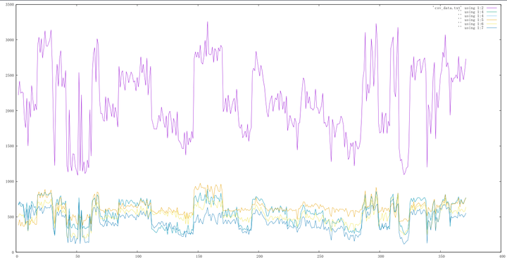


我不是到这里来 引战的，只是说一下这个gnuplot的优势，也许某一天你能够用得到，那么我的这一篇文章也就多了一份的意义。

我用着一个软件的一个重要原因就是它的3维图像等能够输出矢量图（**下面的所有演示图形均为矢量图**），当然matlab也可以（太重了），但是mathematica我是折腾了半天也不行，不理解 。但是后面我会介绍其它方便导出3维矢量图的软件，比如Solidworks，UG等，当然，这就是后话了。。。

如果你想让gnuplot导出的图片更加完美的话，可以使用它的epslatex终端，然后使用LaTeX编译它的输出文件，这样你就可以随意定制样式了。它支持的终端种类是十分丰富的，在我的电脑上就有如下的几十个可用类型终端：

```
$ set terminal
Available terminal types:
       cairolatex  LaTeX picture environment using graphicx package and Cairo backend
           canvas  HTML Canvas object
              cgm  Computer Graphics Metafile
          context  ConTeXt with MetaFun (for PDF documents)
          domterm  DomTerm terminal emulator with embedded SVG
             dumb  ascii art for anything that prints text
              dxf  dxf-file for AutoCad (default size 120x80)
              emf  Enhanced Metafile format
         epscairo  eps terminal based on cairo
         epslatex  LaTeX picture environment using graphicx package
              fig  FIG graphics language V3.2 for XFIG graphics editor
              gif  GIF images using libgd and TrueType fonts
             hpgl  HP7475 and relatives [number of pens] [eject]
             jpeg  JPEG images using libgd and TrueType fonts
              lua  Lua generic terminal driver
               mf  Metafont plotting standard
               mp  MetaPost plotting standard
             pcl5  PCL5e/PCL5c printers using HP-GL/2
         pdfcairo  pdf terminal based on cairo
           pict2e  LaTeX2e picture environment
              png  PNG images using libgd and TrueType fonts
         pngcairo  png terminal based on cairo
       postscript  PostScript graphics, including EPSF embedded files (*.eps)
          pslatex  LaTeX picture environment with PostScript \specials
            pstex  plain TeX with PostScript \specials
         pstricks  LaTeX picture environment with PSTricks macros
               qt  Qt cross-platform interactive terminal
          sixelgd  sixel using libgd and TrueType fonts
              svg  W3C Scalable Vector Graphics
          texdraw  LaTeX texdraw environment
             tikz  TeX TikZ graphics macros via the lua script driver
         tkcanvas  Tk canvas widget
          unknown  Unknown terminal type - not a plotting device
          windows  Microsoft Windows
              wxt  wxWidgets cross-platform interactive terminal
```

当然如果你的美术功底够的话，直接使用Adobe Illustrator, CoreDraw等，你实在是厉害的话可以全程使用tikz，众所周知tikz除了不会生孩子，啥都会。

本文并不是gnuplot入门内容，想要入门的选手可以参看如下的几个网站：

当你学会了基本的操作之后就可以开始学一些tricks了，如果你不满足当下的水平的话，推荐如下的网站：

> 大部分都是从这里那里抄来的，侵删

> 这个应该够你学了吧 

我的主要参考书籍如下（700多页，很实用）：
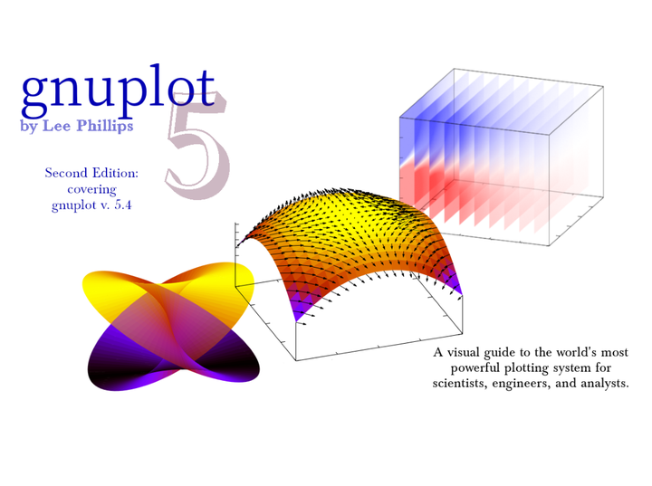

这本书后面有一个index of plots，里里面列举了这本书所绘制的全部图像

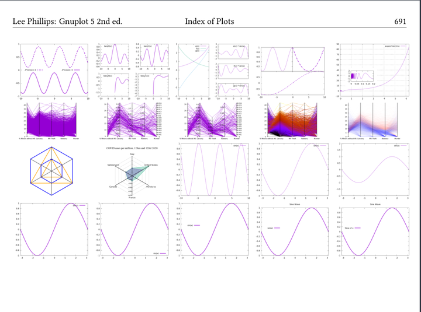
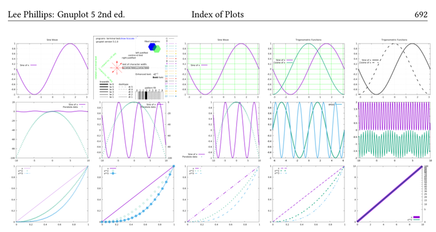

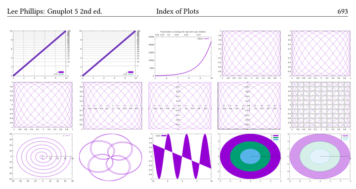

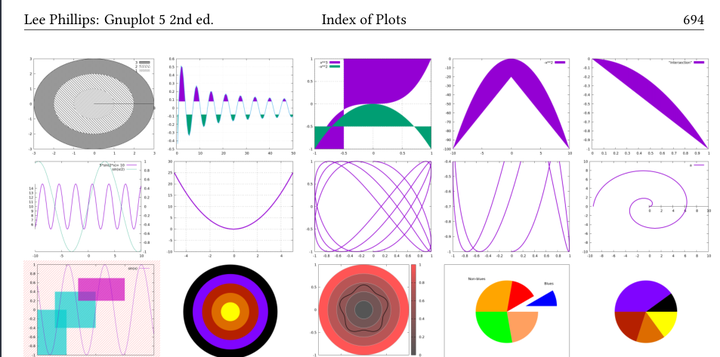

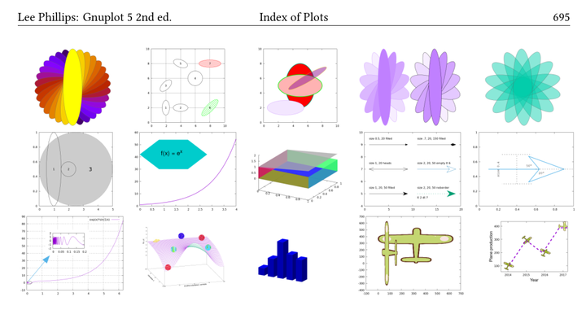

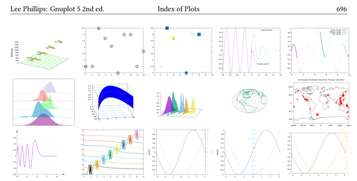


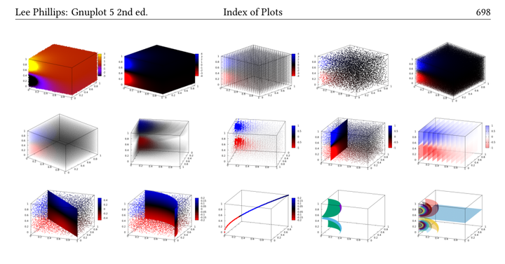

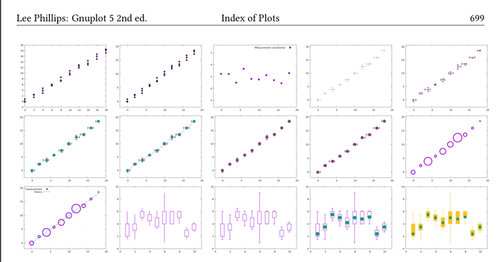

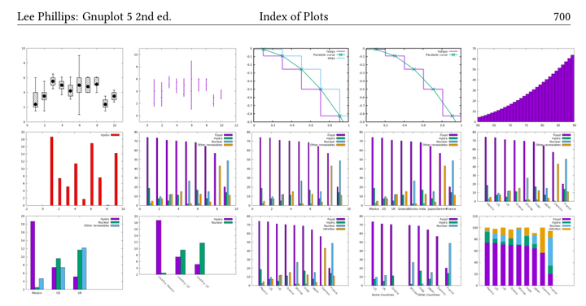

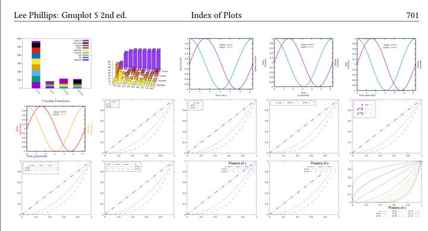

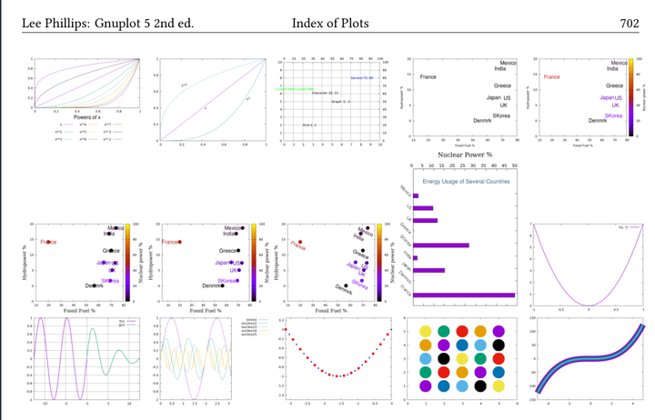

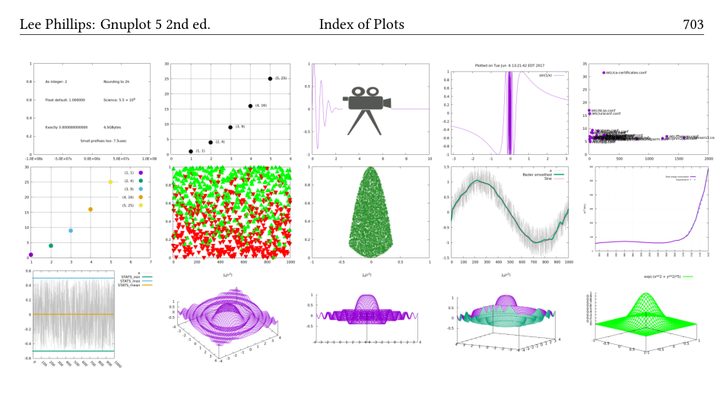

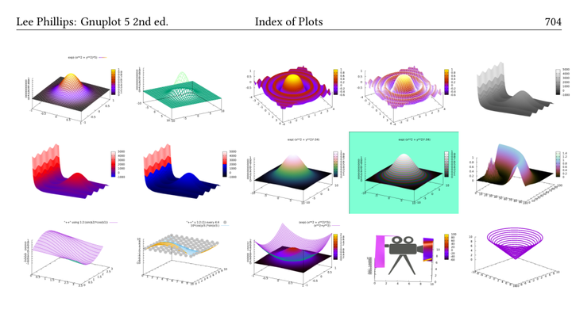

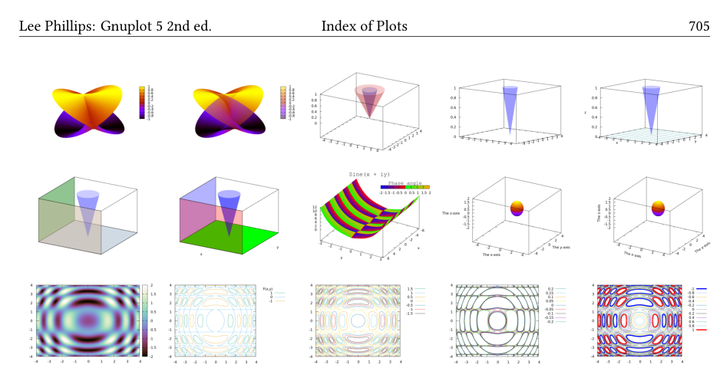

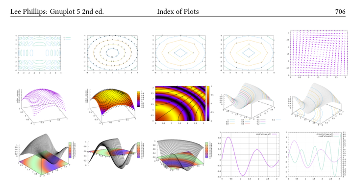


> 当然部分人可能会推荐马欢的gnuplot教程，但是我觉得这个教程很不全面。我还是把链接给出来吧

## 1. 说明

### 1.1 环境说明

``` shell
# 1. powershell
> Major  Minor  Patch  PreReleaseLabel BuildLabel -----  -----  -----  --------------- ---------- 7      3      6
# 2. windows
> Windows 11 家庭中文版 22H2
# 3. gnuplot 版本
> Version 5.4 patchlevel 7    last modified 2023-05-16
```

### 1.2 文件说明
最近使用gnuplot，添加了几个常用的gnuplot绘图的powershell命令，如下 :

- 二维函数绘制
- 三维显示函数绘制
- 参数方程绘制

我设置了绝大部分的绘图设置，这些命令的默认效果基本能够符合大众的审美。想要修改默认效果的，直接去修改

默认的源文件即可。**gayhub**仓库地址,其中的文件说明如下:

``` text
├── Gnuplot 
│   ├── Gplot_2d.gp  **二维绘图脚本** 
│   ├── Gplot_3d.gp  **三维绘图脚本** 
│   └── [GPplot.gp](http://gpplot.gp/) **参数绘图简本** 
├──  
└── Microsoft.PowerShell_profile.ps1powershell 的 **$Profile** 文件
```


我的这几个绘图脚本放到了如下路径:
``` shell
C:/BIN/
```

想要体验的，如果你比较懒，可以直接新建这个文件夹，把这3个脚本仍里面就行了。想要自己调整的，可以把对应的文件放到你们喜欢的任意位置，但是此时你们就需要修改powershell的**$profile**文件中的对应的这几个绘图脚本的路径。下面以Gplot_3d.gp为例:

```
# 3维函数绘图命令
# 1. 首先修改文件
function Gplot_3d_change_Text {
    param (
        [string]$f
    )
    sed -i "34s|f(x, y) = .*|f(x, y) = $f|" C:/BIN/Gplot_3d.gp  # 修改成你的脚本的实际位置
}
# 2.然后调用gnuplot进行绘制
function Gplot_3d{
    Gplot_3d_change_Text -f $args 
    gnuplot C:/BIN/Gplot_3d.gp               # 修改成你的脚本的实际位置
    echo "The 3d Function Graphic(pdf) has Successfully Created,`r`nwhich name is 'Function_output_3d.pdf' as default.`r`nIt Will be automatic opened by Your default pdf_reader ..."
    pdf Function_output_3d.pdf
}
```

## 2.使用演示

1. 以下的命令均为在powershell中执行 
2. **Gplot_2d** 命令和 **GPplot** 有两个参数 -f(unction) 函数, -r(ange) y的范围或者是z的范围



### 2.1 三维参数方程绘图示例1
``` shell
GPplot -f '1*cos(u)*cos(v), 3*cos(u)*sin(v), 2*sin(u)'
```

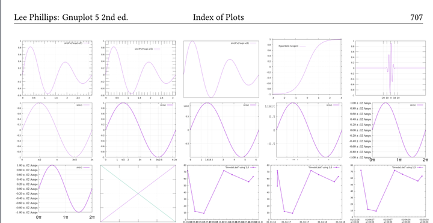


添加z轴范围:

``` shell
GPplot -f '1*cos(u)*cos(v), 3*cos(u)*sin(v), 2*sin(u)' -r '-1:1.5'
```

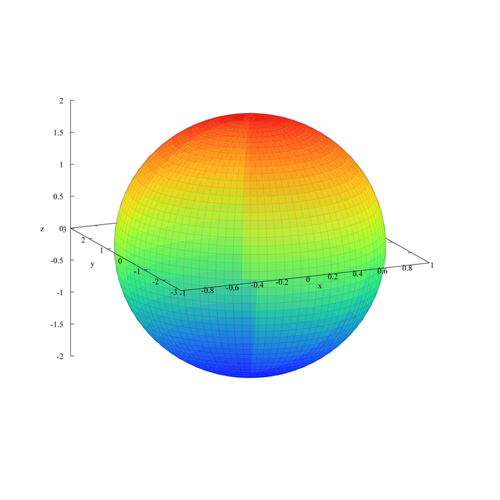

### 2.2 三维参数方程绘图示例2

```
GPplot -f '1/(1/cos(v)), 3*tan(v)*cos(u), 1*tan(v)*sin(u)'
```


### 2.3 其他的一些绘图示例


### 2.4 后续进一步处理

尽管默认输出的图像基本能够满足，但是很多时候是需要精修的，这个使用就可以使用inkscape了，装一个支持TeX的插件，想咋修图就咋修。下面是一个inkscape编辑示例：

> 其中的哪个梯度的示意图就是使用inkscape加的


### 2.5 三维显示函数绘制

这个就比较简单了，看看下面的例子你几乎就会了。

```
Gplot_3d 'x**2-y**2/3'
```


### 2.6 其他显式函数的例子


### 2.7 二维函数演示

```
Gplot_2d '2-exp(1/x)' -r 
```

运行之后他会弹出一个gnuplot的窗口，如下：


然后你可以修改以下再导出，结果如下


其他的示例


