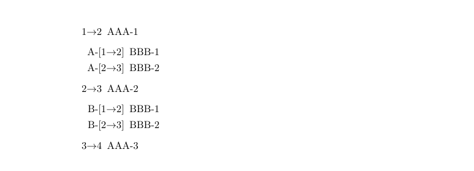
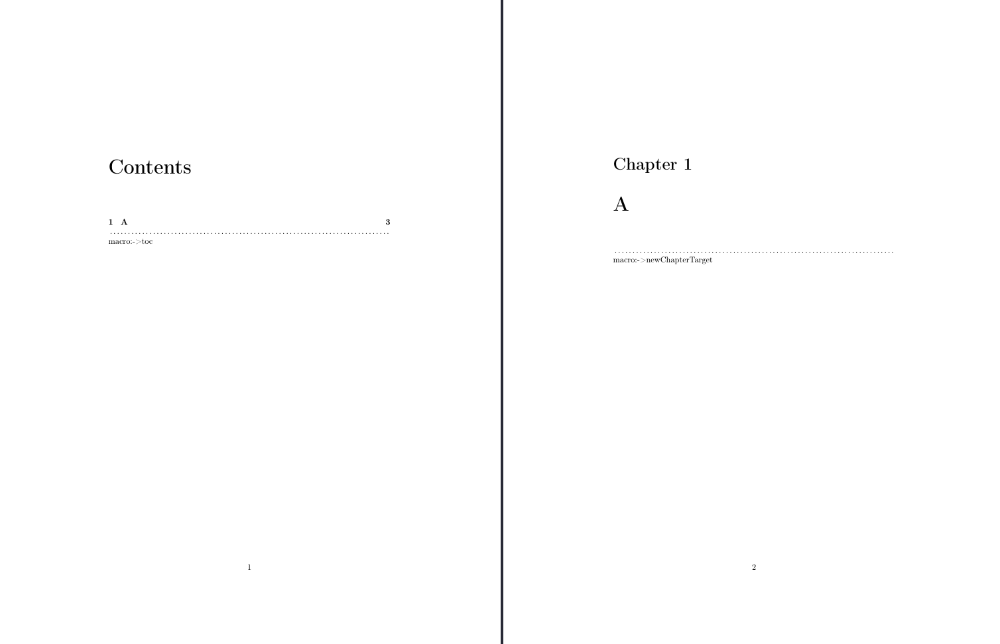
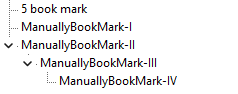

## preface

We will introduce `\label-\ref` commands first, Then move into Hyperref.


## \p@COUNTER and \refstepcounter

 What is these commands used for ? see : [Use of \p@COUNTER](https://tex.stackexchange.com/questions/464274/use-of-pcounter). For a mwe, see below:

```latex
\section{Title}\label{a}
\subsection{Title}\label{b}
\subsubsection{Title}\label{c}

\ref{a}||\ref{b} || \ref{c}

% result: I || I A || I A 1
```

Lets see what happens:

* Command  `\refstepcounter {<counter>}` in `\@sect` commands which construct all `\section` -like command, which will update a macro named `\@currentlabel` into something in form of : `\p@COUNTER\theCOUNTER` .
* Then the `\label` command will write `\@currentlabel` the the `.aux` file
* Finally, command `\ref` retrives contents from `.aux` file. See **label-ref system in LaTeX** for moore info.

Remark:

* command `\refstepcounter` call the `\stepcounter` command to step the COUNTER, see definition in `ltcounts.dtx`: `\def\refstepcounter#1{\stepcounter{<counter>}% ... }`
* thus, the `\p@` in command `\p@COUNTER` just menas **prefix**.


Then we can custom the `enumerate` number format by re-define counter: `\p@enumii`, see the original definition in LaTeX2e:

```latex
\renewcommand\theenumi{\@arabic\c@enumi}
\renewcommand\theenumii{\@alph\c@enumii}
\renewcommand\theenumiii{\@roman\c@enumiii}
\renewcommand\theenumiv{\@Alph\c@enumiv}
\newcommand\labelenumi{\theenumi.}
\newcommand\labelenumii{(\theenumii)}
\newcommand\labelenumiii{\theenumiii.}
\newcommand\labelenumiv{\theenumiv.}
\renewcommand\p@enumii{\theenumi}
\renewcommand\p@enumiii{\theenumi(\theenumii)}
\renewcommand\p@enumiv{\p@enumiii\theenumiii}
```

Thus you will get `3(b)iv` for item in level 3/2/4. Therefore, simple number format does NOT need additional packages like `enumerate`, etc. Just re-define them yourself.

An simple example about `enumerate`, mwe:
```latex
\documentclass{article}
\makeatletter
\renewcommand\theenumi{\@arabic\c@enumi\(\rightarrow\)\inteval{\@arabic\c@enumi+1}}
\renewcommand\theenumii{\@arabic\c@enumii\(\rightarrow\)\inteval{\@arabic\c@enumii+1}}
\renewcommand\p@enumii{\Alph{enumi}-}
\def\labelenumi{\theenumi}
\def\labelenumii{\p@enumii[\theenumii]}
\makeatother


\begin{document}
\begin{enumerate}
  \item AAA-1
  \begin{enumerate}
    \item BBB-1
    \item BBB-2
  \end{enumerate}
  \item AAA-2
  \begin{enumerate}
    \item BBB-1
    \item BBB-2
  \end{enumerate}
  \item AAA-3
\end{enumerate}
\end{document}
```

The output:



## hyperref insight

### Background

There are 2 basic conceptions in hyperref for hyperlinking:

* Link: Internal links and bookmarks can jump to "destination"

* destination: 
	* "destination" in PDF, \pdfdest
	* "anchor" in HTML, \hyper@anchor 
	* "target" under normal case in future, see doc `hyperref-linktarget.pdf`

### Links commands

The following commands are provided by all drivers to create links:

```latex
\hyper@anchor {destination name}
\hyper@anchorstart {destination name}
\hyper@anchorend

\hyper@link{context}{destination name}{link text} % GoTo
\hyper@linkstart {context} {destination name}     % GoTo
\hyper@linkend 									  % GoTo
\hyper@linkfile {link text} {filename} {destname} % GoToR
\hyper@linkurl{link text}{url} 					  % URI

\hyper@linklaunch{filename} {link text} {Parameters} % Launch, only with new generic driver
\hyper@linknamed {action}{link text} 				 % Named, only with new generic driver
```


The argument meaning are:

* `context`: normally consists of  `link`, `url`, `cite`; Refer to `linkcolor` and `citecolor` options for hyperref package; If this context not defined, nothing will happens.
* `destination name`: This is self-explainary, such as the following `ztargetB`, `ztargetBC` .
* `link text`: the clickable text shown in pdf


#### mwe preamble
Then we make a simple explanation or `mwe` to each command, we assume all the preable of these mwe is:

```latex
\documentclass{article}
\usepackage{xcolor}
\usepackage{hyperref}
\hypersetup{
  bookmarksnumbered,
  colorlinks = true,
  linkcolor = red,
  urlcolor = blue,
}

\def\seeTargets{%
  \par\noindent\dotfill\\
  \string\@currentHref\ = \meaning\@currentHref\par
  \string\@currentHpage\ = \meaning\@currentHpage\par
  \string\Hy@currentbookmarklevel\ = \meaning\Hy@currentbookmarklevel\par\vskip3em
}
```

#### Example 1

Let see the first example:

```latex
AAA\hyper@anchor{ztargetB} 

\hyper@link {url}{ztargetB}{link text}; 
\hyper@linkstart{link}{ztargetB} long long link text \hyper@linkend
```


#### Example 2

After click the link text, you will jump to the start place of the target, in this case, it is the first `\dotfill`, that will be shown on the top of your screen.

```latex
\lipsum[1]

\dotfill\par
\hyper@anchorstart {ztargetC}
\lipsum[2]
\hyper@anchorend

\dotfill\par
\lipsum[1]

\newpage
BBB: \hyper@link {cite}{ztargetC}{link text}
```


#### Example 3

The destinations that aready exsits:

```latex
\section{sse First}
AAA

\newpage
BBB:\hyper@link{link}{section.1}{text}
```


### How to set the target ?

Targets are created automatically when `\refstepcounter` is used and it is well known that `\@sect` command will call this command. Thus the star-version section commands need some more attentions.

For package authors, there are some commands to define these **Targets**. You can see document `hyperref-linktarget` for detailed information about how to use these commands.

* \MakeLinkTarget
* \LinkTargetOff / \LinkTargetOn
* \NextLinkTarget
* \SetLinkTargetFilter

The first four commands can be used even if hyperref is not loaded. And package authors can also provide these definitions directly:

```latex
\ProvideDocumentCommand\MakeLinkTarget{sO{}m}{}
\ProvideDocumentCommand\LinkTargetOn{}{}
\ProvideDocumentCommand\LinkTargetOff{}{}
\ProvideDocumentCommand\NextLinkTarget{m}{}
```

So, what is `\MakeLinkTarget` and others doing ? see the Examples below. Is there any relation to code like:

```latex
\renewcommand{\theHsection}{Test 1}
```

Or `\theHchapter` ? Why  hyperref has introduced `\theH<counter>` ?

> For that `\the<counter>` is not always unique. For example, 2 different figures in different section may have the same value if  `\thefigure` has no section counter prefix. 

When should we re-def `\theH<counter>` ? 

> Usually problems with duplicate destination names can be solved by an appropriate definition of `\theH<counter>` . 


#### Example 1: basic usage

Firstly, we see how to use command `\MakeLinkTarget`, the argument spec is:
```latex
\MakeLinkTarget[⟨prefix⟩]{⟨counter⟩}
\MakeLinkTarget[⟨prefix⟩]{}
\MakeLinkTarget*{⟨manual target⟩}
```

Numbers can be occur in the name of the target. The name is then stored globally1 in `\@currentHref` and used for example in the next `\label`. 

After creating this target by `\MakeLinkTarget`, you can use command `\hyper@link` to link to this target, see below:

```latex
\section*{sse}
AAA \MakeLinkTarget[newType]{} 
% use \seeTargets to see current target, it is "newType*.3"

BBB \hyper@link{link}{newType*.3}{link text};
```

it is recommended to stick to ASCII and to avoid spaces in target. The default target format is:

```latex
% format
\MakeLinkTarget{<COUNTER>}     	⇒ <COUNTER>.\theH<COUNTER>

% examples
\MakeLinkTarget{section}     	⇒ section.\theHsection ⇒ section.1.1
\MakeLinkTarget[sec]{section}	⇒ sec.\theHsection
```


Sometimes, users will use `\phantomsection` for an empty section anchor, this command will create a **dummy counter** named **section***. Then this target generated will be:

```latex
section*<artificial number>
```


#### Example 2: \MakeLinkTarget*

Though you need to obey the basic rules about creating a target, you can change current target(stores in macro `\@currentHref` ) by using command `\MakeLinkTarget*{<target>}` sometimes. See below:

```latex
AAA \MakeLinkTarget*{newManualType}
\seeTargets

% Result:
% . . . . . . . . . . . . . . . . . . . . . . . . . . . . . . . . . . . . . . . . . . . . . . . . . . . . . . . . . . . . . . . . . . . . . . . . . . . . . .
% macro:->newManualType
```

In this case: the target name is stored by the next `\label` ? How to check that ? see below, when you typeset these commands:

```latex
\MakeLinkTarget*{newManualType} \label{checkTarget}
```

Then you will see a line

```latex
\newlabel{checkTarget}{{4.2}{4}{MakeLinkTarget-star}{newManualType}{}}
```

in your current `.aux` file. That is how it stores the target !


#### Example 3: \NextLinkTarget

Then let see how to use `\NextLinkTarget` command to change the next target name, see the mwe below:

```latex
\documentclass[oneside]{book}
\usepackage[T1]{fontenc}
\usepackage{bookmark}
\makeatletter
\def\seeTargets{%
  \par\noindent\dotfill\\
  \meaning\@currentHref\par\vskip3em
}

\begin{document}
\bookmark[dest=toc]{Table of Contents}
\NextLinkTarget{toc}
\tableofcontents
\seeTargets

\NextLinkTarget{newChapterTarget}
\chapter{A}
\seeTargets

\end{document}
```

Then the output look like:



Remark:

* This command also affects targets created by `\refstepcounter` .
* It does the same as the \hypersetup key next-anchor.


#### Example 4: \LinkTargetOn/Off

Suppresing the target locally:

* target created with `\MakeLinkTarget`
* target from an internal `\refstepcounter`

After suppresing these targets, you can still declare a new target in this local group for future referencing. See below:

```latex
\LinkTargetOff %suppress anchor in internal refstepcounter
...
\refstepcounter{...}
...
{\LinkTargetOn\MakeLinkTarget*{mytarget}} %create manual anchor
...
\LinkTargetOn
```


#### Example 5: \SetLinkTargetFilter

When merge multi pdf into a single, destinations may come into conflict, eg. all document has `section.1` destination. How to solve this ? A very simple way you may think about is that you can add a different prefixs for all destinations for different pdf file. 

See below to see how to do it. If you have a pdf file named `docA`, hyperref sets anchor with name `Doc-Start` at the begin of the document. Re-def it by adding this line to your preamble:

```latex
\renewcommand*{\HyperDestNameFilter}[1]{docA-#1}
```

Then source of PDF will look like:

```pdf
%destination names:
<<
/Names [(docA-Doc-Start) 7 0 R (docA-chapter.1) 8 0 R (docA-page.1) 6 0 R]
/Limits [(docA-Doc-Start) (docA-page.1)]
>>
%link to a chapter
/A << /S /GoTo /D (docA-chapter.1) >>
%link from the bookmark
<< /S /GoTo /D (docA-chapter.1) >>
```


For that `\MakeLinkTarget` uses this filter too: it would break internal link commands if it would ignore it. To **stay compatible with future development** the filter should not be redefined directly but be set with `\SetLinkTargetFilter`. The command can only be used in the preamble:

```latex
\SetLinkTargetFilter{docA-#1}
```


####  Example 6: \HyperDestLabelReplace - todo

This command may be related to:

* `\label` command
* `.aux` file wrirting
* command `\HyperDestRename{⟨destination⟩}{⟨newname⟩}`


### Patches

To make hyper link work properly, a lot of commands have been re-defined. For Example hyperref patched:

* sectioning commands: \@sect, \@ssect, \@chapter, \@schapter, \@part, \@spart.  Targets are needed for bookmarks and the table of contents, so `\@currentHref` should get the correct meaning before `\addcontentsline` is used. You can suppress these patches by define a command `\hyper@nopatch@sectioning` before loading hyperref, see below:
  ```latex 
  \makeatletter
  \def\hyper@nopatch@sectioning{}
  \makeatother
  \usepackage{hyperref}
  ```
  
* footnotes: ...

* amsmath **tags**: hyperref redefines two internal commands of amsmath related the `\tag` command
  to add an anchor.

* theorems: hyperref patches command  `\@thm`, that why your own thm environment created with `\newenvironment` or `\NewDocumentEnvironment`  with no `\refstepcounter`  can NOT been jumped to after click the `\ref` text. This code can be suppressed by defining `\hyper@nopatch@thm` .  Here is the detailed patches:
  ```latex
  \@ifundefined{hyper@nopatch@thm}{%
   \AtBeginDocument{%
      \@ifpackageloaded{cleveref}
       {\AddToHook{cmd/@thm/before}{\ifhmode\unskip\fi}}
       {%
         \ifpatchable\@thm{\refstepcounter}
           {\patchcmd\@thm{\refstepcounter}{\Hy@theorem@refstepcounter}{}{}}
           {}%
        }
     }
  }{}
  ```

* table of contents: hyperref redefines `\contentsline` to be able to add links to toc entries. For example, you can see the destination names in `.toc` file like: `\contentsline {section}{\numberline {1}Test 1}{2}{section.1}%`, where `section.1` is the destination name.

* math environments: hyperref patches `\equation/\endequation`,  `\eqnarray`,  `\endeqnarray`

* counters: hyperref patches the kernel command `\@definecounter`,  `\@newctr`,  `\@addtoreset ` and the amsmath command `\numberwithin` to ensure that for every counter the correct `\theHcounter` representation is created or reset

* ...


### Bookmark

How does the bookmark generated ? And when ? See **5.7 PDF-specific display options** . Hyperref will automatically add bookmarks for `\section` and similar macros. But you can also set them manually by command:

```latex
\pdfbookmark[level]{text}{name}

% level: default value is 0
% text: the display name in bookmark
% name: the name of existing destination
```


There are some other commands:

```latex
% 1. creates a bookmark at the current level.
\currentpdfbookmark{text}{name}

% 2. creates a bookmark one step down in the bookmark hierarchy.
\subpdfbookmark{text}{name}   % Internally the current level is increased by one.
\belowpdfbookmark{text}{name} % Internally the current level has not changed. 
```


These commands are defined in file `hpdftex.def`, see:

```latex
\newcommand{\currentpdfbookmark}{%
  \pdfbookmark[\Hy@currentbookmarklevel]%
}
\newcommand{\subpdfbookmark}{%
  \@tempcnta\Hy@currentbookmarklevel
  \Hy@StepCount\@tempcnta
  \expandafter\pdfbookmark\expandafter[\the\@tempcnta]%
}
\newcommand{\belowpdfbookmark}[2]{%
  \@tempcnta\Hy@currentbookmarklevel
  \Hy@StepCount\@tempcnta
  \expandafter\pdfbookmark\expandafter[\the\@tempcnta]{#1}{#2}%
  \advance\@tempcnta by -1 %
  \xdef\Hy@currentbookmarklevel{\the\@tempcnta}%
}
\renewcommand\pdfbookmark[3][0]{%
  \Hy@writebookmark{}{#2}{#3.#1}{#1}{toc}%
  \hyper@anchorstart{#3.#1}\hyper@anchorend
}
```


A simple use example:

```latex
\section{book mark}

AAA:\pdfbookmark[1]{ManuallyBookMark-I}{targetA}
\seeTargets

BBB: \currentpdfbookmark{ManuallyBookMark-II}{targetB}
\seeTargets

CCC: \subpdfbookmark{ManuallyBookMark-III}{targetC}
\seeTargets

DDD:(Even bookmark level not step, the number in dstination show step) \belowpdfbookmark{ManuallyBookMark-IV}{targetD}
\seeTargets

EEE: \hyper@anchorstart{target.X}\hyper@anchorend
\seeTargets


\begin{itemize}
  \item AAA: \hyper@link {link}{targetA.1}{link text 1};
  \item BBB: \hyper@link {link}{targetB.1}{link text 2};
  \item CCC: \hyper@link {link}{targetC.2}{link text 3};
  \item DDD: \hyper@link {link}{targetD.3}{link text 4};
  \item EEE: \hyper@link {link}{target.X}{link text 5};
\end{itemize} 
```

The output bookmark looks like as below:



### source

The source for reference:

```latex
\documentclass{article}
\usepackage[T1]{fontenc}
\usepackage{amsthm}
\newcounter{theorem}
\newenvironment{theorem}{\begin{flushleft}\textbf{Theorem}\;\refstepcounter{theorem}\thetheorem\enspace}{\end{flushleft}}
\newtheorem{definition}{Definition}
\makeatletter
\setlength{\parindent}{0pt}
\def\hyper@nopatch@thm{}
\usepackage{lipsum}
\usepackage{xcolor}
\usepackage{hyperref}
% \let\Hy@theorem@refstepcounter\stepcounter
\hypersetup{
  bookmarksnumbered,
  colorlinks = true,
  linkcolor = red,
  urlcolor = blue,
}
\def\seeTargets{%
  \par\noindent\dotfill\\
  \string\@currentHref\ = \meaning\@currentHref\par
  \string\@currentHpage\ = \meaning\@currentHpage\par
  \string\Hy@currentbookmarklevel\ = \meaning\Hy@currentbookmarklevel\par\vskip3em
}

\begin{document}
\tableofcontents

% \@ifundefined{hyper@nopatch@thm}{UN-DEF}{DEF}
% \meaning\@thm


\newpage
\section{Test 1}\label{test1}
\subsection{sss b}
Hello world I. 

AAAA=BBBB
% \MakeLinkTarget{ztargetA}
\hyper@anchor{ztargetB}
\seeTargets

\newpage
\section{thm link}
\begin{theorem}\label{thm1}
This is a theorem: $a^2+b^2=c^2$.
\end{theorem}

\begin{definition}\label{def1}
This is a definition: $a^2+b^2=c^2$.
\end{definition}

\seeTargets


\newpage
\section*{Test 2}
Hello world II, the star version section target is:\par
\seeTargets

\MakeLinkTarget[newType]{}
\seeTargets


\section{see targets}
\subsection{sss aaa}
\subsection{sss bbb}
\seeTargets


\section{Manually change target}
\subsection{theHCOUNTER}
Original current target is:\par
\seeTargets

Then i change current target manually:\par 
\def\theHsection{1000}
\seeTargets

\textbf{Can NOT change the target manually by \string\theHCOUNTER.}

\subsection{MakeLinkTarget-star}
The command \string\MakeLinkTarget* can change \string\@currentHref{} manually:\par
\MakeLinkTarget*{newManualType} \label{checkTarget}
\seeTargets

% \vskip3em
% \meaning\ref

% \vskip2em
% \ExplSyntaxOn
% \cs_meaning:N \__cmd_start:nNNnnn
% \cs_meaning:N \__cmd_start_aux:NNnnnn
% \cs_meaning:N \__cmd_run_code:
% \ExplSyntaxOff


\newpage
\section{book mark}
% \meaning\pdfbookmark\par
% \meaning\new@pdflink\par

AAA:\pdfbookmark[1]{ManuallyBookMark-I}{targetA}
\seeTargets

BBB: \currentpdfbookmark{ManuallyBookMark-II}{targetB}
\seeTargets

CCC: \subpdfbookmark{ManuallyBookMark-III}{targetC}
\seeTargets

DDD:(Even bookmark level not step, the number in dstination show step) \belowpdfbookmark{ManuallyBookMark-IV}{targetD}
\seeTargets

EEE: \hyper@anchorstart{target.X}\hyper@anchorend
\seeTargets


\newpage
1. \string\ref{} commad Test:
\begin{itemize}
  \item Hello world III:\ref{test1}
  \item Hello THM: \ref{thm1}
  \item Hello DEF: \ref{def1}
\end{itemize}

\vskip3em
2. \string\hyperlink{} commad Test:
\begin{itemize}
  \item Link Target Manually: % \LinkTargetOn ztargetA \LinkTargetOff
  \item \hyper@link {url}{ztargetB}{link text}; 
        \hyper@linkstart{link}{ztargetB} long long link text \hyper@linkend
\end{itemize}

\vskip3em
3. \string\MakeLinkTarget{} commad Test:
\begin{itemize}
  \item \hyper@link {link}{section*.2}{link text};
  \item \hyper@link {link}{newType*.3}{link text};
\end{itemize} 

\vskip3em
4. bookmark related target link:
\begin{itemize}
  \item AAA: \hyper@link {link}{targetA.1}{link text 1};
  \item BBB: \hyper@link {link}{targetB.1}{link text 2};
  \item CCC: \hyper@link {link}{targetC.2}{link text 3};
  \item DDD: \hyper@link {link}{targetD.3}{link text 4};
  \item EEE: \hyper@link {link}{target.X}{link text 5};
\end{itemize} 
\end{document}
```


## reference
* [Use of \p@COUNTER](https://tex.stackexchange.com/questions/464274/use-of-pcounter)
* [hyperref doc](http://mirrors.ctan.org/macros/latex/contrib/hyperref/doc/hyperref-doc.pdf)
* [Hyperref link targets](https://ctan.math.illinois.edu/macros/latex/contrib/hyperref/doc/hyperref-linktarget.pdf)
* [Understanding \pdfbookmark](https://tex.stackexchange.com/a/686058/294585)
* [sub-link color in hyperref](https://github.com/muzimuzhi/latex-examples/blob/master/utilities/hyperref-sublinkcolor.tex)
