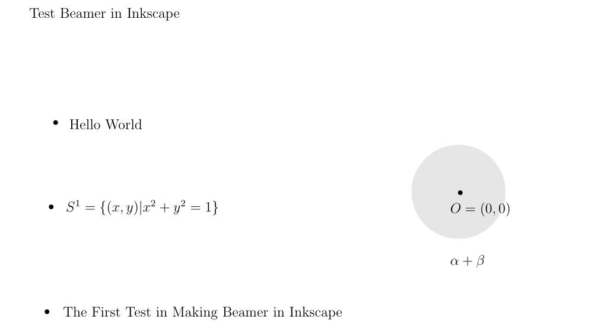

## GUI export 
之前在使用 Inkscape 导出 PDF + LaTeX file 时一直都没有生成那个 `.pdf_tex` 文件。后面自己才发现在导出时应该选择: `Save as` 而不是 `Save a Copy`, 第二种方式无法导出对应的`.pdf_tex`文件.


## CLI export
如果你有一个 svg 文件: `test.svg`, 那么直接在命令行使用如下的命令:

``` shell
inkscape -D --export-latex --export-filename=test.pdf test.svg
```

运行结束便会在当前路径下产生两个文件:
* test.pdf: 不包含 text 的pdf文件
* test.pdf_tex: pdf文件对应的 text

其中的那个 pdf 文件大概长这样:


那么 `test.pdf_tex` 文件中就是下面的内容:
``` latex
%% Creator: Inkscape 1.3.2 (091e20e, 2023-11-25, custom), www.inkscape.org
%% PDF/EPS/PS + LaTeX output extension by Johan Engelen, 2010
%% Accompanies image file 'test.pdf' (pdf, eps, ps)
%%
%% To include the image in your LaTeX document, write
%%   \input{<filename>.pdf_tex}
%%  instead of
%%   \includegraphics{<filename>.pdf}
%% To scale the image, write
%%   \def\svgwidth{<desired width>}
%%   \input{<filename>.pdf_tex}
%%  instead of
%%   \includegraphics[width=<desired width>]{<filename>.pdf}
%%
%% Images with a different path to the parent latex file can
%% be accessed with the `import' package (which may need to be
%% installed) using
%%   \usepackage{import}
%% in the preamble, and then including the image with
%%   \import{<path to file>}{<filename>.pdf_tex}
%% Alternatively, one can specify
%%   \graphicspath{{<path to file>/}}
%% 
%% For more information, please see info/svg-inkscape on CTAN:
%%   http://tug.ctan.org/tex-archive/info/svg-inkscape
%%
\begingroup%
  \makeatletter%
  \providecommand\color[2][]{%
    \errmessage{(Inkscape) Color is used for the text in Inkscape, but the package 'color.sty' is not loaded}%
    \renewcommand\color[2][]{}%
  }%
  \providecommand\transparent[1]{%
    \errmessage{(Inkscape) Transparency is used (non-zero) for the text in Inkscape, but the package 'transparent.sty' is not loaded}%
    \renewcommand\transparent[1]{}%
  }%
  \providecommand\rotatebox[2]{#2}%
  \newcommand*\fsize{\dimexpr\f@size pt\relax}%
  \newcommand*\lineheight[1]{\fontsize{\fsize}{#1\fsize}\selectfont}%
  \ifx\svgwidth\undefined%
    \setlength{\unitlength}{340.15747833bp}%
    \ifx\svgscale\undefined%
      \relax%
    \else%
      \setlength{\unitlength}{\unitlength * \real{\svgscale}}%
    \fi%
  \else%
    \setlength{\unitlength}{\svgwidth}%
  \fi%
  \global\let\svgwidth\undefined%
  \global\let\svgscale\undefined%
  \makeatother%
  \begin{picture}(1,0.74999998)%
    \lineheight{1}%
    \setlength\tabcolsep{0pt}%
    \put(0.12752211,0.6406953){\color[rgb]{0,0,0}\makebox(0,0)[lt]{\lineheight{1.25}\smash{\begin{tabular}[t]{l}Test Beamer in Inkscape\end{tabular}}}}%
    \put(0,0){\includegraphics[width=\unitlength,page=1]{test.pdf}}%
    \put(0.76621568,0.26556717){\color[rgb]{0,0,0}\makebox(0,0)[lt]{\lineheight{1.25}\smash{\begin{tabular}[t]{l}$\alpha+\beta$\end{tabular}}}}%
    \put(0,0){\includegraphics[width=\unitlength,page=2]{test.pdf}}%
    \put(0.18824693,0.471698){\color[rgb]{0,0,0}\makebox(0,0)[lt]{\lineheight{1.25}\smash{\begin{tabular}[t]{l}Hello World\end{tabular}}}}%
    \put(0.18293693,0.34655683){\color[rgb]{0,0,0}\makebox(0,0)[lt]{\lineheight{1.25}\smash{\begin{tabular}[t]{l}$S^1=\{(x, y)|x^2+y^2=1\}$\end{tabular}}}}%
    \put(0.17870969,0.18697422){\color[rgb]{0,0,0}\makebox(0,0)[lt]{\lineheight{1.25}\smash{\begin{tabular}[t]{l}The First Test in Making Beamer in Inkscape\end{tabular}}}}%
    \put(0.76621568,0.34420555){\color[rgb]{0,0,0}\makebox(0,0)[lt]{\lineheight{1.25}\smash{\begin{tabular}[t]{l}$O=(0, 0)$\end{tabular}}}}%
    \put(0,0){\includegraphics[width=\unitlength,page=3]{test.pdf}}%
  \end{picture}%
\endgroup%
```

## compile
尽管在 LaTeX 中的详细使用方法在上面的那个 `test.pdf_tex` 文件中已经写了，但是我自己还是写了一个脚本用于这两个文件的编译. 读者可以参考此代码的实现，然后在自己的 LaTeX 文档中使用:

``` latex
\documentclass[12pt]{standalone}
% \documentclass[12pt]{article}
\PassOptionsToPackage{quiet}{fontspec}
% \usepackage{ctex}
\usepackage[margin=1cm]{geometry}
\usepackage{transparent}
\usepackage{graphicx}
\usepackage{xifthen}
\usepackage{pdfpages}
\newcommand{\inclufig}[1]{%
    \def\svgwidth{\columnwidth}%
    \input{./#1.pdf_tex}
}

\begin{document}
    \inclufig{test}
\end{document}
```

最终的编译结果如下:

