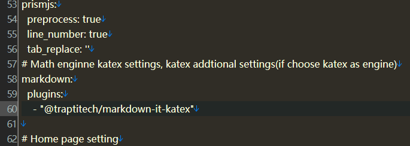
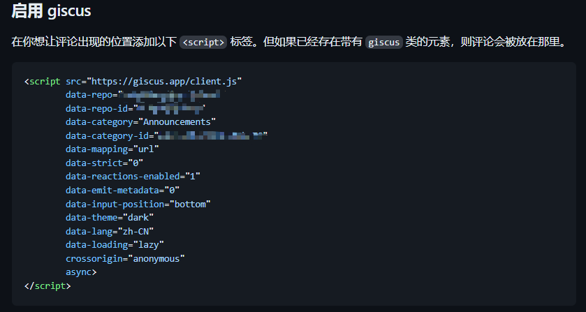
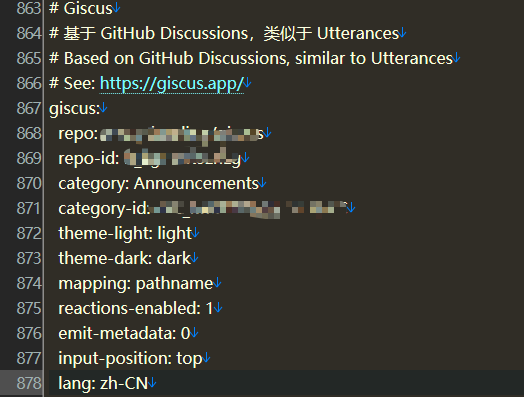

摘要：本篇博客主要注重于Hexo和Fluid主题的安装和使用，尤其是LeTeX的配置。


以下是Hexo的基本使用教程，主要涵盖以下部分
* Hexo 安装
* Hexo 写作
* Hexo 高级配置

完整的示例可以参见官方链接 [Fluid 官方展示](https://hexo.fluid-dev.com/posts/hello-fluid/),更加系统的教程请参见官方教程[Fluid Doc](https://hexo.fluid-dev.com/docs/)


## Hexo 安装
### nodejs, npm安装
这里略过,很简单,稍微说一下hexo的安装,在你的命令行执行如下命令
``` shell
npm install hexo-cli -g
```

然后选定一个目录执行命令作为hexo的根目录(我这里是在 C 盘的根目录下生成 Hexo_Blog 作为我的根目录)
``` shell
hexo init Hexo_Blog
cd .\Hexo_Blog\
```

### about 和 category 页的创建
"关于" 和 "分类"页可以自己创建，使用如下语法:
``` shell
hexo new page about
hexo new page categories
```

然后，如果今后想给自己写的文章设置about和category就可以分别在front matter中使用`tags: [tag1, tag2]`, `categories: [category1]`:一个示例:

``` markdown
---
title: jQuery对表单的操作及更多应用
date: 2017-05-26 12:12:57
categories: [web前端]
---
```

注意：hexo一篇文章只能属于一个分类，也就是说如果在"web前端"后面添加"-xxx"，hexo不会产生两个分类，而是把分类嵌套（即该文章属于 “- web前端”下的 “-xxx ”分类）。


### 主题安装
主要参考 [fluid 官方](https://github.com/fluid-dev/hexo-theme-fluid),在Hexo的项目文件夹下使用如下命令
``` shell
npm install --save hexo-theme-fluid
```	
首先在博客目录下创建 `_config.fluid.yml`，将主题的 `_config.yml` 内容复制进去

这样主要是对原始文件进行一个备份，方便恢复


然后修改 Hexo 博客目录中的 `_config.yml`
``` json
theme: fluid  # 指定主题

language: zh-CN  # 指定语言，会影响主题显示的语言，按需修改
``` 

创建「关于页，参见官方（略）


### 快速开始

#### 创建一篇新文章

``` shell
hexo new "new post"
```

More info: [Writing](https://hexo.io/docs/writing.html)

可以在 front matter 中指定这一篇博客的封面，也就是它在主页的小图,详情请参见图片章节

#### 在本地部署然后预览

``` bash
hexo clean && hexo g && hexo s
```
以上三条命令可以作为一条命令执行，意思分别是
* `hexo clean`: 清除原始构建，从头开始
* `hexo g`(generate): 构建文件
* `hexo s`(start): 在本地浏览器4000端口进行预览


#### 远程部署
在gtihub新建一个仓库，名为 `<your name>.github.io`,可以为public也可以是private，然后在[Hexo 官网](https://hexo.io/zh-cn/docs/github-pages)网站复制如下代码,
在储存库中建立`.github/workflows/pages.yml`这个文件,填入如下代码,其中`Use Node.js 16.x` 中的16更改为你自己的nodejs版本. 

``` json
name: Pages

on:
  push:
    branches:
      - main # default branch

jobs:
  build:
    runs-on: ubuntu-latest
    steps:
      - uses: actions/checkout@v3
        with:
          token: ${{ secrets.GITHUB_TOKEN  }}
          # If your repository depends on submodule, please see: https://github.com/actions/checkout
          submodules: recursive
      - name: Use Node.js 16.x
        uses: actions/setup-node@v2
        with:
          node-version: '16'
      - name: Cache NPM dependencies
        uses: actions/cache@v2
        with:
          path: node_modules
          key: ${{ runner.OS  }}-npm-cache
          restore-keys: |
            ${{ runner.OS  }}-npm-cache
      - name: Install Dependencies
        run: npm install
      - name: Build
        run: npm run build
      - name: Upload Pages artifact
        uses: actions/upload-pages-artifact@v2
        with:
          path: ./public
  deploy:
    needs: build
    permissions:
      pages: write
      id-token: write
    environment:
      name: github-pages
      url: ${{ steps.deployment.outputs.page_url  }}
    runs-on: ubuntu-latest
    steps:
      - name: Deploy to GitHub Pages
        id: deployment
        uses: actions/deploy-pages@v2
```
然后把你之前在本地Hexo根目录下的文件上传到这个仓库中，之后使用 `<your name>.github.io`即可实现轻松访问.

当你在本地的博客没有问题之后就可以考虑把笔记同步更新部署到远程的github了,使用如下的命令
``` shell
hexo d
```

但是如果你使用的是git的话，还需要进行如下的操作:
``` shell
npm install hexo-deployer-git --save
```

然后修改Hexo根目录下的 `_config.yml`文件中的deploy相关设置:
``` yaml
deploy
  type: git
  repository: git@github.com:YOUR_ID/YOUR_ID.github.io.git
  branch: master
```
> 将其中的YOUR_ID改成你自己的GitHub账号

其实就是deploy的简写.More info: [Deployment](https://hexo.io/docs/one-command-deployment.html),然后的话就是直接修改一下hexo根目录下的`_config.yml`文件的deploy部分,如下:

``` yml
### Docs: https://hexo.io/docs/one-command-deployment
deploy:
  type: git
  branch: main
  repo: https://github.com/zongpingding/zongpingding.github.io
```


或者是直接使用 git add, git commit , git push 的流程也是可以的，也就是不去修改上述的什么deploy

注意：上面的缩进是两个空格，不是tab



### 自定义
其实Fluid官方的源代码里面写的很清楚了，每一张图片，每一句话，每一个图标的作用，只需要按照这源文件进行修改即可。
主要修改的就是如下的几个方面:
* 主页，归档页，分类页，关于页的图片
* 浏览器标签中的Icon，默认是fluid.png
* 关于页面的友链


注意:

* 修改图片时，是直接修改`hexo-theme-fluid/source/img/`内部的图片，并不是Hexo根目录下public中的img文件夹。因为这个public文件夹会在每一次的`hexo clean`命令后经历删除，重建的过程。

* 但是修改的 config 文件是hexo根目录下的`_config.fluid.yml`文件. 

* 还有一个的需要注意的点就是，chrome的tab里面的png图片不支持alpha属性，也就是无法加载透明图片.

 

## 标题级别
在Hexo中使用Markdown的标题级别根级别从第二级标题(##)开始，也就是可以认为整个Hexo文章的标题就是整个文章的第一级标题了(#). 因为，如果你在正文中还是以一级标题开始，那么你博客的目录跳转不会正常工作.


## 代码高亮
这一部分的代码高亮主体由Hexo本身提供，Hexo主要支持如下两种高亮语法:
* 代码块标签插件
* 反引号代码块标签插件 


提示：Hexo 支持用任何格式书写文章，只需安装相应渲染插件即可。不论文章以何种格式书写（Markdown、EJS、Swig、Nunjuck、Pug、ASCIIDoc），上述三种代码块语法总是可用。


### Hexo extend style
第一种形式,想要了解更多这种形式用法的可以参考 [code block](http://octopress.org/docs/plugins/codeblock/).
``` markdown

def partition(arr,low,high): 
    i = ( low-1  )         # 最小元素索引
    pivot = arr[high]     
  
    for j in range(low , high): 
  
        # 当前元素小于或等于 pivot 
        if   arr[j] <= pivot: 
          
            i = i+1 
            arr[i],arr[j] = arr[j],arr[i] 
  
    arr[i+1],arr[high] = arr[high],arr[i+1] 
    return ( i+1  )

```

def partition(arr,low,high): 
    i = ( low-1  )         # 最小元素索引
    pivot = arr[high]     
  
    for j in range(low , high): 
  
        # 当前元素小于或等于 pivot 
        if   arr[j] <= pivot: 
          
            i = i+1 
            arr[i],arr[j] = arr[j],arr[i] 
  
    arr[i+1],arr[high] = arr[high],arr[i+1] 
    return ( i+1  )


### Original Markdown style
``` python 
def partition(arr,low,high): 
    i = ( low-1  )         # 最小元素索引
    pivot = arr[high]     
  
    for j in range(low , high): 
  
        # 当前元素小于或等于 pivot 
        if   arr[j] <= pivot: 
          
            i = i+1 
            arr[i],arr[j] = arr[j],arr[i] 
  
    arr[i+1],arr[high] = arr[high],arr[i+1] 
    return ( i+1  ) 
```

## 标签插件
### Hexo 自带Tag
常用的标签插件
* 引用块: quote
* 代码块: codeblock(code)
* 引用文章: post_path, post_link 

比如下面这两个比较简单的来自官网的样例
``` text

Every interaction is both precious and an opportunity to delight.

```


Every interaction is both precious and an opportunity to delight.



### Fluid Highligh Env
或者是其它的高亮颜色块,这一部分的高亮色块是fluid主题提供的,跟多的示例还请参考 [fluid tag](https://hexo.fluid-dev.com/docs/guide/#tag-%E6%8F%92%E4%BB%B6)
``` markdown

这是一段文字



这是一段表示警告的文字

```

这是一段文字



这是一段表示警告的文字



## LaTeX公式
### 基本使用
如果你对数学公式的要求并不高,那么现在的hexo都已经不需要你自己去配置什么 ${\rm \LaTeX}$ 解析之类的了,以前还得自己选择是mathjax还是katex,现在就是很方便了,下面就是一个简单的 ${\rm \LaTeX}$ 公式.

如果是Mathjax，那么你的公式就得像下面这样写，个人感觉很不舒服。
``` LaTeX
$$
\begin{align}
& XA = B \Longleftrightarrow XAA^{-1} = BA^{-1} \\\\[1em]
& \left(\frac{A}{B} \right) \xrightarrow{P} \left(\frac{AA^{-1}}{BA^{-1}}\right)
= \left(\frac{E}{BA^{-1}}\right) \\\\[1em]
& \Gamma_\epsilon(x)=[1-e^{-2\pi\epsilon}]^{1-x}\prod_{n=0}^\infty\frac{1-\exp(-2\pi\epsilon(n+1))}{1-\exp(-2\pi\epsilon(x+n))}
\end{align}
$$
```


注意:当采用Mathjax作为后端时，多行公式的换行需要使用 `\\\\`. 如果每一行的公式之间距离过近，可以采用 `\\\\[1em]`类似的语法手动增加间距


更多的在MathJax中输入公式的注意事项参见 [MathJax 公式](http://masikkk.com/article/MathJax/).当然行内公式也是很简单的,著名的勾股定理 $a^2+b^2=c^2$.

### 后端设置
鉴于目前Mathjax孱弱的数学公式能力，于是我们考虑更换目前默认的LaTeX后端mathjax,主要参考[katex配置](https://hexo.fluid-dev.com/docs/guide/#latex-%E6%95%B0%E5%AD%A6%E5%85%AC%E5%BC%8F).

因为我们要安装katex，所以进行如下的设置
``` shell
npm uninstall hexo-renderer-marked --save
npm install hexo-renderer-markdown-it --save
npm install @traptitech/markdown-it-katex --save
```


进行npm的相关操作后，建议再检查一下自己的 `package.json`文件内容。


我的内容如此:
``` json
{
  "name": "hexo-site",
  "version": "0.0.0",
  "private": true,
  "scripts": {
    "build": "hexo generate",
    "clean": "hexo clean",
    "deploy": "hexo deploy",
    "server": "hexo server"
  },
  "hexo": {
    "version": "7.0.0"
  },
  "dependencies": {
    "@traptitech/markdown-it-katex": "^3.6.0",
    "hexo": "^7.0.0",
    "hexo-generator-archive": "^2.0.0",
    "hexo-generator-category": "^2.0.0",
    "hexo-generator-index": "^3.0.0",
    "hexo-generator-tag": "^2.0.0",
    "hexo-renderer-ejs": "^2.0.0",
    "hexo-renderer-markdown-it": "^7.1.0",
    "hexo-renderer-stylus": "^3.0.0",
    "hexo-server": "^3.0.0",
    "hexo-theme-fluid": "^1.9.6",
    "hexo-theme-landscape": "^1.0.0"
  }
}
```

然后在Hexo根目录下的 `_config.yml`文件中添加如下语句:
``` yaml
markdown:
  plugins:
    - "@traptitech/markdown-it-katex"
```

我大概添加在如下的位置，可以参考


下面是katex的渲染效果
$$
\begin{align*}
& XA = B \Longleftrightarrow XAA^{-1} = BA^{-1} \\
& \left(\frac{A}{B} \right) \xrightarrow{P} \left(\frac{AA^{-1}}{BA^{-1}}\right)
= \left(\frac{E}{BA^{-1}}\right) \\
& \Gamma_\epsilon(x)=[1-e^{-2\pi\epsilon}]^{1-x}\prod_{n=0}^\infty\frac{1-\exp(-2\pi\epsilon(n+1))}{1-\exp(-2\pi\epsilon(x+n))}
\end{align*}
$$


* 个人感觉katex比Mathjax强大，而且书写起来更加的自然，我对katex也更加的熟悉.

* 但是不使用Mathjax的话，读者就不方便复制TeX源码，但是我觉得这个问题不大



### 数学公式渲染选项
Fluid有一个数学公式是否开启的`specific: false`选项，
如果你把这个选项设置为true，那么就必须在front matter中指定 `math: true`后，你之后的公式才会加载，这样可以为非数学文章提高加载速度.


注意: 

* 如果你把这个specific选项设置为true，即使是默认的math=ture,只要你没有在front matter中声明 `math: true`那么公式始终不会被渲染.

* chrome 安装`AllToTeX`这个插件后会自动渲染公式，所以你会看到在chrome上这个选项没有作用的情况

* 注意在这个Hexo+Fluid配置下，KaTeX无法解析此种形式的公式
  ``` markdown
  ${{}}{{}}$
  ```
  也就是你没事就少打一点括号,目前还不知道是哪里的bug.



## 图片插入
### 本地文件夹图片
你需要把文件放到当前路径下然后插入如下的两个路径：
* 博客下的source文件夹内部
* Fluid主题的source文件夹下


TIP

如果是本地图片，目录文件夹可自定义，但必须在 source 目录下，博客与主题的 source 目录最终会合并，因此优先选择博客的 source。可以在Hexo的img目录下为每一次的博客单独创建
一个用于存放图片的文件夹，方便以后管理

图片大小建议压缩到 1MB 以内，否则会严重拖慢页面加载.所以在这里推荐一个压缩图片的免费网站: [squoosh](https://squoosh.app/)



加载图片的语法如下:
``` markdown


```



图片默认居中，挺好的


### 图床配置
我自己是弄了一个图床，用于自己的图片管理，引用方法还是使用链接的方式


### svg图片
这里说一下在MarkDown中插入矢量图svg，同时配以`居中`选项,大致的两种语法如下:
``` markdown
1.使用默认的图片语法


2.使用拓展的HTML语法
<div align=center>
  <object type="image/svg+xml" 
    data="http://sample.com/test.svg">
  </object>
</div>
```

实际效果：
第一种是使用默认的markdown语言，Fluid已经对此元素进行了优化,你不用再去调整对应的宽度之类的了，
跨平台（设备）自适应.


第二种便是自己写对应的html代码，但是并不方便.
<div align=center>
  <object type="image/svg+xml" 
    data="/img/introduction_to_hexo_and_fluid/svgpic.svg">
  </object>
</div>


## 评论区设置
本博客采用的是gicus进行博客搭建,不用使用npm安装额外的第三方包，只需要创建一个giscus的public仓库即可，详情可以参考[知乎文章](https://zhuanlan.zhihu.com/p/603658639)，然后你就可以得到这样的一个列表：



然后你就只需要把这些参数填写到你的Fluid主题的配置文件`_config.fluid.yml`的860行左右的giscus的参数配置位置，配置完成后大致如下：



然后你就有评论区了.

> 目前已经更换为utterances评论插件，相应的配置也是十分的简单的


## 远程服务器部署
关于后续的服务器部署或者是站点域名自定义请参见: [website domain](https://zongpingding.github.io/2024/06/29/website_domain/)


## 工作流
当你完成以上步骤之后，只需要在你的本地写好对应的markdown文档，然后运行hexo的三部曲：
* hexo new: 新建一篇文章
* hexo cl: 清楚已经构建的public仓库
* hexo g：把source目录下的markdown文件转化为静态页面
* hexo s: 在本地启动项目，检查有无错误等
* hexo d: 本地检查没有错误的话，就可以部署到你的远程Linux服务器上


