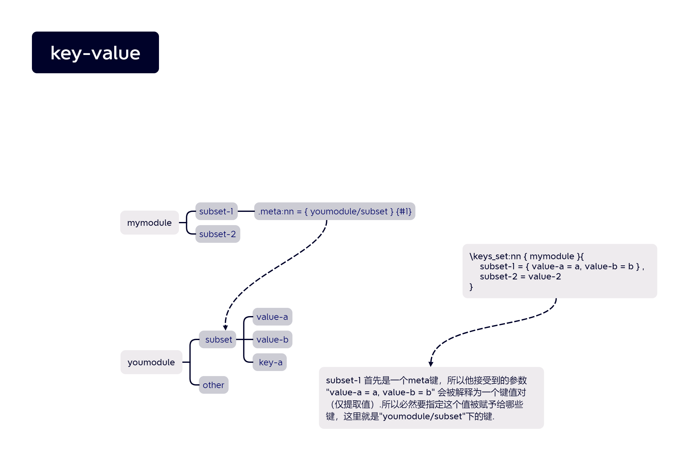

## .default:n / .initial:n
请看如下一段代码:
``` latex 
\keys_define:nn {mymodule}{
    keya    .code:n     = {Enter~ keya},
    keya    .initial:n  = {value-a},
    keyb    .code:N     = {Enter~ keyb},
    keyb    .default:n  = {value-b},
}
\keys_set:nn {mymodule}{keyb}
```
在上述的例子中一个是`.initial:n`, 一个是 `.default:n`, 都表示设置其默认值. 在命令 `\keys_set:nn` 中:
* 如果没有出现 `keyb`, 对应的 `.default` 语句便不会被执行. 如果出现了 `keyb`, 但没有赋值，此时其对应的(默认)语句便会执行.
* 无论其中是否出现 `keya`, 对应的 `.initial` 语句均会执行.


## choice key 
### .choice:
when set key of this type:
* it accepts only one choice(belong to a set of valid choices) in a times.

```latex
\keys_define:nn { moduleA }
  {
    key  .choice:,
    key / subA   .code:n = {subA's~code\par},
    key / subB   .code:n = {subB's~code\par},
  }
\keys_set:nn { moduleA }
  { 
    key = subA, 
    key = subB, 
    % key = {subA, subB}, % --> ERROR
    % key = subC          % --> ERROR
  } 
```

output:
```text 
subA's code
subB's code
```


### .choices:nn
when set key of this type:
* (B). all the choices share the same code.
```latex
\keys_define:nn { moduleB }
  {
    key  .choices:nn = 
      { subA, subB }
      { KeyA~and~KeyB~share~the~same~code\par }
  }
\keys_set:nn { moduleB }
  { 
    key = subA, 
    key = subB, 
    % key = {subA, subB}, % --> ERROR
    % key = subC          % --> ERROR
  }
```
output:
```text 
KeyA and KeyB share the same code
KeyA and KeyB share the same code
```


### .multichoice:
when set key of this type:
* (A). it accepts a set of choices in a time(multiple choice).
```latex
\keys_define:nn { moduleC }
  {
    key      .multichoice:,
    key/subA .code:n = { subA's~code\par },
    key/subB .code:n = { subB's~code\par },
    key/subC .code:n = { subC's~code\par },
  }
\keys_set:nn { moduleC }
  { 
    key = subA,
    key = subB,
    key = {subA, subB}, 
    key = subC
  }
```
output:
```text 
subA's code
subB's code
subA's code
subB's code
subC's code
```


### .multichoices:nn
when set key of this type:
* (A). it accepts a set of choices in a time(multiple choice), and,
* (B). all the choices share the same code.
```latex
\keys_define:nn { moduleD }
  {
    key      .multichoices:nn = 
      { subA, subB }
      { KeyA~and~KeyB~share~the~same~code\par }
  }
\keys_set:nn { moduleD }
  { 
    key = subA,
    key = subB,
    key = {subA, subB}, 
    % key = subC --> ERROR
  }
```
output:
```text 
KeyA and KeyB share the same code
KeyA and KeyB share the same code
KeyA and KeyB share the same code
KeyA and KeyB share the same code
```


## meta-元键
### 介绍
其实就是你传入的参数，比如`{keya=valuea, keyb=valueb}` 解释为键值对，然后再提取 value 给对应的 key 进行赋值. 详细的说明请参见下图:




### 案例
一个简单的使用案例:
```latex
\keys_define:nn { metakey }
  {
    ikeyA        .code:n  = {(inner~ikeyA)~being~set~to:#1\par},
    ikeyB        .code:n  = {(inner~ikeyB)~being~set~to:#1\par},  
    ikeyC / subC .code:n  = {(inner~ikeyC/subC)~being~set~to:#1\par},
    % meta key inner
    MkeyA        .meta:n  = { ikeyA = #1, ikeyB = #1, ikeyC/subC = #1 },
    % meta key outer
    MkeyB        .meta:nn = { metakey / outside }{#1},
  }
% meta key define outside
\keys_define:nn { metakey / outside }
  {
    okeyA   .code:n = {(outside~okeyA)~being~set~to:#1\par},
    okeyB   .code:n = {(outside~okeyB)~being~set~to:#1\par},
  }
\keys_set:nn { metakey }
  { 
    MkeyA = { inner~ikeyA/B/C-val },
    MkeyB = { okeyA=okeyA-val, okeyB=okeyB-val },
    % MkeyA = { ikeyA=ikeyA-val, keyB=ikeyB-val }, % --> ERROR
    % MkeyB = { outer~okeyA/B-val },               % --> ERROR
  }
```

结果输出:
```text 
(inner ikeyA) being set to:inner ikeyA/B/C-val
(inner ikeyB) being set to:inner ikeyA/B/C-val
(inner ikeyC/subC) being set to:inner ikeyA/B/C-val
(outside okeyA) being set to:okeyA-val
(outside okeyB) being set to:okeyB-val
```


## key's group
An simple example:
```latex
\keys_define:nn { groupkey }
  {
    keyA  .code:n   = { keyA's~code\par },
    keyA  .groups:n = { GroupA },
    keyB  .code:n   = { keyB's~code\par },
    keyB  .groups:n = { GroupB },
    keyC / subC .code:n   = { subC's~code\par },
    keyC / subC .groups:n = { GroupA, GroupB },
  }
% 1. set keys belong to groups
\keys_set_groups:nnn { groupkey }{ GroupA }{ keyA, keyB, keyC/subC }
% 2. set keys does NOT belong to groups
\dotfill\par
\keys_set_filter:nnn { groupkey }{ GroupA }{ keyA, keyB, keyC/subC }
% 3. only set the known keys
\dotfill\par
\keys_set_known:nn { groupkey }{ keyA, keyAA }
```

The output:
```text 
keyA's code
subC's code
. . . . . . . . . . . . . . . . . . . . . . . . . . . . 
keyB's code
. . . . . . . . . . . . . . . . . . . . . . . . . . . .
keyA's code
```

## inhert
### example I - intro
An simple example:
```latex 
\keys_define:nn { ParentModuleA }
  {
    pkeyA  .code:n  = { ParentA-keyA's~code\par },
    pkeyB  .code:n  = { ParentA-keyB's~code\par },
    pkeyC  .choice:,
    pkeyC / psubC .code:n  = { ParentA-keyC's~choice~--~subC's~code\par }, 
  }
\keys_define:nn {}{ childkeyA .inherit:n = { ParentModuleA } }
\keys_set:nn { childkeyA }{ pkeyA, pkeyB, pkeyC=psubC }
\dotfill\par
\keys_define:nn { ParentModuleB }{ childkeyA .inherit:n = { ParentModuleA } }
\keys_set:nn { ParentModuleB/childkeyA }{ pkeyA, pkeyB }
```

The output:
```text
ParentA-keyA's code
ParentA-keyB's code
ParentA-keyC's choice – subC's code
. . . . . . . . . . . . . . . . . . . . . . . . . . . . 
ParentA-keyA's code
ParentA-keyB's code
```

### example II - add key
Other example, see: [Inheritance of keys in expl3](https://tex.stackexchange.com/q/739879/294585):
```latex 
\keys_define:nn { ParentA } {
  keyA  .code:n = { ParentA-keyA's~code\par },
}
\keys_define:nn { } {
  ParentB .inherit:n = ParentA,
}
\keys_define:nn { ParentB } {
  keyB  .code:n = { ParentB-keyB's~code\par },
}

\keys_set:nn { ParentB } { keyA = keyA-val, keyB = keyB-val }
```

The output:
```text 
ParentA-keyA's code
ParentB-keyB's code
```


### example III complicate inherit
The code as follows:
```latex 
\keys_define:nn { XXX/ParentA } {
  keyA  .code:n = { ParentA-keyA's~code\par },
}
\keys_define:nn { XXX } {
  ParentB .inherit:n = XXX/ParentA,
}
\keys_define:nn { XXX/ParentB } {
  keyB  .code:n = { ParentB-keyB's~code\par },
}

\keys_set:nn { XXX/ParentB } { keyA = keyA-val, keyB = keyB-val }
```

The output:
```text 
ParentA-keyA's code
ParentB-keyB's code
```


### example IV - delete key
The code as follows:
```latex 
\keys_define:nn { ParentModuleA }
  {
    pkeyA   .code:n = { ParentA-keyA's~code\par },
    unknown .code:n = { ParentA-unkown's~code\par },
  }
\keys_define:nn {}{ childkeyA .inherit:n = { ParentModuleA } }
\keys_define:nn { childkeyA }
  { 
    unknown .code:n = { childkeyA-unkown's~code\par } 
  }
% delete keys
\dotfill\par
\keys_show:nn { childkeyA }{ pkeyA }
\keys_define:nn { ParentModuleA }{ pkeyA .undefine: }
\keys_set:nn { ParentModuleA }{ pkeyA }
\keys_set:nn { childkeyA }{ pkeyA }
```

the shell log is:
```text 
The key childkeyA/pkeyA is undefined.
> .
<recently read> }
                 
l.157 \keys_show:nn { childkeyA }{ pkeyA }
                                          
? 
```

And the final output is:
```text 
ParentA-unkown's code
childkeyA-unkown's code
```

The above results shows that `pkeyA` is not in `childkeyA`, then if you use:
```latex
\keys_define:nn { childkeyA }{ pkeyA .undefine: }
\keys_set:nn { ParentModuleA }{ pkeyA }
\keys_set:nn { childkeyA }{ pkeyA }
```

the output will be:
```text 
ParentA-keyA's code
ParentA-keyA's code
```


## temp variables
For each key processed, information of the full path of the key, the **name** of the key and the **value** of the key is available within two string and one token list variables.

* `\l_keys_path_str`: “full” description of the key, for example: `mymodule/subset/key-a`.
* `\l_keys_key_str`: part of the path after the last `/`, by the above example, the value is `key-a`.
* `\l_keys_value_tl`: everything after the `=`.

Inside the code block for a choice generated using `.choices:nn`, the variables:
* `\l_keys_choice_tl`: the name of the current choice,
* `\l_keys_choice_int`: its position in the comma list.


## others
### usage
usage, see example:
```latex 
\keys_define:nn { module }
  {
    keyA .code:n   = keyA's~code\par,
    keyA .usage:n  = preamble,  % only available in preamble
    keyB .code:n   = keyA's~code\par,
    keyB .usage:n  = load,      % only available when loading
  } 
```

the Scope of use stored in variable `\l_keys_usage_<load|preamble>_prop`:
```latex
\prop_map_inline:Nn \l_keys_usage_load_prop
  { #1=#2.~ } \par
\prop_map_inline:Nn \l_keys_usage_preamble_prop
  { #1=#2.~ } \par
\keys_set:nn { my } { A, B } 
```

### other command
some low level interface to handle key-value data:
* `\keyval_parse:nnn`,
* `\keys_precompile:nnN`,
* `\keys_if_exist:nnTF`,
* `\keys_if_choice_exist:nnnTF`,
* ....


## source code 
The source code of this post:
```latex 
\documentclass{article}
\usepackage[margin=1in]{geometry}
\usepackage{comment}
\parindent0pt


\begin{document}
\ExplSyntaxOn
\section{choice key}
% ==> '.choice:'
\dotfill\par
% when set key of this type:
% 0. it accepts only one choice(among a set of valid choices) in a times.
\keys_define:nn { moduleA }
  {
    key  .choice:,
    key / subA   .code:n = {subA's~code\par},
    key / subB   .code:n = {subB's~code\par},
  }
\keys_set:nn { moduleA }
  { 
    key = subA, 
    key = subB, 
    % key = {subA, subB}, % --> ERROR
    % key = subC          % --> ERROR
  } 


% ==> '.choices:nn'
% when set key of this type:
% 2. all the choices share the same code.
\dotfill\par
\keys_define:nn { moduleB }
  {
    key  .choices:nn = 
      { subA, subB }
      { KeyA~and~KeyB~share~the~same~code\par }
  }
\keys_set:nn { moduleB }
  { 
    key = subA, 
    key = subB, 
    % key = {subA, subB}, % --> ERROR
    % key = subC          % --> ERROR
  }


% ==> '.multichoice:'
% when set key of this type:
% 1. it accepts a set of choices in a time(multiple choice).
\dotfill\par
\keys_define:nn { moduleC }
  {
    key      .multichoice:,
    key/subA .code:n = { subA's~code\par },
    key/subB .code:n = { subB's~code\par },
    key/subC .code:n = { subC's~code\par },
  }
\keys_set:nn { moduleC }
  { 
    key = subA,
    key = subB,
    key = {subA, subB}, 
    % key = subC --> ERROR
  }


% ==> '.multichoices:nn'
% when set key of this type:
% 1. it accepts a set of choices in a time(multiple choice), and,
% 2. all the choices share the same code.
\dotfill\par
\keys_define:nn { moduleD }
  {
    key      .multichoices:nn = 
      { subA, subB }
      { KeyA~and~KeyB~share~the~same~code\par }
  }
\keys_set:nn { moduleD }
  { 
    key = subA,
    key = subB,
    key = {subA, subB}, 
    % key = subC --> ERROR
  }


\section{meta key}
% ==> meta key: 
% a key that set another key.
\keys_define:nn { metakey }
  {
    ikeyA        .code:n  = {(inner~ikeyA)~being~set~to:#1\par},
    ikeyB        .code:n  = {(inner~ikeyB)~being~set~to:#1\par},  
    ikeyC / subC .code:n  = {(inner~ikeyC/subC)~being~set~to:#1\par},
    % meta key inner
    MkeyA        .meta:n  = { ikeyA = #1, ikeyB = #1, ikeyC/subC = #1 },
    % meta key outer
    MkeyB        .meta:nn = { metakey / outside }{#1},
  }
% meta key define outside
\keys_define:nn { metakey / outside }
  {
    okeyA   .code:n = {(outside~okeyA)~being~set~to:#1\par},
    okeyB   .code:n = {(outside~okeyB)~being~set~to:#1\par},
  }
\keys_set:nn { metakey }
  { 
    MkeyA = { inner~ikeyA/B/C-val },
    MkeyB = { okeyA=okeyA-val, okeyB=okeyB-val },
    % MkeyA = { ikeyA=ikeyA-val, keyB=ikeyB-val }, % --> ERROR
    % MkeyB = { outer~okeyA/B-val },               % --> ERROR
  }


\section{key group}
\keys_define:nn { groupkey }
  {
    keyA  .code:n   = { keyA's~code\par },
    keyA  .groups:n = { GroupA },
    keyB  .code:n   = { keyB's~code\par },
    keyB  .groups:n = { GroupB },
    keyC / subC .code:n   = { subC's~code\par },
    keyC / subC .groups:n = { GroupA, GroupB },
  }
% 1. set keys within groups
\keys_set_groups:nnn { groupkey }{ GroupA }{ keyA, keyB, keyC/subC }
% 2. set keys outside groups
\dotfill\par
\keys_set_filter:nnn { groupkey }{ GroupA }{ keyA, keyB, keyC/subC }
% 3. only set the known keys
\dotfill\par
\keys_set_known:nn { groupkey }{ keyA, keyAA }


\section{inhert}
% ==> '.inherit:'
\keys_define:nn { ParentModuleA }
  {
    pkeyA  .code:n  = { ParentA-keyA's~code\par },
    pkeyB  .code:n  = { ParentA-keyB's~code\par },
    pkeyC  .choice:,
    pkeyC / psubC .code:n  = { ParentA-keyC's~choice~--~subC's~code\par }, 
    unknown .code:n = { ParentA-unkown's~code\par },
  }
\keys_define:nn {}{ childkeyA .inherit:n = { ParentModuleA } }
\keys_define:nn { childkeyA }{ unknown .code:n = { childkeyA-unkown's~code\par } }
\keys_set:nn { childkeyA }{ pkeyA, pkeyB, pkeyC=psubC }
\dotfill\par
\keys_define:nn { ParentModuleB }{ childkeyA .inherit:n = { ParentModuleA } }
\keys_set:nn { ParentModuleB/childkeyA }{ pkeyA, pkeyB }
% delete keys
\dotfill\par
\keys_define:nn { childkeyA }{ pkeyA .undefine: }
% \keys_show:nn { childkeyA }{ pkeyA }
\keys_set:nn { ParentModuleA }{ pkeyA }
\keys_set:nn { childkeyA }{ pkeyA }


% other example
\dotfill\par
\keys_define:nn { ParentA } {
  keyA  .code:n = { ParentA-keyA's~code\par },
}
\keys_define:nn { } {
  ParentB .inherit:n = ParentA,
}
\keys_define:nn { ParentB } {
  keyB  .code:n = { ParentB-keyB's~code\par },
}

\keys_set:nn { ParentB } { keyA = keyA-val, keyB = keyB-val }
\ExplSyntaxOff
\end{document}
```

the output of this source code:


## reference
* [LaTeX3 系列教程之二十二（2）：键二](https://zhuanlan.zhihu.com/p/18516611092)
* [interface3](https://mirrors.ctan.org/macros/latex/required/l3kernel/interface3.pdf)
