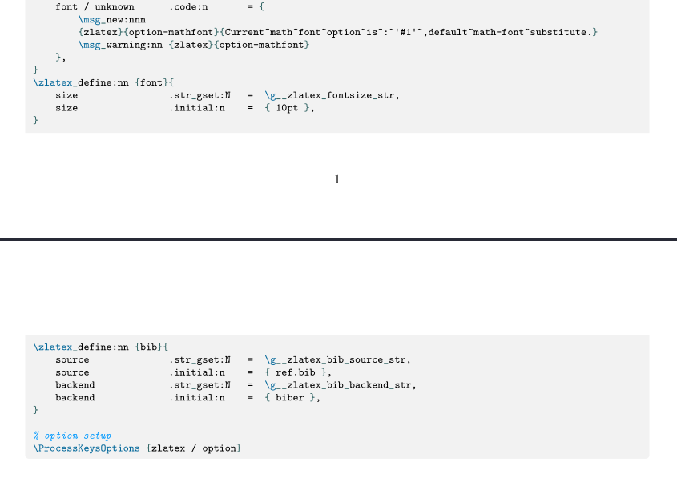
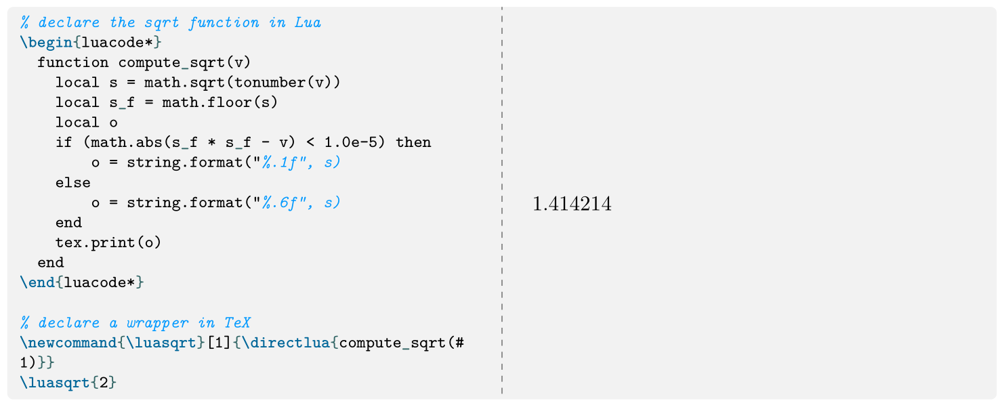
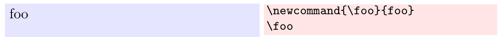
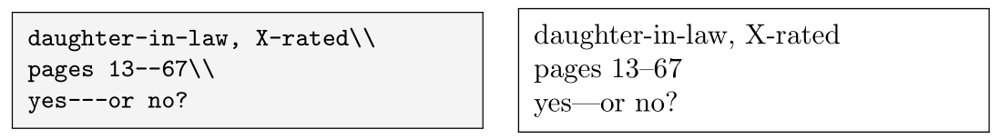

## listing only
一个自己使用的基于`minted` 和 `tcolorbox` 宏包的代码抄录环境，样式说明
* 增加圆角
* 浅色背景
* 可跨页

其实关于代码抄录的核心选项为: `listing only`, 自定义环境的完整声明为:
``` LaTeX
\usepackage{minted}
\usepackage{tcolorbox}
\tcbuselibrary{minted, breakable, skins}
\tcbset{listing engine=minted}
\definecolor{bg}{RGB}{242, 242, 242}
\newtcblisting{code}[1][text]{
  % basic settings
  enhanced,
  breakable,
  listing only, 
  colback=bg, 
  frame hidden, 
  left=1mm, right=1mm,
  top=0mm, bottom=0mm, 
  % minted options
  minted language=#1, 
  minted style=manni,
  minted options = {  
    autogobble,
    tabsize=2,
    breaklines=true, 
    breakanywhere=true,
    breakanywheresymbolpre=,
    breaksymbolleft=,
    fontsize=\footnotesize
  }
}
```

使用方法如下:
``` LaTeX
\begin{code}[<language>]
<your code>
\end{code}
```

使用效果如下



## text and listing
在制作文档类或者是宏包时，作者或许需要一些示例，这些示例的展现形式为:
* 左侧源代码
* 右侧结果展示

更过详细信息可以参见: https://tex.stackexchange.com/q/19295/294585, 或对应的宏包手册. `tcolorbox` 提供了这个接口，对应选项为: `listing and text`. 和此选项相关的几个选项为:
* `sidebyside`: 源码和结果横向分布，默认上下分布
* `listing and text`/`text and listing`: 源码和结果先后顺序

下面是一个我自己常用的代码样例环境:
``` latex
\usepackage{xparse}
\usepackage{minted}
\usepackage{tcolorbox}
\tcbuselibrary{listings, minted, breakable, skins}
\tcbset{listing engine=minted}
\definecolor{bg}{RGB}{242, 242, 242}
\DeclareTCBListing{code}{!O{tex}}{
  % ==> basic settings
  enhanced,
  breakable,
  colback=bg, 
  frame hidden, 
  left=1mm, right=1mm,
  top=0mm, bottom=0mm, 
  %
  % 
  % ==> source and ouput
  sidebyside, 
  listing and text,
  % listing only, 
  % text and listing,
  % listing outside text,
  %
  % 
  % ==> minted options
  minted language=#1, 
  minted style=manni,
  minted options = {  
    autogobble,
    tabsize=2,
    breaklines=true, 
    breakanywhere=true,
    breakanywheresymbolpre=,
    breaksymbolleft=,
    fontsize=\footnotesize
  }
}
```

> 这里我使用了命令 `\DeclareTCBListing`, 需要 `xparse` 宏包来为此环境提供默认参数功能，其中符号 `!` 表示不忽略默认参数中的空格.


使用效果如下



## tkzexample
处理使用 `tcolorbox` 提供的接口外，我们还可使用宏包 `tkzexample` 来实现此功能. 一个基本配置样例:

``` latex
% settings
\usepackage{tkzexample} 
\usepackage[protrusion = true,
            expansion, final,
            verbose = false, babel   = true]{microtype}
\DisableLigatures{encoding = T1, family = tt*}  
\colorlet{graphicbackground}{blue!10!white}
\colorlet{codebackground}{red!10}


% example 
\begin{tkzexample}[latex=.5\linewidth]
\newcommand{\foo}{foo}
\foo
\end{tkzexample}
```

具体效果如下:



## 使用aux辅助
也可以参考: [lshort-zh-cn-style.sty](https://github.com/CTeX-org/lshort-zh-cn/blob/e95288a697822a6f63e6f2eb1b9160a6f324c566/src/lshort-zh-cn-style.sty) 的思路，先把环境中的内容输出到一个外部文件，然后使用 `verbatim` 宏包提供的 `verbatiminput` 命令导入刚才输出的文本.

具体的实现细节如下:
``` latex 
\usepackage{verbatim}
\usepackage{xcolor}


% 'example' environment
\makeatletter
\newwrite\example@out
\newlength\savefboxrule
\newlength\savefboxsep
\edef\example@name{\jobname-example.aux}
\newenvironment{example}%
{\begingroup\@bsphack
  \immediate\openout\example@out=\example@name
  \let\do\@makeother\dospecials\catcode`\^^M\active
  \def\verbatim@processline{\immediate\write\example@out{\the\verbatim@line}}%
  \verbatim@start}%
{\immediate\closeout\example@out\@esphack\endgroup%
  \trivlist\item\relax
  \setlength{\savefboxrule}{\fboxrule}%
  \setlength{\savefboxsep}{\fboxsep}%
  \setlength{\fboxsep}{0.015\textwidth}%
  \setlength{\fboxrule}{0.4pt}%
  \fcolorbox[gray]{0}{0.95}{%
    \begin{minipage}[c]{0.45\textwidth}%
      \setlength{\fboxrule}{\savefboxrule}%
      \setlength{\fboxsep}{\savefboxsep}%
      \small\verbatiminput{\example@name}%
    \end{minipage}%
  }%
  \hfill%
  \fbox{%
    \begin{minipage}[c]{0.45\textwidth}%
      \setlength{\fboxrule}{\savefboxrule}%
      \setlength{\fboxsep}{\savefboxsep}%
      \setlength{\parskip}{1ex plus 0.4ex minus 0.2ex}%
      \normalsize\input{\example@name}%
    \end{minipage}%
  }%
  \endtrivlist
}
\makeatother


% usage 
\begin{example}
daughter-in-law, X-rated\\
pages 13--67\\
yes---or no?
\end{example}
```

具体呈现效果如下:



