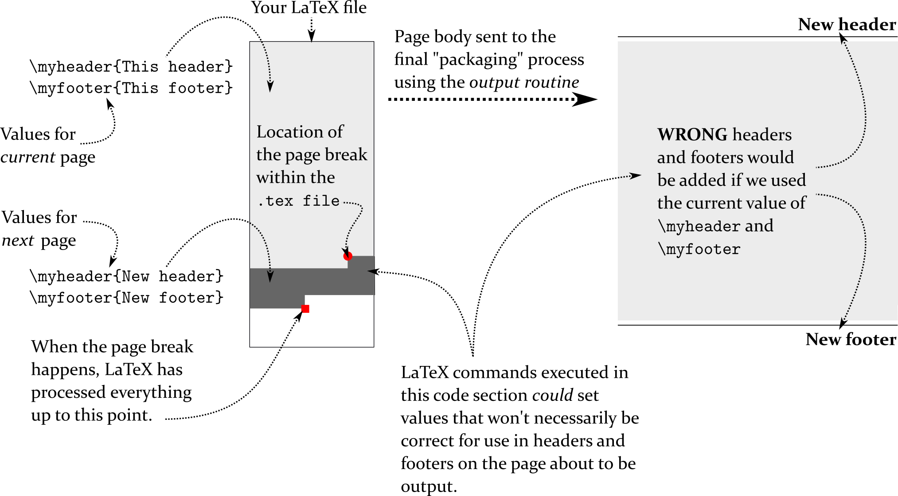
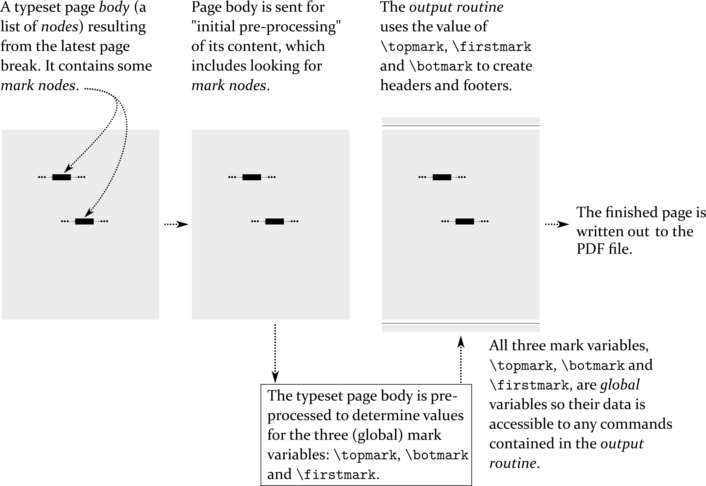
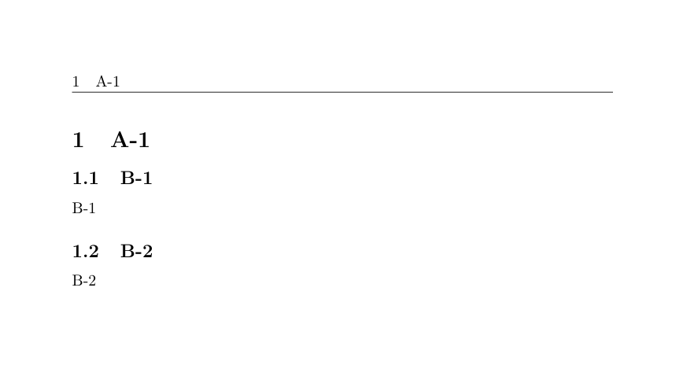
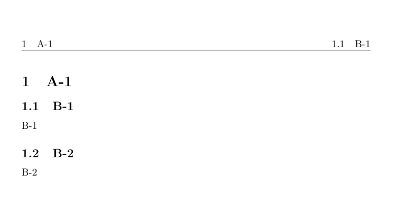

## Main stages

2 stages to of constructing pages:

* finding page breaks
* shipping out completed pages to a PDF file

The internal `\ps@<style>` :

> The `\ps@<style>`  command defines the macros `\@oddhead`, `\@oddfoot`,  `\@evenhead`, and `\@evenfoot` to define the running heads and feet.

For example, see `article.cls`:

```latex
\if@twoside
  \def\ps@headings{%
      \let\@oddfoot\@empty\let\@evenfoot\@empty
      \def\@evenhead{\thepage\hfil\slshape\leftmark}%
      \def\@oddhead{{\slshape\rightmark}\hfil\thepage}%
      \let\@mkboth\markboth
    \def\sectionmark##1{%
      \markboth {\MakeUppercase{%
        \ifnum \c@secnumdepth >\z@
          \thesection\quad
        \fi
        ##1}}{}}%
    \def\subsectionmark##1{%
      \markright {%
        \ifnum \c@secnumdepth >\@ne
          \thesubsection\quad
        \fi
        ##1}}}
\else
  \def\ps@headings{%
    \let\@oddfoot\@empty
    \def\@oddhead{{\slshape\rightmark}\hfil\thepage}%
    \let\@mkboth\markboth
    \def\sectionmark##1{%
      \markright {\MakeUppercase{%
        \ifnum \c@secnumdepth >\m@ne
          \thesection\quad
        \fi
        ##1}}}}
\fi
\def\ps@myheadings{%
    \let\@oddfoot\@empty\let\@evenfoot\@empty
    \def\@evenhead{\thepage\hfil\slshape\leftmark}%
    \def\@oddhead{{\slshape\rightmark}\hfil\thepage}%
    \let\@mkboth\@gobbletwo
    \let\sectionmark\@gobble
    \let\subsectionmark\@gobble}
```

Why we need the macro `\ps@<style>` ? When you change the style of a page using `\pagestyle{<style>}` or `\thispagestyle{<style>}` LaTeX expects to find an internal command named `ps@<style>`—usually provided by the document class `.cls` file or perhaps a package.

## OTR

### Definition

what is **output routine** ?

> One key feature of the final stage of page packaging (composition) is something called an *output routine* which is, in effect, a user-defined sequence of commands used to package-up the page of content to make it ready for sending to the PDF file. One example activity of “packaging-up” is to add headers and footers, but there are numerous ways to use output routines—for example, see [this article in TUGboat](https://tug.org/TUGboat/tb11-1/tb27salomon.pdf). Output routines are a fairly complex area of TeX so we won’t go into detail here: for present purposes **just remember that the final stage of page composition involves using some user-defined sequence of commands (collectively called an *output routine*)**.

The "packaging up" process: once TeX has a “suitably full” page (body) it passes that content to something called an *output routine*.

### Asynchronous 

TeX's typesetting activities *are not synchronised* with the process of outputting typeset pages via the output routine. See the two corresponding internal states of TeX:

* the location in your file corresponding to where the page break takes place
* the location TeX has actually reached in your `.tex` file (always ahead of the before)

are very different in **stored data** , **value of variables**. See example:

```latex
\newtoks\headertoks
\newtoks\footertoks
\newcommand{\myheader}[1]{\global\headertoks={#1}}
\newcommand{\myfooter}[1]{\global\footertoks={#1}}
```

Then see graphic below:



### How to get right value ?

The current page header and footer should be: "This header" and "This footer". So the problem is: which process happens first ?

* the page break(shipout) process ? (process of outputting a typeset page)
* the second red point in the above pgraphic ? (TeX’s typesetting (content construction) activities)

If the first process happens first? Then everything will works right ! But we have see that:

> The second is always ahead of the fisrt, thus we need a rescue -- `\mark` command .

After the TeX engine has determined the location of a page break, these following have been happened in turn:

* TeX’s typesetting (content construction) activities -- determined the location of a page break
* an internal routine (called `fire_up()`) does a lot of pre-processing -- what `\mark` does. We call this process as **mark process** for future reference.
* process of outputting a typeset page

See below for details:



In **mark process** , 3 variables will be set:

* `\botmark` : the last mark seen on the *current* page
* `\topmark` : the value of `\botmark` from the *previous* page
* `\firstmark` : the first mark on the *current* page—the first mark between `\topmark` and `\botmark`

Then how do these marks determined ? See the graphic below:


## Why is your \rightmark empty ?

See the example:

```latex
\documentclass{article}
\usepackage{fancyhdr}
\pagestyle{fancy}
\lhead{\leftmark}
\chead{}
\rhead{\rightmark}
% \rhead{\botmark}    %1 A-11.2 B-2


\begin{document}
\section{A-1}
\subsection{B-1}
B-1

\subsection{B-2}
B-2
\end{document}
```

Compile it, the output will be:



The rightmark is empty. Let's check what happens behind it. Since `\rightmark` is the **first** `right item` in current page.

> Here, the `right item` refers to `<arg>`  in `\markright{<arg>}` or in `\markboth{}{<arg>}` .

Thus we need to check the definition of `\sectionmark`, use command:

```latex
\meaning\sectionmark
```

The ouput is:

```latex
\def\sectionmark##1{%
  \markboth {\MakeUppercase{%
    \ifnum \c@secnumdepth >\z@
      \thesection\quad
    \fi
    ##1}}{}}
```

Then the fisrt `right item` is empty. As you have seen before ? this definition lies in the `twoside` page layout branch. If you add a test command:

```latex
THE DEFAULT LAYPUT: \if@twoside TWOSIDE \else ONESIDE \fi
```

The output is `ONESIDE`. So weird ? No, this is because of the loading of package `fancyhdr`. If you remove this package you will see:

```latex
\sectionmark=\long macro:#1->
```

This is equals to `\let\sectionmark\@gobble` in pagestyle `myheadings`:

```latex
\def\ps@myheadings{%
    \let\@oddfoot\@empty\let\@evenfoot\@empty
    \def\@evenhead{\thepage\hfil\slshape\leftmark}%
    \def\@oddhead{{\slshape\rightmark}\hfil\thepage}%
    \let\@mkboth\@gobbletwo
    \let\sectionmark\@gobble
    \let\subsectionmark\@gobble
}
```

How to make is right when loading package `fancyhdr` ? A simple and **recommended** solution is to use the new mark mechnism  introduced in LaTeX2e. See below:

```latex
\pagestyle{fancy}
\lhead{\leftmark}
\chead{}
\rhead{\FirstMark{2e-right-nonempty}}
```

Then the output will be:



What is the diference between `2e-right-nonempty` and `2e-right`, see the explanation in source2e -- 4.2
Legacy interface extensions:

> The difference between `2e-right` and `2e-right-nonempty` is that the latter will only be updated if the material for the mark is not empty. Thus `\markboth{title}{}` as issued by, say, `\sectionmark`, sets a `2e-left mark` with title and a `2e-right` mark with the empty string but does not add a `2e-right-nonempty` mark.


Or you can re-define the `\sectionmark` command, for example:

```latex
\def\sectionmark#1{\markboth{#1}{<SOMETHING>}}
```

Remark: If you'd like to use this method, please put this line after the loading of `fancyhdr`, otherwise, it will there will be no impact on `\sectionmark` command.


## Create ouput routine command

The markers will be wrong if it have been directly used in normal text. So can we make our own output routine command to access the right value of a mark class ?

There is no need to create such command, IMHO. You can re-define these commands:

* \chaptermark
* \sectionmark
* \subsectionmark
* \subsubsectionmark
* \paragraphmark
* \subparagraphmark

 An simple example:

```latex
\usepackage{fancyhdr}

% create mark classes
\mark_new_class:n {zslide-right}
\mark_new_class:n {zslide-left}

% add entry to these new classes
\renewcommand\sectionmark[1]{\mark_insert:nn {zslide-left}{#1}}
\renewcommand\subsectionmark[1]{\mark_insert:nn {zslide-right}{\thesubsection\ #1}}

% use these classes
\pagestyle{fancy}
\rhead{\FirstMark{zslide-left}}
\rhead{%
	\FirstMark{zslide-right}--\LastMark{zslide-right}%
}
```


The command `\FirstMark` and `\LastMark` is still works perfect in hook, such as `shipout/foreground`, `shipout/background` and so forth.

> In these hooks, the class `2e-right-nonempty` may does NOT work properly !

## REFERENCE

* source 2e
* ltmarks-doc
* [Overleaf How does LaTeX typeset headers and footers?](https://www.overleaf.com/learn/latex/Articles/How_does_LaTeX_typeset_headers_and_footers%3F)


