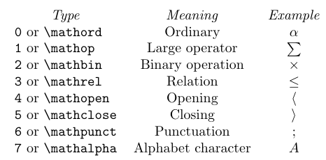
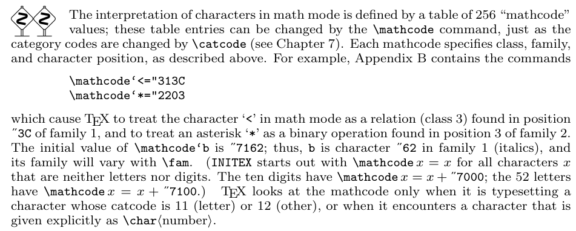
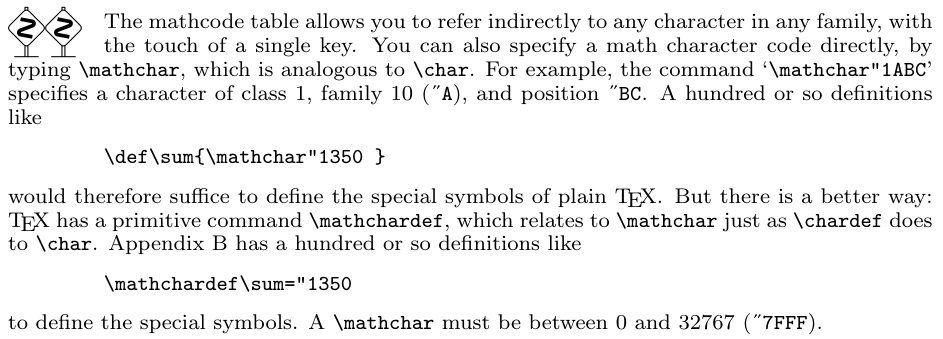
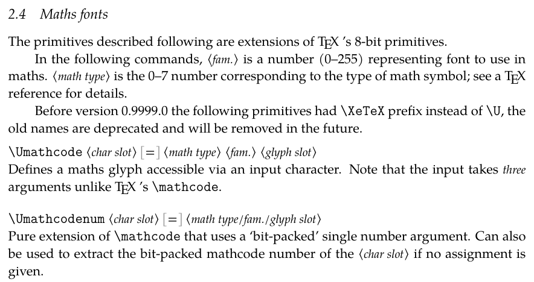
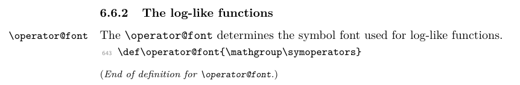
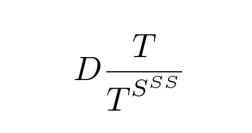

## Preliminery
If you are NOT fimilar with catcode, mathcode, delcode etc, please see my blog: [TeX Coding](https://zongpingding.github.io/2024/11/14/tex_coding/) or other material to learn it fisrt.

If you are not familar with LaTeX text font and math font, you can see by blog [LaTeX font Guide](https://zongpingding.github.io/2024/10/02/font_guide_note/) to learn it.


## font family
Unlike the font scheme(NFSS) in LaTeX, font familt in **plain tex** is something different. Details as below:
* math roman fonts    (family 0) 
* math italic fonts   (family 1) 
* symbol fonts        (family 2) 
* the extension fonts (family 3)


## math atom
Each character(`a,b,c`, `+/-`, etc) or control sequence(`\alpha`, `\sum`, etc) in math fomulars has its own type, which control its spaces arround(before, after, top, below, etc) it. The math symbol type(atom type) is as follows:



When you need some new math symbols, you need to specify to which atom type this symbol should belong during declaring it.

## math code 
All of these commands `\mathcode`, `\mathcahr`, `\mathchardef` are related to mathcode in TeX, which is similar to catcode in text but far more complex that it.


### Plain TeX
In plain TeX, the syntax of command `\mathcode` is:


```latex
\mathcode`<single token>[=]
    <class(atom type)(1 digits)>
    <font family(1 digits)>
    <glyph slot(2 digits)>
```

There is a command `\mathchar` -- `\mathchardef` similar to `\char` -- `\chardef` for text font. See below:



### XeTeX
XeTeX provides command `\Umathcode` (similar to the original command `\mathcode` in plain TeX). It also provides command `\Umathcodenum`, which use a `bit-packed` single argument.



Thus the syntax is:
```latex
\Umathcode<char slot>[=]
    <atom type>
    <font family>
    <glyph slot>

\Umathcodenum<char slot>[=]
    <atom type/font family/glyph slot>
```

## delimiter code 
Beside mathcode, catcode, there is a code called `delimiter code`, you can use command `\delcode` to set it. For detailed info, see: [TeX Coding](https://zongpingding.github.io/2024/11/14/tex_coding/).


## LaTeX 2e
### symbol font
How many `math symol font` pre-defined in LaTeX 2e ? see example below:

```latex
% 1.
\DeclareSymbolFont{sfoperators}{OT1}{cmss}{m}{n}
\DeclareSymbolFontAlphabet{\mathsf}{sfoperators}

% 2.
\DeclareSymbolFont{LMletters}{OML}{lmm}{m}{it}
\DeclareMathSymbol{\lmstar}{\mathbin}{LMletters}{63}
```

There are infinite many math symbol font, see `fntguide` Page 14:

> `\DeclareSymbolFont {⟨sym-font⟩} {⟨encoding⟩} {⟨family⟩} {⟨series⟩} {⟨shape⟩}`. If this is the first declaration for `⟨sym-font⟩` then a new symbol font with this name is created (i.e. this identifier is assigned to a new TEX math group)

So math symbol font from 3 sources:

* the predefine 4 types: `operators`, `letters`, `symbols`, `largesymbols`
* From some package: like `AMSa`, `AMSb` in amsfont package; `zeur` in eulervm package
* The type that your define by command `\DeclareSymbolFont`

### operator font bug ?
Is this a Bug for `\operator@font` in `amsopn.sty` or `ctex.sty`? See definition in latex2e: Page 631



The definition in ctex:

```shell
❯ latexdef -p ctex \symoperators
\symoperators:
\char"0

\the\symoperators:
0
```

The definitions in source 2e:ltmath.dtx - Page 722
```latex
\DeclareRobustCommand\log{\mathop{\operator@font log}\nolimits}
\DeclareRobustCommand\lg{\mathop{\operator@font lg}\nolimits}
\DeclareRobustCommand\ln{\mathop{\operator@font ln}\nolimits}
\DeclareRobustCommand\lim{\mathop{\operator@font lim}}
\DeclareRobustCommand\limsup{\mathop{\operator@font lim\,sup}}
\DeclareRobustCommand\liminf{\mathop{\operator@font lim\,inf}}
\DeclareRobustCommand\sin{\mathop{\operator@font sin}\nolimits}
...
```


## miscellany
### strut and phantom
Reference from "The TeXbook":

> There’s a way out of this dilemma, using an important idea called a “strut.” Plain TEX defines `\strut` to be an invisible box of width zero that extends just enough above and below the baseline so that you would need no interline glue at all if every line contained a strut.

* strut related:
    * `\mathstrut` in math mode:
    ```latex
    \DeclareRobustCommand\mathstrut{\vphantom(}
    ```

    * and the `\strut` in text mode:
    ```latex
    \def\strut{\relax\ifmmode\copy\strutbox\else\unhcopy\strutbox\fi}
    ```


* phantom related:

```latex
\DeclareRobustCommand\vphantom{\v@true\h@false\ph@nt}
\DeclareRobustCommand\hphantom{\v@false\h@true\ph@nt}
\DeclareRobustCommand\phantom{\v@true\h@true\ph@nt}
```


### math surround
Besides, you can control the space arround math atom by command `\mathsurround`, a simple example:

```latex 
abc|{\mathsurround10pt$xyz$}|abc|$xyz$|abc 

% abc| xyz |abc|xyz|abc
```

Additional Reference:
> TEX does, in fact, insert additional space before and after each formula; the amount of such space is called `\mathsurround`, which is a `⟨dimen⟩-valued` parameter.


### style in math 
There are 2 commands `\mathpalette`, `\mathchoice` related to style in math fomulars. Definition of `\mathpalette`, see:

```latex
\def\mathpalette#1#2{%
    \mathchoice
    {#1\displaystyle{#2}}%
    {#1\textstyle{#2}}%
    {#1\scriptstyle{#2}}%
    {#1\scriptscriptstyle{#2}}}
```

What is `\mathchoice` doing for us? Use different construction in different math style.  Syntax of this command is:

```latex
\mathchoice{⟨D/D' math⟩}{⟨T/T' math⟩}{⟨S/S' math⟩}{⟨SS/SS' math⟩}
```

An example using example for "The TeX book":

```latex
\def\puzzle{{\mathchoice{D}{T}{S}{SS}}}
$$\puzzle{\puzzle\over\puzzle^{\puzzle^\puzzle}}$$
```

The output look like:



Then you may know what `\mathpalette` doing .
