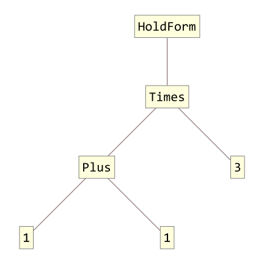

本文的nb文件GayHub仓库地址,望各位不要吝啬小心心,给咱的小仓库点点小星星

https://github.com/zongpingding/Mathematica


## 1. 引入

先来看一段代码（代码来源：[如何用最简单的代码说明Mathematica里面的各个水平层次？](https://www.zhihu.com/question/55683496/answer/148176925)）

``` mathematica
Narcissistic[n_] :=
  Reap[Scan[Module[{count = Join @@ ConstantArray @@@ #},
       Scan[
        If[(Sort@Tally@IntegerDigits[#^n . count] == 
            Sort@ Thread[{#, count}]), Sow[#^n . count]] &, 
        Fold[Function[{digitlist, num}, 
          Flatten[Function[e, 
             Join[e, #] & /@ 
              Subsets[Complement[Range[0, 9], e], {num}]] /@ 
            digitlist, 1]], {{}}, #[[All, 2]]]]
       ] &, Sort /@ Tally /@ IntegerPartitions[n, n]]][[2, 1]];
Narcissistic[10] // AbsoluteTiming
```
这段代码中的  

``` mathematica
:=
#
&  
//  
/@  
/.  
@  
@@  
@@@
```

都是一些啥玩意？你肯能还会在其他的代码中看到另外的一些乱码比如：

``` mathematica
= =
/;
##  
/.  
#1 
#2 
#a  
#b  
## 
##key
##5
%  
%4 
~  
[[]]
```

其实这些就是MMA里面函数的简写：这里我予以说明， 详情肯定是的参考官方文档了

## 2. 说明
### 2.1 符号说明
<!-- > PS <=>     表示等价于 =>       表示结果等于 -->

| 符号 | 原始形式                                        | 含义                                                            |
| ---- | ----------------------------------------------- | --------------------------------------------------------------- |
| //   | 函数的后缀表达式                                | Head[1] <=> 1//Head                                             |
| ~    | 函数的中缀表达式                                | Plus[1, 1] <=> 1~Plus~1                                         |
| :=   | 延迟赋值（可以实时更新）                        | 自定义函数: f[x_] := x+1;                                       |
| ==   | 相等关系                                        | x^2 - 2x + 1 == 0 (一个方程)                                    |
| =    | 赋值符号                                        | a = 2                                                           |
| @    | 函数映射（作用）                                | f[2] <=> f@2                                                    |
| @@   | Apply-应用， 更换头部                           | Apply[f, {1, 2}] <=> f@@{1, 2}                                  |
| @@@  | Apply 应用在第一层的简写                        | Apply[f, {1, 2}, {1}] <=> f@@@{1, 2}                            |
| /;   | Condition (/;)(条件)                            | {6, -7, 3, 2, -1, -2} /. x_ /; x < 0 -> w => {6, w, 3, 2, w, w} |
| /.   | 把某一个表达是按照规则替换                      | {x, x^2, y, z} /. x -> 1=> {1, 1, y, z}                         |
| /@   | Map-映射，Map默认作用在第0层                    | Map[f, 2] <=> f/@2                                              |
| →    | Rule (->)(规则， 这个和我们所说的相等有区别)    | {x, x^2, a, b} /. x -> 3 => {3, 9, a, b}                        |
| #    | 隐函数参数中的第一个参数                        | #1 <=> #                                                        |
| ##   | 纯函数的参数序列                                | f[x, ##, y]&[a, b, c, d] => f[x, a, b, c, d, y]                 |
| ##3  | 表示提供给一个纯函数的参数序列,从第 n个参数开始 | f[##2] &[a, b, c, d] => f[b, c, d]                              |
| #1   | 隐函数中的第一个参数                            | #1 + 1&;                                                        |
| %    | 引用上一次结果                                  | %                                                               |
| %4   | 引用第4次运算结果                               | %4                                                              |
| &    | 纯(匿名)函数声明                                | Function[x, x^2]; <=> #^2&;                                     |
| [[]] | 数组索引                                        | ls[[1]] (数组的第1个元素)                                       |

还有一个`key`的概念,`#key` 选出在关联中对应于"key"的值
``` mathematica
{#b, 1+#b} & [<|"a"->x, "b" -> y |>]
```

上述代码的运行结果为:
``` mathematica
{y, 1 + y}
```


### 2.2 语法说明
一些语句你可能也看不懂，比如下面的

``` mathematica
Apply[f, {{{{{a}}}}}, {0,2}]              (*  结果: f[f[f[{{a}}]]]   *)
Apply[f, {{{{{a}}}}}, Infinity]           (*  结果: {f[f[f[f[a]]]]}  *)
Apply[f, {{{{{a}}}}}, {0, Infinity}]      (*  结果: f[f[f[f[f[a]]]]] *)
```

其实这就是操作中层的概念; 还有以下常见的代码片段：

``` mathematica
Module[
     {x1, y1}, x1 = 1; y1=2;
    res = x1 + y1;
]
```

或者是下面这个

``` mathematica
{
    Block[{x=5}, Hold[x]],
    With[{x=5}, Hold[x]],
    Module[{x=5}, Hold[x]]
}
```

其实这个就是MMA中变量的作用域的概念或者是说生命周期;下面这个例子就是一个比较综合的代码片段，截取自

``` mathematica
images = ConstantImage[Nest[Lighter, Red, 2], #] & /@ 
	Join[ConstantArray[#, 5], ConstantArray[#2, 4], ConstantArray[#3, 6]] & @@ {{400, 450}, {300, 400}, {680, 390}};
	
Show[ImageCollage[
		images, Automatic, {2438, 1219}, 
		Method -> "ClosestPacking", 
		Background -> Nest[Lighter, Blue, 2], 
		ImagePadding -> 5
	], 
	Graphics[{
		Opacity[0], EdgeForm[Black], 
		Rectangle[{0, 0}, {2438, 1219}], EdgeForm[{Red, Thick}], 
		Disk[{1875, 435}, 200],
		Opacity[1], Thick, Dashed, Line[{{#, 0}, {#, 1219}} &[1980]], 
		Line[{{0, #}, {2438, #}} &[490]]
	}], 
	Axes -> True
]
```

MMA中的 `->` 是什么意思啊，为什么不直接使用类似Python中的关键字参数使用`=`来传参呢？这些种种，我都会在下面予以说明。

## 3. 高级编程
其实我也远远没有达到高级编程的程度，但是着篇文章的目的就是为了让你能够看明白其他人的代码。一些你不熟悉的函数，查官方文档就行了。下面主要是一些关于常用内置函数和匿名函数操作的演示。当然还有很多很炫的操作在MMA中，多Google一下就知道了，我这里肯定不能全部包括，特别是一些内置函数的速度快慢等，慢慢积累的。

### 3.1 匿名函数
#### 单参数
``` mathematica
g = # + #&
(* 1. 作用于单个值 *)
g[4]

(* 2. 作用于一个列表 *)
ls = {1, 2, 3};
g[ls]

h = ##&
h[3, 4]
```

运行结果
``` mathmatica
#1 + #1 &
8
{2, 4, 6}
##1 &
Sequence[3, 4]
```

#### 多参数
``` mathematica
f = #1+#2&
f[1, 2]
```

运行结果
``` mathmatica
#1 + #2 &
3
```

#### 抽象函数
``` mathematica
{#, #} & /@ {a, b, c, d}
```

运行结果
``` mathmatica
{{a, a}, {b, b}, {c, c}, {d, d}}
```

#### Function函数
``` mathematica
Function[x, x^2][5]
Function[{x, y}, x+y][4, 2]
```

运行结果
``` mathmatica
25
6
```


### 3.2 头部/数据类型
就目前而言，我觉得这个头部和这个C语言里面的数据类型是差不多的，当然我觉得MMA里面的用起来更舒服一点。
#### 什么是头部
实际上就是一个表达式的数据类型，比如 `List`, `Integer`, `Float` 等； 我们自定义的函数可以看作是一个头部，所以才有了所谓的 `Head`函数; 具体写法如下：主要就是一个抽象的单形参函数 `f` 的使用

``` mathematica
Clear[f]
(* 用 f 替换头部 *)
expr = {a, b, c, d};
Apply[f, expr]

(* 检验头部 *)
expr//Head
Apply[f, expr]//Head
```
运行结果
``` mathematica
f[a, b, c, d]
List
f
```

#### 替换头部
比如把一个"列表"`List`的表头替换成`Plus`，我们就可以对"列表"中的元素求和了; `Apply` 可用于任何头部，而不仅仅是 `List`.
``` mathematica
Clear[g]
Apply[Plus, {1, 2, 3}]
Apply[Plus, g[x,y,z]]
```

运行结果
``` mathmatica
6
x+y+z
```

#### 抽象头部
``` mathematica
abstrcthead = Table[a[i, j], ##]&;

Apply[abstrcthead, {{i, 1, 3}, {j, 1, 2}}]//MatrixForm
```

运行结果
$$
\left(
\begin{array}{cc}
 a[1,1] & a[1,2] \\
 a[2,1] & a[2,2] \\
 a[3,1] & a[3,2] \\
\end{array}
\right)
$$

> 注：SlotSequence (##)(插符序列)

### 3.3 常见简写
下面就是一些常见的函数简写的使用方法
#### Map(/@)

`Map[f, expr] `或 `f/@expr`: 将 `f` 应用到 `expr` 中第一层的每个元素.


**第1个示例**
``` mathematica
Clear[f, g]
(* 1.标准形式 *)
Map[f, {a, b, c}]

(* 2.简写形式 *)
g/@{a, b, c, d}

(* 注：这里的Map能够作用在列表上是应为Map默认作用在第一层 *)
```

运行结果
``` mathmatica
{f[a], f[b], f[c]}
{g[a], g[b], g[c], g[d]}
```

**第2个示例**
``` mathematica
f = {#, #}&;
(* 1.作用一个单个形参 *)
Map[f, 1]
f/@1

(* 2.作用单个形参列表 *)
Map[f, {1, 2}]
f/@{1, 2}


g = {#, #2}&;
(* 错误的写法： Map[g, {{1, 2}, {3, 4}}] *)
```

运行结果
``` mathmatica
1
1
{{1, 1}, {2, 2}}
{{1, 1}, {2, 2}}
```


多个参数必须使用 `Apply` 函数，见下面的说明


#### Apply(@@)

1. `f@@expr` 或 `Apply[f,expr]`: 用 `f` 替换 `expr`的头部. 
2. `Apply[f]`: 表示`Apply`的运算符形式，它可以应用于表达式.
3. `Apply[f,expr,levelspec]`: 替换`expr` 中使用 `levelspec` 指定的部分的头部.


**第1个示例**
``` mathematica
Clear[f]
(* 1.标准形式 *)
Apply[f, {{a,b}, {c}, d}]

(* 2.简写形式 *)

(* 3.运算符形式 *)
Apply[f][{{a,b}, {c}, d}]
```

运行结果
``` mathmatica
f[{a, b}, {c}, d]
f[{a, b}, {c}, d]
```

**第2个示例**:具体写法，主要举例了 `f` 为一个具体的三个形参的函数时的情况
``` mathematica
Clear[x]
fun1 = #1 + #2 + #3 &;

Apply[fun1, {1, 2, x}]
fun1@@{1, 2, x}

(* 错误的写法： Apply[fun1, {{1, 2, x}, {3, 4, y}}]*)
```

运行结果
``` mathmatica
3+x
3+x
```


如果要作用于一个多参数组成的列表，就需要使用`层`这个概念了



### 3.4 操作的层

为什么我们需要层的概念? 为了解决函数作用于列表的时候告诉程序：
1. 列表整体是一个参数
2. 列表中的元素为各个参数（传入多个复合函数形参的参数个数）

表达式所带的`层`对应于需要提取部分的索引号. 像 `Map` 这样的函数可以在指定的层进行操作,可以简单的认为:跨越的大括号对数 = 层数


#### 引入
为什么要有层的概念呢？我当初刚学这个玩意儿的时候是懵逼的，直到有一天我遇到一个问题：

我定义了一个接受三个参数的函数$(x,y,z)$，然后我有一个坐标点的集合$\Omega$,具体的值如下：
$$
\Omega=\{\{1,2,3\},\{4,5,6\},\{7,8,9\}\}
$$

每一个$(x,y,z)$传入后, $F(x,y,z)$都会返回一个具体的实数值$V_i$。


我不想用循环(或者是`Table`去做)，就想用`Apply`去做，让它同时返回$\{V_1,V_2,V_3\}$这样的一个列表。但是我如果直接使用如下的语句：

``` mathematica
Apply[F, {{1, 2, 3}, {4, 5, 6}, {7, 8, 9}}]
```

是报错的，说参数不够。

> 其实当时是受了`Map`的影响，因为`Map`这样就不会报错

然后就深入`Apply`，就了解到了有`层`这个概念；其实按照我的理解，`层`的作用如下（使用上面的例子）：

1. 你告诉函数你的形参列表到底是谁,是最外层（第0层）的那个大列表（此时传入的形参数目为1，就是最大的那个列表）
2. 还是里面第1层的那三个列表（此时传入的型参数目为1，是大列表中的每个小列表，但是F会在第一层遍历这个具有三个元素的大列表）

所以这就是层的作用,还是挺简单的.

> 所以你要真正地搞懂某个东西，也许只有你需要用到它时

#### Map
**第1层**
``` mathematica
Clear[f]
Map[f, {{a, b}, {c, d}}]

(*这个里面的整体元素就是 {a, b}, {c, d}*)
```

运行结果
``` mathmatica
{f[{a, b}], f[{c, d}]}
```

**第2层**
``` mathematica
Map[f, {{a, b}, {c, d}}, {2}]
```

运行结果
``` mathmatica
{{f[a], f[b]}, {f[c], f[d]}}
```

#### Apply
**第0层**
也就是直接把列表中的所有元素作为形参，作用得到一个一维的表达式,，给出一个简单的例子.
``` mathematica
Apply[f, {{a,b,c}, {d,e}}]
```

运行结果
``` mathmatica
f[{a, b, c}, {d, e}]
```

**第1层**
在第一层应用(此时有一个缩写，为`@@@`), 也就是把列表中的每一个元素作为函数每一次作用的形参，作用得到的维度等于列表的维度
``` mathematica
Apply[f, {{a,b,c}, {d,e}}, {1}]
```

运行结果
``` mathmatica
{f[a, b, c], f[d, e]}
```


* `Map`默认在第一层操作
* `Apply`默认在第零层操作


#### @
这个是指普通函数应用,一个简单的示例
``` mathematica
f@x
```

运行结果
``` mathmatica
f[x]
```

#### 多参数匿名函数作用于列表
此时一般不能够用简写的形式， 但是`Apply`有一个`@@@`的简写,
``` mathematica
g = # + #2 + #3&;

g@@{1, 2, 3}
Apply[g, {1, 2, 3}]

Apply[g, {{1, 2, 3}, {4, 5, 6}}, {1}]
g@@@{{1, 2, 3}, {4, 5, 6}}
```

运行结果
``` mathmatica
6
6
{6, 15}
{6, 15}
```


### 3.5 同时作用多层
既然我们可一选择作用在一个层，那么想当然的，我们可以作用于多个层，具体的作用方式就有以下的几种：
``` mathematica
(* 解释：这里是先作用在第0层，然后再作用到得到结果的第1层 *)

(* 检验 *)
"作用在第0层后得到:" Apply[f, {{a,b,c}, {d,e}}]//ToString
"对上面的结果作用在第1层后得到:" Apply[f, Apply[f, {{a,b,c}, {d,e}}], {1}]
"最终的结果:"Apply[f, {{a,b,c}, {d,e}}, {0, 1}]
```

运行结果
``` mathmatica
作用在第0层后得到: f[{a, b, c}, {d, e}]
对上面的结果作用在第1层后得到: f[f[a, b, c], f[d, e]]
最终的结果: f[f[a, b, c], f[d, e]]
```

#### 向下至层2(层0除外)
``` mathematica
Apply[f, {{{{{a}}}}}, 2]
```

运行结果
``` mathmatica
{f[f[{{a}}]]}
```


#### 层0至2
``` mathematica
Apply[f, {{{{{a}}}}}, {0,2}]
```

运行结果
``` mathmatica
f[f[f[{{a}}]]]
```

#### 所有层(从层1)
``` mathematica
Apply[f, {{{{{a}}}}}, Infinity]
```

运行结果
``` mathmatica
{f[f[f[f[a]]]]}
```

#### 层0至所有层
``` mathematica
Apply[f, {{{{{a}}}}}, {0, Infinity}]
```

运行结果
``` mathmatica
f[f[f[f[f[a]]]]]
```


#### 函数符合顺序
``` mathematica
#1+#1&/@Plus[#1, #2]&@@{1, 2}
```

运行结果
``` mathmatica
3
```


### 3.5 一切/随处皆可匿

也就是说，无论在什么地方你都可以使用匿名函数; 若匿名函数多个参数时：使用`[]`包括。


我们可以把我们原来的简单的语句轻松的改成匿名函数语句，相关的操作可以参见下面的演示：
#### 基本使用
``` mathematica
f[x_, y_] := x+y;
f[1, 2]

#+#2&[1, 2]

(*必须使用括号括起来表明是一个函数*)
(#+#2&)[1, 2]
```

运行结果
``` mathmatica
3
3
3
```

#### 实际案例
**示例1**
``` mathematica
Rectangle[{0, 0}, {#, #2}] & @@ {2438, 1219}

(* 相比于这个直接命令方式要好：Rectangle[{0, 0}, {2438, 1219}]*)
```

运行结果
``` mathmatica
Rectangle[{0, 0}, {2438, 1219}]
```

**示例2**
``` mathematica
Line[{{0, #}, {2438, #}} &[490]]

(* 相比于这个命令好：Line[{{0, 490}, {2438, 490}}] *)
```

运行结果
``` mathmatica
Line[{{0, 490}, {2438, 490}}]
```

**示例3**
``` mathematica
Table[i^j, ##]& @@{{i,3}, {j,4}}//MatrixForm
```

运行结果
$$
\left(
\begin{array}{cccc}
 1 & 1 & 1 & 1 \\
 2 & 4 & 8 & 16 \\
 3 & 9 & 27 & 81 \\
\end{array}
\right)
$$


### 3.6 关联

关联将把键符与其值相关联，(用 `->` 输入$\rightarrow$); 其实和Python中的字典差不多，就是一些键值对组成的一个列表。Python或者是其他语言学的好，理解这个也没有什么难的


#### 基本使用
``` mathematica
ass = <|"a" -> x, "b" -> y|>
ass//Head
```

运行结果
``` mathmatica
<|"a" -> x, "b" -> y|>
Association
```

#### 给出键值
``` mathematica
ass["a"]
```

运行结果
``` mathmatica
1
```

#### 纯函数应用
在纯函数中，`#key` 选出在关联中对应于"key"的值,一个简单的示例:
``` mathematica
{#b, 1+#b} & [<|"a"->x, "b" -> y |>]
{#a, 1+#a} & [<|"a"->x, "b" -> y |>]
```

运行结果
``` mathmatica
{15, 16}
{1, 2}
```


### 3.7 插符序列

#### \#\# 
`##`表示提供给纯函数的完全的参数序列,`##` 是 `##1` 的一个简短形式，指的是函数的所有参数.
``` mathematica
f[x, ##, y, ##]&[a, b, c, d]
```

运行结果
``` mathmatica
f[x, a, b, c, d, y, a, b, c, d]
```

对应于##的原对象是一个`Sequence`,见下面的案例:
``` mathematica
##&[a, b, c, d]
```

运行结果
``` mathmatica
Sequence[a, b, c, d]
```

#### 指定参数起始位置
``` mathematica
f[x, ##2, y]&[a, b, c, d]
```

运行结果
``` mathmatica
f[x, b, c, d, y]
```

#### 迭代列表插入到一个Table
``` mathematica
Table[a[i, j], ##]&@@{{i, 3}, {j, 2}}//MatrixForm
```

运行结果
$$
\left(
\begin{array}{cc}
 a[1,1] & a[1,2] \\
 a[2,1] & a[2,2] \\
 a[3,1] & a[3,2] \\
\end{array}
\right)
$$


## 4. 常用函数
### 4.1 Moudle

主要有两种用法：
1. `Module[{x,y,...}, expr]`: 指定在 `expr` 中出现的符号 `x, y, ...` 应被当作局部值.(且不会受到全局变量的影响)
2. `Module[{x=x0,...}, expr]`: 用来定义 `x, ...`的初始值.


#### 变量的作用域
``` mathematica
x = 3
y = 4
Module[
  {x, y},  x = 1; y=2;
  res = x+y;
]

(* 不会受到全局变量的影响 *)
res
```

运行结果
``` mathmatica
3
4
3
```

#### 变量生命周期
``` mathematica
Module[
	{x1, y1},  x1 = 1; y1=2;
	res = x1 + y1;
]

(* 一旦出了Module之外，变量就被清除了 *)
res
x1
y1
```

运行结果
``` mathmatica
2
x1
y1
```

### 4.2 With

用法解释：
`With[{x=x0, y=y0, ...},expr]`: 指定在 `expr` 中出现的符号 `x, y, ...` 应当由`x=x0, y=y0, ...`替换.

备注：`With` 似乎比 `Module` 快


#### 基本使用
``` mathematica
With[{x=7, y=z}, x^2+y]
```

运行结果
``` mathmatica
49 + z
```

#### 没有估值
``` mathematica
(* 一个简单的函数变自量符号替换 *)
With[{x=a}, (1+x^2)&]
```

运行结果
``` mathmatica
1 + a^2 &
```

#### 多次替换
``` mathematica
With[{y=Sin[1.0]}, Sum[y^i, {i,0,10}]]
```

运行结果
``` mathmatica
5.36323
```

### 4.3 Nest

`Nest[f,expr,n]`: 返回一个将`f`作用于 `expr` 上 `n` 次后得到的表达式.


``` mathematica
Nest[g, x, 3]


Clear[y]
f[x_] := x^2;
Nest[f, y+1, 2]


Nest[(1+#)^2&, 1, 3]
((1+(1+(1+1)^2)^2)^2)
(* 计算过程：(1+1)^2 -> (1+(1+1)^2)^2 -> (1+(1+(1+1)^2)^2)^2 *)
```

运行结果
``` mathmatica
g[g[g[3]]]
(1+y)^4
676
676
```

### 4.4 TreeForm
可以使用`TreeForm`查看Mathematica内部表达式的机构,一个示例:
``` mathematica
(1+1)*3//HoldForm//TreeForm
```

运行结果


## 5. 结语
有了这些操作，再也不用担心你的队友看得懂你的代码，说你代码写的菜了。你直接怼他：把我代码看懂再说。

> 还是尽量不要使用太多则会个玩意儿，不然你连你自己的代码都看不明白。
