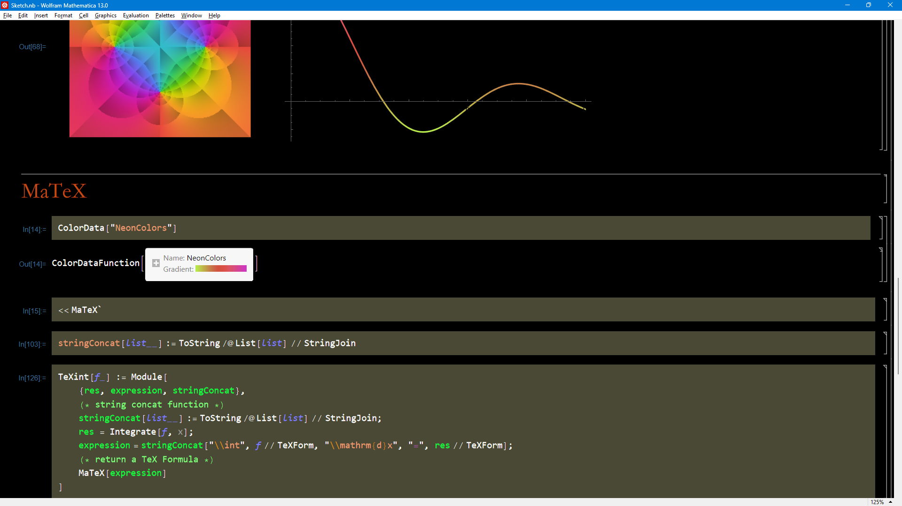

## 自定义黑色主题
我模仿别人的模板做了一个mathematica的暗色主题，相关设置如下，只需要把对应的代码复制到Mathematica中直接运行即可.

``` mathematica
(* 笔记本背景 *)
SetOptions[EvaluationNotebook[], Background -> RGBColor[0, 0, 0]];

(* 绘图label设置 *)
SetOptions[{Plot, Plot3D}, {LabelStyle -> White}];

(* 语法高亮设置 *)
SetOptions[EvaluationNotebook[], 
    Background -> RGBColor[0, 0, 0], 
    AutoStyleOptions -> {
        "LocalVariableStyle" -> {FontColor -> RGBColor[0, 1, 0.25098]}, (* 局部变量颜色 *)
        "StringStyle" -> {FontColor -> RGBColor[0.86, 0.56, 0.06]}, (* 字符串颜色 *)
        "CommentStyle" -> {
            FontColor -> RGBColor[0.5019607843137255, 1., 0.5019607843137255],
            ShowAutoStyles -> False, ShowSyntaxStyles -> False,
            AutoNumberFormatting -> False,
            TranslationOptions -> {"Enabled" -> False}
        }, (* 注释颜色 *)
        "FunctionLocalVariableStyle" -> {FontColor -> RGBColor[0.6196078431372549, 0.6196078431372549, 0.6196078431372549]}, (* 函数中局部变量的颜色 *)
        "PatternVariableStyle" -> {FontColor -> RGBColor[0.5019607843137255, 0.5019607843137255, 1.], FontSlant -> "Italic"}, (* 模式匹配变量的颜色 *)
        "UndefinedSymbolStyle" -> {FontColor -> RGBColor[0.93, 0.62, 0.46]} (* 未赋值的全局符号的颜色 *)
    }
];

(* 使用下面的命令获取当前高亮参数 *)
(*Options[Notebook, AutoStyleOptions]*)
(* 备注:匹配的函数头需要单独手动设置语法高亮为: RGB(128, 128, 192) *)
```

## 效果
最终的效果如下:

