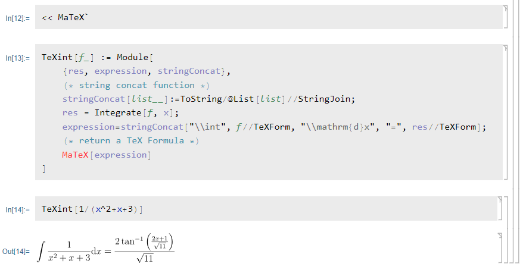

## 模式匹配
模式匹配可以说是 Mathematica 的精华，下面例举几个常用的在 Mathematica 中自定义函数时可能会用到的模式匹配:

### 可变个数参数
``` mathematica
x_   : 匹配任意表达式
x__  : 一个或者多个变量
x___ : 零个,一个或多个变量
```

### 参数类型
我们还可以限定自定义函数参数匹配的类型, 分为简单模式和复杂模式:
``` mathematica
x_Integer   : 匹配整数
x_?NumberQ  : 检验对应的参数是否为数字
```

## 一个应用
Mathematica中有一个 `MaTeX` 包，可以用于在 Mathematica 中使用 LaTeX 公式,但是很多时候这个MaTeX命令并不能很好的和 Mathematica 的命令结合，所以我定义了一个如下命令,用于输出一个函数的积分的 LaTeX 表达式. 命令如下:

``` mathematica
TeXint[f_] := Module[
    {res, expression, stringConcat},
    (* string concat function *)
    stringConcat[list__]:=ToString/@List[list]//StringJoin;
    res = Integrate[f, x];
    expression=stringConcat["\\int", f//TeXForm, "\\mathrm{d}x", "=", res//TeXForm];
    (* return a TeX Formula *)
    MaTeX[expression]
]
```

安装 MaTeX 后运行如下命令:
``` mathematica
<< MaTeX`

(* or *)
Needs["MaTeX`"]
```

然后在运行我上面定义的那个 `TeXint[]` 函数:
``` mathematica
TeXint[1/(x^2+x+3)]
```

最终你就可以得到如下的一个漂亮输出：



## More 
其实 Mathematical 有一个插件仓库的东西,地址如下:
* [PacletRepository](https://resources.wolframcloud.com/PacletRepository/)

这个里面也许有一些你能用的上的插件.


