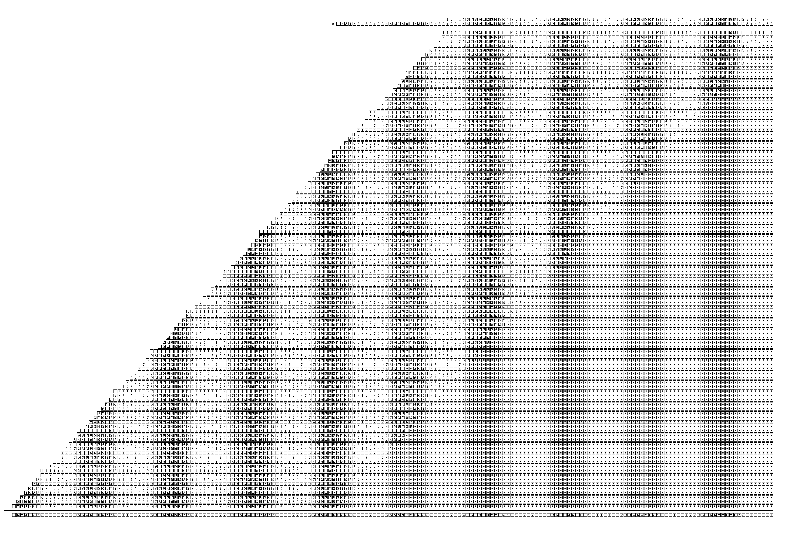

今天写了一个计算乘法的小玩意儿, 遇到的坑还是比较多的:

* 大数乘法怎么解决 ? 本来想自己用 expl3 手搓一个的, 居然发现有现成的了 - `xint`.
* 怎么排版运算过程 ? 我放弃了用表格排版
* 要不就使用 Python 写一个 ? 还是纯 latex 比较好
* ...


代码实现如下(编码风格稍显混乱):

```latex
\documentclass{article}
\newlength\Pwidth
\newlength\Mwidth
\setlength\Pwidth{30in}
\setlength\Mwidth{\dimexpr\Pwidth-1in\relax}
\usepackage[paperwidth=\Pwidth, paperheight=20in, lmargin=\Mwidth, vmargin=0em]{geometry}
\usepackage{xintexpr}

% start implementation
\ExplSyntaxOn\makeatletter
\newbox\resbox
\newlength\digitwd
\newlength\digitht
\newlength\digitsp
\setlength\digitwd{1.5ex}
\setlength\digitht{1.5ex}
\setlength\digitsp{.4ex}

\protected\def\digitfill#1{\hskip\digitsp\relax\fbox{\vbox to\digitht{\vss\hbox to \digitwd{\hss#1\hss}}}}
\protected\def\EMPTY{\rule[.5ex]{.6ex}{.6ex}}

\cs_new:Nn \__num_dec:n
  {
    \tl_map_function:nN {#1}
      \__add_dec:n
  }
\cs_new:Nn \__add_dec:n
  {
    \tl_if_eq:NNTF {#1}{\times}
      {$\times$\ }
      {\digitfill{#1}}
  }

\cs_new:Nn \calc_man_typeset:nn
  {
    \calc_man:nn {#1}{#2}
    \seq_use:Nn \g_tmpa_seq {\par}
    % \seq_show:N \g_tmpa_seq
    \setbox\resbox\hbox{\lastRes}
    % typeset result
    \llap{\rule[.3em]
          {\dimexpr\wd\resbox+2em\relax}
          {1pt}}
    \llap{\exp_args:Ne \__num_dec:n {\xinteval{#1*#2}}}
 }


\cs_new:Nn \calc_man:nn
 {
   \prb_typeset:nn {#1}{#2}
   \int_step_inline:nn {\tl_count:n {#2}}
     {
       \edef\curbnum{\tl_item:nn {#2}{-##1}}
       \edef\curres{\xinteval{#1*\curbnum}}
       \edef\tmpres
         {
          \exp_args:Ne \__num_dec:n 
            {
              % \prg_replicate:nn {\tl_count:n{#2}-##1}{w}
              \curres
            }
          \exp_args:Ne \__num_dec:n {\prg_replicate:nn {##1-1}{\EMPTY}}
         }
       \seq_gput_right:Ne \g_tmpa_seq
         { \exp_not:N \llap{
             \tmpres
          } }
        % save the last item
        \int_compare:nNnT {##1}={\tl_count:n {#2}}
          {\gdef\lastRes{\tmpres}}
      }
  }

\newbox\numa
\newbox\numb
\cs_new:Nn \prb_typeset:nn
  {
    \setbox\numa\hbox{\__num_dec:n {#1}}
    \setbox\numb\hbox{\__num_dec:n {\times~#2}}
    \llap{\copy\numa}
    \llap{\copy\numb}
    \llap{\rule[.3em]
          {\dim_max:nn {\wd\numa}{\wd\numb+1ex}}
          {1pt}}
  }
\def\calcman#1#2{\calc_man_typeset:nn {#1}{#2}}
\ExplSyntaxOff
\parindent0pt\relax
\setlength\fboxsep{1pt}


\begin{document}
\mbox{}\vskip\fill\relax
\calcman{123456789123456789123456789123456789123456789123456789123456789123456789123456789}
{123456789123456789123456789123456789123456789123456789123456789123456789123456789123456789123456789123456789}
\vskip\fill\relax\mbox{}

%%% Some code for debug:
% \llap{\xinteval{123456789123456789123456789123456789123456789123456789*123456789123456789123456789123456789}}

% \xinteval{2^1000}

% \fbox{\vbox to 3em{\vss \hbox{X}\vss}}
\end{document}
```

编译结果如下(生成的 SVG 太大了，就不放上来了):


