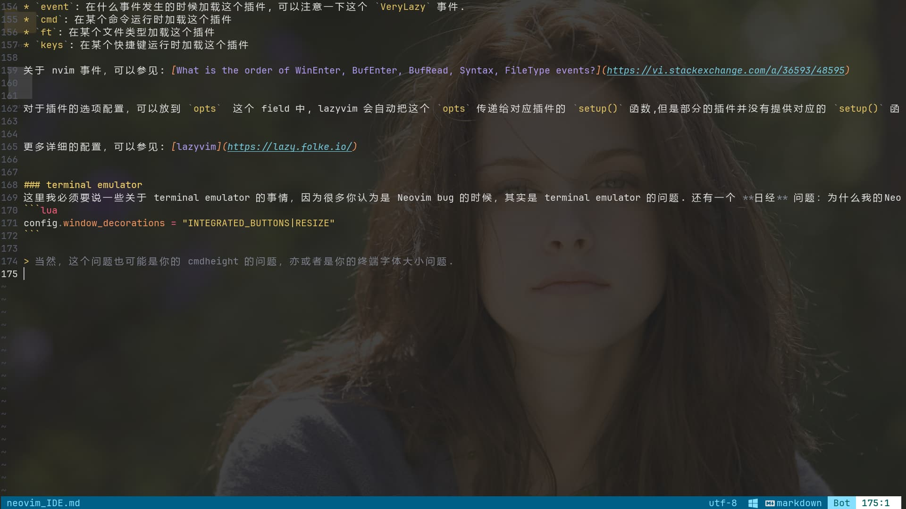

## 编辑器/IDE
我们所说的编辑器和IDE到底有怎样的区别？而被人常常说 Neovim 只是一编辑器，而不是IDE。在我看来一个IDE至少应该是具有以下特点的编辑器：
* `LSP/代码补全`，这个就需要相应的的LSP，也就是Language Server Protocol
* `Highlight/代码高亮`, 虽然说这个功能Neovim自带了，但是很多的时候，它的高亮结果并不是那么的理想，亦或者是说时错误的。于是就需要相应的 Highlight 插件.
* `定义跳转`，很多时候我们都需要在多个文件之间进行跳转.
* `Formatter/代码格式化`，虽然说很多的大型工程都有对于国内的代码规范。我这里就狭义的理解为最普通的代码格式化，比如说代码的缩进，代码的换行，多余的空格控制等等.要在Neovim 中实现对于的Fromat功能，就需要对应的 Formatter，比如针对于Python的Black，针对于C++的Clang-format等等.
* `Linter/代码检查`，其实就是很简单的在我们写代码的时候，进行一些基本的静态检查.比如说变量未定义，函数未定义, 类型不匹配等。这个时候就需要对应的Lint插件，比如说针对于Python的Pylint，针对于C++的Clang-tidy等等.
* `Dap/调试`, 就是Debug，比如加一些断点，单步调试等等.
* ...

其实 IDE 具有的东西还不只上面这些，这里只是例举了一些常用的，必备的功能. 下面就来说一说这些东西怎么配置;


## Neovim 插件
以下的内容均是基于Neovim社区现有的插件进行配置, 我使用的插件管理器是 lazyvim, 淡然你也可以使用其他的插件管理器，比如说vim-plug, dein.vim等等. 
> * 没有必要太纠结插件管理器，我选lazyvim 也不是因为它的lazy load，只是觉得配置起来比较方便而已. 
> * 插件的 lazy load 其实并不是那么的重要，必要的插件在你需要的时候还是会被加载的，所以不必太纠结这个问题.


我的Neovim配置文件结构如下:
```shell
├── init.lua
├── lazy-lock.json
└── lua
    ├── config
    │   ├── lazy.lua
    │   └── options.lua
    ├── plugins
    │   ├── code.lua
    │   ├── copilot.lua
    │   ├── EXPERIMENT.lua
    │   ├── luarocks.lua
    │   ├── note.lua
    │   ├── scheme.lua
    │   └── whick-key.lua
    └── snippets
        ├── luasnip
        │   ├── all.lua
        │   ├── LuaSnipTool.lua
        │   └── tex.lua
        └── vscode
            ├── all.json
            ├── latex.jsonc
            ├── lua.json
            ├── markdown.jsonc
            └── package.json
```

## 配置文件
我的所有东西都是从头开始写的，所以结构可能不想官方推荐的那样, 仅供参考. 上述各个文件夹包含的内容:
* `init.lua`: Neovim 的初始化文件，我在这个里面拉起来了所有的配置文件.
* `lua\config`: 这个里面是一些Lazyvim 本体和一份与插件无关的配置文件.
* `lua\plugins`: 这个里面是所有加载的插件，我分为了几个大类:
    * `code.lua`: 代码相关的插件，比如说LSP, Highlight
    * `scheme.lua`: 主题，语法高亮以及一些UI的插件.
    * `note.lua`: 用于书写笔记相关的插件，如 `Markdown`, `TeX`, `Typst`等.
    * `which-key.lua`: 显示快捷键的插件，当然，如果你熟悉自己的快捷键，这个插件可以不用.
    * `copilot.lua`: Github copilot AI 自动补全插件. (需要你自己申请，但是配置起来是很简单的)
    * `luarocks.lua`: 必要的用于插件管理的插件.
* `lua\snippets`: 代码片段，我这里分为了两个大类，每一个语言的snppets对应的文件:
    * `luasnip`: 用 LuaSnip 写的代码片段, 这里我使用的 `LuaSnip` 插件个人感觉比 vscode 自带的Snippets 强大.
    * `vscode`: 这里我是直接从我以前VSCode中导出的，因为我不行再写一遍.

> 
>* 目前我把 `Formatter`, `Linter`等的配置放入了 `EXPERIMENT.lua` 中，因为我认为这部分还不够的稳定.
>* 对于Vscode 的sniipets，对于的文件夹中必须要有对应的 `package.json` 文件，否则对应的Vscode snippets无法加载.
>* 对于 LuaSnip，对应的snippets 的文件名必须是合法的文件类型, 如 `tex.lua`, `markdown.lua`等等. 
>


## 安装

  在Linux下直接新建目录: `~/.config/nvim` ，我的这个目录结构大致如下：

```shell
~/.config/nvim
├── init.lua
├── lazy-lock.json
└── lua
    ├── config
    ├── plugins
    └── snippets
```

然后切换到这个目录，也就是  `~/.config/nvim` , 运行命令 `nvim`, 之后 nvim 就会自动安装 lazyvim  这插件管理器了。

> 如果你之前安装过 nvim ，请考虑删除 `~/.local/share/nvim`  这个文件夹. 不然可能会对后续的安装有影响.

### Mason
其实对于 LSP, Linter, Formatter 等的东西，完全可以手动安装的，无非就是一个可执行文件嘛, 你自己安装好之后，把这些东西对应的可执行文件的路径加入到 `Path` 中就可以了. 但是我还是推荐新手使用 `Mason` 这个插件，它可以帮助你自动安装这些东西，以及对应的依赖.


在 Windows 下，你可以需要把 Mason 的那个 `bin` 路径加入到 `Path` 中，否则 Mason 安装的这些Linter, Formatter 可能就无法正常工作.


虽然说 Mason 提供给了很多的安装插件，但是部分的 Linter, Formatter 可能并没有提供，这个时候你就需要自己手动安装了. 比如说我需要使用的 `chktex` ，这个东西在 Mason 中并没有提供，所以我就需要自己手动安装了. 但是我使用的是 `nvim-lint`这个插件，它提供了一个 `chktex` 的插件，所以我就不需要自己手动安装了.

> 如果你想要配置对应的 $\LaTeX 3$ 环境的话，目前还没有比较好的 LSP，TeXLab 对此好像还没有动静，更不用说对应的 Linter 了. 在这里还是推荐使用 vscode 的 LaTeX Workshop 插件，它提供了比较好的 LaTeX 3 的 LSP 支持.

对于新手来说，你把 Mason 当作一个专门用于安装 Dap, Linter, Formatter, LSP 的工具就行了. 当你安装好对应的插件后，你就可以在你的配置文件中配置对应的插件了. 

> 如果你只是在 Mason 中安装了这个插件，但是并没有进行相应的配置或者是调用，它们也是不会生效的. 这里我是用的是 `nvimdev/guard.nvim` + `mfussenegger/nvim-lint` 这两个插件. 其中前者主要是用于格式化代码，也就是 Formatter，后者主要是用于检查代码，也就是 Linter. (主要是后者提供的 linter 比前者丰富，所以我才会如此配置.)

如果你想手动配置 LSP，那么可以参见: [neovim-lspconfig](https://github.com/neovim/nvim-lspconfig/blob/master/doc/server_configurations.md), 这个里面有详细的配置说明. 说明了哪些语言应该配置什么样的LSP.

### Tree-sitter
这个 `Tree-sitter` 是用于解析文件，然后提供代码高亮的。但是这个的安装可能优点麻烦, 建议把对应的编译器改为 `zig`, 设置如下:
```lua 
config = function(_, opts)
    require('nvim-treesitter.install').compilers = {"zig", "clang", "gcc"}
    require("nvim-treesitter.install").prefer_git = true
    require("nvim-treesitter.configs").setup(opts)
end
```

### 其余插件
由于目前 lazyvim 还是挺流行的，所以很多的插件仓库中都有对应的 lazyvim 的配置，你只需要稍微改一改就能用了.

## 配置
### snippets 
什么是snippets？这个你自己去网上了解. 目前我使用的是 `LuaSnip` 插件，一方面它可以复用我以前在 Vscode 中已经写好的 snippets，另一方面，它也有自己的一套书写 snippets 的语法, 比vscode的强大很多. 比如它提供的 Node 类型就非常的多:
* `insert node`: 插入节点
* `choice node`: 选择节点
* `function node`: 函数节点
* `text node`: 文本节点
* `dynamic node`: 动态节点
* `snippet node`: 代码片段节点
* `restore node`: 恢复节点
* ...

有了这些类型的节点，再加上 lua 本身的特性，你就可以写出一些非常强大的 snippets 了. 详细的教程可以参见:[LuaSnip](https://github.com/L3MON4D3/LuaSnip/blob/master/DOC.md).一些很 cool 的snippets 可以参见: [awesome-snippets](https://github.com/L3MON4D3/LuaSnip/wiki/Cool-Snippets).


有一个需要说明的是，文件 `require` 时的路径是相对于 `./nvim/lua` 文件夹的. 比如上述的配置结构下我的加载 snippets 的命令为:

```lua
require("luasnip.loaders.from_vscode").lazy_load({paths = "./lua/snippets/vscode"})
require("luasnip.loaders.from_lua").lazy_load({paths = "./lua/snippets/luasnip"})
```


### plugin spec
在你下载插件的时候，其实你有一系列的东西可以配置，参见如下的一个示例:
```lua 
-- terminal: toggleterm.nvim
{
  'akinsho/toggleterm.nvim', 
  version = "*", 
  event = "VeryLazy",
  opts = {
    direction = 'float',
    shell = "pwsh.exe",
    float_opts = { border="curved" }
  },
  config = function(_, opts)
    require("toggleterm").setup(opts)
  end,
  keys = {
    {'<leader>t', "<cmd>ToggleTerm<CR>", mode = "n", noremap = true, desc = "toggle terminal"},
    {'jj',        "<C-\\><C-n>",         mode = "t", noremap = true, desc = "enter normal mode in terminal"},
    {'<Esc>',     "<C-\\><C-n>:q<CR>",   mode = "t", noremap = true, desc = "exit terminal mode"},
  }
}
```

上述的配置中关于 lazy_load 的可选配置有:
* `event`: 在什么事件发生的时候加载这个插件, 可以注意一下这个 `VeryLazy` 事件. 
* `cmd`: 在某个命令运行时加载这个插件
* `ft`: 在某个文件类型加载这个插件
* `keys`: 在某个快捷键运行时加载这个插件

关于 nvim 事件，可以参见: [What is the order of WinEnter, BufEnter, BufRead, Syntax, FileType events?](https://vi.stackexchange.com/a/36593/48595)


对于插件的选项配置，可以放到 `opts`  这个 field 中, lazyvim 会自动把这个 `opts` 传递给对应插件的 `setup()` 函数,但是部分的插件并没有提供对应的 `setup()` 函数，这个时候你就需要自己写一个 `config` 函数，然后在这个函数中进行配置.


更多详细的配置，可以参见: [lazyvim](https://lazy.folke.io/)


### terminal emulator
这里我必须要说一些关于 terminal emulator 的事情，因为很多你认为是 Neovim bug 的时候，其实是 terminal emulator 的问题. 还有一个 **日经** 问题：为什么我的Neovim底部有一个空白的行？这个问题多半就是你的 terminal emulator 的问题.针对与这个问题，如果使用的是 `wezterm`, 那么可以在配置文件中加入如下的配置:
```lua 
config.window_decorations = "INTEGRATED_BUTTONS|RESIZE"
```

> 当然，这个问题也可能是你的 cmdheight 的问题，亦或者是你的终端字体大小问题.


## 最终效果
我的 Neovim 最后的配置效果如下:




  如果你想要抄我的配置，那么请重点看 `EXPERIMENT.lua` 里面的依赖，尤其是那些 formatter 和 linter. 最好安装好如下应用:

* luarocks

* tree-sitter CLI

* clang (for clang-format)

* zig (for compile parser,  仅针对 windows， 在 Linux上使用 gcc 或者是 clang 都可以)

* node, yarn (install parser)

* typos (type check)   如果你没有安装 `typos` 那么在保存文件的时候就会报错:
  ```shell
  Error detected while processing BufWritePost Autocommands for "*":
  Error running typos: ENOENT: no such file or directory
  ```

* selene ( lua  linter) ,   如果没有安装同样会报错:
  ```shell
  Error detected while processing BufWritePost Autocommands for "*":
  Error running selene: ENOENT: no such file or directory
  ```

  
