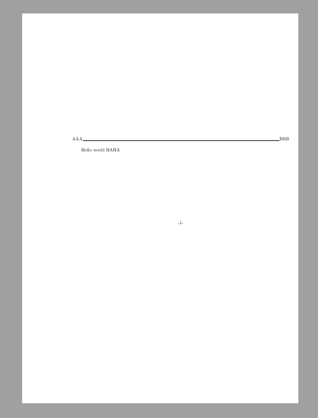
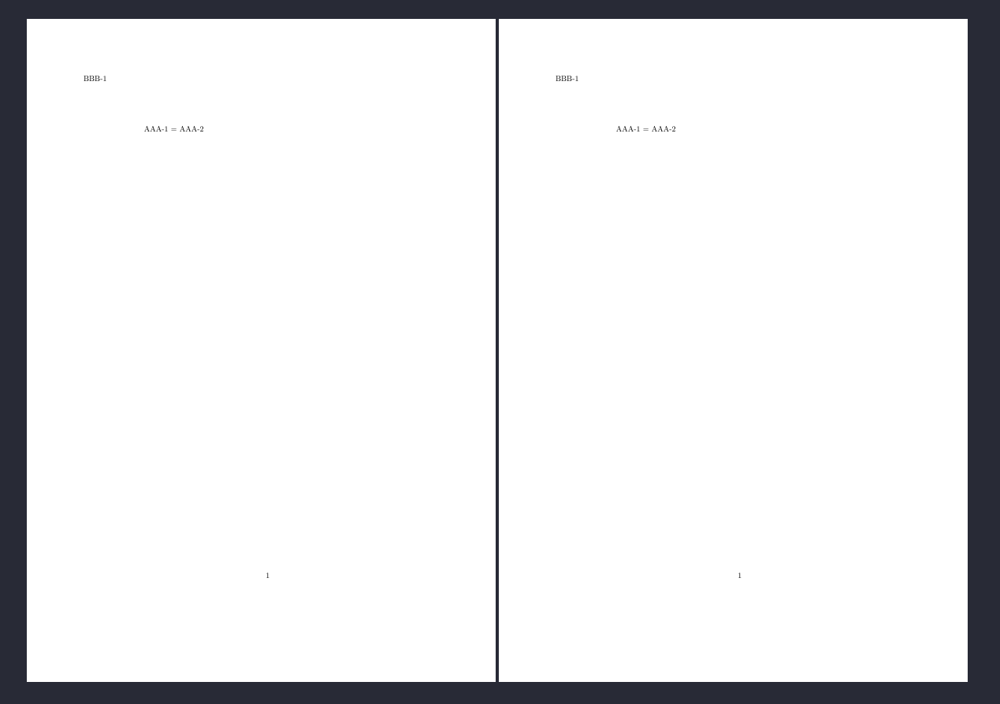

## Plain TeX

### Introduction

Plain TeX 中可以单独定义每一个页面的size, offset，后者可以得到 book 的 twoside. 一个基本的页面格式设置样例:

```latex
\hsize=6.5in
\vsize=2in
\hoffset=.5in
\voffset=3in
\headline={AAA\hrulefill BBB}
\footline={\hss\tenrm-\folio-\hss}


Hello world HAHA
\bye
```

编译结果为:




除了可以使用 `\folio` 直接输出页码外(可以把负数页码输出为 Roman 数字)，还可以使用最原始的 `\pageno` 来输出页码. 后者其实就是 `\countdef\pageno=0`. 前者的定义如下:

```latex
\ifnum\pageno<0 \romannumeral-\pageno \else\number\pageno \fi
```

当然，你还可以使诸如 `\ifnum` 的宏进行条件输出. The TeXbook 中其实也有针对于双栏布局的页眉设计.


而且这个页面是一个 vbox, 那么这个 vertical box 是怎么分开的. TeX 中的裂分操作可以使用一个原始命令: `\vsplit⟨number⟩to⟨dimen⟩` ，它通过从盒子寄存器中裂分出给定量的内容而断点一个 vbox。例如，

```latex
\setbox200=\vsplit100 to 50pt
```

设置 `\box200` 为高度为 `50 pt` 的 vbox；它在 `\box100`（它应该是一个 vbox）中的整个垂直列中找到目标高度为 50 pt 的最低成本断点，其中的丑度和惩罚与分页一样（只是 `\insertpenalties = 0`)。此算法使用 `\splitmaxdepth` 来代替 `\maxdepth` 来控制盒子的最大深度。一些关于 vbox 或者是 hbox 的处理技巧可以参见 The TeXbook 的 "Chapter 13 -- Modes".


那么在这个输入页面的过程中，究竟发生了一些什么 ? 那个页码是怎么加进去的 ? footnote 和图片等东西是怎么个浮动法的 ?


### Main vertical list

现在来看看 TEX 构建页面的细节。所有输入到文档页面东西都放在主垂直列中，它是 TEX 在垂直模式下积累起来的项目序列。在垂直列中的每个项目是下列某种东西:

* 一个盒子 (一个 hbox 或 vbox 或标尺);

* 一个 `无名`(后面要解释的特殊东西);

* 一个标记 (后面要解释的另一种东西);

* 一个插入 (仍然是我们将得到的另一种东西);

* 一个粘连团 (或者 `\leaders`, 我们后面将会看到);

* 一个紧排 (象粘连，但不能伸缩);

* 一个惩罚 (表示此处分页的不良度)

后续会介绍关于这个 main vertical list 的一系列处理. 


### Insertions

但是有时候，要用寄存器临时储存一下，并且确知不会与其它宏冲突。习惯上把寄存器 \count255, \dimen255, \skip255 和 \muskip255 为此保留下来。还有，plain TEX 把 \dimen0 到 \dimen9, \skip0 到 \skip9, \muskip0 到 \muskip9 和 \box0 到 \box9 保留下来随时使用；这些寄存器从来都不被 \new...命令分配。我们已经知道，\count0 到 \count9 是特殊的，并且 \box255 也是特殊的；所以这些寄存器应该避免使用，除非知道自己在做什么.

### Output routine

REF: The TeXbook

> * When a page is completed, it is removed from the main vertical list and passed to an “output routine,” as we will see later;
> 
> * ..., a special “output routine” goes into action before pages actually receive their final form.

可能你想知道页码和此类内容是怎样添加到页面上的。答案是: 在每个分页选定之后，TEX 允许你做进一步处理；在页面得到它们的最终格式前，进入一个特殊的 `输出例行程序(output routine)`。第二十三章讨论了怎样构建输出例行程序以及怎样修改 plain TEX 的输出例行程序. 这个例行程序做的事情一般包括:

- 处理插入对象，如 `\footnote`, `\topinsert` 等

- 页眉页脚, 把命令 `\line{\the\headline}` 放在页面顶部, `\footline` 同理.

- ...

下面我们就来描述一下这个过程:

* 首先从 main vertical list 中分割出内容, 同时进行一些 insertion 和相关寄存器的设置.

* 然后进入模式 -- internal vertical mode，开始读取 `current \output routine` 中命令

* 此时 `\box255` 中包含了TeX 刚刚分割出的那一页内容, 然后这个 output rountine 就会对 `\box255` 做一些操作.

* 当这个 output routine 操作结束后, 在 internal vertical mode 中处理得到的一系列的 item 会被放在 page break 操作之前，超出页面的内容会放被到下一页再次进行类似的处理.

其实这个 `current \output routine` 就是一个含有一系列 token 的东西, 就是一个 token list. 和 `\everypar` ，`\errhelp` 等命令相似，只不过这组 token list 的最开始和结束位置会分别自动插入一个 `{` 和 `}`, 也就是说每一个 output routine 过程都是限制在一个局部的.

> 为什么要加一个 group ? 其实就是防止和当前正文中 TeX 的处理冲突. 为什么会冲突? 其实在 [Marker in TeX - II - Eureka](https://zongpingding.github.io/2024/11/12/marker_in_TeX-II/)  中我们可以知道 TeX 当前所处的位置(page-construction activity)一般是在这个 page break 位置的前面，也就是 page break 操作相对前者是滞后的. TeXbook 中是这样说的:
> 
> "Since TEX’s output routine lags behind its page-construction activity, you can get erroneous results if you change the `\headline` or the `\footline` in an uncontrolled way."
> 
> 
> 
> 这样就可能导致部分位于 page break 和 TeX 当前位置的定义覆盖了 page break 时的定义. 比如 The TeXbook 中描述的这个操作:
> 
> "For example, an output routine often changes the \baselineskip when it puts a headline or footline on a page".

那么这个 \output 里面都有些什么呢? 默认情况或者是 `\output={}` 时，默认的内容为: `\output={\shipout\box255}` . 这种情况下是没有任何的: 页眉，页脚或者是页码的. 

Plain TeX 中的 `\shipout⟨box⟩` 命令才是真正生成最终输出的命令，它把当前 box 中的内容输出到对应的 dvi 文件中. 没输出一个 box，TeX 就会在终端中打印 `\counter0` 到 `\counter9` 的信息, 同时也会记录在对应的 dvi 文件中.

> 你在任何的地方都可以使用 `\shipout` 这个命令，这个命令并不是局限于 output routine.

在 output routine 开始前，`\outputpenalty` 被设为当前断点的惩罚的值, \insertpenalties 被设为与延迟的插入对象的总数相等, ... 这些特殊的变量被设置妥善后，可以在 output routine 中做很多的事情. 其中最典型的就是把所以之前的延迟的插入对象输出(就好比 LaTeX 中的 clearpage 可以把之前没有输出的浮动体全部输出一样) 的命令 `\supereject`, 其实就是它把 `\outputpenalty` 这个值设为了 -20000. 

> * 一个 penalty 可以用于衡量当前是否需要断行，分页或者是这里的 ship out. 如果惩罚的越严重，也就是 penalty 值越大，就越会阻止在此处的断行，分页等操作(直观理解就是：我惩罚 TeX 在这里断行的操作，如果换做一个负值，当然就是鼓励 TeX 在这里进行断行，TeX 开心了, 自然也就愿意断行了, 毕竟被我们奖励了嘛).
> 
> * 那么 `\eject` 和 `\supereject` 这两个咋理解呢？多的那个 super 是干啥的 ?

下面介绍两个关于 output routine 的极端设置, 第一个例子:

```latex
\shipout\box255
```

这个 output routine 就是单纯的只输出一个box中内容，不添加任何的东西到这个 page 的 main vertical list 中, 比如 footline 和 headline.

第二个比较极端的例子如下:

```latex
\output={\unvbox255 \penalty\outputpenalty}
```

这个 output routine 把当前页面的 box 中的内容添加到下一页的 main vertical list 中的同时也在这个地方插入一个 penalty, 然后让 TeX 重新考虑分页，尽管分页的结果可能仍然是一样的，如果你的 `\vsize` 之类的参数没有调整的话 (在这个过程中, 前一页的所有 penalty 都没有丢失). 而且，这个操作会让 TeX 陷入死循环. 这个死循环可以通过 `\deadcycles` 和 `\maxdeadcycles` 两个变量的设置来进行避免.

在整个页面输出过程中，`\box255` 这个特殊的寄存器不能滥用，也就是:

* 在 TeX 准备把一个新的页面内容添加到 `\box255` 前，这个 box 应该保持为空.

* 在 TeX 执行完这个 output routine 之后，这个 `\box255` 也应该置为空.

在 Plain TeX 中的 output routine 设置为:

```latex
\output={\plainoutput}
```

而这个命令中各个 macro 的含义如下:

```latex
% 1. \plainoutput
\shipout\vbox{\makeheadline
\pagebody
\makefootline}
\advancepageno
\ifnum\outputpenalty>-20000 \else\dosupereject\fi

% 2. \makeheadline
\vbox to 0pt{\vskip-22.5pt
  \line{\vbox to8.5pt{}\the\headline}\vss}
\nointerlineskip

% 3. \pagebody
\vbox to\vsize{\boxmaxdepth=\maxdepth \pagecontents}

% 4. \pagecontents
\ifvoid\topins \else\unvbox\topins\fi
\dimen0=\dp255 \unvbox255
\ifvoid\footins\else % footnote info is present
\vskip\skip\footins
\footnoterule
\unvbox\footins\fi
\ifraggedbottom \kern-\dimen0 \vfil \fi

% 5. \makefootline
\baselineskip=24pt
\line{\the\footline}
```

这个 output routine 就是在输出 box 内容的同时，加上 headline 和 footline，以及进行一个 penalty 判断，以此决定是否输出那些 held-over 的 insertions.

上述定义中，值得注意的就是 `\topins` 和 `\footins` 两个命令, 前者在 box 内容的上方插入，后者在 box 下方插入. 而且，如果你的 insertions class 不只这两个，那么你还需要把你自定义的 insertation class 添加到这个 output routine 中.

在看一个书中的题目来增加你对这个 OTR 的理解:

> Explain how to change the output routine of plain TEX so that it will produce twice as many pages. The material that would ordinarily go on pages 1, 2, 3, etc., should go onto pages 1, 3, 5, . . . ; and the even-numbered pages should be entirely blank except for the headline and footline. (Imagine that photographs will be mounted on those blank pages later.)

解答:

```latex
\output={\plainoutput\blankpageoutput}
\def\blankpageoutput{\shipout\vbox{\makeheadline
  \vbox to\vsize{}\makefootline}\advancepageno}
```

这个章节后续的内容就是关于 marker 的了，这个内容请参见我的博客: [Marker in TeX - II - Eureka](https://zongpingding.github.io/2024/11/12/marker_in_TeX-II/) , 这篇文章中介绍了更为现代的 marker 机制.


### Conclusion

总而言之，这个 output routine(OTR) 就是一组放在 `\ouput{<commands>}` 中的命令. shipout 是 OTR 中的一个子命令.


## LaTeX 2e

### Introduction

上面我们讨论了原始的 plain TeX 中关于 OTR 的一些知识，但是现在我们大部分人都是用的 LaTeX 2e，或者是 LaTeX 3. 那么在这两个里面，这个 OTR 又有哪些变化呢 ? 而且 LaTeX 中也提供了 `\ShipoutBox` 命令以及一些和 shipout 相关的 hook，如 `shipout/before`, 那么这些东西要怎么使用呢 ? 


### Document

首先，在 source 2e 中我们可以看到如下的说明:

> For example, the various hooks available during the page shipout process in LATEX’s output routine can (and have to) access the accumulated page material stored in a box named `\ShipoutBox`. This way, code added to, say, the `shipout/before` hook could access the page content, alter it, and then write it back into `\ShipoutBox` and any other code added to this hook could then operate on the modified content. Of course, for such a scheme to work the code prior to executing the hook would need to setup up data in appropriate places and the hook documentation would need to document what kind of storage can be accessed (and possibly altered) by the hook.

其实从上面这段话也能够看出，那个那个把页面内容打包进 `\box255` 的过程是在钩子 `shipout/before` 之前的, 在这个钩子之后才会调用对应的 `\shipout` 命令.

然后再看看 source 2e 中 ltshipout.dtx 小结关于这个 shipout 的介绍:

> The code provides an interface to the `\shipout` primitive of TEX which is called when a finished pages is finally “shipped out” to the target output file, e.g., the `.dvi` or `.pdf` file. A good portion of the code is based on ideas by Heiko Oberdiek implemented in his packages atbegshi and atenddvi even though the interfaces are somewhat different.

而且在 LaTeX 2e 中，`\shipout` 这个命令被重新定义了:

> With this implementation TEX’s shipout primitive is no longer available for direct use. Instead `\shipout` is running some (complicated) code that picks up the box to be shipped out regardless of how that is done, i.e., as a constructed `\vbox` or `\hbox` or as a box register. 
> 
> It then stores it in a named box register. This box can then be manipulated through a set of hooks after which it is shipped out for real. Each shipout that actually happens (i.e., where the material is not discarded for one or the other reason) is recorded and the total number is available in a readonly variable and in a LATEX counter.

具体的定义如下:

```latex
\cs_gset_eq:NN \shipout \__shipout_execute:

\cs_set_protected:Npn \__shipout_execute: {
  \tl_set:Nx \l__shipout_group_level_tl
    { \int_value:w \tex_currentgrouplevel:D }
  \tex_afterassignment:D \__shipout_execute_test_level:
  \tex_setbox:D \l_shipout_box
}
```

那么接下来我们就主要参考文档: ltshipout-code.pdf 这份文档了. 

### Primitive

#### \shipout

首先肯定是考虑使用原始的那个 `\shipout` 命令, 但是这个命令已经不能像原来那样使用了, 你可以使用 `\RawShipout` 这个比较简单的命令, 样例如下:

```latex
\documentclass{article}

\begin{document}
AAA-1
\AddToHook{shipout/before}{
  \RawShipout\box\ShipoutBox
} 
\end{document}
```

此时的输出了两页相同的 PDF, 如下:


需要注意的是，这个命令可以在 `shipout/before` or `shipout/after` 中使用，并且可以使用 `\ShipoutBox` 这个 box. 这个命令可以避过诸如 background, foreground 之类的 hooks，只会执行 `shipout/firstpage` 和 `shipout/lastpage` 这两个 hooks. 另外一个关于这个命令的例子如下:

```latex
\documentclass{article}
\newbox\mybox

\begin{document}
AAA-1 = AAA-2 

% \setbox\mybox=\vbox{\hbox{BBB-1}\box\ShipoutBox}}
\AddToHook{shipout/before}{
  \setbox\mybox=\vbox{\hbox{BBB-1}\box\ShipoutBox}
  \RawShipout\box\mybox
}
\end{document}
```

编译结果为:



注意：如果你的 `\mybox` 定义在 `hook/before` 外面，那么页面内容就会丢失，主要是因为你不能在外部获取 `\ShipoutBox`中的内容，所以它就是一个空盒子.


#### \ShipoutBox

这个盒子寄存器和 Plain TeX 中的 `\box255` 是比较类似的，但是 !! 不要在目前的 LaTeX 中使用 `\box255` 或者是对这个 box 进行全局赋值 (global assignment). 这个盒子是局部的，并且请在局部进行更改, 可以参考上面的第二个例子.

关于这个盒子的使用，直接参见上面的例子即可，这里重点讲解这个盒子和 `shipout/before`， `shipout/after` 的关系. 在 `shipout/before` 这个 hook 中，这个盒子里面只有当前页面的内容(accumulated material for the page). 但是在 `shipout/after` 中，这个盒子中就被添加了 foreground 以及 background 了. 注意：除了在这特定的两页, `shipout/firstpage` 和 `shipout/lastpage` 中的内容也不会出现在这个盒子里面.


### Hooks

lthooks 提供了很多于此相关的 hook, 可以用于 shipout 的相关操作，比如水印添加，页面尺寸调整。主要的 hooks 如下:

* shipout

* shipout/before

* shipout/after

* shipout/foreground

* shipout/background

* shipout/firstpage

* shipout/lastpage

这么多的 hooks，很乱？并没有，只要弄明白每个 hook 之间的先后顺序就简单了. 下面这幅图大致梳理了他们之间的关系:

```latex
1. finished page has been stored in \ShipoutBox

2. shipout/before

3. shipout/background (very first item into the \ShipoutBox)

4. shipout/foreground (very last item into the \ShipoutBox)

5. shipout 

--> (LuaTeX hook: "pre_shipout_filter")

--> ⟨ship out the content in \ShipoutBox⟩

6. shipout/after (the page box has been shipped out)
```

上述的 `shipout/firstpage` 和 `shipout/lastpage` 其实没有什么值得说的，很直观, 需要注意的点在关于 `\ShipoutBox` 一节中也已经说明了. 

在第一个 hook -- `shipout/before` 中，你可以使用命令 `\DiscardShipoutBox (或者是 \shipout_discard:)` 来清空 `\ShipoutBox` 中的内容. 和 Plain TeX 中不同的是，在这个 hook 和最后一个 `shipout/after` hook 中, 你均不能把当前 box 中的内容保留到 next page 的 main vertical list 中重新进行 ship out. 总之，不要用这个 hook 做这个事情，这回导致一系列无法预料的结果.

第二/三个 hook -- `hook/background` , `hook/foreground` 的实现原理也很有意思。这里以 background 举例：它其实就是在 `\ShipoutBox` 的最前面插入了一个宽度为 0 的 `\hbox` ，这个 hbox 中包含了一个 `picture` 环境. 所以你也就能有理解它为啥会被 `\ShipoutBox` 中的内容覆盖了, 同时也解释了为啥你的纵坐标必须为负值了. 后面的 foreground 就是在最后插入的，为了语法的统一，把这个 hbox 同样移动到了页面的 top-left 的 (0, 0) 位置. 

关于 `shipout` 这个 hook，对应的注意点为:

> It cannot be used to cancel the shipout operation via `\DiscardShipoutBox` (that has to happen in shipout/before, if desired! More precisely, `\DiscardShipoutBox` cannot be used in any of the `shipout/...` hooks other than `shipout/before`.

基本的使用示例，可以参见 LaTeX2e 的 [test file](https://github.com/latex3/latex2e/blob/e0ddefece6c8637d76be5e6a77ca641f616e14ca/base/testfiles-search/github-0920.lvt#L22), 大致如下:
```latex
\AddToHook{shipout}{%
  \setbox\ShipoutBox=\vbox{\moveright1in\box\ShipoutBox}%
  \setbox\ShipoutBox=\hbox to\paperwidth{\box\ShipoutBox\hss}%  
  \setbox\ShipoutBox=\hbox{\reflectbox{\box\ShipoutBox}}%
  \setbox\ShipoutBox=\vbox{\moveleft1in\box\ShipoutBox}%
}
```

还有很重要的一点，可以看作是 `\RawShipout` 这个命令的一些 trick:

> If `\RawShipout` is used instead of `\shipout` then only the hooks `shipout/firstpage` and `shipout/lastpage` are executed (on the first or last page), all others are bypassed.


### Infomation counter

在现在，我们不仅拥有这些 hook，还有有一些计数器能够使用，如下:

* `\ReadonlyShipoutCounter`: 当前已经 shipped out 的 page 总数, 如果你是在 OTR 中使用的这个变量，那么还需要加上当前正在 shipping out 的这一页. **这个变量是只读的**, 是一个 TeX counter, 所以使用诸如: `\Alph{\ReadonlyShipoutCounter}` 是没有作用的.

* `totalpages`: 和上面的作用差不多，不过是一个 LaTeX counter. 可以像这样使用它: `\arabic{totalpages}`.

* `\PreviousTotalPages`: 返回上一个文档编译得到的总页数, 默认为 0. 这不是一个 counter，而是一个命令.

### Emulating commands from other packages

在 hook 之际这么完善的情况下，其实我们可以使用这套 hook 取代绝大多数红包中提供的命令了。这一系列的宏包就包括:

* atbegshi

* everyshi

* atenddvi

* everypage


最后再补充一个 Tip，你可以把 hyperref 的 Target 放到 `shipout/background` 中，以此来使用 Hyperref 包. 


## Application

说了这么多，其实没多少东西的. 用它写写东西就好了. 我个人就觉得那个 `\put` 语法的纵坐标为负值无法忍受，所以就写一个用于页面标注的命令, 如下:

```latex
% #1: fore/background; #2: position; 
% #3: anchor;          #4: object
% #5: hook range
% \RequirePackage{transparent}
\dim_const:Nn \zph {\paperheight}
\dim_const:Nn \zpw {\paperwidth}
\cs_new_protected:Npn \__zlatex_page_annotate:nnnnn #1#2#3#4#5
  {
    \tl_if_empty:eTF {#5}
    {
      \hook_gput_code:nnn {shipout/#1}
        {zlatex-page-annotation}
        {\put#2{\makebox(0, 0)[#3]{#4}}}
    }{
      \hook_gput_next_code:nn {shipout/#1}
        {\put#2{\makebox(0, 0)[#3]{#4}}}
    }
  }
\zlatex_keys_define:nn { page/mask }{
  layer    .tl_set:N  = \l__zlatex_page_mask_layer_tl,
  layer    .initial:n = background,
  position .tl_set:N  = \l__zlatex_page_mask_position_tl,
  position .initial:n = {(.5\zpw, .5\zph)},
  anchor   .tl_set:N  = \l__zlatex_page_mask_anchor_tl,
  anchor   .initial:n = c,
}
\cs_generate_variant:Nn \__zlatex_page_annotate:nnnnn {eee}
\cs_new:Npn \__page_mask@pos_parse:w (#1, #2) 
  {(
    \dim_to_decimal:n {#1} pt, 
    \dim_to_decimal:n {#2-\paperheight} pt
  )}
\NewDocumentCommand{\zlatexPageMask}{so+m}{
  \group_begin:
  \IfBooleanTF{#1}{\gdef\@once@hook@sign{}}{\gdef\@once@hook@sign{*}}
  \IfValueT{#2}{\zlatex_keys_set:nn { page/mask }{#2}}
  \__zlatex_page_annotate:eeenn 
    {\l__zlatex_page_mask_layer_tl}
    {\exp_after:wN \__page_mask@pos_parse:w \l__zlatex_page_mask_position_tl}
    {\l__zlatex_page_mask_anchor_tl}{#3}
    {\@once@hook@sign}
  \group_end:
}
```

具体的实现细节就省略了.


## REFERENCE
* The TeXbook: DEK
* source 2e
* source 3
* ltshipout-doc: Frank Mittelbach, LATEX Project Team
