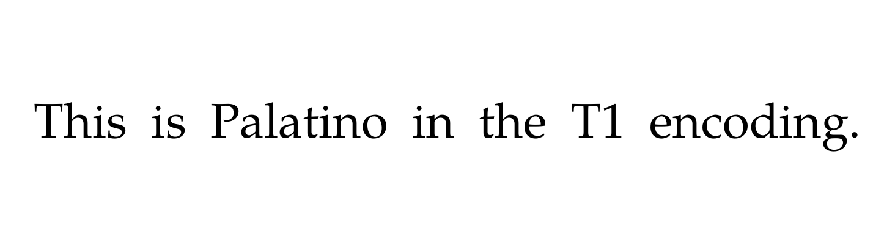

## ttf2afm

### 准备

* 需要转化的字体, 这里以 Palatino 为例, 字体的文件名为: `pala.ttf`
* encoding 文件，把 charcode 对应到 glyph. 这个 encoding 文件的名称为: `ec-uni.enc`.

### .enc 文件

因为 ttf 字体的 glyph name 不是必须的，或者是全部错误，亦或者是部分错误。于是最可靠的一个映射是: `Unicode --> glyph index`.  每一个可用的 TrueType 字体一定会提供了从 unicode 到 glyph index 的正确映射.

有了 glyph index,  我们能干啥呢? 由于在 TrueTypefont 中，并不是像 T1 encoding 那样使用一个 glyph name 来对应一个 glyph。在 TrueType 中使用的是 `indices` 来和 glyph 进行一一对应,  TrueType 通过一个 叫 `cmap` 的机制来解决这个编码问题(一一对应问题). 这个 cmap 中有很多张不同的表用于解决不同 编码下的映射问题，每一张表包含了  `glyph index --> glyph` 这样的一一映射.

`.enc` 文件里面有些什么东西呢？这些东西又有什么用呢? 比例这里会用到的 `ec-uni.enc` 文件，其中有这样的内容：

``` shell
/encqecuni[
/uni0060
/uni00B4
/uni02C6
/uni02DC
/uni00A8
/uni02DD
...
/uni00FD
/uni00FE
/uni00DF
] def
```

要让 pdftex 正常使用这个字体，就必须要让 pdftex 能够找到这个字体里面的 glyphs。从 pdftex 1.21a 开始，pdftex 能够完成这样的事情（仅对 TrueType 管用）:

* 可以读取一个 font 的 `unicode -> glyph index` 表, 寻找这个 unicode 码对应的 glyph index.
* 当读取到对应的 `glyph index` 后, 就能够找到这个 index 对应的 glyph 了.

> 这个 .enc 里面的unicode 编码到底是怎么映射的  ? 比如这里的前面几个Unicode码对应的字符是:
>
> - /uni0060：`  (反引号)
> - /uni00B4：´ (尖音符)
> - /uni02C6：ˆ (抑扬符)
> - /uni02DC：˜ (波浪号)
> - /uni00A8：¨ (分音符)
> - /uni02DD：˝ (双分音符)

`ttf2afm` 这个寻找 glyph index 的过程和上面的 pdftex 寻找的过程相同. 

### .afm 文件

这个 `.afm` 文件到底有什么作用呢? 它的作用就是把一个字体里面的所有 glyph names 转化为 unicode 形式的编码: `uniXXXX`.

一个关于 `.afm` 文件可以编码多少个 characters 的问题:

* 每一个 Type 1 Font  + 它对应的 AFM 文件可以包含无数个 characters ,
* 对于每一个字体，TFM 文件只可以编码最多 256 个 characters.

下面我们就使用 ttf2afm 工具生成这个字体对应的 `.afm` 文件 (由于前面提及对于 TrueType font，从 `glyph name --> glyph index` 这个mapping 是不靠谱的. 所以这里我们采用 `unicode --> glyph index` 这个靠谱的映射. 下面的 `-u` 参数就表示 unicode):

```shell
ttf2afm -u -e ec-uni.enc -o pala-t1.afm pala.ttf
```

> This simple approach does not **handle ligatures**; see below.) This can be done easily enough by a script that reads the AGL (Adobe Glyph List)

运行这个命令对应的 log:

```shell
Warning: ttf2afm (file pala.ttf): `unicode uni02DD' is not mapped to any glyph

Warning: ttf2afm (file pala.ttf): `unicode uni02DA' is not mapped to any glyph

Warning: ttf2afm (file pala.ttf): `unicode uni02C7' is not mapped to any glyph

...

Warning: ttf2afm (file pala.ttf): glyph 8 has multiple encodings (the first one being used): uni0025 uni2027 uni2028 uni2029 uni202A uni202B uni202C uni202D uni202E uni202F

Warning: ttf2afm (file pala.ttf): glyph 130 has multiple encodings (the first one being used): uni009F uni0178

Warning: ttf2afm (file pala.ttf): glyph 238 has multiple encodings (the first one being used): uni0111 uni20AB

Warning: ttf2afm (file pala.ttf): glyph 3 has multiple encodings (the first one being used): uni0020 uni2015 uni2016 uni2017 uni201B uni201F uni2023 uni2024 uni2025 uni2031

...
```

因为 `glyph index --> unicode` 这个 mapping 也不总是靠谱的，可能一个 glyph index 对应了多个 unicode. 

>  ?? 也可能 一个 Unicode 也不对应,  这个时候可能就会分配一个省却的 unicode 码 给这个 glyph index， 比如 `index123`. ？？

 上述的日志表明 glyph index 130 对应了两个 unicode 码：uni009F 和 uni0178. 而 ttf2afm 默认采用了第一个 unicode. 

现在让我们来看一看生成的 `pala-t1.afm` 文件长啥样:

```shell
StartFontMetrics 2.0
Comment Converted at Fri Sep 27 21:34:51 2024 by ttf2afm from font file `pala.ttf'
FontName Palatino
FullName Palatino
FamilyName Palatino
Weight Normal
ItalicAngle 0
IsFixedPitch false
FontBBox -545 -283 1020 1133
UnderlinePosition -48
UnderlineThickness 24
Version 1.0
Notice 
EncodingScheme FontSpecific
CapHeight 708
XHeight 469
Ascender 728
Descender -292
StartCharMetrics 423
C 0 ; WX 333 ; N uni0060 ; B 30 505 254 676 ;
C 1 ; WX 333 ; N uni00B4 ; B 78 505 301 676 ;
C 2 ; WX 333 ; N uni02C6 ; B 11 509 323 676 ;
C 3 ; WX 333 ; N uni02DC ; B 1 535 332 640 ;
C 4 ; WX 333 ; N uni00A8 ; B 17 537 315 637 ;
C 9 ; WX 333 ; N uni00AF ; B 11 538 323 590 ;
C 11 ; WX 333 ; N uni00B8 ; B 96 -225 304 -9 ;
...
C -1 ; WX 0 ; N index418 ; B -532 735 -252 1029 ;
C -1 ; WX 0 ; N index419 ; B -532 735 -137 1046 ;
C -1 ; WX 0 ; N index420 ; B -535 735 -241 1020 ;
C -1 ; WX 0 ; N index421 ; B -532 69 -253 876 ;
C -1 ; WX 777 ; N index422 ; B 0 0 0 -7825 ;
EndCharMetrics
EndFontMetrics
```

### .map / .pl 文件

 当我们生成这个 `.afm` 文件后，其实还不可以在 pdftex 下使用这个字体了，比如你编译下面的这样一个使用样例:

```latex
% test.tex
\pdfmapline{+pala-t1 <ec-uni.enc <pala.ttf}
\font\f=pala-t1
\f This is Palatino in the T1 encoding.
\bye
```

在命令行使用命令 `pdftex  test.tex` 编译，日志输出为:

```shell
This is pdfTeX, Version 3.141592653-2.6-1.40.26 (TeX Live 2024) (preloaded format=pdftex)
 restricted \write18 enabled.
entering extended mode
(./test.tex{c:/texlive/2024/texmf-var/fonts/map/pdftex/updmap/pdftex.map}
kpathsea: Running mktextfm pala-t1

The command name is C:\texlive\2024\bin\windows\mktextfm

kpathsea: Running mktexmf pala-t1.mf

The command name is C:\texlive\2024\bin\windows\mktexmf
name = pala-t1, rootname = pala-t, pointsize = 1
mktexmf: empty or non-existent rootfile!
Cannot find pala-t1.mf.
kpathsea: Appending font creation commands to missfont.log.

! Font \f=pala-t1 not loadable: Metric (TFM) file not found.
<to be read again>
                   \f
l.3 \f
       This is Palatino in the T1 encoding.
?
```

报错说找不到对应的 `.tfm` 文件, 那么我们接下来就生成其对应的 `.tfm` 文件. 首先运行:

```shell
afm2pl pala-t1.afm
```

运行这个命令后生成了 `pala-t1.map`, `pala-t1.pl` 两个文件，两个文件中的内容为:

```latex
% pala-t1.map
pala-t1 Palatino <pala-t1.pfb
```

第二个文件中的内容为:

```latex
% pala-t1.pl
(FAMILY pala-t1)
(CODINGSCHEME FONTSPECIFIC)
(DESIGNSIZE R 10.0)
(DESIGNUNITS R 1000)
(COMMENT DESIGNSIZE (1 em) IS IN POINTS)
(COMMENT OTHER DIMENSIONS ARE MULTIPLES OF DESIGNSIZE/1000)
(BOUNDARYCHAR O 5)
(FONTDIMEN
   (SLANT R 0.000000)
   (SPACE D 500)
   (STRETCH D 250)
   (SHRINK D 166)
   (XHEIGHT D 469)
   (QUAD D 1000)
   (EXTRASPACE D 166)
   )
(LIGTABLE
   )
(CHARACTER O 0 (comment uni0060)
   (CHARWD R 333)
   (CHARHT R 676)
   )
(CHARACTER O 1 (comment uni00B4)
   (CHARWD R 333)
   (CHARHT R 676)
   )
(CHARACTER O 2 (comment uni02C6)
   (CHARWD R 333)
   (CHARHT R 676)
   )
(CHARACTER O 3 (comment uni02DC)
   (CHARWD R 333)
   (CHARHT R 640)
   )
   
...

(CHARACTER O 375 (comment uni00FD)
   (CHARWD R 556)
   (CHARHT R 670)
   (CHARDP R 283)
   )
(CHARACTER O 376 (comment uni00FE)
   (CHARWD R 601)
   (CHARHT R 726)
   (CHARDP R 280)
   )
(CHARACTER O 377 (comment uni00DF)
   (CHARWD R 556)
   (CHARHT R 730)
   (CHARDP R 8)
   )
```

### .tfm 文件

然后再使用如下命令生成对应的 `.tfm` 文件:

```shell
pltotf pala-t1.pl
```

运行这个命令后，生成了 `pala-tl.tfm` 文件, 运行的 log 为:

```shell
I had to round some heights by 13.0000000 units.
I had to round some depths by 2.5000000 units.
```

那么现在我们有了这样一些文件(按照时间顺序列举):

* pala.ttf
* ec-uni.enc
* pala-t1.afm
* pala-t1.map
* pala-t1.pl
* pala-t1.tfm

可以编译通过了吗 ? 试试:

```text
$ pdftex test.tex
This is pdfTeX, Version 3.141592653-2.6-1.40.26 (TeX Live 2024) (preloaded format=pdftex)
 restricted \write18 enabled.
entering extended mode
(./test.tex{c:/texlive/2024/texmf-var/fonts/map/pdftex/updmap/pdftex.map}
[1{ec-uni.enc}] )<pala.ttf><c:/texlive/2024/texmf-dist/fonts/type1/public/amsfo
nts/cm/cmr10.pfb>
Output written on test.pdf (1 page, 12444 bytes).
Transcript written on test.log.
```

编译结果截图如下:



### 测试必要文件

上面生成了一大堆的文件，这些个文件都是必须的吗？我们试试看哪些文件才是必须的。经过一番的测试，发现只有:

* pala.ttf
* ec-uni.enc
* pala-t1.tfm

三个文件时必须的. 但是始终感觉这个 `.enc` 文件比较碍眼.

## fontinst

前面我们借助的工具是 `ttf2afm`, 并且使用它生成了对应的 afm 文件。但是对于 `fontinst` 来说，使用 ttf2afm 生成的 afm 文件对 fontinst 是无效的。我们需要 `afm file with AGL names`。下面来演示以下这个流程:

### 生成 afm 文件

使用命令:

```shell
ttf2afm -u -o pala.afm pala.ttf
```

### 生成 AGL afm 文件

需要自己去完成对应 glyph names to Unicode 的工作. 没有找到对应的脚本。 关于这个 fontinst ，我也不会用。


## 参考

[A closer look at TrueType fonts and pdfTEX](https://tug.org/TUGboat/tb30-1/tb94thanh.pdf)

毕竟这是一篇 2009 年的文章，会不会存在过时的原因 ? 啥时候看看目前比较流行的 pdftex 下调用 ttf 字体的方案.  这篇文章就记录到这里吧.


