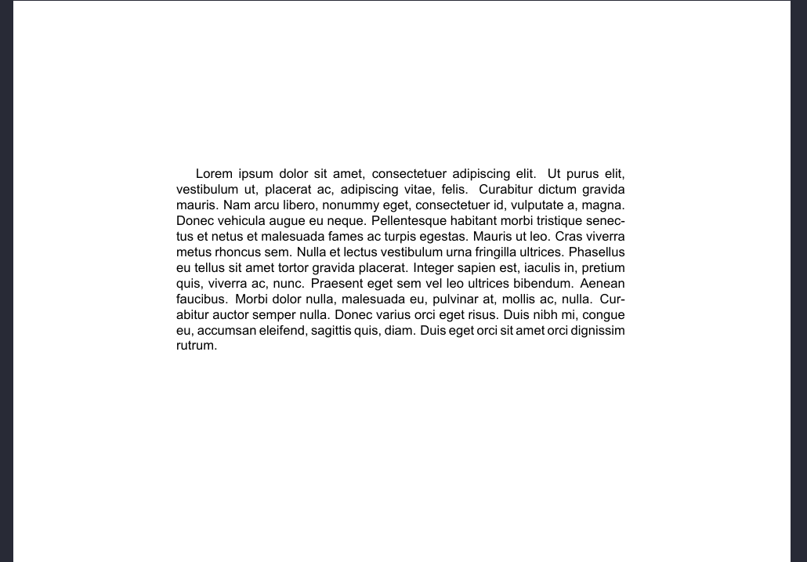

## Preface
You can use an tool: [otftotfm](https://www.lcdf.org/type/otftotfm.1.html), which can work with both `*.ttf`(sometimes may fail) and `*.otf`. Also see the answer in [How do I use TrueType Fonts with PDFTeX using otftotfm?](https://tex.stackexchange.com/a/52902/294585)


## Example - 'arial.ttf'
### get font info
Get font info(just to give an explicit vendor name, which will be the name of the `*.map` file):
```shell
otfinfo -i arial.ttf
```

You'll get:
```txt
Family:              Arial
Subfamily:           Regular
Full name:           Arial
PostScript name:     ArialMT
Version:             Version 7.00
Unique ID:           Monotype:Arial Regular (Microsoft)
Designer:            Monotype Type Drawing Office - Robin Nicholas, Patricia Saunders 1982
Manufacturer:        The Monotype Corporation
Trademark:           Arial is a trademark of The Monotype Corporation.
Copyright:           © 2017 The Monotype Corporation. All Rights Reserved.
```

### generate dependency
Next, generate the required dependency(the name `T1-arial` will be used in `*.fd` file): 
```shell
otftotfm -a --verbose -e ec  -fkern -fliga --vendor monotypecorp arial.ttf T1-arial > Arial.log
```

You'll get:
```txt
C:\texlive\2024\bin\windows\otftotfm.exe: glyphlist.txt found with kpathsea at c:/texlive/2024/texmf-dist/fonts/map/glyphlist/glyphlist.txt
C:\texlive\2024\bin\windows\otftotfm.exe: texglyphlist.txt found with kpathsea at c:/texlive/2024/texmf-dist/fonts/map/glyphlist/texglyphlist.txt
C:\texlive\2024\bin\windows\otftotfm.exe: encoding file ec.enc found with kpathsea at c:/texlive/2024/texmf-dist/fonts/enc/dvips/base/ec.enc
C:\texlive\2024\bin\windows\otftotfm.exe: c:/texlive/2024/texmf-dist/fonts/enc/dvips/base/ec.enc:103: warning: bad ligature ('space' has no encoding)
C:\texlive\2024\bin\windows\otftotfm.exe: c:/texlive/2024/texmf-dist/fonts/enc/dvips/base/ec.enc:103: warning: bad ligature ('space' has no encoding)
C:\texlive\2024\bin\windows\otftotfm.exe: c:/texlive/2024/texmf-dist/fonts/enc/dvips/base/ec.enc:114: warning: bad '{}' ('space' has no encoding)
C:\texlive\2024\bin\windows\otftotfm.exe: c:/texlive/2024/texmf-dist/fonts/enc/dvips/base/ec.enc:114: warning: bad '{}' ('space' has no encoding)
C:\texlive\2024\bin\windows\otftotfm.exe: warning: TrueType-flavored font support is experimental
C:\texlive\2024\bin\windows\otftotfm.exe: warning: 'liga' feature ignored, not supported by font
C:\texlive\2024\bin\windows\otftotfm.exe: placing encoding files in 'c:/Users/PC/.texlive2024/texmf-var/fonts/enc/dvips/monotypecorp'
C:\texlive\2024\bin\windows\otftotfm.exe: creating encoding file c:/Users/PC/.texlive2024/texmf-var/fonts/enc/dvips/monotypecorp/a_g2sfp5.enc
C:\texlive\2024\bin\windows\otftotfm.exe: updating c:/Users/PC/.texlive2024/texmf-var/ls-R for fonts/enc/dvips/monotypecorp/a_g2sfp5.enc
C:\texlive\2024\bin\windows\otftotfm.exe: warning: assuming --no-type1 since this font is TrueType-flavored
C:\texlive\2024\bin\windows\otftotfm.exe: placing TFM files in 'c:/Users/PC/.texlive2024/texmf-var/fonts/tfm/monotypecorp/Arial'
C:\texlive\2024\bin\windows\otftotfm.exe: placing VF files in 'c:/Users/PC/.texlive2024/texmf-var/fonts/vf/monotypecorp/Arial'
C:\texlive\2024\bin\windows\otftotfm.exe: creating C:\Users\PC\AppData\Local\Temp\otftmp.2
C:\texlive\2024\bin\windows\otftotfm.exe: running vptovf C:\Users\PC\AppData\Local\Temp\otftmp.2 "c:/Users/PC/.texlive2024/texmf-var/fonts/vf/monotypecorp/Arial/T1-arial.vf" "c:/Users/PC/.texlive2024/texmf-var/fonts/tfm/monotypecorp/Arial/T1-arial.tfm" 2>&1
I had to round some heights by 12.0000000 units.
I had to round some depths by 1.0000000 units.
C:\texlive\2024\bin\windows\otftotfm.exe: updating c:/Users/PC/.texlive2024/texmf-var/ls-R for fonts/tfm/monotypecorp/Arial/T1-arial.tfm
C:\texlive\2024\bin\windows\otftotfm.exe: updating c:/Users/PC/.texlive2024/texmf-var/ls-R for fonts/vf/monotypecorp/Arial/T1-arial.vf
C:\texlive\2024\bin\windows\otftotfm.exe: placing TFM files in 'c:/Users/PC/.texlive2024/texmf-var/fonts/tfm/monotypecorp/Arial'
C:\texlive\2024\bin\windows\otftotfm.exe: creating C:\Users\PC\AppData\Local\Temp\otftmp.3
C:\texlive\2024\bin\windows\otftotfm.exe: running pltotf C:\Users\PC\AppData\Local\Temp\otftmp.3 "c:/Users/PC/.texlive2024/texmf-var/fonts/tfm/monotypecorp/Arial/T1-arial--base.tfm" 2>&1
I had to round some heights by 12.0000000 units.
I had to round some depths by 1.0000000 units.
C:\texlive\2024\bin\windows\otftotfm.exe: updating c:/Users/PC/.texlive2024/texmf-var/ls-R for fonts/tfm/monotypecorp/Arial/T1-arial--base.tfm
C:\texlive\2024\bin\windows\otftotfm.exe: ignoring TrueType file ./arial.ttf found with kpathsea in '.'
C:\texlive\2024\bin\windows\otftotfm.exe: placing TrueType files in 'c:/Users/PC/.texlive2024/texmf-var/fonts/truetype/monotypecorp/Arial'
C:\texlive\2024\bin\windows\otftotfm.exe: running copy arial.ttf "c:/Users/PC/.texlive2024/texmf-var/fonts/truetype/monotypecorp/Arial/arial.ttf"
C:\texlive\2024\bin\windows\otftotfm.exe: updating c:/Users/PC/.texlive2024/texmf-var/ls-R for fonts/truetype/monotypecorp/Arial/arial.ttf
C:\texlive\2024\bin\windows\otftotfm.exe: placing DVIPS map files in 'c:/Users/PC/.texlive2024/texmf-var/fonts/map/dvips/monotypecorp'
C:\texlive\2024\bin\windows\otftotfm.exe: updating c:/Users/PC/.texlive2024/texmf-var/fonts/map/dvips/monotypecorp/monotypecorp.map for T1-arial--base
C:\texlive\2024\bin\windows\otftotfm.exe: updating c:/Users/PC/.texlive2024/texmf-var/ls-R for fonts/map/dvips/monotypecorp/monotypecorp.map
C:\texlive\2024\bin\windows\otftotfm.exe: updating c:/Users/PC/.texlive2024/texmf-var/fonts/map/dvips/monotypecorp/monotypecorp.map for T1-arial
C:\texlive\2024\bin\windows\otftotfm.exe: c:/Users/PC/.texlive2024/texmf-var/fonts/map/dvips/monotypecorp/monotypecorp.map unchanged
```

### '*.fd' file
make `*.fd` file -- `t1arial.fd`:
```tex
\ProvidesFile{t1arial.fd}
   [2025/08/10 scalable font definitions for T1/Arial.]
\DeclareFontFamily{T1}{Arial}{} % the name 'Arial' will be used in command `\fontfamily{Arial}`
\DeclareFontShape{T1}{Arial}{m}{n}{
  <-> T1-arial
}{}
```

> The file name has to be exactly `t1arial.fd`, consisting of the "LaTeX encoding name" (which is `T1` for ec encoding) and the family name **in lower case**!


### use example
use example as follows:
```tex
\documentclass[a4paper]{article}
\usepackage[T1]{fontenc}
\usepackage{lipsum}
\pdfmapfile{monotypecorp.map}

\begin{document}
\fontfamily{Arial}\selectfont\lipsum[1]
\end{document}
```

Finally, the pdf looks like:


