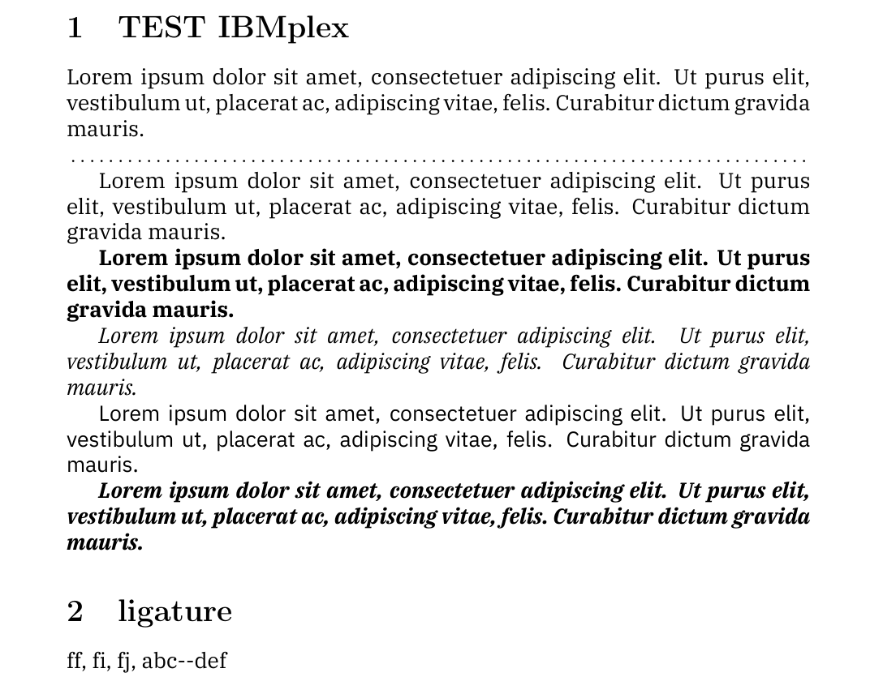

## create '.tfm' (TeX font metric)
First, we need to specify the encoding file, that 
* defines the mapping between character codes within your LaTeX text and the corresponding character shapes (glyphs) contained within the font file.(From $^{[4]}$)
* specifies an ordering of glyphs called the `font-encoding vector`(From $^{[1]}$).

If we use the `T1` encoding -- `ec.enc`:
```shell
ttf2tfm IBMPlexSans-Regular.ttf -T ec.enc T1-IBMPlexSans.tfm
```

there will be warnings:
```text
ttf2tfm: WARNING: Cannot find character `macron'
         specified in input encoding.
ttf2tfm: WARNING: Cannot find character `cwm'
         specified in input encoding.
ttf2tfm: WARNING: Cannot find character `perthousandzero'
         specified in input encoding.
ttf2tfm: WARNING: Cannot find character `dotlessj'
         specified in input encoding.
ttf2tfm: WARNING: Cannot find character `ff'
         specified in input encoding.
ttf2tfm: WARNING: Cannot find character `ffi'
         specified in input encoding.
ttf2tfm: WARNING: Cannot find character `ffl'
         specified in input encoding.
ttf2tfm: WARNING: Cannot find character `visiblespace'
         specified in input encoding.
ttf2tfm: WARNING: Character `hyphen' encoded twice in input encoding
         (positions 2d and 7f; the latter is ignored).
ttf2tfm: WARNING: Cannot find character `Ohungarumlaut'
         specified in input encoding.
ttf2tfm: WARNING: Cannot find character `Uhungarumlaut'
         specified in input encoding.
ttf2tfm: WARNING: Cannot find character `Zdotaccent'
         specified in input encoding.
ttf2tfm: WARNING: Cannot find character `Idotaccent'
         specified in input encoding.
ttf2tfm: WARNING: Cannot find character `dcroat'
         specified in input encoding.
ttf2tfm: WARNING: Cannot find character `ohungarumlaut'
         specified in input encoding.
ttf2tfm: WARNING: Cannot find character `uhungarumlaut'
         specified in input encoding.
ttf2tfm: WARNING: Cannot find character `zdotaccent'
         specified in input encoding.
```

if we use:
```shell
ttf2tfm IBMPlexSans-Regular.ttf -T T1-WGL4.enc T1-IBMPlexSans.tfm
```
there will be less warnings:
```text
ttf2tfm: WARNING: Cannot find character `macron'
         specified in input encoding.
ttf2tfm: WARNING: Cannot find character `compwordmark'
         specified in input encoding.
ttf2tfm: WARNING: Cannot find character `perthousandzero'
         specified in input encoding.
ttf2tfm: WARNING: Cannot find character `dotlessj'
         specified in input encoding.
ttf2tfm: WARNING: Cannot find character `ff'
         specified in input encoding.
ttf2tfm: WARNING: Cannot find character `ffi'
         specified in input encoding.
ttf2tfm: WARNING: Cannot find character `ffl'
         specified in input encoding.
ttf2tfm: WARNING: Cannot find character `visualspace'
         specified in input encoding.
ttf2tfm: WARNING: Character `hyphen' encoded twice in input encoding
         (positions 2d and 7f; the latter is ignored).
```

> REMEBER: TeX just need to know the font metric, characters' glyph in font is not essential to TeX.


## create '.fd' (font description)
Create a file named `t1ibmplexsans.fd`:
```tex
\ProvidesFile{t1ibmplex.fd}[2025/08/10 scalable font definitions for T1/IBMPlex.]

\DeclareFontFamily{T1}{IBMPlex}{\hyphenchar\font=-1}
\DeclareFontShape{T1}{IBMPlex}{m}{sf}{
  <-> T1-IBMPlexSans
}{}
```


## test font
Use the following code:
```latex
\documentclass[a4paper]{article}
\usepackage[T1]{fontenc}
\usepackage{lipsum}
\pdfmapline{+T1-IBMPlexSans < T1-WGL4.enc < IBMPlexSans-Regular.ttf}


\begin{document}
\fontfamily{IBMPlex}\fontshape{sf}\selectfont\lipsum[1]
\end{document}
```


## '.map' file
Font map files provide the connection between TeX TFM font files and outline font file names(from `The pdfTeX user manual`). Instead of using the above command - `\pdfmapline`, we can make a `*.map` file to make use this font more convenient.

An example `.map` file looks like:
```text
cmr10 CMR10 <cmr10.pfb
ptmr8y NimbusRomNo9L-Regu " TeXnANSIEncoding ReEncodeFont " <texnansi.enc <utmr8a.pfb
```

Syntax of the `*.map` file:
```txt
<tfmname> [psname] [font flags] "special" <encoding file> <font file>
```
Some remarks:
* fields in `<>` are mandatory, fields in `[]` or `""` are optional.
* `tfmname`: TFM file name.
* `psname`: PostScript font name(highly recommended to use).
* `fontflags`: specifies various characteristics of the font.
* `special`: use `SlantFont` or `ExtendFont`.
* `encoding file`: must have the extension `.enc`, may be omit if the font resource has the correct built-in encoding.
* `font file`: the most prominent use of the `*.map` file, must be `Type 1`(`*.pfb`) or `TrueType`(`*.ttf` or `*.otf`) font file.

Now, we can write our own map file -- `ibmplex.map`:
```tex
T1-IBMPlexSans < T1-WGL4.enc < IBMPlexSans-Regular.ttf
```

then we can use `\pdfmapfile` to load this file:
```
\documentclass[a4paper]{article}
\usepackage[T1]{fontenc}
\usepackage{lipsum}
\pdfmapfile{+ibmplex.map}

\begin{document}
\fontfamily{IBMPlex}\fontshape{sf}\selectfont\lipsum[1]
\end{document}
```

> Before you can actually use this font, you (usually) also have to add a `dvips/pdftex` map file entry for it, otherwise these programs will believe you have created a completely new metafont font.(Copy from https://tex.stackexchange.com/a/1848/294585) Copy this mapping into file `pdftex.map`.


## make more fonts
Use these commands:
```shell
ttf2tfm IBMPlexSerif-Regular.ttf -q -T T1-WGL4.enc T1-IBMPlexSerif-Regular.tfm
ttf2tfm IBMPlexSerif-Bold.ttf -q -T T1-WGL4.enc T1-IBMPlexSerif-Bold.tfm
ttf2tfm IBMPlexSerif-Italic.ttf -q -T T1-WGL4.enc T1-IBMPlexSerif-Italic.tfm
ttf2tfm IBMPlexSerif-BoldItalic.ttf -q -T T1-WGL4.enc T1-IBMPlexSerif-BoldItalic.tfm
```

file -- `ibmplex.fd` as follows:
```tex
\ProvidesFile{t1ibmplex.fd}[2025/08/10 scalable font definitions for T1/IBMPlex.]

\DeclareFontFamily{T1}{IBMPlex}{\hyphenchar\font=-1}
\DeclareFontShape{T1}{IBMPlex}{m}{n}{
  <-> T1-IBMPlexSerif-Regular
}{}
\DeclareFontShape{T1}{IBMPlex}{b}{n}{
  <-> T1-IBMPlexSerif-Bold
}{}
\DeclareFontShape{T1}{IBMPlex}{m}{it}{
  <-> T1-IBMPlexSerif-Italic
}{}
\DeclareFontShape{T1}{IBMPlex}{b}{it}{
  <-> T1-IBMPlexSerif-BoldItalic
}{}
\DeclareFontShape{T1}{IBMPlex}{m}{sf}{
  <-> T1-IBMPlexSans
}{}
```

file -- `ibmplex.map` as follows:
```tex
T1-IBMPlexSans < T1-WGL4.enc < IBMPlexSans-Regular.ttf
T1-IBMPlexSerif-Regular < T1-WGL4.enc < IBMPlexSerif-Regular.ttf
T1-IBMPlexSerif-Italic < T1-WGL4.enc < IBMPlexSerif-Italic.ttf
T1-IBMPlexSerif-Bold < T1-WGL4.enc < IBMPlexSerif-Bold.ttf
T1-IBMPlexSerif-BoldItalic < T1-WGL4.enc < IBMPlexSerif-BoldItalic.ttf
```

An example mwe:
```latex
\documentclass[a4paper]{article}
\usepackage[T1]{fontenc}
\usepackage{lipsum}
\pdfmapfile{+ibmplex.map}
\DeclareTextFontCommand{\IBMPlex}{\fontfamily{IBMPlex}\selectfont}
\DeclareTextFontCommand{\IBMPlexbf}{\fontfamily{IBMPlex}\fontseries{b}\selectfont}
\DeclareTextFontCommand{\IBMPlexit}{\fontfamily{IBMPlex}\fontshape{it}\selectfont}
\DeclareTextFontCommand{\IBMPlexsf}{\fontfamily{IBMPlex}\fontshape{sf}\selectfont}


\begin{document}
\section{TEST IBMplex}
{\fontfamily{IBMPlex}\selectfont\lipsum[1][1-3]}
\par\noindent\dotfill\par

\IBMPlex{\lipsum[1][1-3]}

\IBMPlexbf{\lipsum[1][1-3]}

\IBMPlexit{\lipsum[1][1-3]}

\IBMPlexsf{\lipsum[1][1-3]}

\IBMPlexbf{\IBMPlexit{\lipsum[1][1-3]}}


\section{ligature}
\IBMPlex{ff, fi, fj, abc--def}
\end{document}
```

The output PDF looks like:




## Note
* If no `\pdfmapfile` primitive is given, the default map file `pdftex.map` will be read by pdfTEX, thus we can add this config to `pdftex.map`.
* pdfTeX can NOT utilize more than 256 characters per font.


## TODO
* ligature, kerning and dash converting.
* handle the missing characters.
* use these fonts in XeTeX and LuaTeX.

In LuaTeX, you should put these following commands in your preamble:
```tex
\ifcsname directlua\endcsname
  \protected\def\pdfmapline {\pdfextension mapline }
\fi
```


## reference
1. https://www.tug.org/TUGboat/tb27-2/tb87owens.pdf
2. https://texdoc.org/serve/pdftex-a.pdf/0
3. https://github.com/IBM/plex
4. https://www.overleaf.com/learn/latex/Questions/I_have_a_custom_font_I%27d_like_to_load_to_my_document._How_can_I_do_this%3F
5. https://www.maths.usyd.edu.au/u/SMS/texdoc/ttf2pk.pdf
6. https://latex.org/forum/viewtopic.php?t=6481
