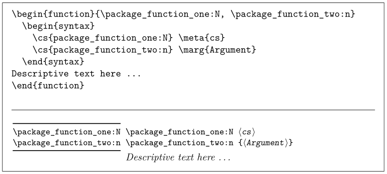

## 背景

往往一个文档说明或者是手册中需要用到部分的命令抄录环境，用于模板作者说明命令的使用格式或者是参数. 某天在一个文档类中看到了如下的声明, 用于打印控制序列(下文简写为 `cs`):

```latex
\NewDocumentCommand\MySubScript{m}{$_{#1}$}

\ExplSyntaxOn
\NewDocumentCommand\PrintVarList{m}{
  \clist_set:Nn \l_tmpa_clist {#1}
  \clist_map_inline:Nn \l_tmpa_clist
    {
      \token_to_str:N ##1 ~
    }
}
\NewDocumentCommand\RelaceChacters{m}{
  \tl_set:Nn \lTmpaTl {#1}
  \regex_replace_once:nnN { \_ } { \c{MySubScript} } \lTmpaTl
}
\NewDocumentCommand\RelaceUnderScoreAll{m}{
  \tl_set:Nn \lTmpaTl {#1}
  \regex_replace_all:nnN { \_ } { \c{_} } \lTmpaTl
  \lTmpaTl
}
\ExplSyntaxOff

\NewDocumentEnvironment{variable}{om}{
  \vspace{5pt}
  \begin{minipage}{\linewidth}
  \hrule\vspace{4pt}\obeylines%
  \begingroup
  \ttfamily\bfseries\color{azure3}
  \PrintVarList{#2}
  \endgroup
  \par\vspace{4pt}\hrule
  \end{minipage}\par\nopagebreak\vspace{4pt}
}{%
  \vspace{5pt}%
}
```

## l3doc class

然后在 `l3doc` 文档类中发现了如下命令:

```
\DeclareDocumentCommand \cmd { O{} m }
  { \__codedoc_cmd:no {#1} { \token_to_str:N #2 } }
```

所以我追溯到命令 `\__codedoc_cmd:no` , 发现如下声明:

```latex
\keys_define:nn { l3doc/cmd }
  {
    index     .tl_set:N     = \l__codedoc_cmd_index_tl        ,
    module    .tl_set:N     = \l__codedoc_cmd_module_tl       ,
    no-index  .bool_set:N   = \l__codedoc_cmd_noindex_bool    ,
    replace   .bool_set:N   = \l__codedoc_cmd_replace_bool    ,
  }

\cs_new_protected:Npn \__codedoc_cmd:nn #1#2
  {
    \bool_set_false:N \l__codedoc_cmd_noindex_bool
    \bool_set_true:N \l__codedoc_cmd_replace_bool
    \tl_set:Nn \l__codedoc_cmd_index_tl { \q_no_value }
    \tl_set:Nn \l__codedoc_cmd_module_tl { \q_no_value }
    \keys_set:nn { l3doc/cmd } {#1}
    \tl_set:Nn \l__codedoc_cmd_tl {#2}
    \bool_if:NT \l__codedoc_cmd_replace_bool
      {
        \tl_set_rescan:Nnn \l__codedoc_tmpb_tl { } { _ }
        \tl_replace_all:NVn \l__codedoc_cmd_tl \l__codedoc_tmpb_tl { _ }
        \__codedoc_replace_at_at:N \l__codedoc_cmd_tl
        \tl_replace_all:NnV \l__codedoc_cmd_tl { _ } \l__codedoc_tmpb_tl
      }
    \mode_if_math:T { \mbox }
      {
        \bool_if:NT \l__codedoc_allow_indexing_bool { \__codedoc_target: }
        \verbatim@font
        \__codedoc_if_almost_str:VT \l__codedoc_cmd_tl
          {
            \__kernel_tl_set:Nx \l__codedoc_cmd_tl { \tl_to_str:N \l__codedoc_cmd_tl }
            \bool_if:NT \g__codedoc_cs_break_bool
              {
                \regex_replace_all:nnN
                  { ([^\\\_]\_*) \_ ([^\_]) }
                  { \1 \c{BreakableUnderscore} \2 }
                  \l__codedoc_cmd_tl
              }
          }
        \tl_replace_all:Nnn \l__codedoc_cmd_tl { ~ } { \@xobeysp }
        \l__codedoc_cmd_tl
        \@
      }
    \bool_if:NT \l__codedoc_allow_indexing_bool
      {
        \bool_if:NF \l__codedoc_cmd_noindex_bool
          {
            \quark_if_no_value:NF \l__codedoc_cmd_index_tl
              {
                \__kernel_tl_set:Nx \l__codedoc_cmd_tl
                  { \c_backslash_str \exp_not:o { \l__codedoc_cmd_index_tl } }
              }
            \exp_args:No \__codedoc_key_get:n { \l__codedoc_cmd_tl }
            \quark_if_no_value:NF \l__codedoc_cmd_module_tl
              {
                \__kernel_tl_set:Nx \l__codedoc_index_module_tl
                  { \tl_to_str:N \l__codedoc_cmd_module_tl }
              }
            \__codedoc_special_index_module:ooonN
              { \l__codedoc_index_key_tl }
              { \l__codedoc_index_macro_tl }
              { \l__codedoc_index_module_tl }
              { usage }
              \l__codedoc_index_internal_bool
          }
      }
  }
\cs_generate_variant:Nn \__codedoc_cmd:nn { no }
```


其中有一个变量 `\l__codedoc_allow_indexing_bool` 的声明如下:

```latex
\bool_new:N \l__codedoc_allow_indexing_bool
\bool_set_true:N \l__codedoc_allow_indexing_bool
\use:e
  {
    \exp_not:n { \cs_set_nopar:Npn \@starttoc #1 }
      {
        \group_begin:
          \bool_set_false:N \l__codedoc_allow_indexing_bool
          \exp_not:o { \@starttoc {#1} }
        \group_end:
      }
  }
```

所以如果想要写手册之类的东西，可以考虑使用 `l3doc` 文档类，其中提供了丰富的命令可以方便我们文档类作者的手册排版, 如:
* `\cmd [⟨options⟩] ⟨control sequence⟩`
* `\cs [⟨options⟩] {⟨csname⟩}`
* `\tn [⟨options⟩] {⟨csname⟩}`

除此之外还提供了 `function`, `varible`, `syntax` 等环境，用于排版类似如下的命令说明:


## 解决方案

最后可以通过命令 `\str_set` 解决，多余的空格也可以使用 str replace 相关的命令替换掉

```latex
\NewDocumentCommand{\zlatexVerb}{O{T}m}{
  \str_set:Nn \l_tmpa_str { #2 } 
  \tl_if_eq:nnT {#1}{F}{
    \str_replace_all:Nnn \l_tmpa_str {~}{} 
  }
  \texttt{\l_tmpa_str}
}
```

这里声明的 `\cmd` 命令中第一个可选参数含义如下:
* `T`: 保留所有空格
* `F`: 去掉所有空格

默认保留所有空格.

## bug
目前还有部分的问题:比如会去掉控制序列中的所有空格，所以你使用:
``` latex 
\cmd{\foo[a b]}
```
得到的是 `\foo[ab]`, 但是我们肯定希望得到的是 `\foo[a b]`. 所以目前这个命令还不够完善.

> 但是想来，你一个 `cs` 中为什么要出现空格呢?
