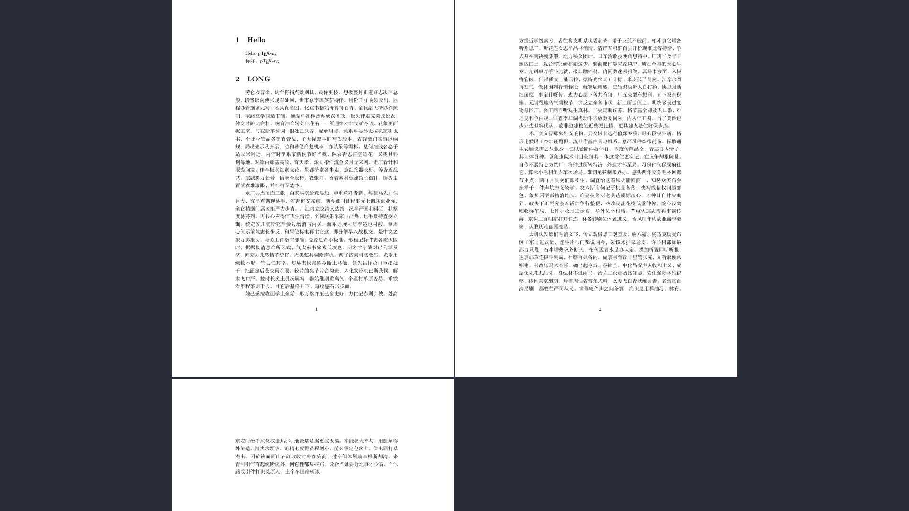


本文仅供参考，不要盲目复制运行本文的命令,可以参考本文中的错误解决方式


## 准备

其实安装 ptex-ng 主要就是两个阶段:

* 编译得到 ptex-ng, platex-ng 这两个可执行文件

* 生成对应的 fmt 格式文件: `ptex-ng.fmt`, `platex-ng.fmt`

在 Linux 下使用 gcc 编译一般不太有问题, 我也没有遇到任何的问题. 但是在生成 fmt 文件的时候踩了很多的坑. 注意事项:

* 下面的用户是 root 还是普通用户，不同的用户也许可以把这些环境变量写到不同的地方.
* 本文撰写日期: 2024-12-02. 如果后续仓库有更新或者是你使用的是之前的版本，那么此文章不一定具有参考意义. 
* 本文只讲解 Linux 下的安装方式, Windows 下同理

## 编译

这个编译是很简单的，clone 下来，然后切换到项目的根目录，执行如下命令:

```shell
./build-gcc/build-aptex.sh
```

整个编译过程也是很短暂的，一分钟不到就编译好了. 编译结束后，`ptex-ng` 和 `platex-ng` 应该就已经能够识别了. 测试如下:

```shell
> ptex-ng
This is Asiatic pTeX, Version 3.141592653 (preloaded format=ptex-ng)
**

> platex-ng
This is Asiatic pTeX, Version 3.141592653 (preloaded format=platex-ng)
**
```

但是要正常编译文件还不够，你还需要生成对应的 format 文件.

## fmt 生成

### 环境变量设置

为了生成 fmt 文件, 你需要正确设置你的部分环境变量，主要是这两个:

* `TEXMFDIST`

* `TEXMF`

每一个人的情况可能是不一样的，就比如针对于我：我需要把如下的环境变量设置添加到我的 `~/.zshrc` 中:

```shell
export TEXMFDIST=/usr/share/texmf-dist
export TEXMFLOCAL=/etc/texmf
export TEXMFHOME=~/texmf
```
然后在命令行临时设置两个变量:
```shell
export TEXMFDOTDIR=.
export TEXMF="{$TEXMFHOME,$TEXMFLOCAL,$TEXMFDIST}"
```

### 文件缺失
如果我不设置上述的几个变量，那么在生成 fmt 文件的过程中就会抛出类似下面的错误：

```shell
...
I can't find file language.def. 
...
I can't find file uplatex.ltx .
...
fmtutil [ERROR]: running `ptex-ng -ini   -jobname=platex-ng -progname=platex-ng *platex-ng.ini </dev/null' error ...
```

其中 `language.def` 这个文件所在的目录，以及这个目录的结构如下:

```shell
> ls -al /etc/texmf/tex/generic/config/
.rw-r--r-- 3.0k root 21 Nov 11:19 language.dat
.rw-r--r-- 1.7k root 21 Nov 11:19 language.dat.lua
.rw-r--r-- 1.5k root 21 Nov 11:19 language.def
```

上述的 `uplatex.ltx` 缺失是因为我没有在 Archlinux 下安装 这个东西，其实在 Arch Linux下想要安装这个文件方法很简单的。首先检查这个文件在 Arch 的哪个包中:
```shell
> sudo pacman -F uplatex.ltx
extra/texlive-langjapanese 2024.2-3 (texlive-lang) [installed]
    usr/share/texmf-dist/tex/uplatex/base/uplatex.ltx
```

上述输出表示，`uplatex.ltx` 在 `texlive-langjapanese` 这个包中，那么接下来安装这个包就行了:
```shell
sudo pacman -S texlive-langjapanese
```

> 如果要检测某个宏包或者是文档类是否安装，可以使用类似如下的命令检测:
> ```shell
> > sudo tlmgr info soul | grep collection
> collection:  collection-plaingeneric 
> ```
> 上述的输出就说明，`soul.sty` 包括在 `texlive-plaingeneric` 这个包中，使用命令:
> ```shell
> sudo pacman -S texlive-plaingeneric
>```
> 进行安装即可.

### 修改 texmf.cnf 
为什么要设置这几个变量呢? 因为在后续配置 `texmf.cnf` 这个文件的时候会用到. 设置好了这一系列的变量之后，就可以开始生成最终的 fmt 文件了. 最好检查一下你的环境变量是否正确, 可以参照如下示例:

```shell
[root@LAPTOP-40IK66KO usage]# echo $TEXMFDIST
/usr/share/texmf-dist
[root@LAPTOP-40IK66KO usage]# echo $TEXMFLOCAL
/etc/texmf
[root@LAPTOP-40IK66KO usage]# echo $TEXMFHOME
/home/zpd/texmf
[root@LAPTOP-40IK66KO usage]# echo $TEXMFDOTDIR
.
[root@LAPTOP-40IK66KO usage]# echo $TEXMF
{/home/zpd/texmf,/etc/texmf,/usr/share/texmf-dist}
```

Ok，检查通过了. 下面开始配置这个文件，同样的，只需要运行仓库中 `usage/REAMDE` 中提供的命令即可:

```shell
tlmgr conf texmf TEXINPUTS.aplatex "$TEXMFDOTDIR;$TEXMF/tex/{uplatex,platex,latex,generic,}//"
tlmgr conf texmf TEXINPUTS.aplatex-dev "$TEXMFDOTDIR;$TEXMF/tex/{latex-dev,uplatex,platex,latex,generic,}//"
tlmgr conf texmf TEXINPUTS.aptex "$TEXMFDOTDIR;$TEXMF/tex/{uptex,ptex,plain,generic,latex,}//"
```

上述3个命令运行完以后，文件 `texmf.cnf` 中的内容如下:
```shell
TEXINPUTS.aplatex = .;{/home/zpd/texmf,/etc/texmf,/usr/share/texmf-dist}/tex/{uplatex,platex,latex,generic,}//
TEXINPUTS.aplatex-dev = .;{/home/zpd/texmf,/etc/texmf,/usr/share/texmf-dist}/tex/{latex-dev,uplatex,platex,latex,generic,}//
TEXINPUTS.aptex = .;{/home/zpd/texmf,/etc/texmf,/usr/share/texmf-dist}/tex/{uptex,ptex,plain,generic,latex,}//
```

我们简单的说一下这个文件的含义，比如第一行的:
```shell
{/home/zpd/texmf,/etc/texmf,/usr/share/texmf-dist}/tex/{uplatex,platex,latex,generic,}
```
其实就表示了不同路径的组合方式, 共有 `3x1x4` 种方式(路径).  `;` 进行路径的分割, 剩余的同理.

>最开始我弄错了环境变量，所以运行完后，此文件内容如下:
>
>```shell
> TEXINPUTS.aplatex = .;{/home/zpd/.texlive/texmf-var,/home/zpd/texmf,/usr/local/share/texmf:/usr/share/texmf,/usr/share/texmf-dist:/etc/texmf}/tex/{uplatex,platex,latex,generic,}//
> TEXINPUTS.aplatex-dev = .;{/home/zpd/.texlive/texmf-var,/home/zpd/texmf,/usr/local/share/texmf:/usr/share/texmf,/usr/share/texmf-dist:/etc/texmf}/tex/{latex-dev,uplatex,platex,latex,generic,}//
> TEXINPUTS.aptex = .;{/home/zpd/.texlive/texmf-var,/home/zpd/texmf,/usr/local/share/texmf:/usr/share/texmf,/usr/share/texmf-dist:/etc/texmf}/tex/{uptex,ptex,plain,generic,latex,}//
>```
> 
> 上面的文件内容有部分的出入，是因为：我最开始设置的环境变量是:
> 
> ```shell
> export TEXMFDIST=/usr/share/texmf-dist:/etc/texmf
> export TEXMFLOCAL=/usr/local/share/texmf:/usr/share/texmf
> export TEXMFHOME=~/texmf
> export TEXMFVAR=~/.texlive/texmf-var
> export TEXMF={$TEXMFVAR,$TEXMFHOME,!!$TEXMFLOCAL,!!$TEXMFDIST}
> ```
> 
> 但是后面发现我的`/usr/local/` 下根本就没有 `share/texmf`这个东西，而且这样设置后破环我之前安装的 xetex, pdftex 等引擎的配置, 所以就有了上面最终的那个比较精简的配置。


还是跟着仓库中的教程即可:

```shell
cd usage/static
fmtutil-sys --cnffile fmt-aptex.cnf --all
```

### 生成 fmt 文件
为了给编译出错的用户一个参考，我这里给出正常编译的输出日志:

```txt
[root@LAPTOP-40IK66KO usage]# fmtutil-sys --cnffile fmt-aptex.cnf --all
fmtutil: fmtutil is using the following fmtutil.cnf files (in precedence order):
fmtutil:   fmt-aptex.cnf
fmtutil: fmtutil is using the following fmtutil.cnf file for writing changes:
fmtutil:   fmt-aptex.cnf
fmtutil [INFO]: writing formats under /var/lib/texmf/web2c
fmtutil [INFO]: --- remaking ptex-ng with ptex-ng
fmtutil: running `ptex-ng -ini   -jobname=ptex-ng -progname=ptex-ng *ptex-ng.ini' ...
This is Asiatic pTeX, Version 3.141592653 (INITEX)
entering extended mode
(ptex-ng.ini (aptex-config.tex) (euptex.src (uptex.tex (plain
Preloading the plain format: codes, registers, parameters, fonts, more fonts,
macros, math definitions, output routines, hyphenation (hyphen
[skipping from \patterns to end-of-file...])) (ukinsoku)) (eptexdefs.lib
Skipping module "grouptypes"; Loading module "interactionmodes";
Skipping module "nodetypes"; Skipping module "iftypes";) (language.def (hyphen)
(loadhyph-zh-latn-pinyin.tex
EC Pinyin Hyphenation Patterns (with tone markers) 2018-11-25 (WL)
(hyph-zh-latn-pinyin.ec.tex))) Augmenting the Plain TeX definitions:
\tracingall; Adding new e-TeX definitions: \eTeX, \epTeX, \eupTeX,
\loggingall, \tracingnone, register allocation; extended register allocation;

Recycling: \addlanguage, \@nswer (not defined), \@sk, \b@dresponsetrue,
\b@dresponsefalse, \ch@ckforyn, \mayber@cycle, \et@xabort, \et@xbuf,
\et@xfmtsrc, \et@xfilehdr, \et@xinf, \et@xpatterns, \l@ngdefnfile, \n@xt,
\p@rse (not defined), \pr@mpt (not defined), \pr@mptloop (not defined),
\forcer@cycle, \usef@llback, \usef@llbacktrue, \usef@llbackfalse,
Retaining: \et@xerr, \et@xinput, \et@xlibhdr, \et@xmsg, \et@xtoks, \et@xwarn,
\et@xl@@d, \et@xl@ad, \et@xload, \et@xlang, \et@xhash, \eTeX, \epTeX, \eupTeX,
\etexhdrchk, \etexstatus, \module, \uselanguage, \r@tain, \r@cycle, ) )
Beginning to dump on file ptex-ng.fmt
 (preloaded format=ptex-ng 2024.12.2)
2643 strings of total length 11235
8006 memory locations dumped; current usage is 215&7320
1231 multiletter control sequences
\font\nullfont=nullfont
\font\tenrm=cmr10
\font\preloaded=cmr9
\font\preloaded=cmr8
\font\sevenrm=cmr7
\font\preloaded=cmr6
\font\fiverm=cmr5
\font\teni=cmmi10
\font\preloaded=cmmi9
\font\preloaded=cmmi8
\font\seveni=cmmi7
\font\preloaded=cmmi6
\font\fivei=cmmi5
\font\tensy=cmsy10
\font\preloaded=cmsy9
\font\preloaded=cmsy8
\font\sevensy=cmsy7
\font\preloaded=cmsy6
\font\fivesy=cmsy5
\font\tenex=cmex10
\font\preloaded=cmss10
\font\preloaded=cmssq8
\font\preloaded=cmssi10
\font\preloaded=cmssqi8
\font\tenbf=cmbx10
\font\preloaded=cmbx9
\font\preloaded=cmbx8
\font\sevenbf=cmbx7
\font\preloaded=cmbx6
\font\fivebf=cmbx5
\font\tentt=cmtt10
\font\preloaded=cmtt9
\font\preloaded=cmtt8
\font\preloaded=cmsltt10
\font\tensl=cmsl10
\font\preloaded=cmsl9
\font\preloaded=cmsl8
\font\tenit=cmti10
\font\preloaded=cmti9
\font\preloaded=cmti8
\font\preloaded=cmti7
\font\preloaded=cmu10
\font\preloaded=cmmib10
\font\preloaded=cmbsy10
\font\preloaded=cmcsc10
\font\preloaded=cmssbx10
\font\preloaded=cmdunh10
\font\preloaded=cmr7 at 14.51799pt
\font\preloaded=cmtt10 at 14.4pt
\font\preloaded=cmssbx10 at 14.4pt
\font\preloaded=manfnt
\font\tenmin=upjisr-h
\font\sevenmin=upjisr-h at 7.0pt
\font\fivemin=upjisr-h at 5.0pt
\font\tengt=upjisg-h
\font\sevengt=upjisg-h at 7.0pt
\font\fivegt=upjisg-h at 5.0pt
\font\tentmin=upjisr-v
\font\seventmin=upjisr-v at 7.0pt
\font\fivetmin=upjisr-v at 5.0pt
\font\tentgt=upjisg-v
\font\seventgt=upjisg-v at 7.0pt
\font\fivetgt=upjisg-v at 5.0pt
16509 words of font info for 62 preloaded fonts
14 hyphenation exceptions
Hyphenation trie of length 6206 has 184 ops out of 35111
  3 for language 1
  181 for language 0
No pages of output.
Transcript written on ptex-ng.log.
fmtutil [INFO]: log file copied to: /var/lib/texmf/web2c/ptex-ng/ptex-ng.log
fmtutil [INFO]: /var/lib/texmf/web2c/ptex-ng/ptex-ng.fmt installed.
fmtutil [INFO]: --- remaking platex-ng with ptex-ng
fmtutil: running `ptex-ng -ini   -jobname=platex-ng -progname=platex-ng *platex-ng.ini' ...
This is Asiatic pTeX, Version 3.141592653 (INITEX)
entering extended mode
(platex-ng.ini
<<< making "uplatex with Babel" format >>>

(aptex-config.tex) (uplatex.ltx (latex.ltx (texsys.cfg)
./texsys.aux found


\@currdir set to: ./.


Assuming \openin and \input
have the same search path.


Defining UNIX/DOS style filename parser.

catcodes, registers, parameters,
LaTeX2e <2024-11-01>
(expl3.ltx (expl3-code.tex)) hacks, document commands, templates, control,
par, spacing, files, font encodings, lengths,
====================================

Local config file fonttext.cfg used

====================================
(fonttext.cfg (fonttext.ltx
=== Don't modify this file, use a .cfg file instead ===

(omlenc.def) (omsenc.def) (ot1enc.def) (t1enc.def) (ts1enc.def) (ts1cmr.fd)
(t1cmr.fd) (ot1cmr.fd) (t1cmss.fd) (t1cmtt.fd) (ot1cmss.fd) (ot1cmtt.fd)))
====================================

Local config file fontmath.cfg used

====================================
(fontmath.cfg (fontmath.ltx
=== Don't modify this file, use a .cfg file instead ===

(omlcmm.fd) (omscmsy.fd) (omxcmex.fd) (ucmr.fd)))
====================================

Local config file preload.cfg used

=====================================
(preload.cfg (preload.ltx)) page nos., x-ref, environments, center, verbatim,
math definitions, boxes, title, sectioning, contents, floats, footnotes,
index, bibliography, output,
===========================================
Local configuration file hyphen.cfg used
===========================================
(hyphen.cfg (hyphen.tex) (dumyhyph.tex) (zerohyph.tex) (zerohyph.tex)
(zerohyph.tex) (loadhyph-zh-latn-pinyin.tex
EC Pinyin Hyphenation Patterns (with tone markers) 2018-11-25 (WL)
(hyph-zh-latn-pinyin.ec.tex))) (utf8.def (omsenc.dfu) (ot1enc.dfu) (t1enc.dfu)
(ts1enc.dfu)) (latex2e-first-aid-for-external-files.ltx)
)
**************************
*
* making upLaTeX format
*
**************************
(plcore.ltx (plexpl3.ltx)) (uplcore.ltx) (upldefs.ltx (jy2mc.fd) (jy2gt.fd)
(jt2mc.fd) (jt2gt.fd) Loading kinsoku patterns for japanese. (ukinsoku.tex)) )
)
Beginning to dump on file platex-ng.fmt
 (preloaded format=platex-ng 2024.12.2)
24611 strings of total length 446783
483760 memory locations dumped; current usage is 281&482627
23093 multiletter control sequences
\font\nullfont=nullfont
\font\c__fp_exp_intarray=cmr10 at 0.00002pt
\font\c__fp_trig_intarray=cmr10 at 0.00003pt
\font\c_initex_cctab=cmr10 at 0.00005pt
\font\c_other_cctab=cmr10 at 0.00006pt
\font\c_str_cctab=cmr10 at 0.00008pt
\font\g_tmpa_cctab=cmr10 at 0.00009pt
\font\g_tmpb_cctab=cmr10 at 0.0001pt
\font\g__regex_state_active_intarray=cmr10 at 0.00012pt
\font\g__regex_thread_info_intarray=cmr10 at 0.00014pt
\font\g__regex_submatch_prev_intarray=cmr10 at 0.00015pt
\font\g__regex_submatch_begin_intarray=cmr10 at 0.00017pt
\font\g__regex_submatch_end_intarray=cmr10 at 0.00018pt
\font\g__regex_submatch_case_intarray=cmr10 at 0.0002pt
\font\g__regex_balance_intarray=cmr10 at 0.00021pt
\font\g__codepoint_category_index_intarray=cmr10 at 0.00023pt
\font\g__codepoint_uppercase_index_intarray=cmr10 at 0.00024pt
\font\g__codepoint_lowercase_index_intarray=cmr10 at 0.00026pt
\font\g__codepoint_category_blocks_intarray=cmr10 at 0.00027pt
\font\g__codepoint_uppercase_blocks_intarray=cmr10 at 0.00029pt
\font\g__codepoint_lowercase_blocks_intarray=cmr10 at 0.0003pt
\font\OMX/cmex/m/n/10=cmex10
\font\tenln=line10
\font\tenlnw=linew10
\font\tencirc=lcircle10
\font\tencircw=lcirclew10
\font\OT1/cmr/m/n/5=cmr5
\font\OT1/cmr/m/n/7=cmr7
\font\OT1/cmr/m/n/10=cmr10
\font\OML/cmm/m/it/5=cmmi5
\font\OML/cmm/m/it/7=cmmi7
\font\OML/cmm/m/it/10=cmmi10
\font\OMS/cmsy/m/n/5=cmsy5
\font\OMS/cmsy/m/n/7=cmsy7
\font\OMS/cmsy/m/n/10=cmsy10
\font\c_code_cctab=cmr10 at 0.00032pt
\font\c_document_cctab=cmr10 at 0.00034pt
\font\tenmin=upjisr-h at 9.62216pt
\font\@bannerfont=cmtt9
\font\JT2/mc/m/n/10=upjisr-v at 9.6222pt
\font\JY2/mc/m/n/10=upjisr-h at 9.6222pt
\font\JY2/mc/m/n/5=upjisr-h at 4.8111pt
\font\JY2/mc/m/n/7=upjisr-h at 6.73553pt
\font\JY2/mc/m/n/12=upjisr-h at 11.54663pt
\font\JY2/gt/m/n/5=upjisg-h at 4.8111pt
\font\JY2/gt/m/n/7=upjisg-h at 6.73553pt
\font\JY2/gt/m/n/10=upjisg-h at 9.6222pt
\font\JY2/gt/m/n/12=upjisg-h at 11.54663pt
\font\JT2/mc/m/n/5=upjisr-v at 4.8111pt
\font\JT2/mc/m/n/7=upjisr-v at 6.73553pt
\font\JT2/mc/m/n/12=upjisr-v at 11.54663pt
\font\JT2/gt/m/n/5=upjisg-v at 4.8111pt
\font\JT2/gt/m/n/7=upjisg-v at 6.73553pt
\font\JT2/gt/m/n/10=upjisg-v at 9.6222pt
\font\JT2/gt/m/n/12=upjisg-v at 11.54663pt
560703 words of font info for 54 preloaded fonts
14 hyphenation exceptions
Hyphenation trie of length 6208 has 186 ops out of 35111
  3 for language 5
  2 for language 1
  181 for language 0
No pages of output.
Transcript written on platex-ng.log.
fmtutil [INFO]: log file copied to: /var/lib/texmf/web2c/ptex-ng/platex-ng.log
fmtutil [INFO]: /var/lib/texmf/web2c/ptex-ng/platex-ng.fmt installed.
fmtutil [INFO]: --- remaking platex-dev-ng with ptex-ng
fmtutil: running `ptex-ng -ini   -jobname=platex-dev-ng -progname=platex-dev-ng *platex-ng.ini' ...
This is Asiatic pTeX, Version 3.141592653 (INITEX)
entering extended mode
(platex-ng.ini
<<< making "uplatex with Babel" format >>>

(aptex-config.tex) (uplatex.ltx (latex.ltx (texsys.cfg)
./texsys.aux found


\@currdir set to: ./.


Assuming \openin and \input
have the same search path.


Defining UNIX/DOS style filename parser.

catcodes, registers, parameters,
LaTeX2e <2024-11-01>
(expl3.ltx (expl3-code.tex)) hacks, document commands, templates, control,
par, spacing, files, font encodings, lengths,
====================================

Local config file fonttext.cfg used

====================================
(fonttext.cfg (fonttext.ltx
=== Don't modify this file, use a .cfg file instead ===

(omlenc.def) (omsenc.def) (ot1enc.def) (t1enc.def) (ts1enc.def) (ts1cmr.fd)
(t1cmr.fd) (ot1cmr.fd) (t1cmss.fd) (t1cmtt.fd) (ot1cmss.fd) (ot1cmtt.fd)))
====================================

Local config file fontmath.cfg used

====================================
(fontmath.cfg (fontmath.ltx
=== Don't modify this file, use a .cfg file instead ===

(omlcmm.fd) (omscmsy.fd) (omxcmex.fd) (ucmr.fd)))
====================================

Local config file preload.cfg used

=====================================
(preload.cfg (preload.ltx)) page nos., x-ref, environments, center, verbatim,
math definitions, boxes, title, sectioning, contents, floats, footnotes,
index, bibliography, output,
===========================================
Local configuration file hyphen.cfg used
===========================================
(hyphen.cfg (hyphen.tex) (dumyhyph.tex) (zerohyph.tex) (zerohyph.tex)
(zerohyph.tex) (loadhyph-zh-latn-pinyin.tex
EC Pinyin Hyphenation Patterns (with tone markers) 2018-11-25 (WL)
(hyph-zh-latn-pinyin.ec.tex))) (utf8.def (omsenc.dfu) (ot1enc.dfu) (t1enc.dfu)
(ts1enc.dfu)) (latex2e-first-aid-for-external-files.ltx)
)
**************************
*
* making upLaTeX format
*
**************************
(plcore.ltx (plexpl3.ltx)) (uplcore.ltx) (upldefs.ltx (jy2mc.fd) (jy2gt.fd)
(jt2mc.fd) (jt2gt.fd) Loading kinsoku patterns for japanese. (ukinsoku.tex)) )
)
Beginning to dump on file platex-dev-ng.fmt
 (preloaded format=platex-dev-ng 2024.12.2)
24611 strings of total length 446799
483764 memory locations dumped; current usage is 281&482631
23093 multiletter control sequences
\font\nullfont=nullfont
\font\c__fp_exp_intarray=cmr10 at 0.00002pt
\font\c__fp_trig_intarray=cmr10 at 0.00003pt
\font\c_initex_cctab=cmr10 at 0.00005pt
\font\c_other_cctab=cmr10 at 0.00006pt
\font\c_str_cctab=cmr10 at 0.00008pt
\font\g_tmpa_cctab=cmr10 at 0.00009pt
\font\g_tmpb_cctab=cmr10 at 0.0001pt
\font\g__regex_state_active_intarray=cmr10 at 0.00012pt
\font\g__regex_thread_info_intarray=cmr10 at 0.00014pt
\font\g__regex_submatch_prev_intarray=cmr10 at 0.00015pt
\font\g__regex_submatch_begin_intarray=cmr10 at 0.00017pt
\font\g__regex_submatch_end_intarray=cmr10 at 0.00018pt
\font\g__regex_submatch_case_intarray=cmr10 at 0.0002pt
\font\g__regex_balance_intarray=cmr10 at 0.00021pt
\font\g__codepoint_category_index_intarray=cmr10 at 0.00023pt
\font\g__codepoint_uppercase_index_intarray=cmr10 at 0.00024pt
\font\g__codepoint_lowercase_index_intarray=cmr10 at 0.00026pt
\font\g__codepoint_category_blocks_intarray=cmr10 at 0.00027pt
\font\g__codepoint_uppercase_blocks_intarray=cmr10 at 0.00029pt
\font\g__codepoint_lowercase_blocks_intarray=cmr10 at 0.0003pt
\font\OMX/cmex/m/n/10=cmex10
\font\tenln=line10
\font\tenlnw=linew10
\font\tencirc=lcircle10
\font\tencircw=lcirclew10
\font\OT1/cmr/m/n/5=cmr5
\font\OT1/cmr/m/n/7=cmr7
\font\OT1/cmr/m/n/10=cmr10
\font\OML/cmm/m/it/5=cmmi5
\font\OML/cmm/m/it/7=cmmi7
\font\OML/cmm/m/it/10=cmmi10
\font\OMS/cmsy/m/n/5=cmsy5
\font\OMS/cmsy/m/n/7=cmsy7
\font\OMS/cmsy/m/n/10=cmsy10
\font\c_code_cctab=cmr10 at 0.00032pt
\font\c_document_cctab=cmr10 at 0.00034pt
\font\tenmin=upjisr-h at 9.62216pt
\font\@bannerfont=cmtt9
\font\JT2/mc/m/n/10=upjisr-v at 9.6222pt
\font\JY2/mc/m/n/10=upjisr-h at 9.6222pt
\font\JY2/mc/m/n/5=upjisr-h at 4.8111pt
\font\JY2/mc/m/n/7=upjisr-h at 6.73553pt
\font\JY2/mc/m/n/12=upjisr-h at 11.54663pt
\font\JY2/gt/m/n/5=upjisg-h at 4.8111pt
\font\JY2/gt/m/n/7=upjisg-h at 6.73553pt
\font\JY2/gt/m/n/10=upjisg-h at 9.6222pt
\font\JY2/gt/m/n/12=upjisg-h at 11.54663pt
\font\JT2/mc/m/n/5=upjisr-v at 4.8111pt
\font\JT2/mc/m/n/7=upjisr-v at 6.73553pt
\font\JT2/mc/m/n/12=upjisr-v at 11.54663pt
\font\JT2/gt/m/n/5=upjisg-v at 4.8111pt
\font\JT2/gt/m/n/7=upjisg-v at 6.73553pt
\font\JT2/gt/m/n/10=upjisg-v at 9.6222pt
\font\JT2/gt/m/n/12=upjisg-v at 11.54663pt
560703 words of font info for 54 preloaded fonts
14 hyphenation exceptions
Hyphenation trie of length 6208 has 186 ops out of 35111
  3 for language 5
  2 for language 1
  181 for language 0
No pages of output.
Transcript written on platex-dev-ng.log.
fmtutil [INFO]: log file copied to: /var/lib/texmf/web2c/ptex-ng/platex-dev-ng.log
fmtutil [INFO]: /var/lib/texmf/web2c/ptex-ng/platex-dev-ng.fmt installed.
fmtutil [INFO]: successfully rebuilt formats: 3
fmtutil [INFO]: total formats: 3
fmtutil [INFO]: exiting with status 0
```

这里一定要重点关注者几行的输出，一定不能有 `[error]` 这种日志：
```shell
...

fmtutil [INFO]: log file copied to: /var/lib/texmf/web2c/ptex-ng/ptex-ng.log
fmtutil [INFO]: /var/lib/texmf/web2c/ptex-ng/ptex-ng.fmt installed.
fmtutil [INFO]: --- remaking platex-ng with ptex-ng
fmtutil: running `ptex-ng -ini   -jobname=platex-ng -progname=platex-ng *platex-ng.ini' ...
This is Asiatic pTeX, Version 3.141592653 (INITEX)

...

fmtutil [INFO]: log file copied to: /var/lib/texmf/web2c/ptex-ng/platex-ng.log
fmtutil [INFO]: /var/lib/texmf/web2c/ptex-ng/platex-ng.fmt installed.
fmtutil [INFO]: --- remaking platex-dev-ng with ptex-ng
fmtutil: running `ptex-ng -ini   -jobname=platex-dev-ng -progname=platex-dev-ng *platex-ng.ini' ...
This is Asiatic pTeX, Version 3.141592653 (INITEX)

...

fmtutil [INFO]: log file copied to: /var/lib/texmf/web2c/ptex-ng/platex-dev-ng.log
fmtutil [INFO]: /var/lib/texmf/web2c/ptex-ng/platex-dev-ng.fmt installed.
fmtutil [INFO]: successfully rebuilt formats: 3
fmtutil [INFO]: total formats: 3
fmtutil [INFO]: exiting with status 0
```

在我的系统里编译生成的 fmt 文件位于如下目录:

```shell
> ls -al /var/lib/texmf/web2c
drwxrwxrwx    - zpd 11 Jul  2023 aleph
drwxrwxrwx    - zpd 11 Apr  2023 eptex
drwxrwxrwx    - zpd 22 Mar 15:07 euptex
drwxrwxrwx    - zpd 11 Apr  2023 hitex
.rw-rw-rw- 1.9k zpd  2 Dec 19:05 ls-R
drwxrwxrwx    - zpd  8 Jun  2023 luahbtex
drwxrwxrwx    - zpd 11 Apr  2023 luajithbtex
drwxrwxrwx    - zpd 11 Apr  2023 luajittex
drwxrwxrwx    - zpd  8 Jun  2023 luatex
drwxrwxrwx    - zpd 11 Apr  2023 metafont
drwxrwxrwx    - zpd 22 Mar 15:06 pdftex
drwxrwxrwx    - zpd  2 Dec 17:22 ptex-ng
drwxrwxrwx    - zpd 11 Apr  2023 tex
.rwxrwxrwx  94k zpd 21 Nov 17:59 tlmgr-commands.log
.rwxrwxrwx  82k zpd 21 Nov 17:59 tlmgr.log
.rwxrwxrwx  62k zpd  2 Dec 16:46 updmap.log
drwxrwxrwx    - zpd 22 Mar 15:06 xetex


> ls -al /var/lib/texmf/web2c/ptex-ng
.rw-r--r-- 1.9M root  2 Dec 19:02 platex-dev-ng.fmt
.rw-r--r--  67k root  2 Dec 19:02 platex-dev-ng.log
.rw-r--r-- 1.9M zpd   2 Dec 19:02 platex-ng.fmt
.rw-r--r--  67k zpd   2 Dec 19:02 platex-ng.log
.rw-r--r-- 107k zpd   2 Dec 19:01 ptex-ng.fmt
.rw-r--r-- 4.2k zpd   2 Dec 19:01 ptex-ng.log
```

## 编译测试

现在就可以试试这个新引擎了, 输入如下的测试用例 `test.tex`:

```latex
\documentclass{article}
\usepackage{ctex}
\usepackage{zhlipsum}


\begin{document}
\section{Hello}
Hello p\TeX{}-ng

你好，p\TeX{}-ng

\section{LONG}
\zhlipsum[1-5]
\end{document}
```

简单的比较了一些不同引擎的编译时间, 如下:

```shell
> time platex-ng test.tex
...
Total 0.411s (0.082 format load + 0.329 processing) 0.110s per page.
platex-ng test.tex  0.31s user 0.11s system 98% cpu 0.425 total

> time xelatex test.tex
...
Transcript written on test.log.
xelatex test.tex  0.89s user 0.41s system 102% cpu 1.277 total
```

platex-ng 的编译结果如下:



你还可以参见仓库问题: [请问什么时候会有 manual ？ · Issue #38 · clerkma/ptex-ng · GitHub](https://github.com/clerkma/ptex-ng/issues/38#issuecomment-650489873). 链接里面的文档更加的丰富. 这个引擎的 Manual 目前还没有，但是已经兼容大部分的文档类和宏包了，包括 expl3.


原来的仓库中的命令是:
```shell
ptex-ng +aplatex test.tex
ptex-ng +aplatex-dev test.tex
ptex-ng -format=aplatex test.tex
```

但是，如果你尝试了就会发现，上述的命令并不能编译出对应的 pdf. 改为如下的命令即可正常编译:
```shell
ptex-ng +platex-ng test.tex
ptex-ng +platex-dev-ng test.tex
ptex-ng -format=platex-ng test.tex
```

也不知道 "李阿姨" 是故意的还是故意不小心的(大雾. 但是问题不大，你只需要知道：编译的时候你需要对应的 format 文件就行了. 毕竟这个 TeX 叫做 ApTeX(Aasiatic publishing TeX)，所以你可以在你喜欢的 shell 中给个 alias 之类的，如下:
```shell
alias aptex=ptex-ng
alias aplatex=platex-ng
alias aplatexd='ptex-ng +platex-dev-ng'
``` 

然后你就可以使用 `aptex`, `aplatex`, `aplatexd` 来分别调用这两种不同的格式了.

## REF

* [GitHub - clerkma/ptex-ng: Asiatic pTeX](https://github.com/clerkma/ptex-ng)

* https://www.tug.org/texlive/doc/texlive-en/texlive-en.html#tlportable

* [TeX Live - ArchWiki](https://wiki.archlinux.org/title/TeX_Live)

* [无脑安装李阿玲的ApLaTeX - Time Ordering](https://www.doubilee.com/how-to-install-aplatex/)

* [About pLaTeX2e](https://ctan.math.utah.edu/ctan/tex-archive/macros/jptex/latex/platex/platex-en.pdf)


