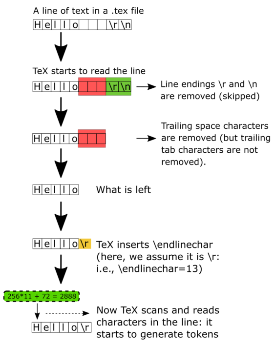
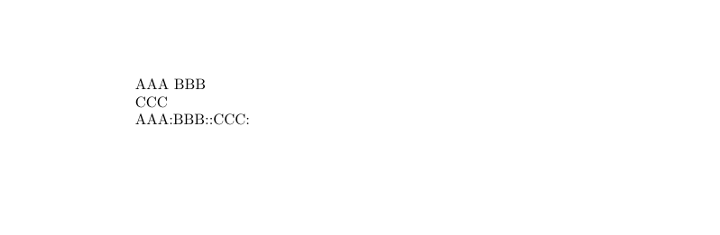

## Preface

### Example

你也许在部分的模板或者是宏包中看到过类似下面的东西, 那么这些东西是啥意思呢 ?

```latex
^^M
^^J
```

如果你熟悉 ASCII 码表的话，你会发现这两个东西和 `脱出字符表示` 比较相似. 比如 `回车(CR)` 的脱出字符表示为: `^M` . 而 `换行(LF)` 的表示为 `^J` . 我们在后文会介绍的这个东西的，但是在介绍之前，你需要先了解部分的基础知识，关于字符和编码的基础知识. 

### 字符与编码

#### 进制

在 TEX 的内部使用 `'`(单引号)后加数字表示八进制，`"`(双引号)后接数字表示十六进制。下面便有几个示例。注：我们使用原语 (primitive) 的`\number`命令进行十进制输出:

* 八进制：`\number'10` 结果：8
* 十进制：`\number10` 结果：10
* 十六进制：`\number"10` 结果：16

#### 基本规则

TEX 内部的字符是有各自的编码的，下面先演示一句话：
神秘代码：

```latex
^^(^^%^^,^^,^^/^^l^^`^^7^^/^^2^^,^^$^^a

% 运行结果：hello, world!
```

具体的规则如下:

* 连续两个上标符号 `^^` 后跟一个字符 `c`，可以表示另一个字符 `c'`:
  
  * 64 ≤ ASCIIc ≤ 127 ⇒ ASCIIc' = ASCIIc - 64
  * 0 ≤ ASCIIc ≤ 63 ⇒ ASCIIc' = ASCIIc - 64

* `^^` 后跟两个小写十六进制数字，可以表示任意 ASCII 符号:
  
  ```latex
  ^^68^^65^^6c^^6c^^6f^^2c^^20^^77^^6f^^72^^6c^^64^^21
  
  % 输出结果为: hello, world!
  ```

#### 转换

我们可以使用原语 `\number` 轻松的输出字符对应的 ASCII 数值(ASCII 中的字符和十进制之间的相互转换), 同时也可以使用 [\`] 输出一个字符对应的编码. 也就是:

* 字符 ⇒ 编码：\`<字符>
* 编码 ⇒ 字符：\char<编码>

> 编码转换使用的是前引号: [\`], 但是 8 进制使用的是后单引号: [`'`]

下面展示关于字符到编码的几个使用样例：

```latex
\number`A    % 65
\number`\A   % 65
\number"41   % 65
\number`\%   % 37
```

但是如果我们输入了

```latex
\number`人 % 20154
```

即一个非 ASCII 字符, 那么为什么会得到这个东西呢？其实此时它会按照 Unicode 字符集进行映射. 下面再展示几个编码到字符的转换样例：

```latex
\char65      % A
\char"41     % A
\char20000   % 丠
```

我们可以使用 `\char` 命令进行一些不方便使用输入法键入的繁体字的录入，前提是我们得知道它的 Unicode 编码。所以必要时你需要指定一个支持中文，且支持中文数量比较的字体，例如可以使用如下的设置：

```latex
\usepackage{fontspec}
\setmainfont{SimSun}
```

## Pre-defined coding

### catcode

#### basic

The basic catcode table as follows:

| 类别码 | 含义     | 符号         | ASCII 码（HEX） |
| --- | ------ | ---------- | ------------ |
| 0   | 转义符    | \          | 5C           |
| 1   | 组开始    | {          | 7B           |
| 2   | 组结束    | }          | 7D           |
| 3   | 切换数学环境 | $          | 24           |
| 4   | 表格对齐   | &          | 26           |
| 5   | 回车     | CR         | 0D           |
| 6   | 参数     | #          | 23           |
| 7   | 上标     | ^          | 5E           |
| 8   | 下标     | _          | 5F           |
| 9   | 可忽略字符  | NUL        | 00           |
| 10  | 空格     | SP         | 20           |
| 11  | 字母     | A~Z, a~z   | -            |
| 12  | 其他字符   | 本表未列出的其他符号 | -            |
| 13  | 活动字符   | ~          | 7E           |
| 14  | 注释     | %          | 25           |
| 15  | 无效符    | DEL        | 7F           |

#### end line char

其实现在我们已经把 `回车(CR/\r)` 和 `换行(LF/\n)` 两个概念给混淆了, 前者一般的 ASCII 码为 `13`, 后者为 `10`. 可以简单的认为 “回车” 就是把光标移动到当前行的行首(水平移动),  而 “换行” 就是把光标移动到下一行的同一水平位置(垂直移动). 

现代意义下的 “换行” 和 “回车”基本已经表示同一个东西了, 也就是 `CRLF`. 并且不同的操作系统上的这个现代意义上的“换行”的表示方法还不一样: Unix-base 的操作系统用的是 LF, 一些比较老的 MacOS 用的是 CR, 而大部分人用的 Windows 其实是 CRLF. 

TeX 是一个跨平台的应用, 这是大家都知道的。所以为了处理这个烦人的“换行”问题， TeX 引入了一个叫做: `\endlinechar` 的东西. 这个 `\endlinechar` 和 catcode 有啥关系呢 ? 其实就是下面这两句话:

* `\endlinechar` 对应的字符一般是 ASCII 13 这个字符, 也就是 `\r` . 合法的 ASCII code 取值范围是: (-1, 256), 不取两个边界值 .
* 同时 ASCII 13 这个字符 (`\r`) 对应的 catcode 一般是 `5` .

TeX 处理你的 tex 文档的基本逻辑是这样的, 以下的讨论均基于默认情况下, 所注释的 ASCII 码和其它的数字均为 10 进制:

* 逐行从你的 .tex 文件中读入 tokens, 并不是把整个文件同时塞到内存里面的.
* 把每一行的换行符(`\r`, 或者是 `\n`) 及其末尾多余的空格(ASCII code 32)去掉, 但是并不会把 ASCII 码为 9 对应的 Tab 给移除掉.
* 然后再把合法的 `\endlinechar` 添加到行末
* 然后就开始扫描这一行中的具体内容了, 扫描每一个 token
* 然后根据这个 `\endlinechar` 的 catcode 决定接下来该做什么，应为有时候面对复杂的任务，这个`\endlinechar` 对应的 catcode 也许是 `\active`  的. 
* 那么具体是做什么呢 ？ 也许是把这个 `\endlinechar` 变为 一个空格，也许是把两个连续的 `\endlinechar` 变为 `\par`  这个 token. (TeX 使用 catcode 为 5 的 character 去做这件事情)

如果你觉得上述的文字描述不够直观，可以看看 Overleaf 上原博客中提供的这幅图:



所以，如果你想要避免换行，那么你可以把 `\endlinechar` 定义为一个非法字符或者是其它的字符. 下面就是一个示例:

```latex
\documentclass{article}

\begin{document}
AAA 
BBB 

CCC

\endlinechar=58% ASCII oct code 58 = :
AAA 
BBB 

CCC
\end{document}
```

对应的输出的 pdf 如下:



可以看到，中间的那两个 `::` token, 在默认情况下就会被转为 `\par` 这个 token. 但是此时 `:` 对应的 catcode 并不是 5, 所以它并没有变成 `\par` .

#### active character

对于 `活动字符` 可以做的事情就比较多了, 你可以直接把 `活动字符` 看作一个 cs, 然后对它进行定义, 参见下面这个结合了 catcode 和 mathcode 的例子:

```latex
\documentclass{article}
\usepackage{amsmath}

\begin{document}
\let\oricat\catcode
\let\oricef\def
\let\oriifmmoce\ifmmode
\catcode`d\active
\oricef d{\oriifmmoce \,\mathrm{\char100}\else \char100\fi}

\section{catcode}
Hello d
\[
  \int xdx = 1 + C
\]
\oricat`d11

\section{mathcode}
\mathcode`d="7064
Hello d 
\[
  \int xdx = 1 + C
\]
\end{document}
```

这段代码输出的结果为:


如果你对于 mathcode 不熟悉，那么可以参见我的另一篇文章: [math code](https://zongpingding.github.io/2024/10/30/mathMode/)

#### initial

```latex
% This is the plain TeX format that’s described in The TeXbook.
%% N.B.: A version number is defined at the very end of this file;
% please change that number whenever the file is modified!
% And don’t modify the file under any circumstances.
\catcode`\{=1 % left brace is begin-group character
\catcode`\}=2 % right brace is end-group character
\catcode`\$=3 % dollar sign is math shift
\catcode`\&=4 % ampersand is alignment tab
\catcode`\#=6 % hash mark is macro parameter character
\catcode`\^=7 \catcode`\^^K=7 % circumflex and uparrow for superscripts
\catcode`\_=8 \catcode`\^^A=8 % underline and downarrow for subscripts
\catcode`\^^I=10 % ASCII tab is treated as a blank space
\chardef\active=13 \catcode`\~=\active    % tilde is active
\catcode`\^^L=\active \outer\def^^L{\par} % ASCII form-feed is \outer\par
\message{Preloading the plain format: codes,}
```

#### others

When **INITEX** begins, category 12 (other) has been assigned to all 256 possible characters, except that the 52 letters `A...Z` and `a...z` are category 11 (letter), and a few other assignments equivalent to the following have been made:

```latex
\catcode `\\ =0     \catcode`\=10       \catcode `\% =14
\catcode`\^^@=9     \catcode`\^^M=5     \catcode`\^^?=15
```

Thus `\` is already an escape character, `␣` is a space, and `%` is available for comments on the first line of the file;  ASCII `⟨null⟩` .

### mathcode

The correcponding definitions as below:

```latex
\mathcode`\^^@="2201     \mathcode`\^^A="3223     \mathcode`\^^B="010B 
\mathcode`\^^C="010C     \mathcode`\^^D="225E     \mathcode`\^^E="023A
\mathcode`\^^F="3232     \mathcode`\^^G="0119     \mathcode`\^^H="0115
\mathcode`\^^I="010D     \mathcode`\^^J="010E     \mathcode`\^^K="3222
\mathcode`\^^L="2206     \mathcode`\^^M="2208     \mathcode`\^^N="0231
\mathcode`\^^O="0140     \mathcode`\^^P="321A     \mathcode`\^^Q="321B
\mathcode`\^^R="225C     \mathcode`\^^S="225B     \mathcode`\^^T="0238
\mathcode`\^^U="0239     \mathcode`\^^V="220A     \mathcode`\^^W="3224
\mathcode`\^^X="3220     \mathcode`\^^Y="3221     \mathcode`\^^Z="8000
\mathcode`\^^[="2205     \mathcode`\^^\="3214     \mathcode`\^^]="3215
\mathcode`\^^^="3211     \mathcode`\^^_="225F     \mathcode`\^^?="1273
\mathcode`\ ="8000       \mathcode`\!="5021       \mathcode`\’="8000  
\mathcode`\(="4028       \mathcode`\)="5029       \mathcode`\*="2203  
\mathcode`\+="202B       \mathcode`\,="613B       \mathcode`\-="2200  
\mathcode`\.="013A       \mathcode`\/="013D       \mathcode`\:="303A  
\mathcode`\;="603B       \mathcode`\<="313C       \mathcode`\=="303D  
\mathcode`\>="313E       \mathcode`\?="503F       \mathcode`\[="405B
\mathcode`\\="026E       \mathcode`\]="505D       \mathcode`\_="8000     
\mathcode`\{="4266       \mathcode`\|="026A       \mathcode`\}="5267  
```

Or you can see the table:

| column 1             | column 2             | column 3             |
| -------------------- | -------------------- | -------------------- |
| \mathcode`\^^@="2201 | \mathcode`\^^A="3223 | \mathcode`\^^B="010B |
| \mathcode`\^^C="010C | \mathcode`\^^D="225E | \mathcode`\^^E="023A |
| \mathcode`\^^F="3232 | \mathcode`\^^G="0119 | \mathcode`\^^H="0115 |
| \mathcode`\^^I="010D | \mathcode`\^^J="010E | \mathcode`\^^K="3222 |
| \mathcode`\^^L="2206 | \mathcode`\^^M="2208 | \mathcode`\^^N="0231 |
| \mathcode`\^^O="0140 | \mathcode`\^^P="321A | \mathcode`\^^Q="321B |
| \mathcode`\^^R="225C | \mathcode`\^^S="225B | \mathcode`\^^T="0238 |
| \mathcode`\^^U="0239 | \mathcode`\^^V="220A | \mathcode`\^^W="3224 |
| \mathcode`\^^X="3220 | \mathcode`\^^Y="3221 | \mathcode`\^^Z="8000 |
| \mathcode`\^^[="2205 | \mathcode`\^^\="3214 | \mathcode`\^^]="3215 |
| \mathcode`\^^^="3211 | \mathcode`\^^_="225F | \mathcode`\^^?="1273 |
| \mathcode`\ ="8000   | \mathcode`\!="5021   | \mathcode`\’="8000   |
| \mathcode`\(="4028   | \mathcode`\)="5029   | \mathcode`\*="2203   |
| \mathcode`\+="202B   | \mathcode`\,="613B   | \mathcode`\-="2200   |
| \mathcode`\.="013A   | \mathcode`\/="013D   | \mathcode`\:="303A   |
| \mathcode`\;="603B   | \mathcode`\<="313C   | \mathcode`\=="303D   |
| \mathcode`\>="313E   | \mathcode`\?="503F   | \mathcode`\[="405B   |
| \mathcode`\\="026E   | \mathcode`\]="505D   | \mathcode`\_="8000   |
| \mathcode`\{="4266   | \mathcode`\|="026A   | \mathcode`\}="5267   |

### delcode

The catcode of delimiters in formulas, Reference from "The TeXbook":

> The last code table is called `\delcode`, and again it’s necessary to change only a few values. **INITEX** has made all delimiter codes equal to `−1`, which means that no characters are recognized as delimiters in formulas. But there's an exception: The value \delcode\`\.=0 has been prespecified, so that `.` stands for a `null delimiter`. (See Chapter 17.) 

Plain format sets up the following nine values, based on the delimiters available in Computer Modern:

```latex
\delcode`\(="028300     \delcode`\/="02F30E     \delcode`\)="029301
\delcode`\[="05B302     \delcode`\|="26A30C     \delcode`\]="05D303
\delcode`\<="26830A     \delcode`\\="26E30F     \delcode`\>="26930B
```


### play with code

Here is something you can play with:

- [ ]  Write environment verbatim to file

- [ ]  add


## REFERENCE

Reference as below:

* xetexref
* source2e
* TeXbyTopic
* [runoob ascii table](https://www.runoob.com/w3cnote/ascii.html)
* TeXbook -- Appendix B: BasicControlSequences
* [Difference between CR LF, LF and CR line break types](https://stackoverflow.com/a/72703428/21276653)
* [An introduction to \endlinechar: How TeX reads lines from text files](https://www.overleaf.com/learn/latex/Articles/An_introduction_to_%5Cendlinechar%3A_How_TeX_reads_lines_from_text_files)
