## 更新：2023-09-03
对文章进行重构

## 更新：2022-2-10
补充一个外接键盘输入问题，推荐一个版半本地化的verbtex软件

## 更新：2022-1-5
1. 外接键盘无法切换中文输入法的解决
2. 添加了另外一种不需要搭建TeXLive环境的半本地LaTeX写作方案


## 1. 序言 
这天突发奇想，想要在Android上进行TexLive的安装，想着Android和Linux几乎同源，既然可以在Linux上安装，为什么不能够在手机上使用呢？我觉得在平板上安装TexLive也应该类似，但是没有试过。

这里只能够说[Donald Ervin Knuth](https://baike.baidu.com/item/唐纳德·克努特/1436781)太NB（实在是想不到什么好词）了，使得TeX具有这么良好的移植性。向他老人家致敬，也祝愿他老人家身体健康，也希望他老人家早日完成巨著《计算机程序设计艺术》。

这里的在手机上使用LaTeX不是用那些所谓的在线LaTeX编辑网站，而是在手机上安装TexLive发行版,在自己得手机上实现编译。

这是一段表示警告的文字

我个人不在手机上进行LaTeX的文件编辑于编译，因为在电脑上配合vscode编写文档的体验要完胜手机


写本文的目的也是处于无聊，万一有时候你能够用得上，那么我写这篇文章也就值了。常见的LaTeX编辑网站主要就是如下的吧？欢迎补充在评论区

- [Overleaf](https://www.overleaf.com/)
- [slager](https://www.slager.link/#/home)
- [TexPage](https://texpage.com/)
- [mathcha](https://www.mathcha.io/editor)

上边的网站大概涵括了大多数的LaTeX在线网站吧。对了，还有一个[妈咪叔](https://space.bilibili.com/223146252?spm_id_from=333.337.0.0)开发的网站，但是用于写作应该是有一点的不合适。

但是为了足够的宣传他的工作，我专门用一个卡片来强调。他完全自掏腰包的搭建了这个网站，还提供了免费的Mathpix的API接口给我们用（每天30次，够用了）。**大家不得请他一杯咖啡？？**

## 2. 手机安装TexLive

### 2.1 准备

首先你得安装一个手机上得终端模拟器（应该叫Shell吧，管它了），以下统称终端。这个终端得名字就叫做Termux，Termux的详细使用见[教程](https://www.sqlsec.com/2018/05/termux.html)这个软件可以在网上找，但是可能版本比较的陈旧。我是从Google应用商店下载的（需要科学上网）。当然也可以从这个知乎用户分享的链接进行下载：

的分享连接来下载.本篇文章也是参考[芒果不盲](https://www.zhihu.com/people/zhu-meng-99-23)这篇文章来做的，下边是他的相关博客

> 相关引用文章侵删

百度网盘链接：

提取码：1234

安装Termux可以完全照着它的来：

**1. 先换源**

```
sed -i 's@^\(deb.*stable main\)$@#\1\ndeb https://mirrors.tuna.tsinghua.edu.cn/termux/termux-packages-24 stable main@' $PREFIX/etc/apt/sources.list
sed -i 's@^\(deb.*games stable\)$@#\1\ndeb https://mirrors.tuna.tsinghua.edu.cn/termux/game-packages-24 games stable@' $PREFIX/etc/apt/sources.list.d/game.list
sed -i 's@^\(deb.*science stable\)$@#\1\ndeb https://mirrors.tuna.tsinghua.edu.cn/termux/science-packages-24 science stable@' $PREFIX/etc/apt/sources.list.d/science.list
pkg update
```

复制到Termux的界面中**依次**执行（一句一句的复制，然后执行）,换源过程中已知回车就行，使用它的默认设定

**2. 基础工具的安装和美化Termux（可选）**

参见上边的[那篇文章](https://zhuanlan.zhihu.com/p/439870373)（不想过多的抄袭）,本文的主要目的是解决texlive-full无法安装的问题。基本准备结束，**重启终端**

### 2.2 安装TexLive

其实参考上边的那篇文章无法安装的原因的本质是我们的源里面没有TexLive-full这个包了，所以你只会得到

报错：**E：unable to locate package texlive-full。**如图：我用了一个不存在的包**abcdefg**来检验。

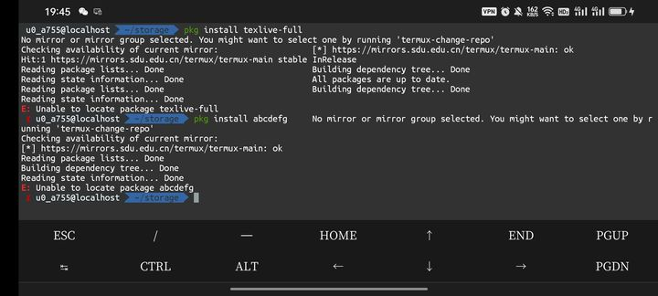


那么他又变成什么名字了呢？其实你可以搜索一下texlive关键词就行了。在你手机里边的Termux输入如下的语句

``` shell
pkg search texlive
```

然后你就会得到如下的结果

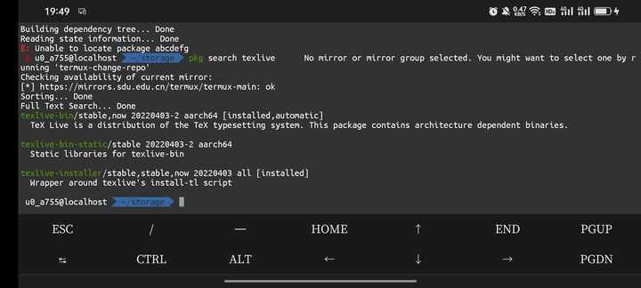


所以我们可以用**texlive-installe**r来安装。下载**texlive-installe**r，使用语句

```
pkg install texlive-installer
```

一直回车就行，然后运行命令

```
termux-install-tl
```

你就会进入一个界面

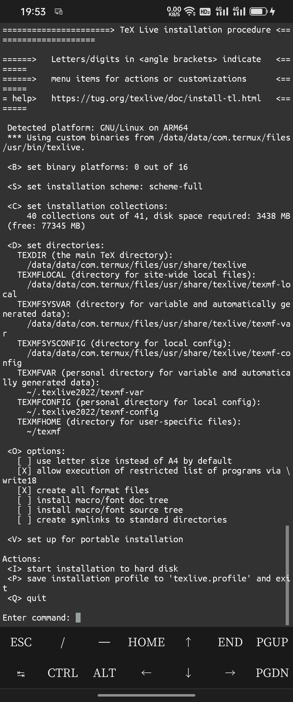


**安装选项（可选）**

你可以输入S（大写的），选择安装的包的多少，默认full-scheme（全部的宏包）推荐新手使用默认选项，不要做任何的修改。同时：上边也有很多的安装时的可选参数，可以自行研究。

**开始安装**

接下来直接输入I（大写的）就可以开始安装了，安装过程可能比较漫长，我安装了4200多个宏包，花了两个多小时，具体的情况因人而异。手机安装时的大致模样

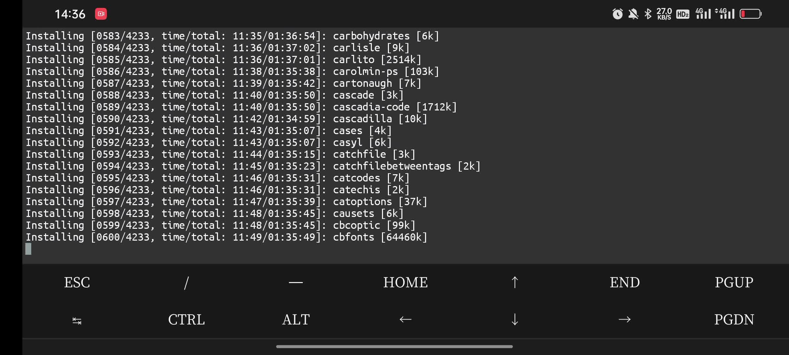


安装完成后的截图

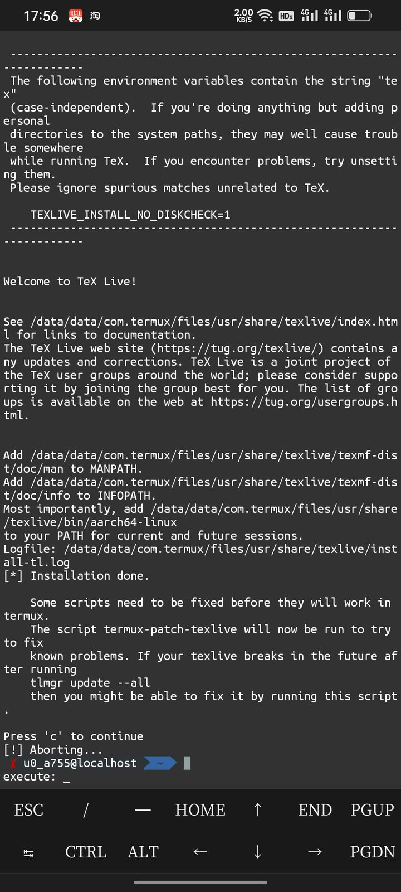


,但是此时你输入xelatex可能无法识别，需要你执行一下如下的语句（稍微有点Linux基础的，应该都懂吧）

``` shell
source /data/data/com.termux/files/usr/etc/profile.d/texlive.sh
```

**检验安装是否成功**

依次输入如下的语句，检查各个引擎和宏包管理软件tlmgr是否安装好了。下边有运行结果截图：

``` shell
xelatex -v              % 最常用，绝对不能出问题
latex -v
paflatex -v
tlmgr --version         % 宏包管理软件,也很重要
```

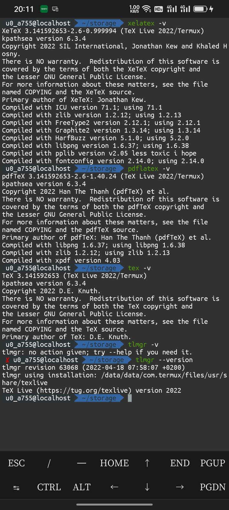


## 3.使用TexLive

这里需要你有一点的vim或者是nano的基础（不会也行），原则上你的手机上的任何的文本编辑器都能够写处.tex文档。只不过使用vim就在终端里面，方便一些。此处测试文档编辑基本的vim操作：

``` shell
:wq                            % 保存并退出（normal模式下）
:q!                            % 强制退出（normal模式下）
i                              % 进入编辑模式
Esc(或Ctrl + c)                % 退出编辑模式
```

**编写测试文件**

输入命令

``` shell
vim main.tex
```

输入如下的内容：

``` tex
\documentclass{article}

\usepackage{ctex}

\begin{document}

Test Basic english\\
Hello{} \LaTeX


测试中文\\
这是一句中文
Hello{} \LaTeX


\end{document}
```
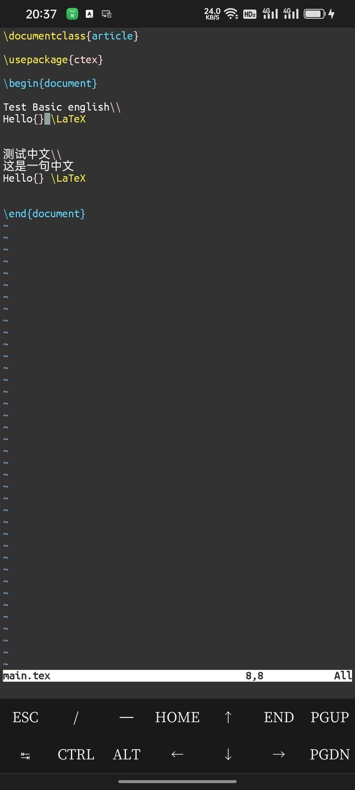


**编译文件**

```
xelatex main.tex
```

**查看编译输出（可选）**

```
ls -al
```

上述流程演示截图

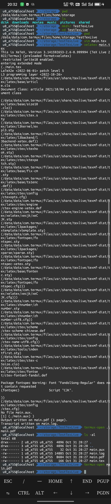


**查看编译输出的pdf文件**

```
termux-open main.pdf
```

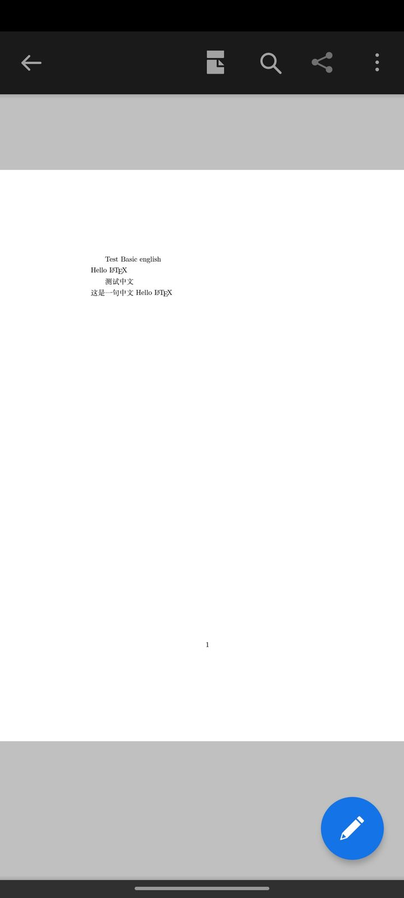


## 4.在手机上编辑LaTeX的一些拓展选项

### 4.1 键盘输入

就在手机上打字是很痛苦的，所以可以考虑外接一个键盘进行输入。

### 4.2 投屏操作

就在这么小的手机上写代码，体验是极为糟糕的。所以可以选择把手机屏幕投射到电脑上去，在结合外接的键盘进行编写。（不要问【喷】我为什么不在电脑用原生的TexLive和Vscode，而非得投屏，请仔细看我的前言）

**1.电脑投屏到手机**

使用windows自带的投屏进行操作：这里讲解安装这个应用：无线显示

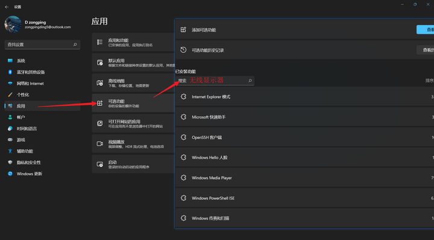


具体的操作见

**2.手机投屏到电脑**

手机电脑在同一局域网内部（连接同一个WIFI），具体操作

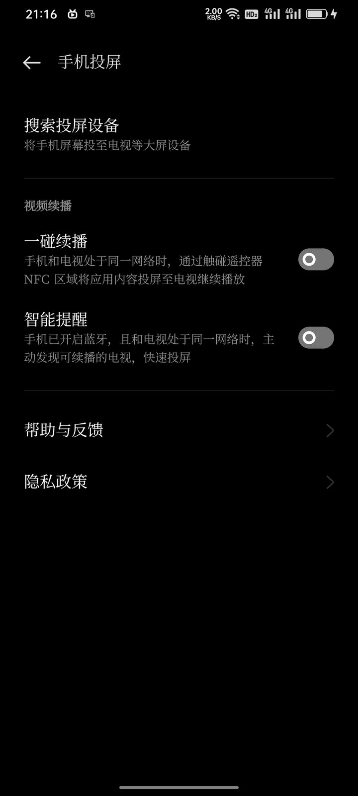

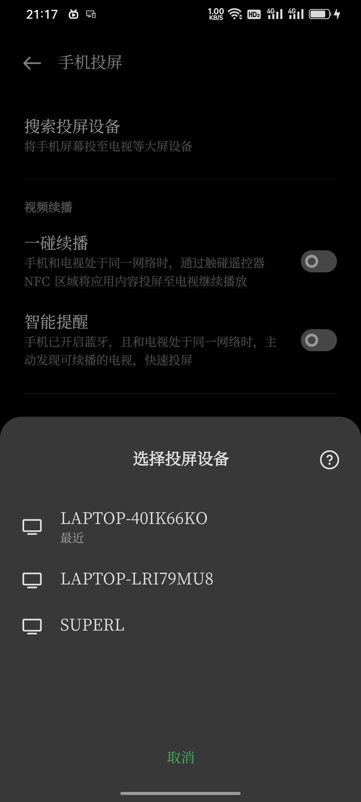


**3.使用软件Xdisplay实现投屏**

**同时在手机和电脑上下载Xdisplay软件。**

**电脑端：**直接在[网站](https://www.splashtop.cn/cn/)上下载就行了

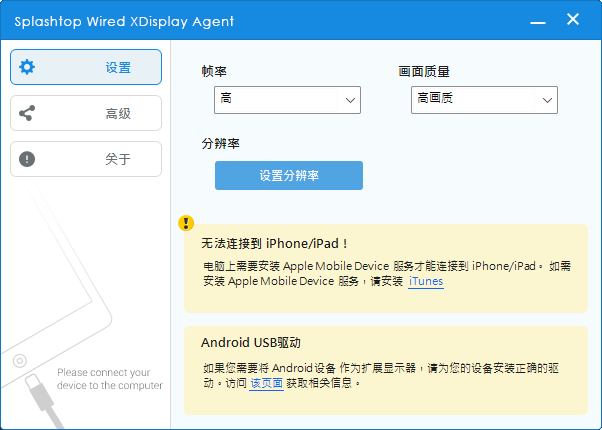


**手机端：**我是在Google商店（需要科学上网）下载的。你们可以网站下载Android版

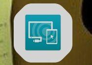


**电脑端和手机端的设置：**电脑打开软件即可，电脑手机用USB线连接。手机需要打开USB调试（4击版本号进入开发者模式，然后就会出现了）， 部分手机连接时需要选择【**传输文件和照片】。**


## 5.结语

Have Fun， Happy LaTeXing !!!

## 6 外接键盘无法切换中文输入法

直接把toolbar向左边拖动，就可以了。截图如下：

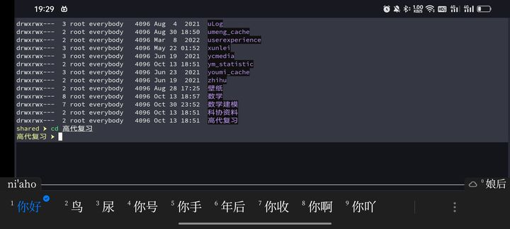


只不过此时命令的跳转不好操作

## 7 半本地化的VerbTeX

只需要在google商店下载一个免费的VerbTeX即可：我才它的工作机制应该是调用的在线引擎，编译生成PDF后进行下载到手机端查看。然后再说一说它支持的功能吧：

1. 语法高亮
2. 引用本地图片
3. LaTeX 语法
4. 快捷输入
5. 大纲查看

**不足之处**

目前好像无法更改其他的编译的引擎，所以只能够使用的有pdflatex和xelatex，但是对于一个手机端的LaTeX编辑器，他已经很好了。下面是演示效果：

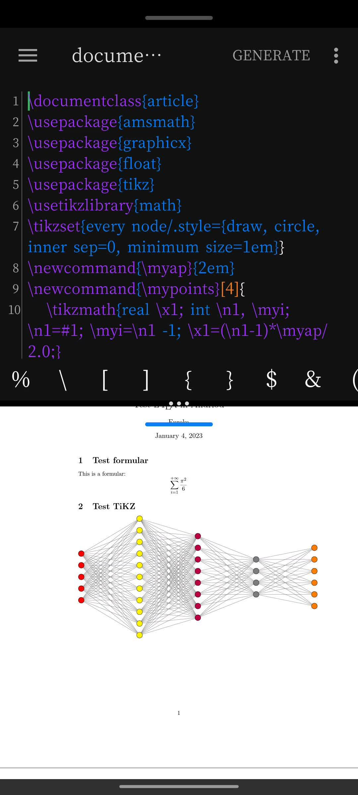
