## 1. 前言
其实之前我已经写过一篇文章来总结了部分的TiKZ的可视化编辑软件，但是自己后面又发现了有很多的好用的工具，然后就都去用了一遍，也体会到了各个工具的优劣。后面发现，在某些方面TiKZ还是有一定的局限性。我也就去了解了各种的矢量图绘制软件，于是就有了这篇**矢量图绘制**软件推荐。

但是感觉有的时候，其实真没有必要太过于追求矢量图，位图也挺好的。但是我折腾就要折腾到底，满足自己近乎变态的绘图要求。所以下面我的内容将不在限定于TiKZ，但是绝大多数（90%）的软件都是支持导出tikz的 ......

> 为什么要写这篇文章? 
> 1. 纪念自己曾经折腾TiKZ的这段经历 
> 2. 为了给没有入坑的人提供一点参考, 让各位少走一点弯路

更多参考示例, 这个里面有各式各样的精美抑或是令你感到unbelievable的示例：
> https://tex.stackexchange.com/questions/158668/nice-scientific-pictures-show-off

## 2. 工具内容

相关的部分工具大致划分为：

1. 分为绘图软件
2. 绘图语言

> PS: 其实这种划分并不太准确（欢迎讨论交流），同时也欢迎交流其他的矢量图绘制软件。

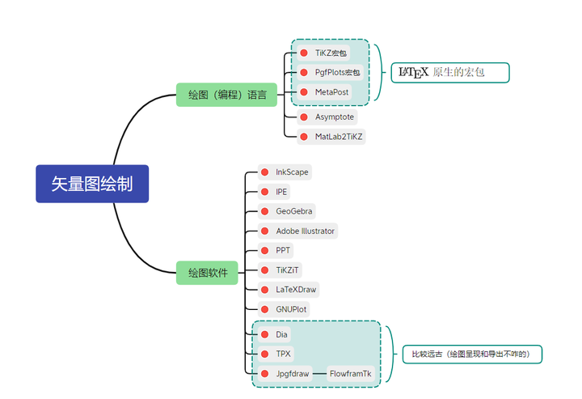


## 3. 工具使用介绍
### 3.1 TiKZit
在介绍tikz之前，先给新手介绍一个比较友好的tikz可视化绘图软件TikZit,github的地址为:https://github.com/tikzit/tikzit; 是一个Github上的开源项目，是一个GitHub上的开源项目,这个东西的使用体验还好吧，也是我在这个方面的入门软件。我大概学了一个下午吧。这个软件的入门文档作者写的很好，按照它的教程一步步的走下来，基本上这个软件的功能你就可以摸透了.

1. 功能简单，入手快.可以作为新手入门tikz的铺垫，
2. 可以调用pdflatex进行预览
3. 支持自定义node和edge的样式，可以方在文件中通过 \input{ } 调用

> 对于中文支持即使更改默认的latex编译引擎pdflatex为xelatex的位置，并且在tikzdefs中引入ctex宏包仍然不支持中文

我去软件的github仓库开了一个issue，但是还是没能解决问题


大致的使用方法如下:
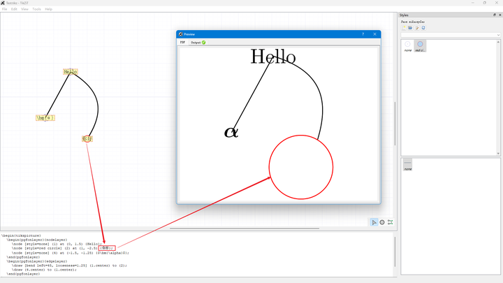

 

1. 到了后期就会发现功能有一点的单一
2. node和edge的样式太少（但是可以修改源码）
3. 部分的样式定义不合理的话软件会崩溃
4. 部分定义的样式在GUI界面无法显示


> 对应的BUG的解决? 中文node和样式不合理导致的崩溃：均可以退出软件然后手动修改源码

**使用演示**
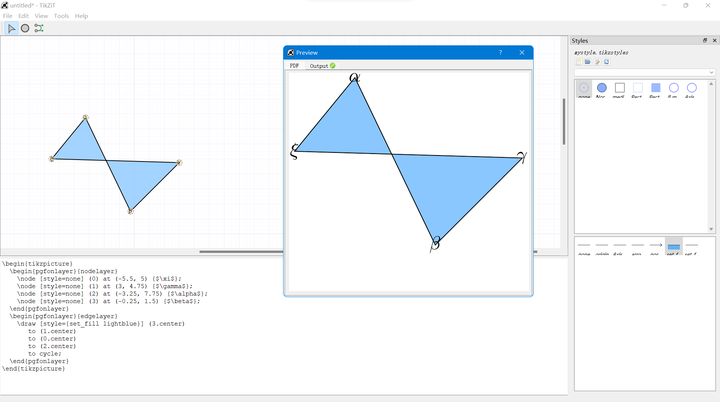



使用tips:
1. 使用`Ctrl + J`打开源码进行修改
2. 把自己的样式定义在一个文件中，宏定义文件定义在一个文件中



其中有两个样式文件(配置文件) `.tikzstyles` 和 `.tikzdefs`， 其中第一个样式文件是必须的，第二个样式文件会被tikzit自动导入，这两个文件中的内容大概长这个样子

``` tex
%%%%%  .tikzstyles
% TiKZ style file generated by TikZiT. You may edit this file manually,
% but some things (e.g. comments) may be overwritten. To be readable in
% TikZiT, the only non-comment lines must be of the form:
% \tikzstyle{NAME}=[PROPERTY LIST]

% Node styles
\tikzstyle{red circle}=[fill=white, draw=red, shape=circle]

% Edge styles
%%%%%  .tikzdefs
\PassOptionsToClass{\CurrentOption}{article}
\usepackage{ctex}
\usepackage{bm}
\newcommand{\param}[1]{\ensuremath{\vec{\bm{#1}}}}
```

从上面可以看出tikzit的style文件其实就是一系列声明的node style (如果你对tikz熟悉的话). 但是目前为止我觉得用这个东西来绘制贝塞尔曲线还可以试试，其他的就算了.


### 3.2 TiKZ and PgfPlots
LATEX 自带的tikz宏包肯定不必多说了吧，你随便在网上一搜就有一堆的结果,有很多的相关内容.


### 3.3 MetaPost
可以稍微的介绍以下 MetaPost 的内容，MetaPost 是脱胎于 D. E. K. 的 MetaFont 的一个东西，感觉和TiKZ差不多. 你可以在你的电脑上本地执行MetaPost的文件，也可以使用在线网站: http://www.tlhiv.org/mppreview/

具体的使用文档可以查看官方文档，只需要在你电脑的终端中输入如下的命令：
``` shell
texdoc metapost
```

操作示意图

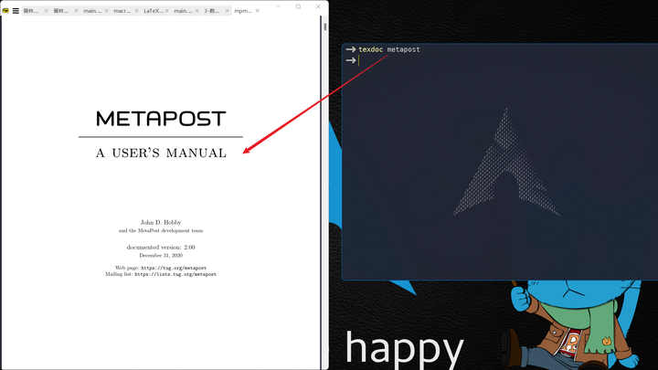


**1. 文件**

一段简单的测试代码（使用样例）, 把它保存为文件fig.mp

```
% fig.mp
% 这里是注释

% 设置输出图片的格式为eps
filenametemplate "%j-%c.eps";

beginfig (1) ; 
    for i=0 upto 9:
        draw (0,0){dir 45}..{dir -10i}(6cm,0);
    endfor

    for i=0 upto 9:
        draw (7cm,1cm){dir 45}..{dir 10i}(13cm,1cm);
    endfor
endfig ;

end
```

**2. 编译**

在命令行输入如下的指令：

``` shell
mpost fig.mp
```

**3. 输出**

然后你会得到如下的输出：
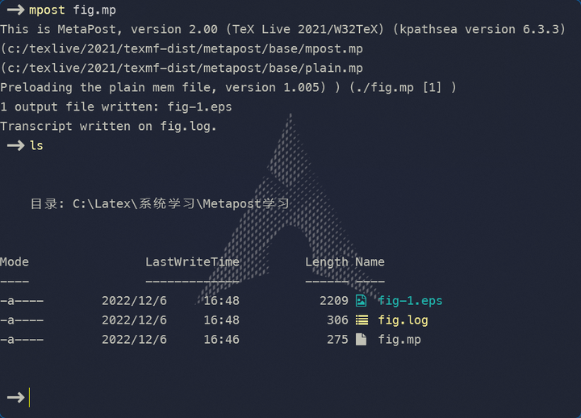


**4. 查看**

打开eps文件（可以使用Gsview）就可以看到内容了，如下：
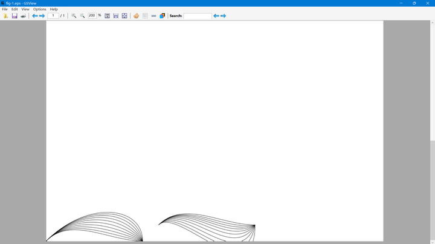


> 详细的使用方法可以参见如下链接
> 1. 参见：https://www.tug.org/docs/metapost/mpman.pdf
> 2. 查阅自带的文档：`texdoc metapost`


### 3.4 Asymptote
个人感觉这个软件（语言）挺好的, 软件的介绍(来自百度百科)：

> Asymptote 是一种为了绘制技术图形而设计的矢量图语言，其灵感来自 MetaPost，它具有 IEEE 标准的浮点数支持、原生的三维图形支持、灰度 /RGB/CMYK/HSV 等不同色彩指定方式以及类似 C++ 的语法。与 MetaPost不同，Asymptote 原生的支持多段路径（因此不局限于单连通区域）、填充图案、Gouraud 着色（shading）以及PostScript 图像（和pdf等）

自己那段时间真的想把这个东西学会，我在学习的过程中看到它的语法和C差不多，而且文档也讲的挺详细的。

它有两种绘图模式：

1. **BathMode** (写为一个文件)
2. **InteractiveMode** （命令行实时交互）

重要的是用它来绘制二维和三维图形的方法感觉比TikZ简单多了，而且这个也是TeXLive自带的一个宏包， 可以和TiKZ类似， 可以直接写在 .tex 文件中，直接编译, 还可以支持生成交互模式的三维pdf格式文档。

> PS：要使用交互功能需要使用支持JavaScript的pdf阅读器（比如Adobe Acrobat）。

**Asymptote 使用演示**

1.**BatchMode**

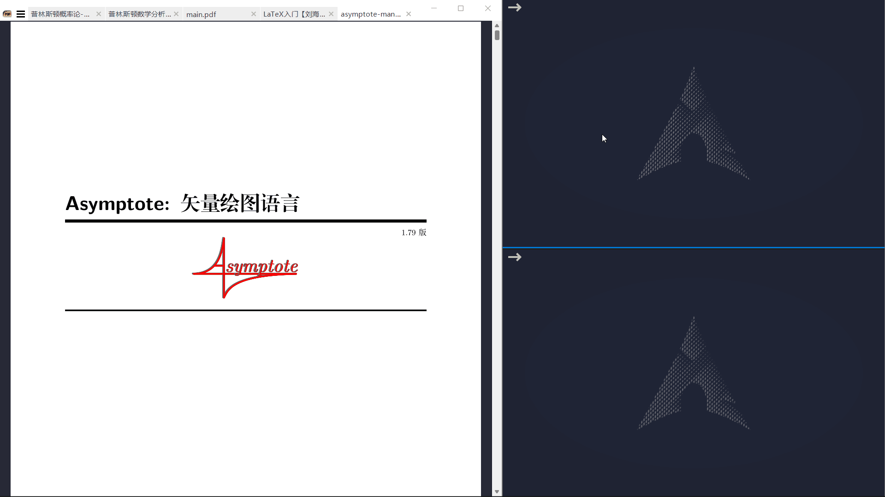


2.**InteractiveMode**


视频中用到的MarkDown文档在这里 

### 3.5 Matlab2TikZ 
其实Matlab本身就可以导出相对比较精准的矢量图，可以绘制出图以后直接在绘图窗口另存为pdf格式，此时就是高清的矢量图了，如下：
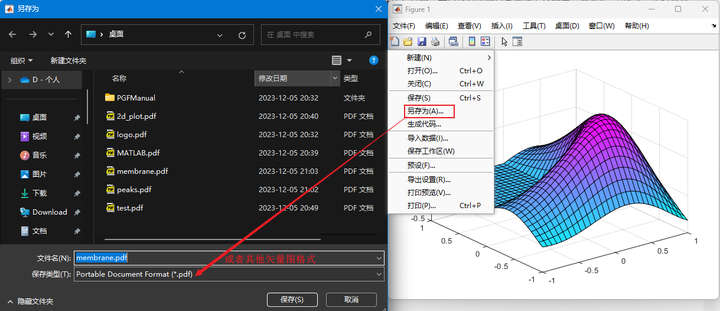


当然，你们可能会遇到即使是选择了pdf, eps等矢量图格式，但是导出的图片依然非常的糊，那么只需要把如下的导出设置渲染方式更改一下即可:

> 但是我记得matlab好像默认就是OpenGL位图格式导出的，此时你可以选择dpi

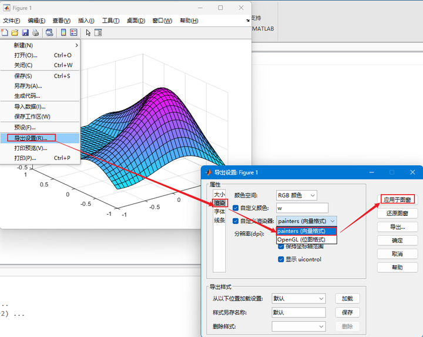


> 还可以使用matlab自带的函数 exportgraphics 进行导出，语法为

``` matlab
exportgraphics(gcf,'test.pdf','ContentType','vector'); 
```

但是如果你追求完美的数学字体和统一的  的话，那么就可以使用如下推荐的一个工具:`MaTlaB2TiKZ`, 一个GitHub上的开源项目, 项目地址为:https://github.com/matlab2tikz; 这个可以认为是我这篇博客里边的又一个重点, 它的功能十分的强大，可以和MatlaB梦幻联动，能不强大？具体的使用使用方法可以参见github在下载下来的源码里边的如下文件:

``` shell
~\MatLab2TiKZ\src\matlab2tikz.m
```

下边我给出几个个最基本的，也是最常用的使用方法样例

**二维函数绘图导出**

``` matlab
clear,clc;
% 绘制二维图
x = 0:0.1:2*pi;
y = sin(x);
plot(x, y, 'r')

% 导出（默认当前文件夹下）
addpath C:\Latex\MatLab2TiKZ\src
matlab2tikz('Test2D.tex')
```

**三维函数导出**

``` matlab
% 绘制三维图
peaks;

% 导出
addpath C:\Latex\MatLab2TiKZ\src
matlab2tikz('Test3D.tex')
```

> PS: 也可以先把图形绘制出来，调整好后再导出TiKZ源码, 只需使用如下两条语句：

``` matlab
% import matlab2tikz function
addpath C:\Latex\MatLab2TiKZ\src

% Export graphicx
matlab2tikz('Test3D.tex') 
```

**MatLab2TiKZ的编译效果**
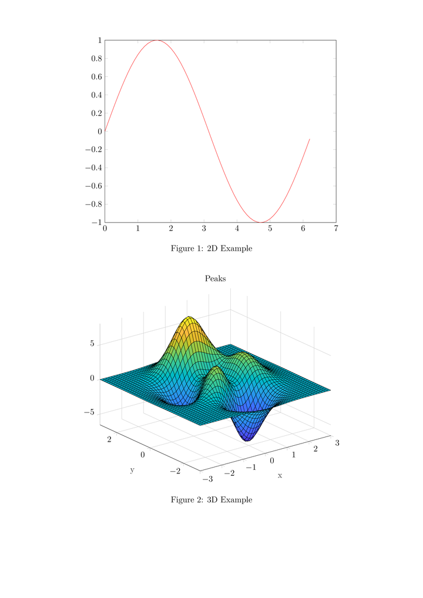


### 3.6 gnuplot
对于这个软件，我只能用一个词来形容, 那就是 **短小精悍,** 但是我用的不多. 以下为gnuplot的一个简单使用样例:


> 备注: 怎么在gnuplot中清屏(即清除历史输入输出信息) ？system "cls", 如果是在类Unix上则为 system "clear"

关于GnuPlot在LaTeX中的使用，我在这里把GnuPlot在TiKZ中的使用详细介绍一下.在介绍怎么使用 TikZ 与 Gnuplot 之前，我们先说怎么编译。在发行里，gnuplot并不包含在内。它的原理是 TikZ 调用 Gnuplot 之后，在编译的过程中，我们将会得到两个中间文件:

``` shell
filename.pgf-plot.gnuplot

filename.pgf-plot.table
```

其中，前者是 **pgf-plot.table** 的设定文件，而后者就是调用 Gnuplot 之后产生的一个数据表（点的坐标），然后 TikZ 调用这些点的坐标得到函数图。为了能够使用 TikZ 与 Gnuplot，需要做两件事

1. 在电脑安装 Gnuplot
2. 命令行加入参数【临时】: **pdflatex –shell-escape** filename.tex 

或者是修改配置文件【永久】, vscode 的配置文件中加上–shell-escape 如下图：
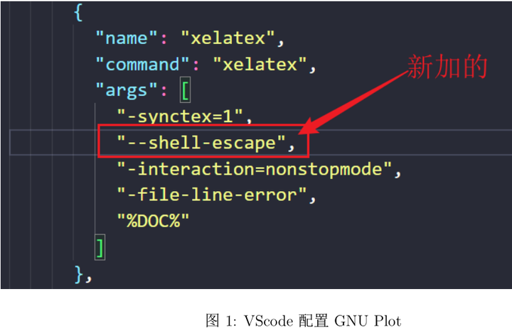


想要更进一步了解gnuplot的使用方法的可以参见我的宏包`ztikz`，其中有着诸多的`gnuplot`应用示例.

### 3.7 Geogebra 
GeoGebra这个软件想必大家都知道吧，一个很有名的数学教学软件； 它的功能太多了，网上也有很都多使用它做出来的炫酷的项目。
但是我们主要是使用它的导出TiKZ源代码的功能.


1. 尽量使用GeoGebra5吧，真心感觉GeoGebra6不太好用
2. 导出的代码选择PGF/TiKZ别用PStrik（太底层了）



**导出演示**
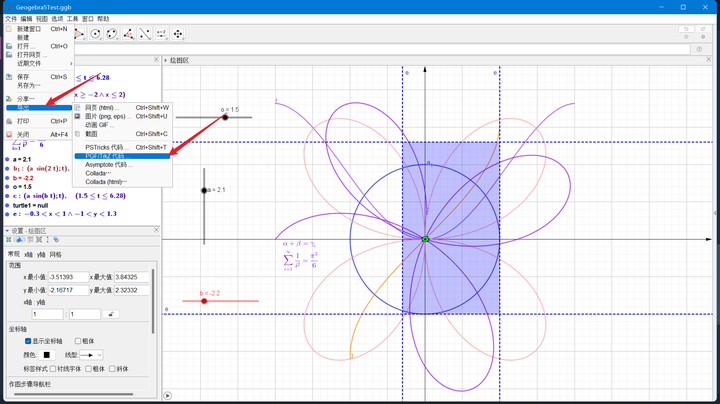


导出对应的绘图源码后,在你的文件中input进来就可以用了.

> 编译出bug了不要慌张，看一看它导出的源代码，可能需要GNUplot参与编译过程,只需要在命令行使用如下的命令编译即可

``` shell
xelatex --shell escape main.tex
```


### 3.8 LaTeXDraw
同样的这也是一个开源的的软件，软件接口可以通过[source forge地址](https://sourceforge.net/projects/latexdraw/files/latexdraw/4.0.3/)进行下载。官网上有一些使用样例，可以仿照着学一学:
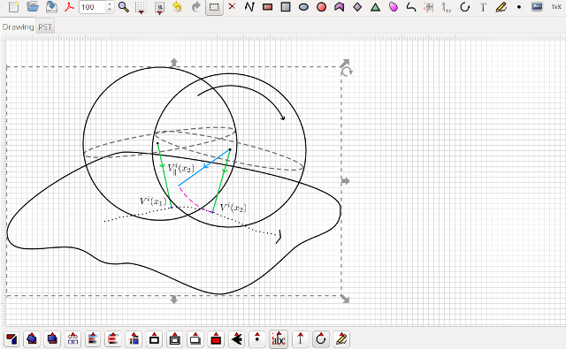

官方网站的又一个使用演示:
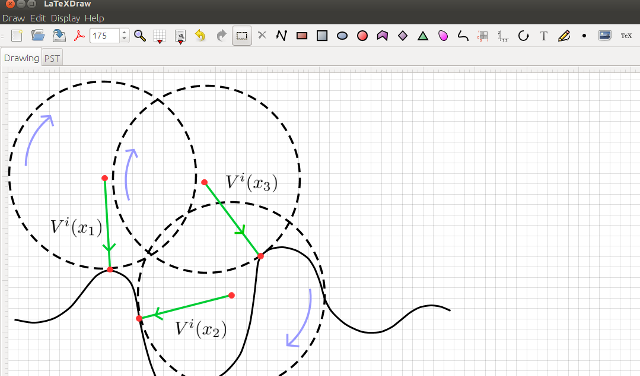


这个软件很强大，但是我没有怎么深入用过它。我用了一段时间的TiKZiT后就转纯TiKZ了。 但是它默认的安装是无法导出pdf等格式的，需要安装一个perl脚本。 这个是官方的说明：
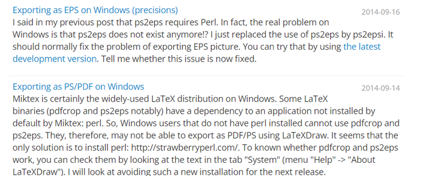


> 我就不演示了，毕竟我目前也不咋用这个东西了。


### 3.9  Adobe Illustrator
这里介绍的这个 GeoGeBra 的使用和之前那片文章的使用方法不太一样。那篇文章是使用的GeoGeBra导出TiKZ代码的功能，这里我们主要是利用 GeoGeBra生成pdf文档的方法联合 Adobe Illustrator绘制一部分的矢量图（数学笔记之类的）。

> PS:满足你排版数学矢量图笔记的需要

AI的各个功能都很强的，但是数学方面不太行，主要体现在如下的几点:

1. 不支持数学公式的输入
2. 不能进行函数图像的绘制

所以为了支持数学公式的输入我们需要给AI添加一个插件: **latex2ai**. 这个是官方项目地址

里边有各种的注意事项，好好阅读一下就行了，里边讲的还是很详细的。对应的使用教程为演示如下：

1. **公式使用方法和模板的配置**


**2. 联合GeoGeBra**


> 安装提示：
1. AI的路径和你的.ai文件的路径中均不能含有非ASCII字符（也就是说：汉字是不允许的）
2. 你可以自定义你的模板，里边可以包含你自己添加的宏包。但是千万别修改文档类。
3. GeoGeBra导出的三维图形是位图（png）的，但是你可以选择分辨率，所以也没有多大的影响。


### 3.10 LaTeXDraw
也不知道是什么原因，我安装了Perl等一系列的插件之后，这个软件现在还是无法导出pdf，我在官方的主页也没有找到修复的方法。

但是除了不能导出pdf外，LaTeXDraw这个软件真的是好用的，导出PSTriks代码很方便。界面的设计也是十分的简洁，看着也很舒服。

### 3.11 PPT (PowerPoint)
你以为PPT就只能够做一下幻灯片 ？？？ NO! NO! NO! 其实很多发表的论文中的图都是使用PPT来绘制的，可以直接导出svg， 然后随便到网上找一个svg装pdf的网站即可，他们网站上还有非常多的好用的pdf工具，下面截取部分加以展示：
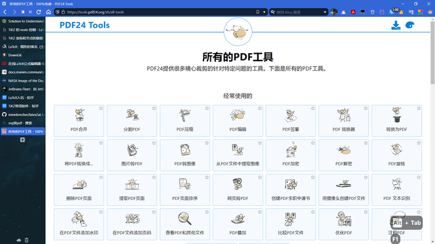


> 这里给大家推荐一个良心的网站：[svg转pdf](https://tools.pdf24.org/zh/svg-to-pdf) 他们还有一个对应的pdf编辑的工具箱，个人感觉比绝大多数的pdf工具强。

操作演示：


### 3.12 IPE
强烈推荐这个软件，目前我已经入坑这个软件了。主要的优点

1. UI 设计精良，看着很舒服
2. 软件的功能设计合理，快捷键人性化
3. 具有良好的拓展性，可以安装诸多的插件。
4. 方便绘制几何图形和函数图像

界面截图:
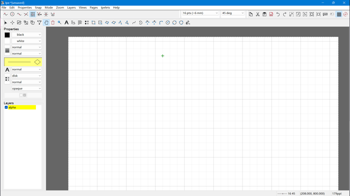


我的一些排版作品：
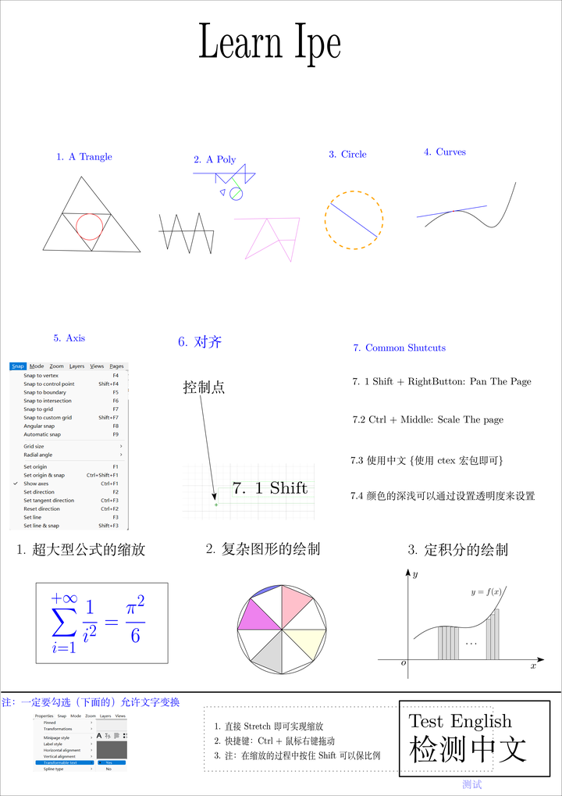


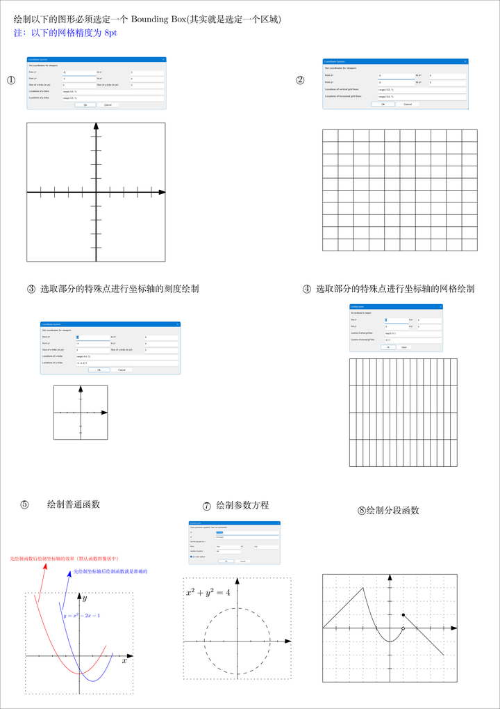

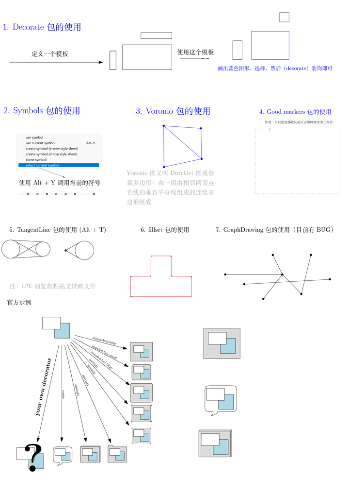


**1.怎么安装插件?**

进入他们的官网: https://github.com/otfried/ipelets; 把对应的 **.lua** 代码文件复制到你IPE的目录 Ipelets下，如图（我自己安装的插件）：
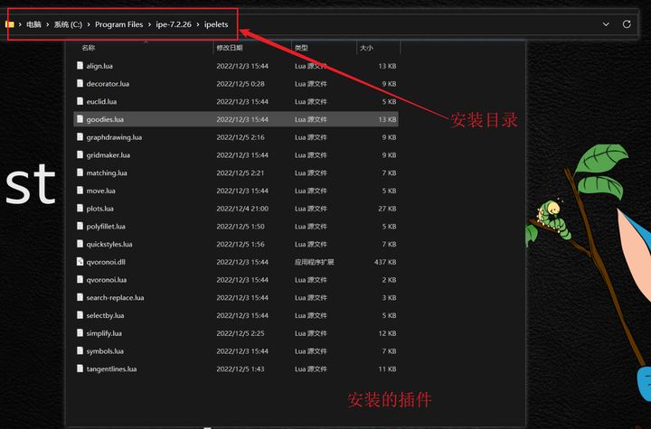


> PS: 部分的插件安装还是需要参考官方文档.

1. **我的IPE插件**
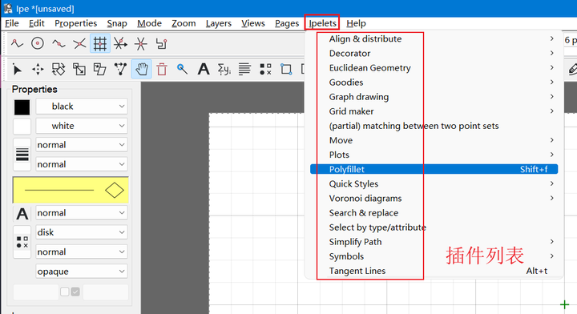


**2. IPE学习**
* 对应的视频教程: https://www.bilibili.com/video/BV14E411u7Na/?spm_id_from=333.337.search-card.all.click&vd_source=96bb8d1f8bd0536bf4c7face3f42d777
* 对应的实例教程: https://www.bilibili.com/video/BV1rE411N7RU/?spm_id_from=333.337.search-card.all.click

看完了上面的两个教程之后，你会觉得这就是一个为了TiKZ而生的软件。


### 3.13 Inkscape
最近总算是有机会来接触Inkscape则会个软件了，感觉对于IPE就是碾压，IPE有的优点，Inkscape几乎都有，IPE没有的，InkScape也有。而且你还可以自己去调用它的API接口，很强。终于理解了为什么那个外国小哥要用Inkscape了.

比如Inkscape中的LaTeX公式对象可以在InkScape中编辑，而不用去修改源码，这点胜过IPE和AI，也有官方的说明：
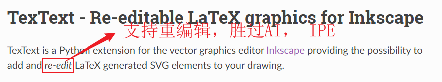


首先便是使得InkScape支持  了，很简单，直接无脑安装一个 TexText就可以了，下载地址：

然后稍微参考一下官方的安装教程就很安装好了。

**注：**

1. **你的插件可能会报错：**
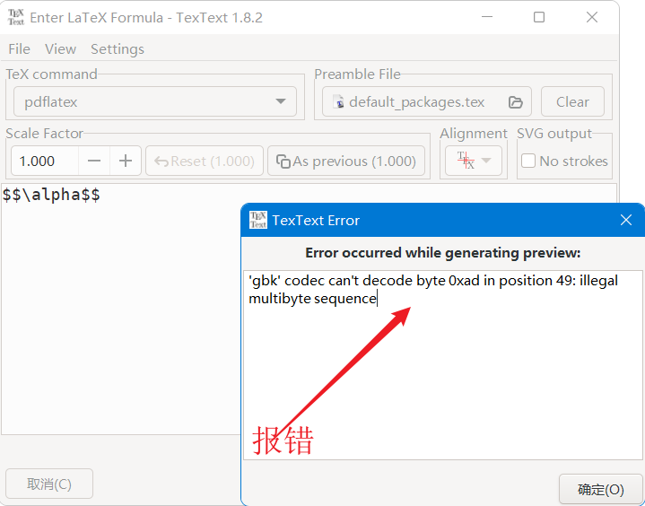


**解决办法**

把你的模板文件中的中文全部删掉，使用原始的模板文件，模板文件如下：

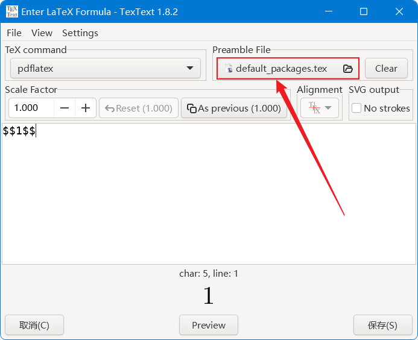


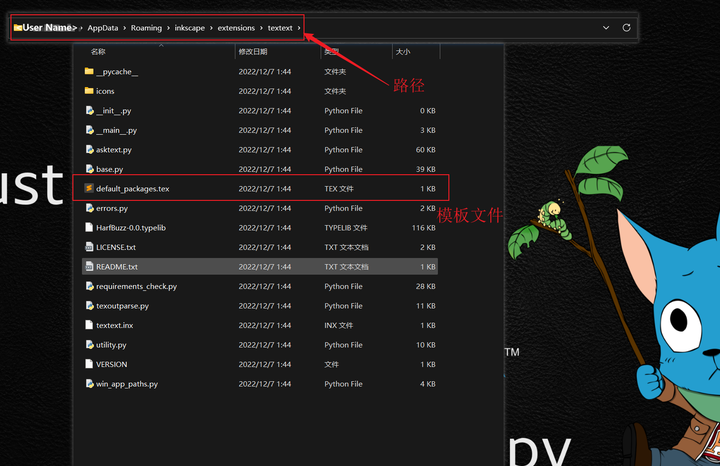


**改了之后我还产生报错**

```
Command C:\Users\PC\scoop\apps\inkscape\current\bin\inkscape.exe --pdf-poppler --pdf-page=1 --export
```

**我报错的原因**

是我之前使用Scoop安装过一次InkScape，导致TexText还是去找原来路径下的InkScape。

**解决**

只需要使用windows的.bat文件把TexText重新安装一次就行了，不要使用GUI的安装方式。

**报错二**

想要在LaTeX中使用中文产生了如下的报错：

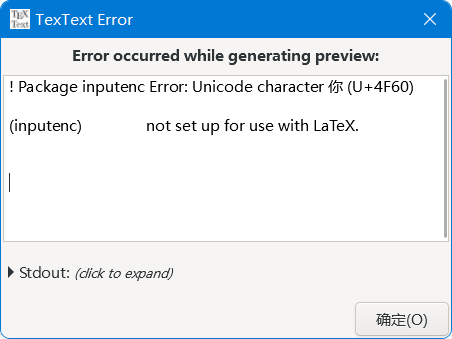


需要去修改TexText的模板文件

**解决方法**

模板增加为：

```
\documentclass[fontset=windows]{article}        % 必须加上[fontset=windows]，否则会报错fandol字体找不到
\usepackage{ctex}
```

**InkScape的插件**

InkScape的插件是十分丰富的，其余的InkScape插件的安装地址

推荐安装的一个TeX代码相关的插件：[GtkSourceView【64位】](https://github.com/textext/gtksourceview-for-inkscape-windows/releases/download/1.0.0/Install-GtkSourceView-3.24-Inkscape-1.0-64bit.exe)

**作用（官方解释）**
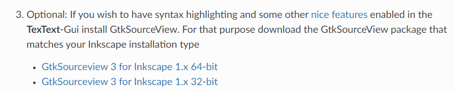


**具体的使用效果**
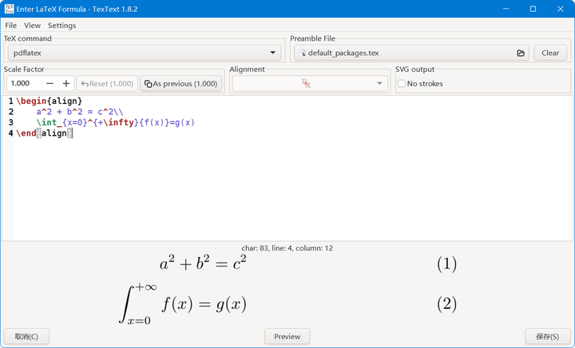


安装好的使用截图：
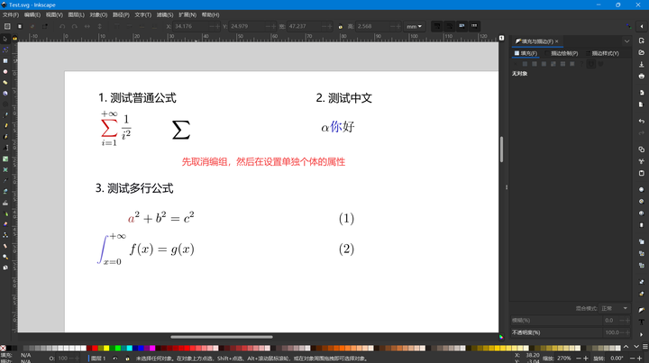


其余的功能就和AI是差不多的了，参考学习一下就行了。


### 3.14  Dia
他们的绘图实时渲染不怎么好，UI界面看着很难受, 但是内在很强大，支持多种格式的导出，如图（截取部分）：
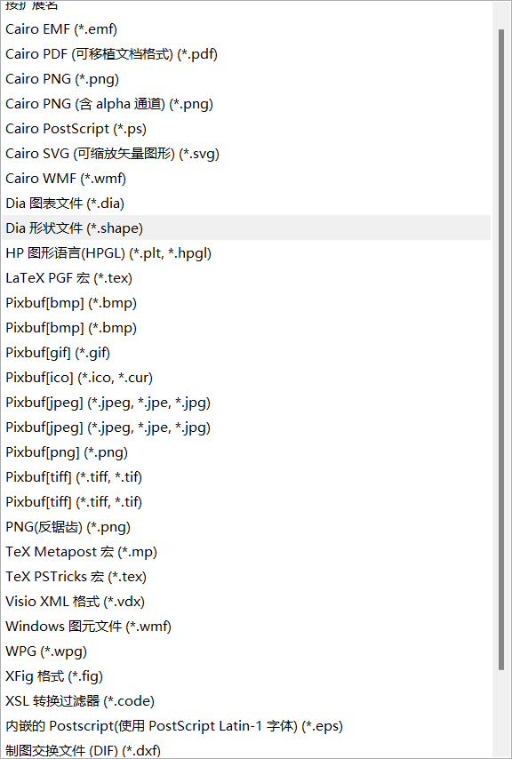


导出后的文件的渲染效果也很好。所以这告诉了我们一个道理，外在往往不是那么的重要, 导出的示例图形
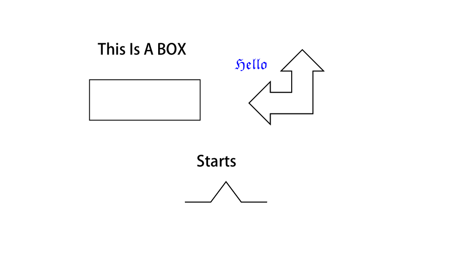


### 3.15 TpX
这个软件的使用体验上面的Dia差不多, 软件下载地址: https://sourceforge.net/projects/tpx/; 界面截图：
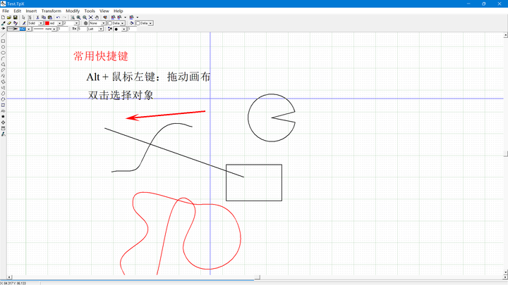


### 3.16 FlowframTK
软件下载：https://texblog.net/latex-archive/uncategorized/jpgfdraw/; 这个软件的原名其实是叫做Jpgfdraw，后来因为种种的原因，改成了这个名字。而且这个软件的安装方式也很奇葩。它依赖与Java环境，使用的是一个Java脚本来安装的，可以看看官方的安装教程:
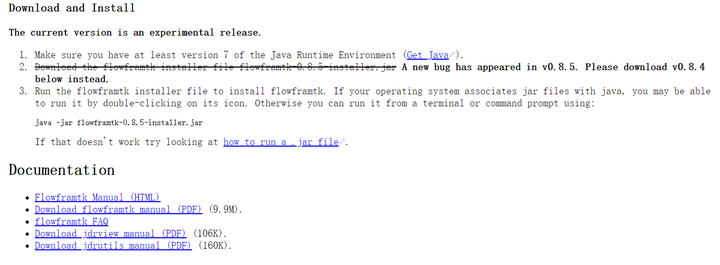


安装好之后，可能你们会不知道在哪里打开这个应用，它不是我们熟知的 **.exe**, 也不是Linux下的 **.sh**, 它的启动是双击windows下的一个批处理脚本 **.bat** 文件，如下：
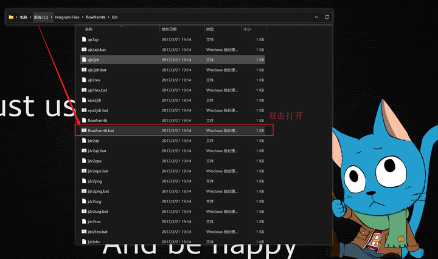


这个是它的界面,看看怎么样：
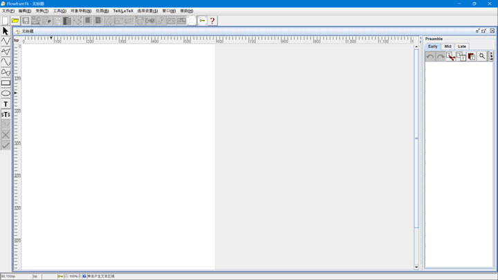


功能啥的，我稍微的体验了一下，感觉不太好。应该还有提升的空间。但是这个软件的官方文档（就在安装目录下）说明是十分的详细的，如果想要学习这个软件还是比较简单的， 这个是它帮助文档的部分目录截取:
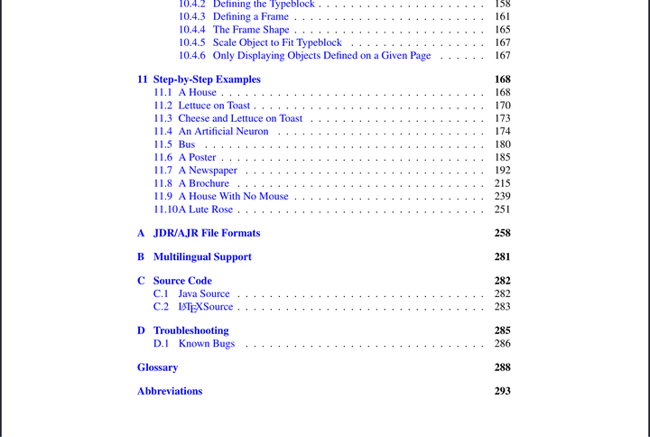


> 制作这个软件，作者还是很用心的 >_<


### 3.17 AxMath and AxGlyph
这两个软件可以和MS那一套结合，类似于MathType，但是个人感觉比MathType强一百倍。当然也可以单独的使用，就i类似于其他的软件了。AxMath主要是用于数学公式的编辑，AxGlyph主要是用于矢量图的绘制。但是...但是那个Axglyph有时导出pdf会报错，具体的bug原因没有找到。如果你习惯于使用MS那一套，那么这两个东西是你的不二之选。

> PS: 这两个软件是付费的，也没有多贵，买了也算是支持国产.下面就是这两个软件的使用截图：

**0. AxMath使用演示**
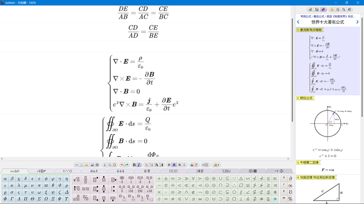


个人作品

**1.AxGlyph的演示**

我选取一部分官网的图片，自己用它做的事也不多。
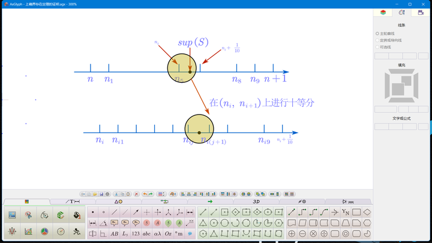


个人的作品

**2.官网使用截图**
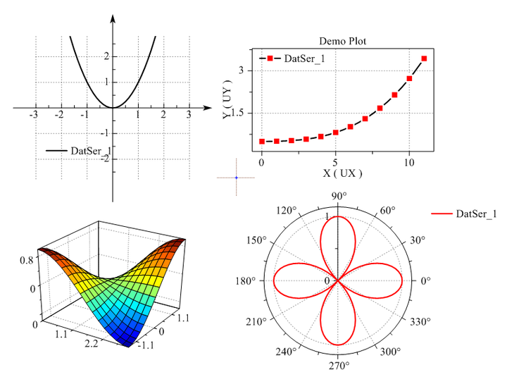

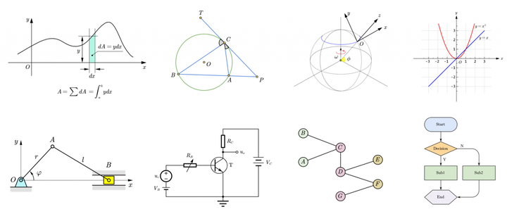


### 3.18 Mermaid
这是一个开源项目，下面是官方介绍：

> Mermaid is a JavaScript-based diagramming and charting tool that uses Markdown-inspired text definitions and a renderer to create and modify complex diagrams. The main purpose of Mermaid is to help documentation catch up with development.

简要的概括就是：使用MarkDown语法来制作流程图，思维导图，表格等各种**图**的工具。项目地址：https://mermaid.js.org/; 官方仓库也给了许多的例子：
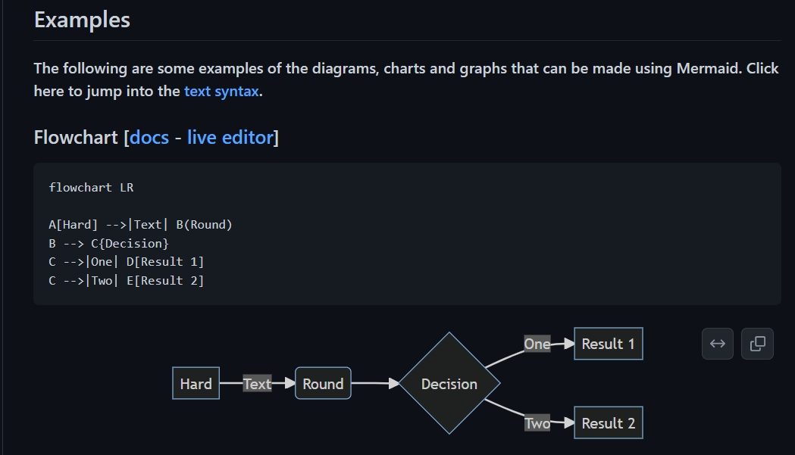


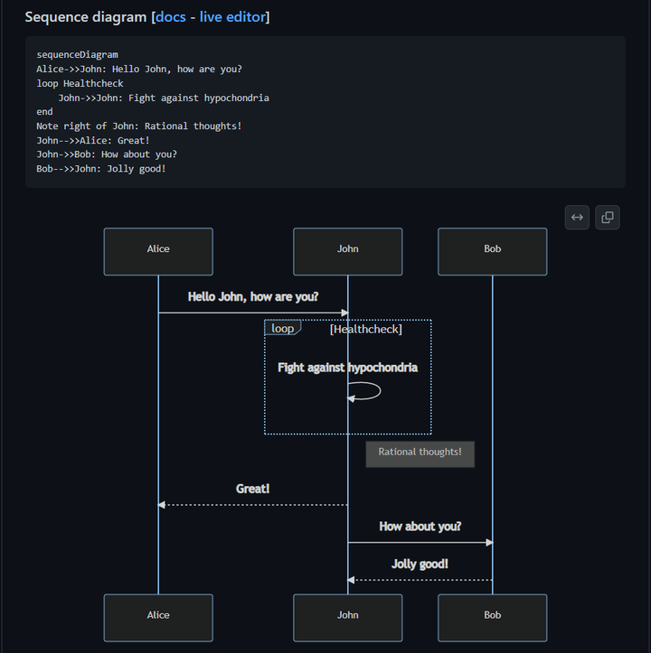


具体的安装

1. 通过NPM安装在本地
2. 使用在线的编辑网站

但是导出的矢量图是svg格式的，因为我们往往使用的都是pdf格式，所以我写了一个把svg转化为pdf的python脚本。【也可以用网上那种 [svg转pdf的网站](https://tools.pdf24.org/zh/svg-to-pdf)】

下面演示一下我那个脚本的使用示例截图:

**1. Shell脚本配置如下**

``` powershell
# 自定义一个svg2pdf的命令
function svg2pdf {
    python C:\BIN\Svg2Pdf.py $args
    # 注意：这里的脚本路径根据你的实际路径更改
}
# 注：如下的命令会报错
# Set-Alias -Name svg2pdf -Value "python C:\BIN\Svg2Pdf.py"
# 这样不带参数会报错：因为默认的python已经把这个脚本运行完,没有传入参数. 解析到的参数为：['C:\\BIN\\Svg2Pdf.py']

# Update:2023-12-05
# 使用inkscape作为转换工具, 可以解决更多的兼容性问题
function svg2pdf {
    # 注意：这里的脚本路径根据你的实际路径更改
    # 1. 使用python的svg库转换 --> 会失真
    # python C:\BIN\Svg2Pdf.py $args
    # 2. 使用inkscape转换，效果更好
    inkscape --export-type=pdf $args
}
```

**2.Python脚本如下**

> PS：这个脚本只能够处理比较简单的转换工作，有时候会字体丢失

``` python
import sys
from svglib.svglib import svg2rlg
from reportlab.graphics import renderPDF


if __name__ == '__main__':
    # 获取参数列表
    # sys.argv[0]表示第一个参数，是脚本自己【即sysTest.py】

    args = sys.argv[1:]
    # 显示传入的参数
    # print(sys.argv)
    input_file = args[0]
    output_file = args[1]

    # 开始转换
    drawing = svg2rlg(input_file)
    renderPDF.drawToFile(drawing, output_file)
```

### 3.19 SolidWroks
一些复杂的三维模型可以使用专门的软件来制作，这个方面solidworks, UG等肯定是一个很好的选择。毕竟专业的软件干专业的事。在本文中，我们主要讨论关于solidworks导出三维模型矢量图相关，毕竟二维的矢量图是十分的方便导出的。

我们这里以SOLIDWorks为例，同时还需要用到一个东西，就是 SOLIDWORKS Composer. 这个可执行文件位置应该在这里：
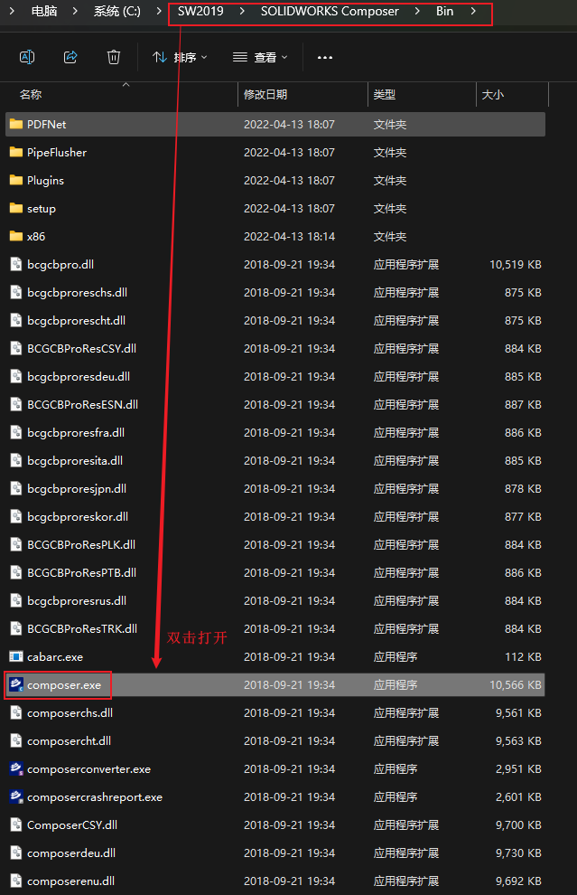


导出矢量图相关的操作如下,假如有一如下的3维模型 
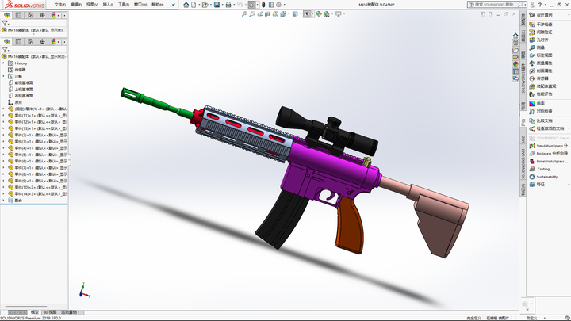


首先把这个模型另存为 `.smg` 格式
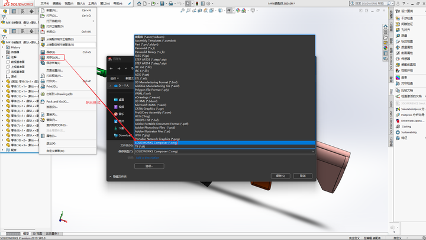


然后打开 SOLIDWORKS Composer, 导入刚才导出的 .smg 文件，如下
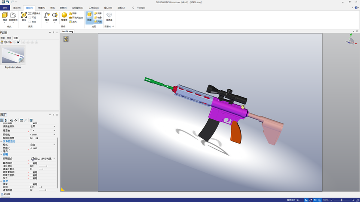


然后切换到 技术图解 菜单，进行相关的导出设置，然后导出为 M416.svg, 如下
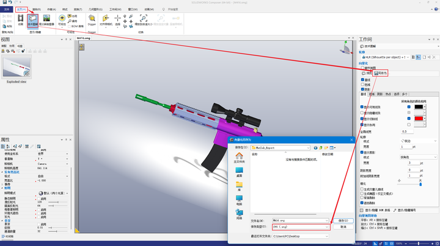


> 我这里就是默认导出为线稿了，你可以设置材质，光照等参数，然后导出，看个人喜好

得到svg之后，参考之前我的文章中的一个svg转pdf的inkscape命令

``` shell
inkscape --export-type=pdf M416.svg
```

执行过程如下
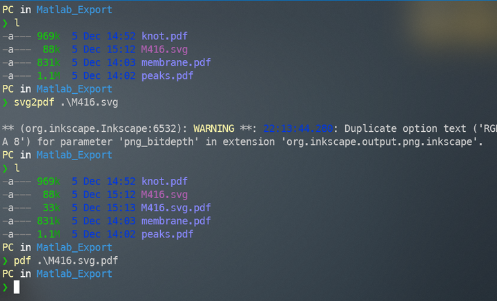


所以你可以得到一个pdf文件， 使用sumatrapdf打开，结果如下
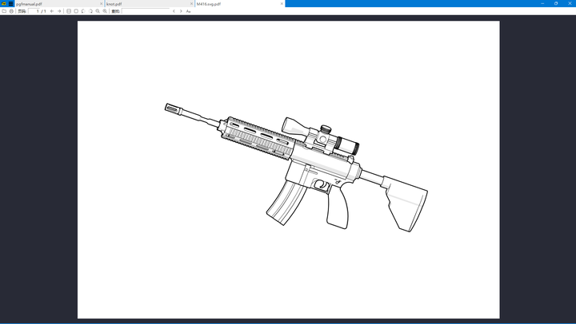


solidworks相关方法参考

下面是一个设置了线宽和色彩的基本导出例子


> 很完美的一个矢量图，perfect 


### 3.20 sane_tikz
一个使用python生成tikz代码的仓库，地址: https://github.com/negrinho/sane_tikz; 仓库中的一个示例代码，来看看他的书写风格

``` python
import sane_tikz.core as stz

label_spacing = 0.25
tick_label_spacing = 0.25
tick_length = 0.25
segment_spacing = 0.6
length_multiplier = 0.8


def segment(length, label_str, left_tick_label_str, right_tick_label_str):
    seg = stz.line_segment([0, 0], [length, 0])
    left_tick = stz.centered_vertical_line_segment([0, 0], tick_length)
    right_tick = stz.centered_vertical_line_segment([length, 0], tick_length)
    left_tick_label = stz.latex([0, 0], left_tick_label_str)
    right_tick_label = stz.latex([0, 0], right_tick_label_str)
    stz.place_above_and_align_to_the_center(left_tick_label, left_tick,
                                            tick_label_spacing)
    stz.place_above_and_align_to_the_center(right_tick_label, right_tick,
                                            tick_label_spacing)
    seg_label = stz.latex([-label_spacing, 0], label_str)
    return [
        seg, left_tick, right_tick, left_tick_label, right_tick_label, seg_label
    ]


segs = [
    segment(length_multiplier * 5, "A", "0", "5"),
    segment(length_multiplier * 1, "B", "2", "3"),
    segment(length_multiplier * 3, "C", "1", "4")
]

stz.distribute_vertically_with_spacing(segs[::-1], segment_spacing)
stz.draw_to_tikz_standalone(segs, "segments.tex")
```

绘制出来的图像


还有一些很复杂的图的例子


### 3.21 quiver
这是一个专门用于绘制交换图的应用，github仓库地址:https://github.com/varkor/quiver; 它也有一个在线网站:https://q.uiver.app/; 下面是一些是官方仓库的示意图:


对于不喜欢tikz代码的人来说，可以一试


### 3.22 自己开发库
最近我也在开发一个跨平台的tikz绘图库，充分使用gnuplot和octave等工具，但是目前还在开发中，但是现在的大致样子如下


最后一个图的代码长这样

``` tex
\begin{tikzpicture}[font=\small, >=Latex]
    % draw grid(coordinates)
    \ShowGrid{(-8, -8); (8, 8)}
    % \fill[black] (0, 0)node[below right]{$O$=(0, 0)} circle (1pt);
    \Show{(0, 0)}[$O=(0, 0)$][below right=.5em and 1em]
    \ShowAxis {(0, -8); (0, 8)}
    \ShowAxis {(-8, 0); (8, 0)}

    % Test unit
    \fill[red] (-4cm, 4em)node[left]{$A_1$=(-4cm, 4em)} circle (1pt);
    \fill[blue] (-4cm, 4cm)node[left]{$A_2$=(-4cm, 4cm)} circle (1pt);

    % draw function
    \draw[color=orange, domain=-3:3] plot (\x, 2*\x+1);
    \draw[color=cyan, domain=-1:7.6] plot (\x, -.9*\x+7);

    % draw an ellipse
    % 1.use self define cmd
    \NormalPlotPrecise{1500}
    \NormalPlot[][-7:7.8]{3*sin(1/x)}
    \NormalPlot[green, name path=exp][-1.5:7.5] {x*exp(-x)}
    \ParamPlot[red, name path=ellipse][0:2*pi]{7*sin(t), 4*cos(t)}

    % fill(needs \usetikzlibrary{patterns})
    \begin{scope}
        \clip (2, 0) rectangle (8, 1); 
        \fill[pattern=north east lines] plot file{./2d_plot/gnuplot_output_data/data_gen_2.table};
    \end{scope}
    \begin{scope}
        \clip (-6, 0) rectangle (-2, -2);
        \NormalPlot[][-6:-1]{3*sin(1/x)}
        \fill[pattern=crosshatch, pattern color=orange] plot file{./2d_plot/gnuplot_output_data/data_gen_4.table} -- (-2, 0) -- (-6, 0);
    \end{scope}

    % find intersection
    \ShowIntersecions{exp; ellipse}{2}
    % 或者是如下的语句
    % \path[name intersections={of=exp and ellipse}];
    % \ShowPoint[color=red] {(intersection-1); (intersection-2)}

    % draw intersection dot 
    \ShowPoint {(2.068, 5.137); (4.242, 3.181); (6.843, 0.840); (7.324, 0.408)}
        [$p_1$; $p_2$; $p_3$; $p_4$; $p_5$; $p_6$; $p_7$][above]
    \ShowPoint[radius=3pt, color=blue, opacity=.5, type=rectangle] {(-2.380, -3.761)}
    \ShowPoint[color=orange, opacity=1, radius=2pt] {(1.456, 3.912)}
\end{tikzpicture}
```

而且还有cache机制，绘制复杂的函数也很快。但是还有部分功能还有没有整合好，但是我相信，要开发出来了，快了

## 4. 结语
这次推荐的软件和绘制语言，就是我最近的折腾内容了，其实挺无聊的。总之，内容为王，排版只是一些锦上添花的内容, 更多内容可以参见如下讨论


## 5. 致谢
* **感谢优秀开源的的TeX排版系统 ！！！**
* **感谢伟大的开源工作者 ！！！**
* **正是他们的无私付出，才使得很多的优秀软件能够被我们使用 ！！！**
