## Preface

How to make such command:

```latex
% interface
% #1: name
% #2: level
\cs_new:Npn \__title_new:nn #1#2 
  {

  }

% #1: name
% #2: indent, beforeskip, afterskip, 
%     style(title, number),  label, sep, shape, etc.
\cs_new:Npn \__title_format:nn #1#2 
  {

  }

% sec class ?? 
```

What feature should we implement ? Here are some usefule sign:

1. `ltdefns.dtx` contains some internal macros for package or class writers.

2. The related `\csname #7mark\endcsname` should be defined.

3. what a sec command will do:
   
   * handle some skip values (hard for me now)
   
   * typeset sec head name
   
   * typeset counter and `\refstepcounter` it
   
   * set marker and `\addcontentsline`


Maybe ? `xtemplate` is a better choice, thogh there is already a package named `xcontent`, see [latex3/xpackages/xcontents at develop · latex3/latex3 · GitHub](https://github.com/latex3/latex3/tree/develop/xpackages/xcontents) 

In the following, we will disscuss something about `titlesec` package.


## Typos

Page 2:

```latex
if sections have been defined without that macro, arbitrary
values for the format (an) the spacing are provided.


--> if sections have been defined without that macro, arbitrary
values for the format (and) the spacing are provided,
```


## Exceptions

Two sec commands are special:

* `\chapter`

* `\part`

These 2 commands need more attention when you need to change their style.


## Shapes

The test code snippet as below:

```latex
\titleformat{\section}[⟨shape⟩]{\sffamily}{\thesection}{0pt}{}[]
\section{SECOND}
The prior examples {redefined existing} sectional unit title.
commands. This defines a new one, illustrating the needed 
counter and macros to display that counter. commands This 
defines a new one, illustrating the needed counter and macros 
to display that counter illustrating the needed defines a new one, 
illustrating the needed counter and macros to display that counter.
```

Different section (title) shape example:

1. display:
   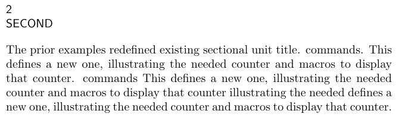

2. block:
   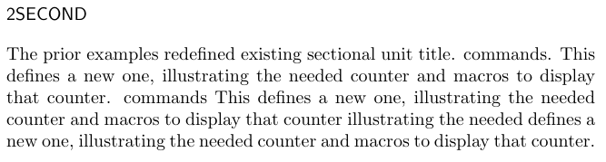

3. runin(插入):
   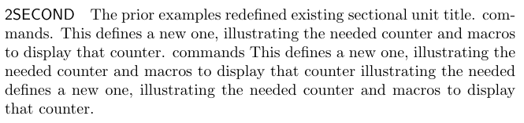

4. leftmargin: Puts the title at the left margin. Since the mechanism used is independent from that of the margin pars, they can overlap. A deprecated synonymous is `margin`. (useful in `twoside` layout)
   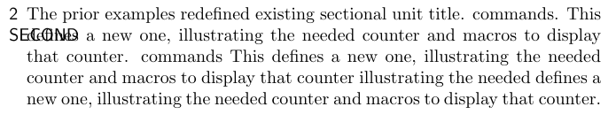

5. rightmargin: Similar as the above (useful in `twoside` layout)
   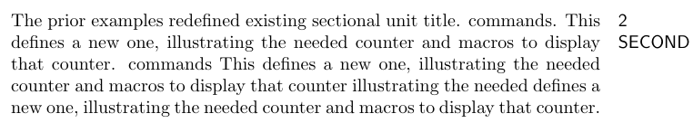

6. drop: the space reserved in drop for the title is fixed
   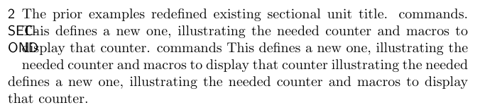

7. wrap: the space automatically readjusted to the longest line
   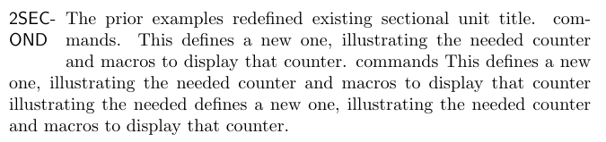

8. frame: framed + display
   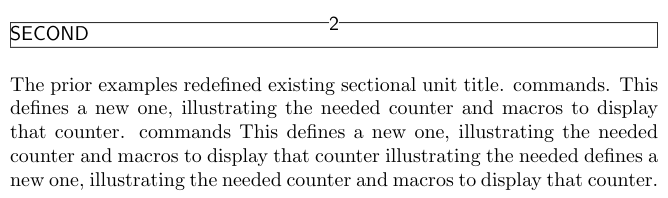

9. hang: is the default value, with a hanging label. (Like the standard \section.)
   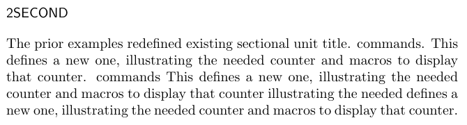

## Format

### syntax

Syntax of `\titleformat` as below, we call `SECNAME` by `text`, `1` by `label` in section title: `1.SECNAME`

```latex
\titleformat{⟨command⟩}
    [⟨shape⟩]
    {⟨format⟩} % apply to both label and text
    {⟨label⟩}  % \thesection, \thesubsection, etc.
    {⟨sep⟩}    % horizontal space between label and text 
               %    (1. vertical in 'display' shape; 
               %    (2. in 'frame' it is the distance from text to frame;
    {⟨before-code⟩} % code before the text
    [⟨after-code⟩]  % code after the text: 

```

For code before and after, sec title is typeset in (c.f. `⟨sep⟩`):

* vertical mode for `hang`, `block` and `display`;

* horizontal mode for `runin` and `leftmargin`;

Some Note about these arguments:

* `⟨label⟩` and `⟨sep⟩` are ignored in starred versions of sectioning commands.

* `⟨before-code⟩` and `⟨after-code⟩` are not the proper places for penalties, see command `\sectionbreak`.

All of the arguments is within a sec group, something like:

```latex
⟨doc-text⟩

\beginsec
⟨begin-shape⟩ % ⟨shape⟩ determines whether vertical or horizontal mode
    ⟨format⟩⟨label⟩
    ⟨sep⟩     % \vskip or \hskip
    ⟨before-code⟩
    ⟨text⟩
    ⟨after-code⟩
⟨end-shape⟩
\endsec

⟨doc-text⟩
```

### examples

#### before-code

The horizontal mode and vertical mode test is similar to that in `⟨after-code⟩`, see example:

```latex
\titleformat{\section}[display]{\sffamily}{\thesection}{0pt}{X\vskip3em X}[]
\section{SECOND}
The prior examples {redefined existing} sectional unit title.
commands. This defines a new one, illustrating the needed 
counter and macros to display that counter. commands This 
defines a new one, illustrating the needed counter and macros 
to display that counter illustrating the needed defines a new one, 
illustrating the needed counter and macros to display that counter.
```

output:

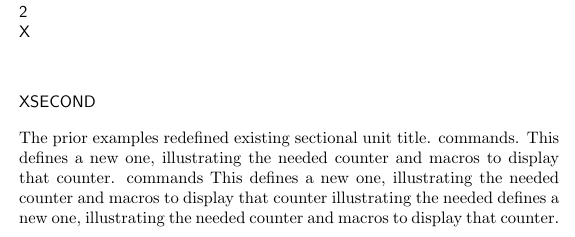

You can use a command that absorb 1 argument to handle the `text` in section body, see example:

```latex
\def\testcmd#1{\textbf{(#1)}}
\titleformat{\section}[hang]{\sffamily}{\thesection}{0pt}{\testcmd}[]
\section{SECOND}
The prior examples {redefined existing} sectional unit title.
commands. This defines a new one, illustrating the needed 
counter and macros to display that counter. commands This 
defines a new one, illustrating the needed counter and macros 
to display that counter illustrating the needed defines a new one, 
illustrating the needed counter and macros to display that counter.

```

output:

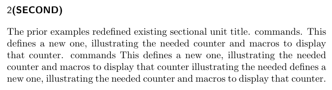

If you load the `explicit` package option, the you should pass `#1` to your own function, c.f. the `\testcmd` command above.


#### after-cdoe

An example about `⟨after-code⟩` in each mode:

```latex
% horizontal mode
\titleformat{\section}[runin]{\sffamily}{\thesection}{0pt}{}[X\hskip4em X]
\section{SECOND}
The prior examples {redefined existing} sectional unit title.
commands. This defines a new one, illustrating the needed 
counter and macros to display that counter. commands This 
defines a new one, illustrating the needed counter and macros 
to display that counter illustrating the needed defines a new one, 
illustrating the needed counter and macros to display that counter.
```

output:

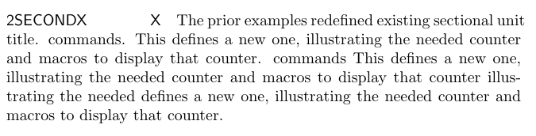

Then test this code in vertical mode:

```latex
% vertical mode
\titleformat{\section}[hang]{\sffamily}{\thesection}{0pt}{}[X\vskip4em X]
\section{SECOND}
The prior examples {redefined existing} sectional unit title.
commands. This defines a new one, illustrating the needed 
counter and macros to display that counter. commands This 
defines a new one, illustrating the needed counter and macros 
to display that counter illustrating the needed defines a new one, 
illustrating the needed counter and macros to display that counter.
```

output:

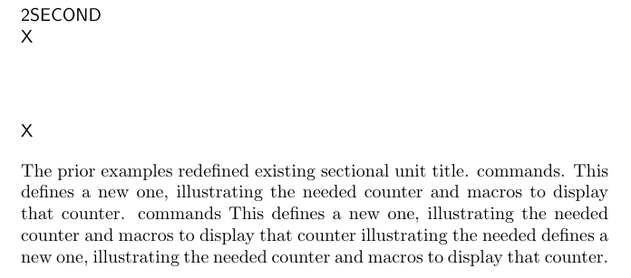

## Spacing

### Syntax

There are two ways to set these spacing, the fisrt is use command:

```latex
\titlespacing*{⟨command⟩}
              {⟨left⟩} % left margin, except in the:
                       % (1. title width in '..margin', and 'drop' shapes
                       % (2. maximum width in 'wrap'
                       % (3. indentation before the whole title
              {⟨before-sep⟩} % vertical space before the title
              {⟨after-sep⟩}  % separation between title and text:
                             % (1. vertical with 'hang', 'block', 'display';
                             % (2. horizontal with 'runin', 'drop', 'wrap' and '...margin';
              [⟨right-sep⟩]
```

### examples

See example:

```latex
XXX-YYY
\titleformat{\section}[hang]{\bfseries}{\thesection}{0pt}{}[]
\titlespacing*{\section}{0em}{2em}{2em}
\section{SECOND}
The prior examples {redefined existing} sectional unit title.
commands. This defines a new one, illustrating the needed 
counter and macros to display that counter. commands This 
defines a new one, illustrating the needed counter and macros 
to display that counter illustrating the needed defines a new one, 
illustrating the needed counter and macros to display that counter.
```

output:

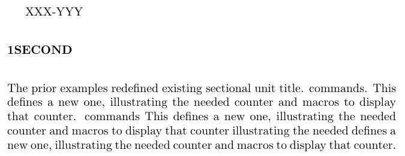

Example of `runin` shape:

```latex
XXX-YYY
\titleformat{\section}[runin]{\bfseries}{\thesection}{0pt}{}[]
\titlespacing*{\section}{1em}{2em}{2em}
\section{SECOND}
The prior examples {redefined existing} sectional unit title.
commands. This defines a new one, illustrating the needed 
counter and macros to display that counter. commands This 
defines a new one, illustrating the needed counter and macros 
to display that counter illustrating the needed defines a new one, 
illustrating the needed counter and macros to display that counter.

```

output:

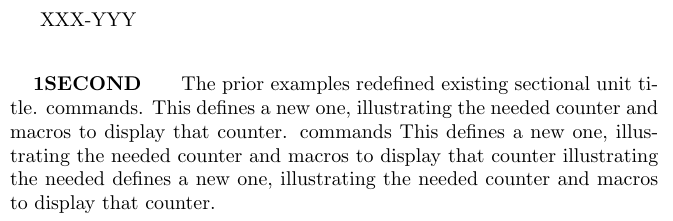

There is an syntax abbreviation `*n` in `{⟨before-sep⟩}` and `{⟨after-sep⟩}`, which stands for `n` times of:

```latex
1ex plus .3ex minus .06ex
1ex plus .1ex
```

respectively.

## Tools

### Rule

`titlesec` also provides command to add rule above of below sec title:

```latex
\titleline[⟨align⟩]{⟨horizontal material⟩}
\titlerule[⟨height⟩]
\titlerule*[⟨width⟩]{⟨text⟩}
```

The `\titlerule` command, which is enclosed automatically in `\titleline` if necessary. Example of `\titleline` and `\titlerule` :

```latex
\titleformat{\section}[display]
  {\color{red}\bfseries\titlerule} % always
  {\thesection}{0pt}
  {\color{blue}\titleline[c]{AAA}}
  [\color{orange}\titlerule]       % for 'hang', 'display', 'block';
\section{SECOND}
The prior examples {redefined existing} sectional unit title.
commands. This defines a new one, illustrating the needed 
counter and macros to display that counter. commands This 
defines a new one, illustrating the needed counter and macros 
to display that counter illustrating the needed defines a new one, 
illustrating the needed counter and macros to display that counter.
```

output:

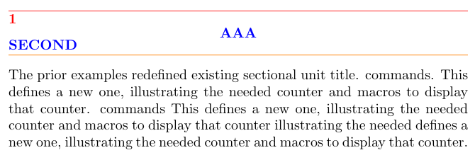

Example of `\titlerule*`: 

```latex
\titleformat{\section}[hang]
  {\bfseries\titlerule*[1pc]{.}}
  {\thesection}{0pt}
  {\titlerule*[2pc]{x}}
\section{SECOND}
The prior examples {redefined existing} sectional unit title.
commands. This defines a new one, illustrating the needed 
counter and macros to display that counter. commands This 
defines a new one, illustrating the needed counter and macros 
to display that counter illustrating the needed defines a new one, 
illustrating the needed counter and macros to display that counter.

```

output:

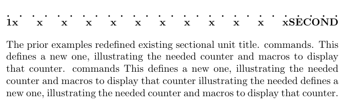

### Extend Syntax

The `first` argument of both `\titleformat` and `\titlespacing` has an extended syntax which allows to set different formats depending on the context. This argument can be a list of `key/value` pairs in the form:

* `name`: \chapter, \section, etc.

* `page`: Only even, odd.

* `numberless`: set different style for numbered and unnumbered (or those with level below `secnumdepth`) sec commands.

> The “number” version is usually fine when generating unnumbered variants since removing the label is the only change required in most cases.

An example from the doc:

> Let’s suppose we’d like a layout with titles in the outer margin. We might set something like:

```latex
\titleformat{name=\section,page=even}[leftmargin]
    {\filleft\scshape}{\thesection}{.5em}{}
\titleformat{name=\section,page=odd}[rightmargin]
    {\filright\scshape}{\thesection}{.5em}{}
```

## Create new class

You can define your own sec command rely on the internal class:

* `page`: command in a single page, like `\part`,

* `top`: at the top in page, similar to `\chapter`,

* `straight`: in the middle of text.

Syntax as below:

```latex
\titleclass{⟨name⟩}{⟨class⟩}
\titleclass{⟨name⟩}{⟨class⟩}[⟨super-level-cmd⟩]
\titleclass{⟨name⟩}[⟨start-level-num⟩]{⟨class⟩}
```

NOTE:

> If there is a TOC and format for it is special, you may need package `titletoc` or change the hardcoded value in `titletoc`.

A simple example:

```latex
\titleclass{\part}{straight}
\titleformat{\part}{\bfseries}{\thepart}{0pt}{}
```

At the time you create this new sec command, you should define its format, or an error will occur.


