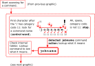
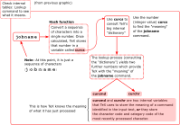
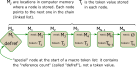
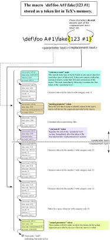
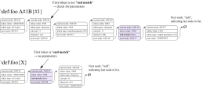
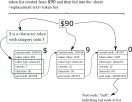
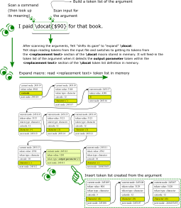

## preface
在阅读此篇文章前, 我给诸位的几点警告:
* 本篇文章讲述的话题过于底层, 所以它 $\color{red}不$ 适合 $\LaTeX$ 初学者
* 本篇文章可能含有诸多不当的说法，请自行辨别 
* 本篇文章均抄袭自原 Overleaf 上的文章，如果英文水平还行请阅读原文
* 本篇文章的封面图由 GPT-4o 生成

在后文中，在不加说明是, 所讨论的对象默认为 D. E. K. 所使用的那个最初始的 8-bit 引擎. 


## token
### introduction
在 TeX 的大部分阶段(实际上时除了 scan 阶段)， 处理的基本单位都是一个叫做 Token 的东西. TeX 中处理的 token 可以分为下面这两类:

* TeX converts input characters into tokens by combining the **character code** and **category code** into a single compostite integer.

* using the name of the command it calculates an integer called a **command token**

所以在 see(scan/read) 阶段就是得到了一串数字(character 被翻译为了整数，command 被翻译为了整数). 一个详细的 Note:

> As a guide, you can think of tokens as TeX’s method for “packaging” items it has read from the input, making them ready for dispatch into the next stage of TeX’s processing. Having all items (characters or commands) neatly wrapped into a single numeric representation makes it easier to process them further down the chain. For example, when TeX wants to store some of your input to use later on, such as a macro definition, **TeX just needs to save your macro definition, however complex, as a series of integers**, where each integer is a token representing a character or a command that forms part of (is contained within) your macro’s definition.

这个所谓的 scan 阶段就是为了把我们输入的所有(文本)内容转化为 token. 在补充一点，一个 character 的 character code(token value) 一旦生成了, 那么其对应的 categroy code 就永远不能改变了.

> 在后文中，我们有时也称 character code 为 token value.

### identify command

下面讨论 TeX 怎么处理 `\` 后面的这个 command token. 需要说明的是: TeX 在定义一个命令的时候并不会立马执行这个命令, 只是把这个 command 转化(TeX 用了一个 Hash Function)为一系列的整数(就是上述的 command token). 这个过程我们称之为 **curcs**， 在后面我们会讨论这个流程的内部细节. 我们从下面的图片开始讨论:

<!--  -->


那么上述的这个所谓的 **internal table** 是什么呢 ? 其实就是一个映射: command $\longrightarrow$ command 定义. 那么这个对应过程是怎样的呢 ? 上面我们讲到了， TeX 会把 command token 转化为一个整数，所以上述的映射的原像其实就是一个 **整数**.

### curcs(current control sequence)

经过上述的查表过程后，TeX 就能知道这个 command 的具体含义 （meaning）, 这个 meaning 包含两个部分:

* curcmd(its role): 

* curchar(what it does): 

这个 curcs 的过程图示如下:

<!--  -->


### command token

我们常常想知道，一个 command 在 TeX 内部到底是怎么存储的，或者说 TeX 是怎么区分这一系列的命令的 ?

常见的命令类型:

* 定义宏: `\def, \gdef, \edef, \xdef` .

* 制作盒子: `\hbox, \vbox, \vcenter` .

* ....

光上述命令类型这个信息就够了吗 ? 不够的 !  TeX 还存储了这个 command 的一些辅助信息, 叫做 **command modifier**. 针对 Macros 来说，这个辅助信息就是这个 command 在内存中的地址.

所以 TeX 其实就是给每一个命令(Macro) 分配了两个值, 分别叫做 **command code**, **command modifier**.

比如在 Knuth 最初始的那个 TeX 中，这两个值默认为:

| **Command** | **Command code** | **Command modifier** |
| ----------- | ---------------- | :------------------: |
| `\def`      | 97               |          0           |
| `\gdef`     | 97               |          1           |
| `\edef`     | 97               |          2           |
| `\xdef`     | 97               |          3           |

### conclusion

其实当前 TeX 处理的 token，无论是一个 character 还是 command，都会被转化为一个整数，这个整数叫做 **curtok**. 不同情况下的计算方法如下:

* 当前为 character 时: $\rm curtok = 256\times curcmd + curchr$ 

* 当前为 command 时: $\rm curtok = 4095 + curcs$ .

上述的 $\rm curcmd, curchr, curcs$ 的含义如下表所示:

|                                      |                                                                                                                                                                                                                 |                                                                                                                                                                                                                                                                         |
| ------------------------------------ | --------------------------------------------------------------------------------------------------------------------------------------------------------------------------------------------------------------- | ----------------------------------------------------------------------------------------------------------------------------------------------------------------------------------------------------------------------------------------------------------------------- |
| **Global variable used inside TeX:** | **When TeX scans a character:**                                                                                                                                                                                 | **When TeX scans a command:**                                                                                                                                                                                                                                           |
| **curcmd**                           | Stores the category code of the current character                                                                                                                                                               | Stores the *command code*—which identifies the “type” of the current command                                                                                                                                                                                            |
| **curchr**                           | Stores the character code of the current character                                                                                                                                                              | Stores supplementary data (called the *command modifier*) which provides additional information about the current command                                                                                                                                               |
| **curcs**                            | 0                                                                                                                                                                                                               | A non-zero positive integer that is calculated (via a hash function) using the string of characters present in the command name. It is used to access TeX’s “dictionary” to look-up the current meaning of a command—to retrieve its command code and command modifier. |
| **curtok**                           | For 8-bit TeX engines, a *character token* is calculated using the formula: $\rm curtok = 256\times curcmd + curchr$ where $\rm curcmd$ is the character’s category code and $\rm curchr$ is the character code | For 8-bit TeX engines, a *command token* is calculated using the formula: $\rm curtok = 4095 + curcs$                                                                                                                                                                   |

上述的定义会导致 character 的 $\rm curtok_{char}$ 和 command 的 $\rm curtok_{cmd}$ 重叠吗 ? 这是不可能的 ! 理由如下(在 8-bit 的引擎中讨论的), $\rm curtok_{chr}$ 的理论最大值为：

$$
\rm\max(curtok_{chr}) = 2^8\times 15 + 255 = 4095.
$$

但是 catcode 为 15 的 (invalid) character 在 scan 阶段已经被去掉了，所以一定有 (因为有 $\rm curcs \ge 0$):

$$
\rm curtok_{cmd} = 4095 + curcs > curtok_{chr}.
$$

这样以来，TeX 就能知道自己当前在处理一个普通的 character 还是 command 了.

## define macro

command 本上就是一系列的 token 组成的 list. 在介绍后续的内容前，我们先引入一个很重要的注记:

> TeX only thinks about characters at the earliest stage of input processing: from that point on it’s tokens all the way! Over this, and the remaining articles in this series, we will explore the role that tokens play in TeX macros.

翻译过来就是: TeX 只有在早期的 scan 阶段时才以 character 为处理对象，自此阶段过后，TeX 都是以 token 为基本处理对象 (一个 token 包含 character code 和 category code 两部分). 

定义一个基本的 macro 的格式为:

```latex
<TeX macro primitive><macro name><parameter text>{<replacement text>}
```

> **Note**: Some readers may know about TeX’s “hashquote” mechanism (`#{`) but we won’t touch on that here.

TeX actually expects is the text of your macro `<replacement text>` to open with a character of category code 1 (“Start a group”) and close with a character of category code 2 (“End a group”). 所以你完全可以像下面这样去定义一个宏:

```latex
\catcode`\(=1
\catcode`\)=2
\def\foo #1(Hello, #1)
\foo(World!)
```

那么 TeX 创建一个命令时到底做了什么 ? 参见如下的解释:

> when you instruct TeX to define a macro it creates a sequence of tokens (a token list) and stores them in its memory linked to a **name** that you define.

在这里补充一个关于 `\catcode` 的小坑, 参见如下的代码:

```latex
\documentclass{article}
\begin{document}
\def\foo A#1B{Hello, #1}
\foo AGrahamB % This works 
\catcode`\B=12\relax
\foo AGrahamB
\end{document}
```

这个代码，你觉得能够正常运行吗 ? 如果你尝试之后，会发现，它会抛出如下的错误:

```
Runaway argument?
GrahamB \end {document}
! File ended while scanning use of \foo.
<inserted text>
                \par 
<*> main.tex

I suspect you have forgotten a `}', causing me
to read past where you wanted me to stop.
I'll try to recover; but if the error is serious,
you'd better type `E' or `X' now and fix your file.

! Emergency stop.
<*> main.tex

*** (job aborted, no legal \end found)
```

报错: `runaway argument`, 即 "参数失控"，失控发生在对 `\foo` 命令第二次调用时, `\foo` 从 `A` 开始 "吃" 参数一直吃到了文件结束都没有找到 "当初的那个 `B`" >_<

这里失控的原因也很简单，`B` 的 catcode 被改变了，他已经不是曾经(在定义时)的那个 `B` 了. 而我们在 TeX 中的基本处理单位是 token，所以 $\rm B_{11}$ 和 $\rm B_{12}$ 的 token value 已经不一样了，那么他们就不是同一个 `B`. 所以这就导致 TeX 在处理 paramenter text 时一直向前寻找结束符 $\rm B_{11}$, 一直找到文件结尾也没找到.

## token list

下面在此回到抽象的底层, 我们讨论一个 token list(实际上就是一个整数数组) 是怎么存储的，以及怎么使用的. token list 的存储结构参见下图:

<!--  -->



### Macro token list
为什么要专门讨论这类 token list, 参见如下注解:

> Token lists for macros are slightly different to other token lists used within TeX because they contain “special” token values that only processes internal to TeX itself can create/generate: those special tokens cannot be directly created by any commands that you can include in your .tex file. TeX creates and uses those “special” token values to help with processing your macro call, as we’ll explore and explain below.

我们以一个具体的例子来分析, 比如一定义了一个如下的宏:

```latex
\def\foo A#1\fake{123 #1}
```

那么对应的 TeX 处理流程如下:

<!--  -->


上述流程图中几个值得注意的点:

* macro token list 的第一个元素之前有一个特殊的 node，叫做 `reference count`.

* 上述 paramenter text 中未定义的 `\fake` 仅起到结束 parameter text 的作用.

### special tokens in parameter text token list

#### "end math" token

这个 token 由 TeX 创建，用户无法创建，它起到分割 token list 中 parameter text 和 replace text 的作用.

#### "match parameter" tokens

 这个 parameter text 中的 math parameter token(`#1`) 就是告诉 TeX："从这个地方开始，你要准备开始拾取参数了".

#### "output parameter" tokens

当 TeX 处理完前面的内容后, 后续在用户调用这个 宏(`\foo`) 的时候, TeX 就会运行(展开)这个宏. 在 replacement text 中的这个 output parameter tokens(`#1`) 就是告诉 TeX: "在这里插入由用户提供的（实际）参数."

## tokenization and expansion

### introduction

先从一个简单的例子讲起(肯定很多人尝试过这种改 catcode 的办法, 我不说是谁 !!!):

```latex
\begin{document}
\def\docat #1{\catcode`\$=11 #1}
I paid \docat{$90} for that book.
\end{document}
```

尝试编译上面的代码，你会得到如下的报错:

```
! Missing $ inserted.
<inserted text> 
                $
<to be read again> 
                   \par 
l.7
```

按照常规人的理解，`\def` 不就是一个普通的 `替换` 吗 ? 那么上述的代码应该和下面这个正确的代码是等价的:

```latex
\begin{document}
I paid \catcode`\$=11 $90 for that book.
\end{document}
```

但是为啥最开始的那个代码不对呢 ? 难道这是 TeX 的 bug ?? 又可以赚 Don 的支票了 ?? 所以问题出现在哪里 ??

### short answer

SHORT ANSWER IS THAT:

> TeX **first** converts **macro arguments** to tokens **before** it feeds them into the token list of the `<replacement text>`

也就是说, 对于 `\docat{$9}` 这个调用, TeX 会首先把这个 macro argument(`$1`) 给 tokenize 了,  此时 `$9` 中的 `$` 的 catcode 仍然是 `3(math shift)`， 得到一个整数形式的 token value; 然后再把这个 tokenlize 后的 token value 放入 `<replacement text>` 中. 也就是说传入这个 repacement text 中的参数还是原来的 $\char36_{3}$ (这里右下角的 3 表示其对应的 catcode), 而不是 $\char36_{11}$; 前者对应的 token value 为 $256\times 3+36=804$, 而后者的 token value 为 $256\times 11+36=2582$. 我们前面说过:

> TeX 在结束 scan 阶段后，处理的基本单位是 token(可以粗略的认为是一个个的整数)

所以就导致了我们 replacement text 中的 `\catcode` 根本就没有起作用. 为导致用户无法理解上述的解释，还可以看看原始的解释:

> What we need to remember is that our notion of TeX using text/characters is only relevant to the content of the file that TeX is reading: as soon as TeX has read-in any characters, we are in the world of *tokens*. TeX macro calls work with *tokens*, not the actual *written/text representation* of TeX/LaTeX commands

### detailed analysis

#### tokenize

当我们在源文件中调用这个宏时，TeX 在 scan 你的文本输入时发现这是一个 macro command, 然后就会去执行(excute)它. TeX 首先会检查(macro token list 中的)第一个 token 是否为 `end match`. 

> 更详细一点来说: TeX 在执行一个 command 时，首先会检查这个 command 是否需要参数(因为这个命令之前已经定义了, 所以 TeX 能够通过这个命令在定义中的 parameter text 部分来确定其参数形式)，如果需要参数，那么 TeX 会在源文件中继续向后扫描(注意: 这个过程发生在执行 replacement text 中的 macro code 执行之前). 然后 TeX 就会按照定义中的 parameter text 对应的模板在 input file 中一直扫描，直到遇到 `end math` 这个 token. 现在，TeX 已经把用户提供的实际参数提取到了，完成了对应的参数搜集工作, TeX 的目光就会从源文件中离开，紧接着就可以开始处理 replacement text 中的内容了(此时不需要再在源文件中向前 scan 了，因为这个宏的定义已经保存在内存里了)，也就是要要开始展开工作(expansion)了.

针对具体案例，一个简单的分析流程如下:

<!--  -->


在 TeX 搜集命令的参数时，会把这系列的参数给 tokenize 掉(变成一系列的整数). 针对我们这个具体的例子来说, 这个 tokenize 的过程如下:

<!--  -->


为什么在上述 tokenize 过程中 `$` 对应的 catcode 为 3，参见我们前面的注解:

> Character tokens(token value) are created using the category code values *in operation at the time the character is read-in*—i.e., at the time the argument’s token list is created (turned into tokens).

所以在 tokenize 这个过程之前，`\docat` 中的 `catcode` 命令还没有执行, 自然 `$` 对应的 catcode 就是 3 了. 

#### expansion

当 TeX 完成了参数搜集的工作后就会开始执行 replacement text 中的展开工作(expansion)了. 在我们这个例子中，具体的展开流程如下:

<!--  -->


这里还是再提醒一下: 我们处理的基本单位是 token，不是 character. 所以在执行 `\catcode` 语句后，

replacement text 中任意的 **显示(character 形式)** 的 `$` 对应的 categroy code 都变成 11 了，但是传入的 argument 的形式是 token list -- `804,3129,3120`，而不是具体的 character 形式的 -- `$90`.

### fix it

我们怎么样才能让这个代码跑起来了? 目前来看有如下的 2 种思路:

* 在执行 `\docat` 之前就把 `$` 的 catcode 置为 11.

* 取消 TeX 对参数(macro arguments) 的 tokenizaion 过程.

Overleaf 上给出的方案为: 让 `\docat` 变成一个无参数的命令(这样也没有了 tokenize 这个过程), 具体代码如下:

```latex
\begin{document}
\def\docat{\catcode`\$=11 \getarg} % No parameters, calls a second macro \getarg
\def\getarg#1{#1} %1 parameter whose argument will be tokenized
Now you can run it like this and it will work:

I paid \docat{$90} for that book.
\end{document}
```

上述代码的一个注记:

> Remember that when TeX expands a macro it gets its next input by reading the tokens contained in the token list of that macro’s definition; i.e., from its `<replacement text>` section stored in memory. (也就是说 TeX 在展开一个命令时，是根据其在内存中的定义来决定下一个输入的 token 的)

具体的执行流程可以参见下图:

<!--  -->


但是上面这样写有一个坏处，那就是：在 `\docat` 之后的所有 `$` 的 catcode 都被改为了 `11`，我们无法再使用 `$` 的 mathshift 功能了. 当然，一个很简单的方法就是把 `\docat` 这个命令限制在一个局部组中, 像下面这样:

```latex
I paid {\docat{$90}} for that book.
```

或者把上面的代码修改成这样:
```latex 
\begin{document}
\def\docat{\catcode`\$=11 \getarg}
\def\getarg#1{#1\catcode`\$=3{}}
Now you can run it like this and it will work:

I paid \docat{$90$} for that book, $1+1$.
\end{document}
```

**注意事项**:
* 上面的 `\docat` 命令不能这样修改(具体原因请自己分析):
  ```latex 
  \def\docat{{\catcode`\$=11} \getarg}
  ```
* 在使用这个新的 `\docat` 命令时, 也不能把它嵌套在另一个宏的参数里, 也就是说不能写成这样: `\textbf{\docat{$100}}`; 但是你可以变通一下，写成这样: `{\bfseries \docat{$100}}`. 也就是说，你可以做一个环境出来，这样就可以避免受到  tokenize 的影响了.


## Furthermore
现在你知道了 tokenize 的概念了，已经可以尝试制作一个属于你自己的 `\verb` 命令了(同时也能够弄明白为啥 `\verb` 之类的命令不能作为其它命令的参数了)；至于看懂 `\obeylines` 的定义, 这个更是小 case.

之后有空的话，会再补充一点关于下面这些命令的说明和使用方法:
* `\scantokens`
* `\detokenize`
* `\@onelevel@sanitize`


## reference
本文主要抄袭(参考)自如下地址:

* [How TeX macros actually work: Part 1 - Overleaf, Online LaTeX Editor](https://www.overleaf.com/learn/latex/How_TeX_macros_actually_work%3A_Part_1)

* [How TeX macros actually work: Part 2 - Overleaf, Online LaTeX Editor](https://www.overleaf.com/learn/latex/How_TeX_macros_actually_work%3A_Part_2)

* [How TeX macros actually work: Part 3 - Overleaf, Online LaTeX Editor](https://www.overleaf.com/learn/latex/How_TeX_macros_actually_work%3A_Part_3)

* [How TeX macros actually work: Part 4 - Overleaf, Online LaTeX Editor](https://www.overleaf.com/learn/latex/How_TeX_macros_actually_work%3A_Part_4)

* [How TeX macros actually work: Part 5 - Overleaf, Online LaTeX Editor](https://www.overleaf.com/learn/latex/How_TeX_macros_actually_work%3A_Part_5)

* [How TeX macros actually work: Part 6 - Overleaf, Online LaTeX Editor](https://www.overleaf.com/learn/latex/How_TeX_macros_actually_work%3A_Part_6)


