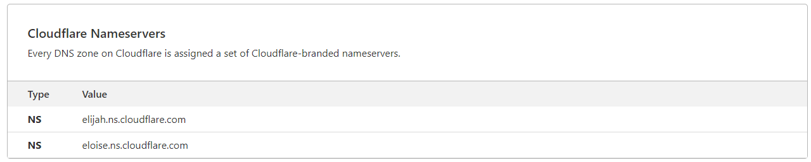
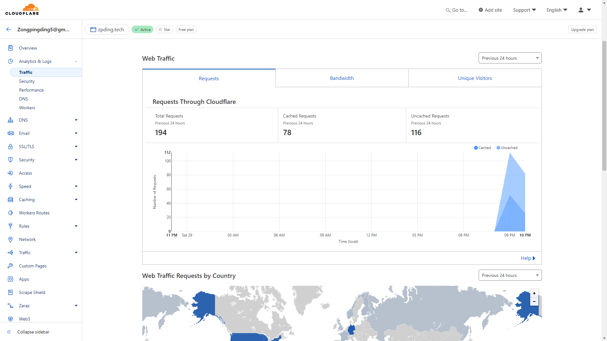

## 背景
很多时候我们都想有一个自己的域名，但是从购买域名到具体的域名绑定等，这一套下来新手一般搞不定. 下面为我自己的一次配置记录,供有需要的人参考.

## 基本配置

想要自己购买域名，然后指向自己的服务器，需要经历下面几个步骤:

* 在域名服务商处购买域名

* 购买服务器, 查明其公网 IP

* 寻找 DNS 解析服务商(DNS 用于把域名转为 ip)，这里使用的DNS服务商是 Cloud Flare

* 注册 CF, 选择免费的就够了。然后把自己的网站托管到 CF. 随后把 CF 提供的 nameserver 填入域名服务商后台的 nameserver 配置处 (删除原有配置), 然后更新

  > 一定要添加域名到 CF 之后再做这些操作，不然后续无法生成对应的 SSL 证书

* 随后在 CF 上添加两个Records: `A`(原始名称: 如 `zpding.tech`), `CNAME` (域名别名: 这里设为 `zongpingding.github.io`，所以当输入后面的名称时会自动跳转到我的域名 `zpding.tech`). 具体配置如下:
  

* (可选) 可以在CF中启用一些别的东西, 比如 

  * 强制 https
  * 免费 SSL 证书, 后续可以放到 nginx 的配置中去
  * 看看你的网站平时的访问数据，防一防 ddos 之类的. 比如可会看到这样的访问数据分析:
    

* 在仓库中创建 CNAME 文件(必须要有), 其中填入你的域名, 比如我这里就是 `www.zpding.tech`

  > 也可以: 在 `github` -> `settings` -> `pages` -> `custom domain` 中填入购买的域名, 我这里就是  `www.zpding.tech`. 也会自动创建对应的 CNAME 文件

  点击 save，随后 GitHub 会检查其对应的 DNS. 为了避免每次 deploy 后需要再次进行这个过程, 可以把这个 `CNAME` 文件放到博客根目录的 `source/` 文件夹下，参见[Hexo changes Custom Domain](https://stackoverflow.com/questions/42582288/hexo-changes-custom-domain-on-github-when-deploying-to-the-github-repository) 

  > github 的强制 https 选项可能并不能够马上生效或者是能够启用，可能得等几个小时。但是由于 CF 启用了强制 https, 所以在访问网站时还是会强制使用 https. 更多信息请参见: [https discuss](https://github.com/orgs/community/discussions/23049).

## 二级域名
如果你有一个一级域名，比如这里的 `zpding.tech`, 那么可以创建很多个子域名用来指向不同的 IP, 比如让域名 `blog.zpding.tech` 指向 `123.45.67.89`. 只需要在 DNS 解析服务商的配置中增加一条 `A 记录`:
* `主机名(name)`为 `blog`;  
* `记录值(content)` 为 `123.45.67.89`. 

然后就可以使用了.

## 可能的问题

### SSL 证书缺失

在上述的配置中可能会出现一个很奇怪的问题: 

```
您的连接不是私密连接 攻击者可能会试图从 ...
```

然后你会发现浏览器上显示你的网站没有证书. e, 最后怎么解决的呢 ? 给自己的机器换一个 IP (怎么换？自己想吧 >_<). 详细信息可以参见: [ssl missing](https://github.com/XX-net/XX-Net/issues/5106)

### 备案

如果服务器或者是域名中的任何一个是位于国内的，那么请一定备案。者都是国外的话，可以不用备案.

> 包括域名解析这个工作也不要用国内的厂商，如果有必要的话
