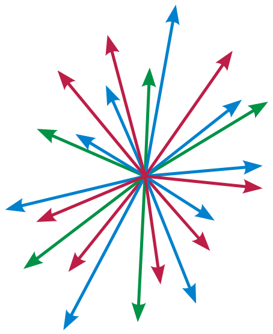
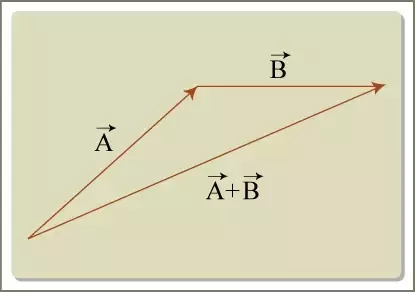

## 1. Ongoing debate
关于什么是张量，有人说

- 是向量
- 是向量的向量(多半所谓的TensorFlow做演示)
- 是多重线性映射
- 是矩阵或向量的一般化
- ...

到底什么是张量，这里搬运一个Quora上的回答, 提前叠甲, 但是还是给个表情包先:

所以把原文给搬过来, 没有兴趣阅读的出门右转。本人未对原回答做任何内容上的更改,原文章信息：

* 平台: https://www.quora.com/www.quora.com/
* 文章地址: https://www.quora.com/What-is-a-tensor
* 作者：https://www.quora.com/profile/William-Oliver-1

## 2. Original Post
### Preface
A few years ago, I vowed that I would answer this question when I figured out what a tensor really was, because I also had a problem with finding an intuitively satisfying answer online, and the answers here also didn't fully satisfy me. A year later, I wrote a draft for an answer. And just now I discovered this draft that I never finished.

What I've found is that there are a lot of big misconceptions floating around the internet that are simply wrong. But there is one big one that I thought I should dispel right away.


Tensors are not f**king generalizations of vectors or matrices goddamnit!!


I can't tell you how many people online start their description of tensors by saying that "Tensors are a generalization of scalars, vectors, and matrices" or something similar. This, by far, caused me the most confusion when learning about tensors, because it’s blatantly false. I’ll say it again, Tensors are not generalizations of vectors in any way. It’s very slightly more understandable to say that tensors are generalizations of matrices, in the same way that it is slightly more accurate to say “vanilla ice cream is a generalization of chocolate ice cream” than it is to say that “vanilla ice cream is a generalization of dessert”, closer, but still false. Vanilla and Chocolate are both ice cream, but chocolate ice cream is not a type of vanilla ice cream, and “dessert” certainly isn’t a type of vanilla ice cream.

So please, I beg you dear reader, if you are confused about tensors, DO NOT compare them to vectors as you learned them in physics class, and DO NOT compare them to matrices. In fact, technically, vectors are generalizations of tensors. I know it’s hard to trust me considering all of the definitions you may have read on the internet running contrary to this, but please trust me, thinking about them like vectors or matrices will cause you nothing but confusion.

What we generally think of as "vectors" are in fact just a special case of actual of vectors, which I will define shortly. What we generally think of as vectors are geometrical points in space, and we normally represent them as an array of numbers. That array of numbers is what people are referring to when they say "Tensors are generalizations of vectors", but really, even this adjusted claim is fundamentally false and extremely misleading.

When I was learning this, I found a few people who did explain that tensors are not generalizations of vectors, but they never explained why so many people would get this wrong, so I didn’t believe them. How could so many people claim to know what a tensor is but have no idea? I still don’t have the complete answer, but if you stick with me, I will not only explain what tensors really are, but also why so many people make false claims about them.

I also found when I was learning this that people were either way too abstract and technical, or way too simplistic to really get a full understanding. So I will aim for somewhere in between.

But before we talk about tensors, we have to make sure you have a clear understanding of what vectors actually are. Unlike tensors, this is generally explained pretty well, but just in case you haven’t heard it before I’ll explain it here.

So what are vectors if not the arrays of numbers that we have known them as? Well, we can't really define vectors without first defining something called a vector space, so lets do that.

### The real definition of a vector

The set  is a vector space with respect to the operations + (which is any operation that maps two elements of the space to another element of the space, not necessarily addition) and * (which is any operation that maps an element in the space and a scalar to another element in the space, not necessarily multiplication) if and only if, for every  and  

1. `+` is commutative, that is $x+y=y+x$
2. `+` is associative, that is $(x+y)+z=x+(y+z)$
3. There exists an identity element in the space, that is there exists an element $0$ such that $x+0=x$ 
4. Every element has an inverse, that is for every element  there exists an element $-x$ such that $x+(-x)=0$ 
5. `*` is associative, that is $a(b*x)=(ab)*x$
6. There is scalar distributivity over +, that is $a*(x+y) = a*x+a*y$
7. There is vector distributivity over scalar addition, that is $(a+b)*x = a*x+b*y$ 
8. And finally, $1*x=x$ 

### A vector is defined as a member of such a space

Notice how nothing here is explicitly stated to be numerical. We could be talking about colors, or elephants, or glasses of milk; as long as we meaningfully define these two operations, anything can be a vector (it might be a good exercise to define a vector space of glasses of milk, or elephants). The special case of vectors that we usually think about in physics and geometry satisfy this definition ( i.e. points in space or “arrows”). Thus, “arrows” are special cases of vectors. More formally, every “arrow”  represents the line segment from00, "the origin", which is the identity element of the vector space, to some other point in space. In this view, you can construct a vector space of “arrows” by first picking a point in space, and taking the set of all line segments from that point. (From now on, I will use the term “arrows” to formally distinguish between formal vectors and the type of vectors that have “magnitude and direction”.)

And, I can't stress this enough, we are talking about theactual, physicalline segments, and not some numerical representation. We are thinking of these line segments as the ancient Greek Geometers would, just as platonic line segments. Addition is the operation of moving along one line segment, then from the tip of that line segment, moving along another line segment.

Okay, so anyone trying to understand tensors probably already knows this stuff.

But here is something you may not have heard about before if you are learning about tensors. When we define a vector space like this, we generally find that it is natural to define an operation that gives us lengths and angles. A vector space with lengths and angles is called an inner product space.

### Inner product space

An inner product space is a vector space $V$ with an additional operation⋅⋅such that, for all $x,y,z\in V$ 

1. $x\cdot x\in \mathbb{R}$ 
2. $x\cdot y\ge 0$
3. $x\cdot x=0\iff x=0$
4. $x\cdot(ay) = a(x\cdot y)$
5. $x\cdot y=y\cdot x$
6. $x\cdot (y+z) = x\cdot y + x\cdot z$

We define the length of a vector $x$ in a inner product sapce to be $\|x\|=\sqrt{x\cdot x}$ , and the angle between two vectors $x,y$ to be $\arccos(\frac{x\cdoy y}{\|x\|\|y\|})$ .

This is the equivalent of the dot product, which is defined to be $\|x\|\|y\|\cos(\theta)$ , but note that this isnot defined in terms of any sort of "components" of the vector, there are no arrays of numbers mentioned.I.e. the dot product is a geometrical operation.

So I have secretly given you your first glimpse at a tensor. Where was it? Was it $x$ ? Was it $y$ ? Was it $V$ ? Was it the glass of milk ???

It was none of these things; **it was the operation itself**, The dot product itself is an example of a tensor. 

This is where I was getting confused. “The dot product can’t be a tensor” I thought, “Why would so many people be saying that tensors are a generalization of a vectors and matrices?

Well, again, tensors aren’t generalizations of vectors at all. Vectors, as we defined them above, are generalizations of tensors. And tensors aren’t technically generalizations of matrices. But tensors can certainly be thought of as kind of the same sort of object as a matrix.

There are two things that dot products and matrices have in common. The first, and most important thing, is that  **.** This is why tensors are almost generalizations of matrices. The second, and more misleading, thing is that they can be represented as a 2d array of numbers. This second thing is a huge, and I mean HUGE red herring, and has undoubtedly caused an innumerable number of people to be confused.

However, neglecting to talk about how tensors can be represented as arrays of numbers is equally as misleading. Its like not describing to someone learning linear algebra how vectors can be represented as arrays of numbers.

Let’s tackle the concept of bilinear maps, and then we can use that knowledge of bilinear maps to help us tackle the concept of representing rank 2 tensors as 2d arrays.

### Bilinear maps

The dot product is what the cool kids like to call abilinear map. This just means that the dot product has the following properties:

1. $x\cdot(y+z) = x\cdot y+x\cdot z$
2. $(y+z)\cdot x = y\cdot x + z\cdot x$
3. $x\cdot (ay) = a(x\cdot y)$

Why is this important? Well if we represent the vector $x$ as $x=x_1i+x_2j$ , and we represent the vector $y=y_1i+y_2j$ , then because $\cdot$ is linear, the following is true: 
$$
    x\cdot y = y_1x_1i\cdot i + y_2x_2j\cdot j + (x_1y_2+x_2y_1)i\cdot j
$$

This means **if we know the values of** $i\cdot i, j\cdot j, j\cdot i$ and $i\cdot j$, then we have completely defined the operation $\cdot$. In other words, knowing just these 4 values allows us to calculate the value of $x\cdot y$ for any $x$ and $y$ .

Now we can describe how⋅⋅might be represented as a 2d array. If⋅⋅is the standard cartesian dot product that you learned about on the first day of your linear algebra or physics class, and  and  are both the standard cartesian unit vectors, then . To represent this tensor⋅⋅as a 2d array, we would create a table holding these values, i.e 

$$
\begin{bmatrix}\cdot&i&j\\i&1&0\\j&0&1\end{bmatrix}
$$

Or, more compactly
$$
\begin{bmatrix}1&0\\0&1\end{bmatrix}
$$

> DO NOT LET THIS SIMILARITY TO THE SIMILAR MATRIX NOTATION FOOL YOU.

Multiplying this by a vector will clearly give the wrong answer for many reasons, the most important of which is that the dot product produces a scalar quantity, a matrix produces a vector quantity. This notation is simply a way of neatly writing what the dot product represents, it isnota way of making the dot product into a matrix. 

If we become more general, then we can take arbitrary values for these dot products $i\cdot i=a$, $j\cdot j=b$, $j\cdot i=i\cdot j=c$. Which would be represented as 
$$
\begin{bmatrix}a&c\\c&b\end{bmatrix}
$$

A tensor defined in this way is called the metric tensor. The reason it is called that, and the reason it is so important in general relativity, is that just by changing the values we can change the definition of lengths and angles (remember that inner product spaces define length and angles in terms of $\cdot$), and we can enumerate over all possible definitions of lengths and angles. We call this a rank 2 tensor because it is a 2d array (i.e. it looks like a square), if we had a 3x3 tensor, such as a metric tensor for 3 dimensional space it would still be an example of a rank 2 tensor. 
$$
\begin{bmatrix}a&d&e\\d&b&f\\e&f&c\end{bmatrix}
$$

> Note: the table is symmetric along the diagonal only because the metric tensor is commutative. A general tensor does not have to be commutative and thus its representation does not have to be symmetric

To get a rank 3 tensor, we would create a cube-like table of values as opposed to a square-like one (I can’t do this in latex so you’ll have to imagine it). A rank 3 tensor would be a trilinear map. A trilinear map $m$ takes 3 vectors from a vector space $V$, and can be defined in terms of the values it takes when its arguments are the basis vectors of $V$. E.g. if $V$ has two basis vectors $i$ and $j$ , then $m$ can be defined by defining the values of $m(i,i,i), m(i,i,j), m(i,j,i), m(i,j,j), m(j,i,i),m(i,i,j),m(j,j,i)$ and $j,j,j)$ in a 3d array.

A rank 4 tensor would be a 4-linear, A.K.A quadrlinear map that would take 4 arguments, and thus be represented as a 4 dimensional array etc.

### Why do people think tensors are generalizations of vectors ?

So now we come to why people think tensors are generalizations of vectors. Its because, if we take a function $f(y)=x\cdot y$ , then $f$ , being the linear scallawag it is, can be defined with only 2 values. $f(y)=y_1f(i)+y_2f(j)$, so knowing the values of $f(i)$ and $f(j)$ completely define $f$. And therefore, $f$ is a rank 1 tensor, i.e. a multilinear map with one argument. This would be represented as a 1d array, very much like the common notion of a vector. Furthermore, these values completely define $x$ as well. If $\cdot$ is specifically the cartesian metric tensor, then the values of the representation of  and the values of the representation of  are exactly the same. **This is why people think tensors are generalizations of vectors.**

But if  is given different values, then the representation of $x$ and the representation of $f$ will have different values. **Vectors by themselves are not linear maps, they can just be thought of as linear maps.** In order for them to actually be linear maps, they need to be combined with some sort of linear operator such as $\cdot$.

**So here is the no bs definition: A tensor is any multilinear map from a vector space to a scalar field.**

> Note: A multilinear map is just a generalization of linear and bilinear maps to maps that have more than 2 arguments. I.e. any map which is distributive over addition and scalar multiplication. Linear maps are considered a type of multilinear map

This definition as a multilinear maps is another reason people think tensors are generalization of matrices, because matrices are linear maps just like tensors. But the distinction is that matrices take a vector space to itself, while tensors take a vector space to a scalar field. So a matrix is not strictly speaking a tensor.

So there are four layers of confusion created by Physicis- er.. many people who describe tensors:

1. Many people forget that not all vectors are “arrows”.
2. Many people conflate a vector in a vector space with its representation as an array of numbers.
3. Many people forget that if ⋅⋅ is given values other than those of the cartesian metric tensor, then the representation of $x$ and the representation of $f$ (as we defined $f$ above) will differ.
4. The concept of Covariance and Contravariance is important, but it’s a really dumb to define tensors in terms of Covariance and Contravariance.

Speaking of which, we have not talked about covariance and contravariance. I think it is important to explain it so that you know what physicists are talking about.

### Covariance and Contravariance

So essentially, in many situations, it is useful to get rid of the concept of “arrows” altogether, and instead deal only in tensors. Physicists, especially in the mathematics related to relativity, will use tensors to stand for things that they used “arrows” for in classical mechanics. The way they do this makes tensors seem very very similar to “arrows” and matrices, but its important to remember that they are actually separate notions.

They are, however, making tensors act more like the vectors that they are, as we defined vectors above.

To their credit, they are clever about how they do this. So lets go back to the example of a rank 1 tensor. 
$$
f(y) = y_1f(i)+y_2f(j)
$$

If we represent $f$ as $f=(f_1,f_2)$ where $f(i)=f_1$ and $f_2=f(j)$ , then we can think of $y$ as a function $y$ such that $y=(f)=f_1y(i^*)+f_2y(j^*)$ , where $y(i^*)=y_1$ and $y(j^*)=y_2$ and $i^*=(1,0)$ and $j^*=(0,1)$ are functions $f$.

And therefore, we can think of $y$ as a rank 1 tensor acting on the space of possible functions $f$. (I will be lazy and leave it as an exercise to the reader to verify that the set $F$ of possible functions $f$ with naturally defined + and * is a vector space. But If you are confused by this please feel free to ask me in the comments ).

Let’s see what happens when we change the basis vector of $y$. Instead of using $i$ and $j$ we will use $i'=2i$ and $j'=2j$. The components $y_1$ and $y_2$ of $y$, become $y_1'=y_1/2$ and $y_2'=y_2/2$. The magnitude of the components of $y$ decreased while the magnitude of $y$'s basis vectors increased .**These components vary contrary to the change in basis of $y$, so physicists call $y$ a  contravariant tensor**.

On the other hand, if we look at how the components $f_1$ and $f_2$ of $f$ change with $y$'s change in basis, we get $f_1'=f(2i)=2f(i)=2f_1$, and similarly $f_2'=2f_2$.

The magnitude of the components of $f$ increasedwhile the magnitude of  $y$'s basis vectors also increased. **These components vary in cooperation with the change in basis of $y$, so physicists call $f$ a covariant tensor.**

It baffles me that physicists use this as a definition of tensors. In particular, when we look at this concept purely mathematically, the concept of covariant and contravariant tensors does not exist, only contravariant and covariant components exist. Mathematically, when we change the basis vectors, the tensors themselves do not change, so there is no sense in which there is “variance”. When you change the basis vectors that $y$ is represented with, $y$ hasn’t changed, just its representation has changed. Similarly,$f$ still represents the same function from a mathematical perspective, it still maps the same vector to the same scalar.

Furthermore, this definition requires an underlying vector space $y$ from which $y$ was derived, because deciding which tensor is contravariant and which tensor is covariant entirely depends on this underlying vector space. If we’d chosen to define this in terms of  $f$'s basis vectors, then $y$ would be covariant and $f$ would be contravariant. Despite this, physicists take a physical approach, and say whichever one represents something which physically exists, e.g. the position of a planet, is always considered to be the contravariant tensor, while whichever one represents an imagined quantity is covariant 

> e.g. basis vectors. You don’t see basis vectors floating around peoples heads in the real world.

## Tl;Dr

1. Tensors are not generalizations or formalizations of vectors or matrices. Oh sorry, you didn’t hear? I’ll say it again. Come closer. No no, closer. **TENSORS ARE NOT GENERALIZATIONS OR FORMALIZATIONS OF VECTORS OR MATRICES.**
2. Some tensors can be represented as 2d arrays, but these 2d arrays do not necessarily work anything like matrices. The numerical values in a matrix’s representation represent entirely different things than the numerical values in a tensor’s definition.
3. Vectors can be Nicolas Cage dvds, cats, or strands of Donald Trump’s toupee if you choose addition and scalar multiplication the right way.
4. The fundamental definition of the dot product of two vectors $x$ and $y$ is not $x_1y_1+x_2y_2$, it is $\|x\|\|y\|\cos(\theta)$. The former is just a convenient computational shortcut when working in Cartesian coordinates.
5. Covariant and Contravariant tensors don’t exist. Physicists don’t know this because they have only watched the anime, they haven’t read the manga.
6. The definition of a tensor: A tensor is any multilinear map from a vector space to a scalar field.
