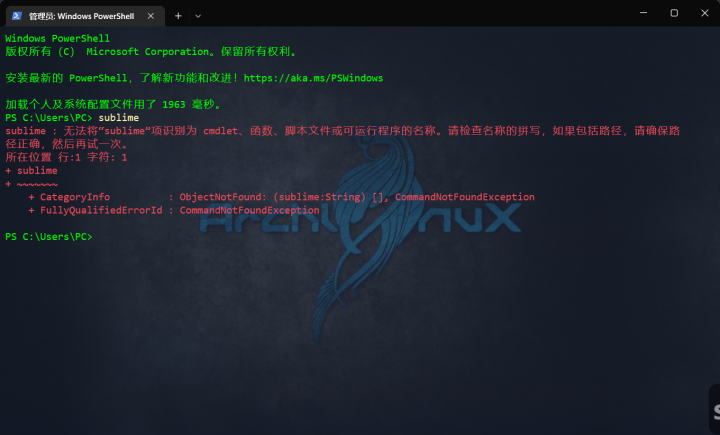
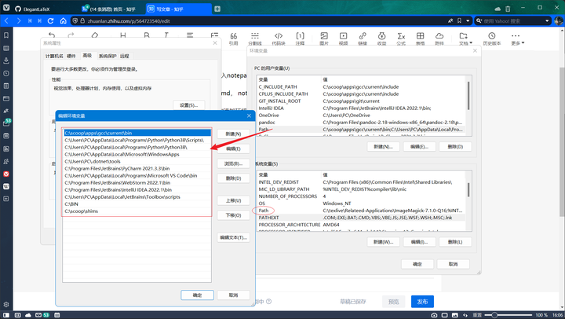
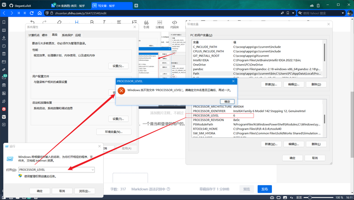
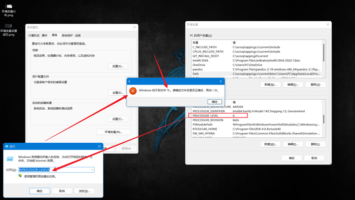
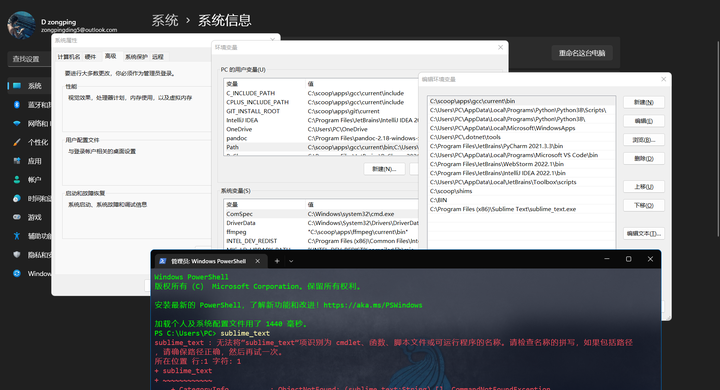
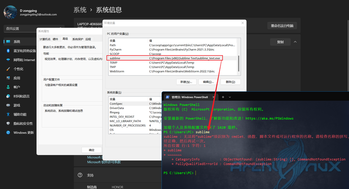
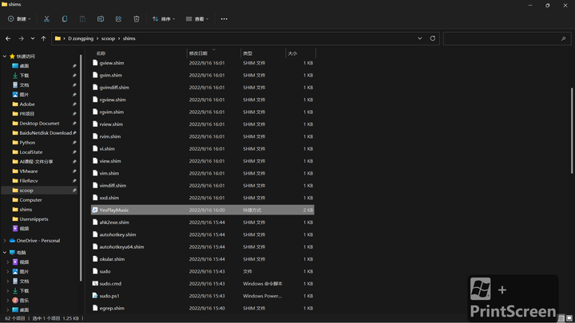

## 1. 引入问题
在编写LaTeX的时候，肯定很多的小伙伴不想使用vim，而是想要用sublime来编辑，于是直接在CLI下输入sublime，但是出现的是




也许你会觉得这样引入很奇怪，但是不妨先看看我为什么这样讲.



于是就产生了本篇文章和下边的问题：

1. 为什么你可以在命令行窗口中输入vim，notepad，`<Enter>`之后就可以打开notepad？
2. 为什么你在<运行>窗口中输入`cmd`，`notepad`等也能够打开这些应用？
3. 为什么安装`python`的时候要叫你添加环境变量?
4. 环境变量和经常说到的`Path`又是什么关系？


## 2. <运行>下的环境变量
环境变量是什么：说白了就是给系统指明最要的文件目录地址。


所谓<运行>下的环境变量实际上就是在运行窗口下运行应用。



### 2.1 最重要的Path环境变量
然后我们运行某个程序时，操作系统就会从我们指定的路径中去寻找这个可执行程序。找到了就执行，找不到就报错。操作系统会去那些路径下寻找呢？就是Path环境变量里边寻找。如图：



Path变量有两个，一个是系统的，一个是当前登录的用户的。


### 2.2 认识环境变量
如图，打开环境变量，我们看到有一个PROCESSOR_LEVEL的变量;我们尝试运行来查看它的值，结果报错，如下图：



### 2.3 设置环境变量
问题出在哪里呢？就是变量这里。系统怎么知道这个东西是一个变量，不是一个单纯的字符换呢？你得告诉它这是一个变量，怎么告诉它呢？和Linux下类似，只不过:

* Linux下使用得的是**$<Var-name>**的格式，
* windows下你的使用**%<var-name>%**的格式，

好那么就看一下改进之后的运行结果:我们使用如下的命令，就会发现，它识别出来PROCESSOR_LEVEL的值了，就是6.但是还是报错了。



**原因解释**

但是这个例子可能不太恰当，毕竟<运行>窗口时用来运行可执行程序的，你给它一个6，它怎么给你运行呢？我用这个例子就是为了第二个问题作的回答。那么我们就用一个具体的例子来演示，比入把sublime加入到**“运行”**中


### 2.4 环境变量设置进阶
你们可以应用的快捷方式加入到环境变量里边，这样也可以运行的，但是你稍微的想想，你电脑上的应用很多吧，如果把你的应用像视频里的那样一个一个的单独加入到环境变量中，那么你的环境变量的内容是不是就很多了。

所以才有了Path环境变量这个东西，把你的可执行文件路径放在一个文件夹里边，然后把这个文件夹加入到Path环境变量中，这样在你运行你自己添加的某个可执行程序时系统就会到你添加到Path中的那个文件夹里边去寻找，就可以执行了。而且这样还有一个好处就是你不用再多输入两个烦人的%%了，是不是很爽。

接下来就把最开始的那个sublime的环境变量删了吧

> 不仅仅只在<运行>窗口里边可以识别环境变量，在你的**文件管理器**等地方都能够使用，前提是你得用`%%`声明这是一个产量而不是一个简单的字符串.


## 3. cli下的环境变量
还有一个问题没有解决，就是在命令行下边打开应用。刚才我们的设置是不足以在CLI下打开sublime的，你可以试一试在CLI中输入sublime，你看看你是不是会得到下图：


为什么在命令行下可以打开其他的应用呢？有些人可能是认为我们无法打开是因为那是一个快捷方式的原因,然而并不是，如下图：



3.2 还有人可能以为是我把第一个设置的sublime的环境变量删除了的缘故;其实也不是，如下图：



**究竟是什么呢？**

这就需要我们了解一个东西了，就是`PATHEXT`这个环境变量下边是它的解释说明：


* Windows的“运行”命令为一些有经验的用户提供了一个简单快速的方法来打开文件，而不再需要通过“开始”目录，或在文件夹中寻找文件。例如：当我再“运行”窗口中输入cmd.exe 并点击确定时，命令行窗口就直接被打开了。同样的，输入 msconfig.exe后，可以直接打开“系统配置”界面
* 其实很多人都知道，当使用“运行”命令时，并不需要总是输入某些文件的扩展名的，例如只输入文件名部分，用cmd代替cmd.exe即可。如果这样可以，那是因为EXE文件扩展名是XP中的可靠扩展名而无须提供。当你没有输入扩展名时，XP会尝试几种默认扩展名，这些XP默认的扩展名就在PATHEXT变量中声明
* PATHEXT系统变量默认的声明如下：.COM;.EXE;.BAT;.CMD;.VBS;.VBE;.JS;.JSE;.WSF;.WSH



### 4 解决方法
其实我们只需要把刚才的那个PATHEXT的环境变量里边加上

``` shell
;,lnk
```



需要注意的是`.MSC`扩展名并不在此之列。这个后缀的文件用来打开XP的管理控制台。如果你希望打开类似Services这类MMC文件，而不在“运行”窗口输入文件全名(services.msc)，那么就需要将`.MSC`添加到XP的`PATHEXT`变量中。



## 2022.09.16补充
如过你使用scoop的话，不管是快捷方式还是.exe文件，直接扔到scoop的shims文件夹就行了,前提是你的scoop的正常。



