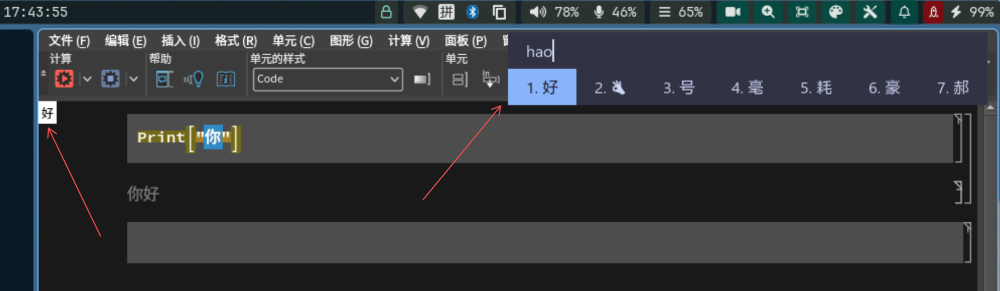

<!-- markdown-toc start - Don't edit this section. Run M-x markdown-toc-refresh-toc -->
**Table of Contents**

- [0. Environments](#environments)
- [1. Problem Description](#problem-description)
- [2. Related Issues](#related-issues)
- [3. Debugging Difficulties and Solutions](#debugging-difficulties-and-solutions)
  - [Difficulty 1: Silent Failures and Isolated Environments](#difficulty-1-silent-failures-and-isolated-environments)
  - [Difficulty 2: The Qt ABI Version Mismatch](#difficulty-2-the-qt-abi-version-mismatch)
  - [Difficulty 3: CMake Configuration Failing (Missing ECM)](#difficulty-3-cmake-configuration-failing-missing-ecm)
  - [Difficulty 4: Misplaced Input Panel (Cursor Tracking Failure)](#difficulty-4-misplaced-input-panel-cursor-tracking-failure)
- [4. Complete Terminal Compilation Log](#complete-terminal-compilation-log)

<!-- markdown-toc end -->


## 0. Environments

All of my aliases:

``` shell
# PS1
if [[ "$(tty)" == "/dev/tty1" ]]; then
  # PS1='%(?.0.%?) --> '
  PS1='${MY_TMUX_FLAG}%(?.%F{green}0 --> %f.%F{red}%? --> %f)'
else
  # PS1='%(?.0.%?) > '
  PS1='${MY_TMUX_FLAG}%(?.%F{green}0 > %f.%F{red}%? > %f)'
fi

# command alias
alias l='exa --long --git'
alias p=pwd
alias c=clear
```


## 1. Problem Description

When running Wolfram Notebook 14.3 (which utilizes the Qt6 graphics engine) on an Arch Linux system running the Wayland display protocol, the Fcitx5 input method framework fails to work. While `fcitx5-diagnose` confirms that Fcitx5 successfully captures the `com.wolfram.Wolfram.14.3` process and establishes DBus communication in the `wayland_v2` frontend, it remains impossible to trigger the input method or type non-ASCII characters inside the notebook. 

```shell
fcitx state:
1.  executable:

    found fcitx5 at `/usr/bin/fcitx5`.

2.  version:

    fcitx version: `5.1.19`

3.  process:

    found 1 fcitx5 process:

          41692 fcitx5

4.  `fcitx5-remote`:

    `fcitx5-remote` works properly.

5.  dbus interface:

    using `dbus-send` to check dbus.

    owner of dbus name `org.fcitx.fcitx5` is `:1.185`.

    pid of dbus name `org.fcitx.fcitx5` owner is `41692`.

    debug information from dbus:

           group [wayland:] has 4 inputcontext(s)
          ic [070269ac7cb34d6aab8e23f8f0151cfb] program:foot frontend:wayland_v2 cap:100000072 focus:1
          ic [e12027ee6a0d46c7809836859e8879f3] program:com.wolfram.wolfram.14.3 frontend:wayland_v2 cap:100000072 focus:0
          ic [0e71fd992de34894b050fb12440bd8b6] program:google-chrome frontend:wayland_v2 cap:100000072 focus:0
          ic [ad986948aa804882b670f2f9665351ed] program: frontend:wayland_v2 cap:100000072 focus:0
        group [x11::0] has 0 inputcontext(s)
        input context without group

# frontends setup:
the environment variable checked by this script only shows the environment under current shell. it is still possible that you did not set the environment to the whole graphic desktop session. you may inspect the actual environment variable of a certain process by using `xargs -0 -l1 /proc/$pid/environ` for a certain process that you find not working.

## xim:
1.  `${xmodifiers}`:

    environment variable xmodifiers is set to "@im=fcitx" correctly.
    xim server name from environment variable is fcitx.

2.  xim_servers on root window:

    xim server name is the same with that set in the environment variable.

3.  xim for emacs:

    **your lc_ctype is set to en_us.utf-8 instead of one of zh, ja, ko. you may not be able to use input method in emacs because of an really old emacs bug that upstream refuse to fix for years.**

## qt:
1.  qt4 - `${qt4_im_module}`:

    environment variable qt_im_module is set to "fcitx" correctly.

    **`fcitx5-qt4-immodule-probing` not found.**

2.  qt5 - `${qt_im_module}`:

    environment variable qt_im_module is set to "fcitx" correctly.

    using fcitx5-qt5-immodule-probing to check the actual im module to be used under current environment:

        qt_qpa_platform=wayland
        qt_im_module=fcitx
        im_module_classname=fcitx::qfcitxplatforminputcontext

3.  qt6 - `${qt_im_module}`:

    environment variable qt_im_module is set to "fcitx" correctly.

    using fcitx5-qt6-immodule-probing to check the actual im module to be used under current environment:

        qt_qpa_platform=wayland
        qt_im_modules="wayland;fcitx;ibus"
        im_module_classname=qtwaylandclient::qwaylandinputcontext

4.  qt im module files:

    found fcitx5 qt6 module: `/usr/lib/fcitx5/qt6/libfcitx-quickphrase-editor5.so`.
    found fcitx5 im module for qt6: `/usr/lib/qt6/plugins/platforminputcontexts/libfcitx5platforminputcontextplugin.so`.
    found unknown fcitx qt module: `/usr/lib/qt6/plugins/plasma/kcms/systemsettings/kcm_fcitx5.so`.
    found unknown fcitx qt module: `/usr/lib/office6/qt/plugins/platforminputcontexts/libfcitxplatforminputcontextplugin.so`.
    found fcitx5 im module for qt: `/usr/lib/qt/plugins/platforminputcontexts/libfcitx5platforminputcontextplugin.so`.

    following error may not be accurate because guessing qt version from path depends on how your distribution packages qt. it is not a critical error if you do not use any qt application with certain version of qt or you are using text-input support by qt under wayland.
    **cannot find fcitx5 input method module for qt4.**

```

This issue stems from a combination of isolated application environments, strict ABI (Application Binary Interface) compatibility requirements in the Qt framework, and Wayland-specific input handling.


## 2. Related Issues
1. Github issue(2017): https://github.com/fcitx/fcitx/issues/372
2. Package Comment(2020): https://aur.archlinux.org/packages/mathematica?O=80&all_deps=1
```text
JP-Ellis commented on 2020-09-28 12:27 (UTC)
@tuxzz I've never used Fcitx or fcitx5. From what I could find, they are meant to add support for inputting
non-ASCII characters? If that's the case, then I doubt that will ever work because Mathematica simply does
not support unicode very well. It only added unicode support in v12, and even then it's very limited and you
cannot input non-ASCII characters without using the special syntax they use.
```

---

## 3. Debugging Difficulties and Solutions

### Difficulty 1: Silent Failures and Isolated Environments
**The Problem:** Initial attempts to trace the Qt plugin loading process using `QT_DEBUG_PLUGINS=1 wolframnb` or forcing the Xcb fallback using `QT_QPA_PLATFORM=xcb wolframnb` yielded absolutely no terminal output and failed to invoke the input method. 
**The Solution:** Inspecting the `/usr/local/Wolfram/Wolfram/14.3/Executables/wolframnb` shell script revealed that Wolfram forces its own isolated environment. It heavily modifies `QT_PLUGIN_PATH` and `LD_LIBRARY_PATH` to point exclusively to its bundled libraries, completely ignoring system-level Qt plugins. Running `wolframnb -e` exposed these hardcoded environment variables and the specific shared objects loaded by the binary.

### Difficulty 2: The Qt ABI Version Mismatch
**The Problem:** The `ldd -v` output from the notebook executable revealed that Wolfram Notebook 14.3 is hard-linked against **Qt 6.5**. However, on a rolling-release distribution like Arch Linux, the system's `fcitx5-qt` plugins are compiled against the latest Qt versions (e.g., Qt 6.7+). Because Qt C++ plugins enforce strict ABI compatibility across minor versions, Wolfram's older Qt 6.5 engine silently rejects the system's newer `fcitx5-qt` plugin.
**The Solution:** Since the Xwayland (`xcb`) fallback approach did not successfully trigger Fcitx5, the only viable solution was to cross-compile a dedicated Qt 6.5 version of the `libfcitx5platforminputcontextplugin.so` specifically for Wolfram.

Check libraries details of `wolframnb`:

```shell
0 > wolframnb -e
Started as:             /usr/local/bin/wolframnb
Executables Directory:  /usr/local/Wolfram/Wolfram/14.3/Executables
Top Directory:          /usr/local/Wolfram/Wolfram/14.3
VersionID:              14.3.0.0
CreationID:             11930374
Display:                :0
LD_LIBRARY_PATH:
QT_PLUGIN_PATH:         /usr/local/Wolfram/Wolfram/14.3/SystemFiles/Libraries/Linux-x86-64/Qt/plugins/
QT_IM_MODULE:           fcitx
...
libQt6Core.so.6 (Qt_6.5) => /usr/local/Wolfram/Wolfram/14.3/SystemFiles/FrontEnd/Binaries/Linux-x86-64/../../../Libraries/Linux-x86-64/Qt/lib/libQt6Core.so.6
...
```

Comfirm the QT version than `wolframnb` binds:

``` shell
# Extract the exact Qt version from the bundled libQt6Core.so
strings ...libQt6Core.so | grep -i "^Qt 6\."
```


### Difficulty 3: CMake Configuration Failing (Missing ECM)
**The Problem:** While trying to compile `fcitx5-qt` against a locally downloaded Qt 6.5 SDK (using `aqtinstall`), CMake threw a fatal error: `Could not find a package configuration file provided by "ECM" (Extra CMake Modules)`. This happened because overriding `CMAKE_PREFIX_PATH` strictly to the local Qt folder prevented CMake from finding system-level KDE/Fcitx5 dependencies.
**The Solution:** The failed CMake cache was wiped (`rm -rf CMakeCache.txt CMakeFiles/`). Required dependencies were ensured via `sudo pacman -S --needed extra-cmake-modules fcitx5 wayland wayland-protocols`. Finally, the `CMAKE_PREFIX_PATH` was adjusted to include both the local Qt 6.5 directory and the system root (`;/usr`), allowing the compiler to resolve all dependencies.





### Difficulty 4: Misplaced Input Panel (Cursor Tracking Failure)
**The Problem:** After successful compilation and injection of the plugin, Fcitx5 could be triggered successfully. However, the input panel was persistently pinned to the top-right corner of the window rather than following the text cursor.
**The Solution:** This is a known, currently unresolvable upstream issue with closed-source software on Wayland. Wayland relies on relative coordinates (`text-input-v3`) to position overlays. Because Wolfram Notebook utilizes a highly custom, proprietary canvas rendering engine rather than standard Qt input widgets (like `QLineEdit`), it fails to dynamically report the `cursorRectangle` coordinates to the Wayland compositor. Consequently, the compositor receives a default `(0,0,0,0)` coordinate, forcing the Fcitx5 panel into a fixed fallback position at the edge of the window. The pragmatic workaround is to either increase Fcitx5's font size for better peripheral visibility or perform heavy text editing in external editors (like Emacs).

---

## 4. Complete Terminal Compilation Log

Below is the complete, unedited shell execution log detailing the setup of an isolated Python environment, the fetching of the Qt 6.5 SDK via `aqtinstall`, the CMake compilation process, and the final plugin injection.


```bash
0 > p
/home/zpd/fcitx5-wolfram-build
0 > l
0 > uv venv              
Using CPython 3.13.12
Creating virtual environment at: .venv
Activate with: source .venv/bin/activate
0 > source .venv/bin/activate
(fcitx5-wolfram-build) 0 > uv pip install aqtinstall
Resolved 24 packages in 3.82s
Prepared 20 packages in 1.12s
Installed 24 packages in 10ms
 + aqtinstall==3.3.0
 + backports-zstd==1.5.0
 + beautifulsoup4==4.15.0
 + brotli==1.2.0
 + bs4==0.0.2
 + certifi==2026.5.20
 + charset-normalizer==3.4.7
 + defusedxml==0.7.1
 + humanize==4.15.0
 + idna==3.18
 + inflate64==1.0.4
 + multivolumefile==0.2.3
 + patch-ng==1.19.1
 + psutil==7.2.2
 + py7zr==1.1.0
 + pybcj==1.0.7
 + pycryptodomex==3.23.0
 + pyppmd==1.3.1
 + requests==2.34.2
 + semantic-version==2.10.0
 + soupsieve==2.8.4
 + texttable==1.7.0
 + typing-extensions==4.15.0
 + urllib3==2.7.0
(fcitx5-wolfram-build) 0 > aqt install-qt linux desktop 6.5.3 gcc_64 -O ./qt_pr
efix
INFO    : aqtinstall(aqt) v3.3.0 on Python 3.13.12 [CPython Clang 21.1.4 ]
INFO    : Downloading qtbase...
INFO    : Downloading qtsvg...
INFO    : Downloading qttools...
INFO    : Downloading qtdeclarative...
INFO    : Redirected: qt.mirror.constant.com
INFO    : Redirected: qt.mirror.constant.com
INFO    : Redirected: qt.mirror.constant.com
INFO    : Redirected: qt.mirror.constant.com
INFO    : Finished installation of qtsvg-Linux-RHEL_8_4-GCC-Linux-RHEL_8_4-X86_64.7z in 5.51240611
INFO    : Downloading qttranslations...
INFO    : Redirected: qt.mirror.constant.com
INFO    : Finished installation of qtbase-Linux-RHEL_8_4-GCC-Linux-RHEL_8_4-X86_64.7z in 11.74809961
INFO    : Finished installation of qttranslations-Linux-RHEL_8_4-GCC-Linux-RHEL_8_4-X86_64.7z in 7.53249604
INFO    : Downloading qtwayland...
INFO    : Downloading icu...
INFO    : Redirected: qt.mirror.constant.com
INFO    : Redirected: qt.mirror.constant.com
INFO    : Finished installation of qttools-Linux-RHEL_8_4-GCC-Linux-RHEL_8_4-X86_64.7z in 20.68757440
INFO    : Finished installation of qtwayland-Linux-RHEL_8_4-GCC-Linux-RHEL_8_4-X86_64.7z in 9.61311320
INFO    : Finished installation of icu-linux-Rhel7.2-x64.7z in 10.33026663
INFO    : Finished installation of qtdeclarative-Linux-RHEL_8_4-GCC-Linux-RHEL_8_4-X86_64.7z in 24.28935467
INFO    : Patching qt_prefix/6.5.3/gcc_64/bin/qmake
INFO    : Patching qt_prefix/6.5.3/gcc_64/lib/pkgconfig/Qt6LabsQmlModels.pc
INFO    : Patching qt_prefix/6.5.3/gcc_64/lib/pkgconfig/Qt6Qml.pc
INFO    : Patching qt_prefix/6.5.3/gcc_64/lib/pkgconfig/Qt6QuickDialogs2Utils.pc
INFO    : Patching qt_prefix/6.5.3/gcc_64/lib/pkgconfig/Qt6QmlWorkerScript.pc
INFO    : Patching qt_prefix/6.5.3/gcc_64/lib/pkgconfig/Qt6Gui.pc
INFO    : Patching qt_prefix/6.5.3/gcc_64/lib/pkgconfig/Qt6LabsSharedImage.pc
INFO    : Patching qt_prefix/6.5.3/gcc_64/lib/pkgconfig/Qt6Xml.pc
INFO    : Patching qt_prefix/6.5.3/gcc_64/lib/pkgconfig/Qt6Platform.pc
INFO    : Patching qt_prefix/6.5.3/gcc_64/lib/pkgconfig/Qt6QmlModels.pc
INFO    : Patching qt_prefix/6.5.3/gcc_64/lib/pkgconfig/Qt6LabsAnimation.pc
INFO    : Patching qt_prefix/6.5.3/gcc_64/lib/pkgconfig/Qt6Svg.pc
INFO    : Patching qt_prefix/6.5.3/gcc_64/lib/pkgconfig/Qt6OpenGLWidgets.pc
INFO    : Patching qt_prefix/6.5.3/gcc_64/lib/pkgconfig/Qt6Network.pc
INFO    : Patching qt_prefix/6.5.3/gcc_64/lib/pkgconfig/Qt6LabsSettings.pc
INFO    : Patching qt_prefix/6.5.3/gcc_64/lib/pkgconfig/Qt6Help.pc
INFO    : Patching qt_prefix/6.5.3/gcc_64/lib/pkgconfig/Qt6Designer.pc
INFO    : Patching qt_prefix/6.5.3/gcc_64/lib/pkgconfig/Qt6Test.pc
INFO    : Patching qt_prefix/6.5.3/gcc_64/lib/pkgconfig/Qt6UiTools.pc
INFO    : Patching qt_prefix/6.5.3/gcc_64/lib/pkgconfig/Qt6Concurrent.pc
INFO    : Patching qt_prefix/6.5.3/gcc_64/lib/pkgconfig/Qt6QuickWidgets.pc
INFO    : Patching qt_prefix/6.5.3/gcc_64/lib/pkgconfig/Qt6QuickControls2.pc
INFO    : Patching qt_prefix/6.5.3/gcc_64/lib/pkgconfig/Qt6LabsWavefrontMesh.pc
INFO    : Patching qt_prefix/6.5.3/gcc_64/lib/pkgconfig/Qt6QuickLayouts.pc
INFO    : Patching qt_prefix/6.5.3/gcc_64/lib/pkgconfig/Qt6QuickTemplates2.pc
INFO    : Patching qt_prefix/6.5.3/gcc_64/lib/pkgconfig/Qt6SvgWidgets.pc
INFO    : Patching qt_prefix/6.5.3/gcc_64/lib/pkgconfig/Qt6Core.pc
INFO    : Patching qt_prefix/6.5.3/gcc_64/lib/pkgconfig/Qt6WaylandClient.pc
INFO    : Patching qt_prefix/6.5.3/gcc_64/lib/pkgconfig/Qt6QuickTest.pc
INFO    : Patching qt_prefix/6.5.3/gcc_64/lib/pkgconfig/Qt6QuickDialogs2QuickImpl.pc
INFO    : Patching qt_prefix/6.5.3/gcc_64/lib/pkgconfig/Qt6Widgets.pc
INFO    : Patching qt_prefix/6.5.3/gcc_64/lib/pkgconfig/Qt6QmlLocalStorage.pc
INFO    : Patching qt_prefix/6.5.3/gcc_64/lib/pkgconfig/Qt6LabsFolderListModel.pc
INFO    : Patching qt_prefix/6.5.3/gcc_64/lib/pkgconfig/Qt6QuickDialogs2.pc
INFO    : Patching qt_prefix/6.5.3/gcc_64/lib/pkgconfig/Qt6QuickControls2Impl.pc
INFO    : Patching qt_prefix/6.5.3/gcc_64/lib/pkgconfig/Qt6PrintSupport.pc
INFO    : Patching qt_prefix/6.5.3/gcc_64/lib/pkgconfig/Qt6Linguist.pc
INFO    : Patching qt_prefix/6.5.3/gcc_64/lib/pkgconfig/Qt6QmlIntegration.pc
INFO    : Patching qt_prefix/6.5.3/gcc_64/lib/pkgconfig/Qt6UiPlugin.pc
INFO    : Patching qt_prefix/6.5.3/gcc_64/lib/pkgconfig/Qt6Sql.pc
INFO    : Patching qt_prefix/6.5.3/gcc_64/lib/pkgconfig/Qt6DBus.pc
INFO    : Patching qt_prefix/6.5.3/gcc_64/lib/pkgconfig/Qt6OpenGL.pc
INFO    : Patching qt_prefix/6.5.3/gcc_64/lib/pkgconfig/Qt6QmlCore.pc
INFO    : Patching qt_prefix/6.5.3/gcc_64/lib/pkgconfig/Qt6QmlXmlListModel.pc
INFO    : Patching qt_prefix/6.5.3/gcc_64/lib/pkgconfig/Qt6Quick.pc
INFO    : Patching qt_prefix/6.5.3/gcc_64/lib/libQt6Test.prl
INFO    : Patching qt_prefix/6.5.3/gcc_64/lib/libQt6LabsQmlModels.prl
INFO    : Patching qt_prefix/6.5.3/gcc_64/lib/libQt6QuickLayouts.prl
INFO    : Patching qt_prefix/6.5.3/gcc_64/lib/libQt6Sql.prl
INFO    : Patching qt_prefix/6.5.3/gcc_64/lib/libQt6QmlLocalStorage.prl
INFO    : Patching qt_prefix/6.5.3/gcc_64/lib/libQt6InputSupport.prl
INFO    : Patching qt_prefix/6.5.3/gcc_64/lib/libQt6Concurrent.prl
INFO    : Patching qt_prefix/6.5.3/gcc_64/lib/libQt6Designer.prl
INFO    : Patching qt_prefix/6.5.3/gcc_64/lib/libQt6LabsSharedImage.prl
INFO    : Patching qt_prefix/6.5.3/gcc_64/lib/libQt6WaylandEglClientHwIntegration.prl
INFO    : Patching qt_prefix/6.5.3/gcc_64/lib/libQt6QuickEffects.prl
INFO    : Patching qt_prefix/6.5.3/gcc_64/lib/libQt6OpenGLWidgets.prl
INFO    : Patching qt_prefix/6.5.3/gcc_64/lib/libQt6FbSupport.prl
INFO    : Patching qt_prefix/6.5.3/gcc_64/lib/libQt6QuickControlsTestUtils.prl
INFO    : Patching qt_prefix/6.5.3/gcc_64/lib/libQt6Quick.prl
INFO    : Patching qt_prefix/6.5.3/gcc_64/lib/libQt6Widgets.prl
INFO    : Patching qt_prefix/6.5.3/gcc_64/lib/libQt6QmlModels.prl
INFO    : Patching qt_prefix/6.5.3/gcc_64/lib/libQt6QmlXmlListModel.prl
INFO    : Patching qt_prefix/6.5.3/gcc_64/lib/libQt6Network.prl
INFO    : Patching qt_prefix/6.5.3/gcc_64/lib/libQt6QmlWorkerScript.prl
INFO    : Patching qt_prefix/6.5.3/gcc_64/lib/libQt6Help.prl
INFO    : Patching qt_prefix/6.5.3/gcc_64/lib/libQt6QuickWidgets.prl
INFO    : Patching qt_prefix/6.5.3/gcc_64/lib/libQt6QmlDom.prl
INFO    : Patching qt_prefix/6.5.3/gcc_64/lib/libQt6WlShellIntegration.prl
INFO    : Patching qt_prefix/6.5.3/gcc_64/lib/libQt6PrintSupport.prl
INFO    : Patching qt_prefix/6.5.3/gcc_64/lib/libQt6EglFsKmsSupport.prl
INFO    : Patching qt_prefix/6.5.3/gcc_64/lib/libQt6LabsFolderListModel.prl
INFO    : Patching qt_prefix/6.5.3/gcc_64/lib/libQt6QmlTypeRegistrar.prl
INFO    : Patching qt_prefix/6.5.3/gcc_64/lib/libQt6QuickDialogs2.prl
INFO    : Patching qt_prefix/6.5.3/gcc_64/lib/libQt6DesignerComponents.prl
INFO    : Patching qt_prefix/6.5.3/gcc_64/lib/libQt6QuickControls2.prl
INFO    : Patching qt_prefix/6.5.3/gcc_64/lib/libQt6QuickParticles.prl
INFO    : Patching qt_prefix/6.5.3/gcc_64/lib/libQt6Svg.prl
INFO    : Patching qt_prefix/6.5.3/gcc_64/lib/libQt6QuickTestUtils.prl
INFO    : Patching qt_prefix/6.5.3/gcc_64/lib/libQt6ExampleIcons.prl
INFO    : Patching qt_prefix/6.5.3/gcc_64/lib/libQt6KmsSupport.prl
INFO    : Patching qt_prefix/6.5.3/gcc_64/lib/libQt6EglFSDeviceIntegration.prl
INFO    : Patching qt_prefix/6.5.3/gcc_64/lib/libQt6LabsWavefrontMesh.prl
INFO    : Patching qt_prefix/6.5.3/gcc_64/lib/libQt6QuickTemplates2.prl
INFO    : Patching qt_prefix/6.5.3/gcc_64/lib/libQt6Xml.prl
INFO    : Patching qt_prefix/6.5.3/gcc_64/lib/libQt6QuickTest.prl
INFO    : Patching qt_prefix/6.5.3/gcc_64/lib/libQt6Qml.prl
INFO    : Patching qt_prefix/6.5.3/gcc_64/lib/libQt6PacketProtocol.prl
INFO    : Patching qt_prefix/6.5.3/gcc_64/lib/libQt6XcbQpa.prl
INFO    : Patching qt_prefix/6.5.3/gcc_64/lib/libQt6QuickShapes.prl
INFO    : Patching qt_prefix/6.5.3/gcc_64/lib/libQt6QmlCore.prl
INFO    : Patching qt_prefix/6.5.3/gcc_64/lib/libQt6LabsAnimation.prl
INFO    : Patching qt_prefix/6.5.3/gcc_64/lib/libQt6WaylandClient.prl
INFO    : Patching qt_prefix/6.5.3/gcc_64/lib/libQt6UiTools.prl
INFO    : Patching qt_prefix/6.5.3/gcc_64/lib/libQt6SvgWidgets.prl
INFO    : Patching qt_prefix/6.5.3/gcc_64/lib/libQt6QmlDebug.prl
INFO    : Patching qt_prefix/6.5.3/gcc_64/lib/libQt6DBus.prl
INFO    : Patching qt_prefix/6.5.3/gcc_64/lib/libQt6Core.prl
INFO    : Patching qt_prefix/6.5.3/gcc_64/lib/libQt6DeviceDiscoverySupport.prl
INFO    : Patching qt_prefix/6.5.3/gcc_64/lib/libQt6QuickDialogs2Utils.prl
INFO    : Patching qt_prefix/6.5.3/gcc_64/lib/libQt6QuickDialogs2QuickImpl.prl
INFO    : Patching qt_prefix/6.5.3/gcc_64/lib/libQt6Gui.prl
INFO    : Patching qt_prefix/6.5.3/gcc_64/lib/libQt6LabsSettings.prl
INFO    : Patching qt_prefix/6.5.3/gcc_64/lib/libQt6QmlCompiler.prl
INFO    : Patching qt_prefix/6.5.3/gcc_64/lib/libQt6QuickControls2Impl.prl
INFO    : Patching qt_prefix/6.5.3/gcc_64/lib/libQt6OpenGL.prl
INFO    : Finished installation
INFO    : Time elapsed: 28.72689657 second
(fcitx5-wolfram-build) 0 > git clone https://github.com/fcitx/fcitx5-qt.git
Cloning into 'fcitx5-qt'...
remote: Enumerating objects: 3472, done.
remote: Counting objects: 100% (544/544), done.
remote: Compressing objects: 100% (77/77), done.
remote: Total 3472 (delta 493), reused 481 (delta 465), pack-reused 2928 (from 3)
Receiving objects: 100% (3472/3472), 1.21 MiB | 3.61 MiB/s, done.
Resolving deltas: 100% (2565/2565), done.
(fcitx5-wolfram-build) 0 > cd fcitx5-qt           
(fcitx5-wolfram-build) 0 > p
/home/zpd/fcitx5-wolfram-build/fcitx5-qt
(fcitx5-wolfram-build) 0 > l
drwxr-xr-x    - zpd  9 Jun 17:16 -- cmake
.rw-r--r-- 2.5k zpd  9 Jun 17:16 -- CMakeLists.txt
drwxr-xr-x    - zpd  9 Jun 17:16 -- common
drwxr-xr-x    - zpd  9 Jun 17:16 -- LICENSES
.rwxr-xr-x   61 zpd  9 Jun 17:16 -- Messages.sh
drwxr-xr-x    - zpd  9 Jun 17:16 -- po
drwxr-xr-x    - zpd  9 Jun 17:16 -- qt4
drwxr-xr-x    - zpd  9 Jun 17:16 -- qt5
drwxr-xr-x    - zpd  9 Jun 17:16 -- qt6
.rw-r--r--  693 zpd  9 Jun 17:16 -- README.md
drwxr-xr-x    - zpd  9 Jun 17:16 -- test
(fcitx5-wolfram-build) 0 > mkdir build && cd build
(fcitx5-wolfram-build) 0 > p
/home/zpd/fcitx5-wolfram-build/fcitx5-qt/build
(fcitx5-wolfram-build) 0 > cmake -GNinja \
  -DCMAKE_PREFIX_PATH="$HOME/fcitx5-wolfram-build/qt_prefix/6.5.3/gcc_64" \
  -DENABLE_QT4=OFF \
  -DENABLE_QT5=OFF \
  -DENABLE_QT6=ON \
  ..
-- The C compiler identification is GNU 16.1.1
-- The CXX compiler identification is GNU 16.1.1
-- Detecting C compiler ABI info
-- Detecting C compiler ABI info - done
-- Check for working C compiler: /usr/bin/cc - skipped
-- Detecting C compile features
-- Detecting C compile features - done
-- Detecting CXX compiler ABI info
-- Detecting CXX compiler ABI info - done
-- Check for working CXX compiler: /usr/bin/c++ - skipped
-- Detecting CXX compile features
-- Detecting CXX compile features - done
CMake Error at CMakeLists.txt:9 (find_package):
  By not providing "FindECM.cmake" in CMAKE_MODULE_PATH this project has
  asked CMake to find a package configuration file provided by "ECM", but
  CMake did not find one.

  Could not find a package configuration file provided by "ECM" (requested
  version 1.4.0) with any of the following names:

    ECM.cps
    ecm.cps
    ECMConfig.cmake
    ecm-config.cmake

  Add the installation prefix of "ECM" to CMAKE_PREFIX_PATH or set "ECM_DIR"
  to a directory containing one of the above files.  If "ECM" provides a
  separate development package or SDK, be sure it has been installed.


-- Configuring incomplete, errors occurred!
(fcitx5-wolfram-build) 1 > rm -rf CMakeCache.txt CMakeFiles/
(fcitx5-wolfram-build) 0 > sudo pacman -S --needed extra-cmake-modules fcitx5 w
ayland wayland-protocols
[sudo] password for zpd: 
warning: fcitx5-5.1.19-1 is up to date -- skipping
warning: wayland-1.25.0-1 is up to date -- skipping
warning: wayland-protocols-1.49-1 is up to date -- skipping
resolving dependencies...
looking for conflicting packages...

Packages (1) extra-cmake-modules-6.26.0-1

Total Download Size:   0.46 MiB
Total Installed Size:  2.12 MiB

:: Proceed with installation? [Y/n] Y
:: Retrieving packages...
 extra-cmake-modu...   470.0 KiB  1374 KiB/s 00:00 [#####################] 100%
(1/1) checking keys in keyring                     [#####################] 100%
(1/1) checking package integrity                   [#####################] 100%
(1/1) loading package files                        [#####################] 100%
(1/1) checking for file conflicts                  [#####################] 100%
(1/1) checking available disk space                [#####################] 100%
:: Processing package changes...
(1/1) installing extra-cmake-modules               [#####################] 100%
Optional dependencies for extra-cmake-modules
    python-pyxdg: to generate fastlane metadata for Android apps
    python-requests: to generate fastlane metadata for Android apps [installed]
    python-yaml: to generate fastlane metadata for Android apps [installed]
:: Running post-transaction hooks...
(1/1) Arming ConditionNeedsUpdate...
(fcitx5-wolfram-build) 0 > cmake -GNinja \
  -DCMAKE_PREFIX_PATH="$HOME/fcitx5-wolfram-build/qt_prefix/6.5.3/gcc_64;/usr" \
  -DENABLE_QT4=OFF \
  -DENABLE_QT5=OFF \
  -DENABLE_QT6=ON \
  ..
-- The C compiler identification is GNU 16.1.1
-- The CXX compiler identification is GNU 16.1.1
-- Detecting C compiler ABI info
-- Detecting C compiler ABI info - done
-- Check for working C compiler: /usr/bin/cc - skipped
-- Detecting C compile features
-- Detecting C compile features - done
-- Detecting CXX compiler ABI info
-- Detecting CXX compiler ABI info - done
-- Check for working CXX compiler: /usr/bin/c++ - skipped
-- Detecting CXX compile features
-- Detecting CXX compile features - done
-- Found XCB_XCB: /usr/lib/libxcb.so (found version "1.17.0")
-- Found XCB: /usr/lib/libxcb.so (found version "1.17.0") found components: XCB
-- Found XKBCommon_XKBCommon: /usr/lib/libxkbcommon.so (found version "1.13.2")
-- Found XKBCommon: /usr/lib/libxkbcommon.so (found suitable version "1.13.2", minimum required is "0.5.0") found components: XKBCommon
-- Found X11: /usr/include
-- Looking for XOpenDisplay in /usr/lib/libX11.so;/usr/lib/libXext.so
-- Looking for XOpenDisplay in /usr/lib/libX11.so;/usr/lib/libXext.so - found
-- Looking for gethostbyname
-- Looking for gethostbyname - found
-- Looking for connect
-- Looking for connect - found
-- Looking for remove
-- Looking for remove - found
-- Looking for shmat
-- Looking for shmat - found
-- Looking for IceConnectionNumber in ICE
-- Looking for IceConnectionNumber in ICE - found
-- Found Gettext: /usr/bin/msgmerge (found version "1.0")
-- Performing Test CMAKE_HAVE_LIBC_PTHREAD
-- Performing Test CMAKE_HAVE_LIBC_PTHREAD - Success
-- Found Threads: TRUE
-- Performing Test HAVE_STDATOMIC
-- Performing Test HAVE_STDATOMIC - Success
-- Found WrapAtomic: TRUE
-- Found OpenGL: /usr/lib/libOpenGL.so
-- Found WrapOpenGL: TRUE
-- Found XKB: /usr/lib/libxkbcommon.so (found suitable version "1.13.2", minimum required is "0.5.0")
-- Could NOT find WrapVulkanHeaders (missing: Vulkan_INCLUDE_DIR) 
-- Found Wayland_Client: /usr/lib/libwayland-client.so (found version "1.25.0")
-- Found Wayland_Server: /usr/lib/libwayland-server.so (found version "1.25.0")
-- Found Wayland_Cursor: /usr/lib/libwayland-cursor.so (found version "1.25.0")
-- Found Wayland_Egl: /usr/lib/libwayland-egl.so (found version "18.1.0")
-- Found Wayland: /usr/lib/libwayland-client.so;/usr/lib/libwayland-server.so;/usr/lib/libwayland-cursor.so;/usr/lib/libwayland-egl.so (found suitable version "1.25.0", minimum required is "1.15")
-- Found WaylandScanner: /usr/bin/wayland-scanner
-- Performing Test COMPILER_HAS_HIDDEN_VISIBILITY
-- Performing Test COMPILER_HAS_HIDDEN_VISIBILITY - Success
-- Performing Test COMPILER_HAS_HIDDEN_INLINE_VISIBILITY
-- Performing Test COMPILER_HAS_HIDDEN_INLINE_VISIBILITY - Success
-- Performing Test COMPILER_HAS_DEPRECATED_ATTR
-- Performing Test COMPILER_HAS_DEPRECATED_ATTR - Success
-- The following OPTIONAL packages have been found:

 * Qt6CoreTools (required version >= 6.5.3)
 * Qt6Core (required version >= 6.0.0)
 * OpenGL
 * XKB (required version >= 0.5.0), XKB API common to servers and clients., <http://xkbcommon.org>
 * Qt6GuiTools (required version >= 6.5.3)
 * Qt6DBusTools (required version >= 6.5.3)
 * Qt6Gui (required version >= 6.0.0)
 * Qt6WidgetsTools (required version >= 6.5.3)
 * Qt6Widgets (required version >= 6.0.0)
 * Qt6WaylandScannerTools (required version >= 6.5.3)
 * Qt6WaylandClient (required version >= 6.0.0)

-- The following REQUIRED packages have been found:

 * ECM (required version >= 1.4.0)
 * XCB, X protocol C-language Binding, <https://xcb.freedesktop.org/>
 * XKBCommon (required version >= 0.5.0), Keyboard handling library using XKB data, <http://xkbcommon.org>
 * Fcitx5Utils (required version >= 5.0.16)
 * X11
 * Gettext
 * Qt6 (required version >= 6.0.0)
 * Qt6Concurrent

-- The following OPTIONAL packages have not been found:

 * WrapVulkanHeaders

-- Configuring done (1.9s)
-- Generating done (0.1s)
-- Build files have been written to: /home/zpd/fcitx5-wolfram-build/fcitx5-qt/build
(fcitx5-wolfram-build) 0 > ninja       
[61/64] Building CXX object qt6/quickp...phrase-editor5.dir/filelistmodel.cpp.
/home/zpd/fcitx5-wolfram-build/fcitx5-qt/qt6/quickphrase-editor/filelistmodel.cpp: In member function ‘virtual QVariant fcitx::FileListModel::data(const QModelIndex&, int) const’:
/home/zpd/fcitx5-wolfram-build/fcitx5-qt/qt6/quickphrase-editor/filelistmodel.cpp:28:41: warning: comparison of integer expressions of different signedness: ‘int’ and ‘std::vector<std::filesystem::__cxx11::path>::size_type’ {aka ‘long unsigned int’} [-Wsign-compare]
   28 |     if (!index.isValid() || index.row() >= fileList_.size()) {
      |                             ~~~~~~~~~~~~^~~~~~~~~~~~~~~~~~~
[64/64] Linking CXX shared module qt6/...editor/libfcitx-quickphrase-editor5.s
(fcitx5-wolfram-build) 0 > sudo cp qt6/platforminputcontext/libfcitx5platforminputcontextplugin.so \
  /usr/local/Wolfram/Wolfram/14.3/SystemFiles/Libraries/Linux-x86-64/Qt/plugins/platforminputcontexts/
(fcitx5-wolfram-build) 0 > deactivate 
0 > 
```


